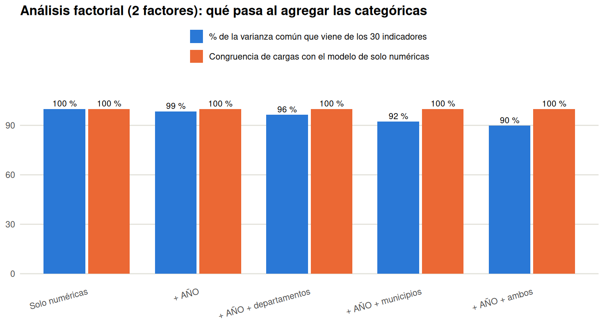

```{r setup, include=FALSE}

knitr::opts_chunk$set(
  echo = TRUE,
  warning = FALSE, 
  message = FALSE,
  fig.align = "center", 
  fig.width = 8, 
  fig.height = 6,
  dpi = 300,
  out.width = "85%"
)

find_project_root <- function(start = getwd()) {
  path <- normalizePath(start, mustWork = TRUE)
  repeat {
    if (file.exists(file.path(path, "data", "raw", "educacion.csv")) &&
        dir.exists(file.path(path, "reports"))) return(path)
    parent <- dirname(path)
    if (parent == path) stop("No se encontró la raíz del proyecto.")
    path <- parent
  }
}

project_root <- find_project_root()
knitr::opts_knit$set(root.dir = project_root)

# Paquetes que se usan en el documento
paquetes <- c(
  "ggplot2",
  "dplyr",
  "tidyr",
  "reshape2",
  "knitr",
  "corrplot",
  "forcats",
  "readr",
  "DT",
  "psych",
  "GPArotation"
)

faltantes <- paquetes[
  !vapply(paquetes, requireNamespace, logical(1), quietly = TRUE)
]

if (length(faltantes) > 0) {
  install.packages(faltantes)
}

# Librerías que se usan en el documento
library(readr)
library(dplyr)
library(ggplot2)
library(corrplot)
library(knitr)
library(DT)
library(forcats)
library(tidyr)

# Cargar dataset
datos <- read.csv(file.path(project_root, "data", "raw", "educacion.csv"),
                  check.names = FALSE, stringsAsFactors = FALSE)
```

# Introducción

El presente documento desarrolla un Análisis Exploratorio de Datos (EDA) sobre los indicadores educativos a nivel municipal en Colombia durante el periodo 2011-2024. A partir de información oficial del Ministerio de Educación Nacional, sometida a un riguroso proceso de limpieza y reducción dimensional (consolidando una muestra operativa de 13.802 observaciones y 33 variables), el estudio aplica un enfoque estadístico escalonado. Metodológicamente, la investigación transita desde un análisis descriptivo y univariado —centrado en la caracterización geométrica de las distribuciones y la detección de valores atípicos mediante el rango intercuartílico— hacia un análisis bivariado y de correlación múltiple. A través del cálculo de coeficientes de asociación, matrices de calor, evaluación de redundancias y pruebas de significancia estadística, el objetivo central es cuantificar el comportamiento simultáneo de los indicadores en sus distintos niveles formativos. Este marco cuantitativo proporciona una base empírica sólida para la formulación de hipótesis sobre las dinámicas y factores subyacentes del sistema educativo colombiano.

En esta segunda entrega se añade un Análisis de Componentes Principales (PCA) sobre todas las variables numéricas del dataset depurado. El PCA integra lo trabajado en los talleres de Componentes Principales I y II, que lo aplicaron a seis variables seleccionadas, y responde a la redundancia y la casi singularidad de la matriz de correlación encontradas en el análisis multivariado: resume el sistema educativo en pocas dimensiones interpretables y permite evaluar qué se pierde al hacerlo.

# Descripción del dataset

```{r dimensiones}
dim(datos) 
```

El conjunto de datos original consta de 15.707 observaciones y 41 variables, consolidando información oficial del Ministerio de Educación Nacional sobre el comportamiento del sector educativo en los municipios de Colombia durante el periodo 2011–2024 (enfocado en la población de 5 a 16 años). La unidad de análisis corresponde a la relación panel municipio-año, lo que permite capturar tanto la heterogeneidad territorial como las dinámicas longitudinales de los indicadores.

A continuación, se presenta la caracterización taxonómica de las variables agrupadas en cinco dimensiones metodológicas. La columna Tipo Original especifica la codificación inicial asignada por la lectura del motor de R, señalando en particular las variables porcentuales leídas como cadenas de texto (por ejemplo, “56,11%”), cuya conversión a escala numérica continua se aborda formalmente en la sección de Carga y Limpieza de Datos.

```{r estructura}
str(datos)
```

## 1. Variables de Identificación Geográfica y Temporal

| Variable | Tipo Original | Clasificación | Descripción |
|:---|:---|:---|:---|
| `AÑO` | Entero | Categórica | Año de referencia del registro (2011-2024) |
| `CÓDIGO_MUNICIPIO` | Entero | Categórica | Código DANE único del municipio |
| `MUNICIPIO` | Texto | Categórica | Nombre del municipio |
| `CÓDIGO_DEPARTAMENTO` | Entero | Categórica | Código DANE del departamento |
| `DEPARTAMENTO` | Texto | Categórica | Nombre del departamento |
| `CÓDIGO_ETC` | Numérico | Categórica | Código de la Entidad Territorial Certificada |
| `ETC` | Texto | Categórica | Nombre de la Entidad Territorial Certificada |

## 2. Variables Demográficas

| Variable | Tipo Original | Clasificación | Descripción |
|:---|:---|:---|:---|
| `POBLACIÓN_5_16` | Texto | Numérica | Población proyectada entre 5 y 16 años en el municipio |

## 3. Variables de Matrícula y Cobertura

| Variable | Tipo Original | Clasificación | Descripción |
|:---|:---|:---|:---|
| `TASA_MATRICULACIÓN_5_16` | Texto | Numérica | % de población de 5-16 años matriculada en el sistema educativo |
| `COBERTURA_NETA` | Texto | Numérica | % de población en edad escolar matriculada en el nivel correspondiente (general) |
| `COBERTURA_NETA_TRANSICIÓN` | Texto | Numérica | Cobertura neta en nivel de transición (preescolar) |
| `COBERTURA_NETA_PRIMARIA` | Texto | Numérica | Cobertura neta en educación primaria |
| `COBERTURA_NETA_SECUNDARIA` | Texto | Numérica | Cobertura neta en educación secundaria |
| `COBERTURA_NETA_MEDIA` | Texto | Numérica | Cobertura neta en educación media |
| `COBERTURA_BRUTA` | Texto | Numérica | Matrícula total respecto a la población en edad escolar (general) |
| `COBERTURA_BRUTA_TRANSICIÓN` | Texto | Numérica | Cobertura bruta en nivel de transición |
| `COBERTURA_BRUTA_PRIMARIA` | Texto | Numérica | Cobertura bruta en educación primaria |
| `COBERTURA_BRUTA_SECUNDARIA` | Texto | Numérica | Cobertura bruta en educación secundaria |
| `COBERTURA_BRUTA_MEDIA` | Texto | Numérica | Cobertura bruta en educación media |

## 4. Variables de Eficiencia Escolar

| Variable | Tipo Original | Clasificación | Descripción |
|:---|:---|:---|:---|
| `DESERCIÓN` | Texto | Numérica | Tasa general de abandono del sistema educativo |
| `DESERCIÓN_TRANSICIÓN` | Texto | Numérica | Tasa de deserción en nivel de transición |
| `DESERCIÓN_PRIMARIA` | Texto | Numérica | Tasa de deserción en educación primaria |
| `DESERCIÓN_SECUNDARIA` | Texto | Numérica | Tasa de deserción en educación secundaria |
| `DESERCIÓN_MEDIA` | Texto | Numérica | Tasa de deserción en educación media |
| `APROBACIÓN` | Texto | Numérica | Tasa general de promovidos de grado |
| `APROBACIÓN_TRANSICIÓN` | Texto | Numérica | Tasa de aprobación en nivel de transición |
| `APROBACIÓN_PRIMARIA` | Texto | Numérica | Tasa de aprobación en educación primaria |
| `APROBACIÓN_SECUNDARIA` | Texto | Numérica | Tasa de aprobación en educación secundaria |
| `APROBACIÓN_MEDIA` | Texto | Numérica | Tasa de aprobación en educación media |
| `REPROBACIÓN` | Texto | Numérica | Tasa general de no promovidos de grado |
| `REPROBACIÓN_TRANSICIÓN` | Texto | Numérica | Tasa de reprobación en nivel de transición |
| `REPROBACIÓN_PRIMARIA` | Texto | Numérica | Tasa de reprobación en educación primaria |
| `REPROBACIÓN_SECUNDARIA` | Texto | Numérica | Tasa de reprobación en educación secundaria |
| `REPROBACIÓN_MEDIA` | Texto | Numérica | Tasa de reprobación en educación media |
| `REPITENCIA` | Texto | Numérica | Tasa general de estudiantes que cursan nuevamente el grado |
| `REPITENCIA_TRANSICIÓN` | Texto | Numérica | Tasa de repitencia en nivel de transición |
| `REPITENCIA_PRIMARIA` | Texto | Numérica | Tasa de repitencia en educación primaria |
| `REPITENCIA_SECUNDARIA` | Texto | Numérica | Tasa de repitencia en educación secundaria |
| `REPITENCIA_MEDIA` | Texto | Numérica | Tasa de repitencia en educación media |

## 5. Variables de Infraestructura y Conectividad

| Variable | Tipo Original | Clasificación | Descripción |
|:---|:---|:---|:---|
| `TAMAÑO_PROMEDIO_DE_GRUPO` | Texto | Numérica | Número promedio de estudiantes por grupo académico |
| `SEDES_CONECTADAS_A_INTERNET` | Texto | Numérica | Proporción de sedes educativas con acceso a internet |

# Carga, Depuración y Limpieza de Datos

El proceso de preparación de los datos constituye una fase crítica para garantizar la validez metodológica del estudio. Esta etapa busca transformar el conjunto de datos original en una estructura limpia, consistente y operativamente eficiente, eliminando sesgos derivados de errores de codificación, valores atípicos de formato e inconsistencias en la captura de la información oficial.

## 1. Tratamiento e Identificación de Valores Faltantes

En primera instancia, se procedió con la depuración inicial mediante la identificación y estandarización de campos vacíos o representados por espacios en blanco (`""` o `" "`), sustituyéndolos explícitamente por la estructura `NA` de R. Esto previene que datos inexistentes sean interpretados erróneamente como cadenas de texto válidas.

```{r depuracion}
# Sustitución de cadenas vacías por valores nulos explícitos (NA)
datos[datos == "" | datos == " "] <- NA
```

Seguidamente, se evaluó la proporción de valores faltantes por columna para diagnosticar la integridad del conjunto de variables.

```{r pct_faltantes}
# Cálculo del porcentaje de nulos por columna
porcentaje_nulos <- round(colMeans(is.na(datos)) * 100, 2)
print(porcentaje_nulos)
```

La exploración evidencia que la gran mayoría de las variables presenta una completitud superior al 99%. Las excepciones críticas se concentran en TAMAÑO_PROMEDIO_DE_GRUPO (51,79%) y SEDES_CONECTADAS_A_INTERNET (50,54%), seguidas por DESERCIÓN_TRANSICIÓN (5,75%) y DESERCIÓN_MEDIA (4,67%). Para los dos primeros indicadores, se analizó su comportamiento longitudinal a lo largo de la serie temporal (2011-2024).

```{r nulos_por_anio}
# Evaluación del sesgo temporal en los valores faltantes
datos %>%
  group_by(AÑO) %>%
  summarise(
    n = n(),
    NA_tamano_grupo   = round(mean(is.na(TAMAÑO_PROMEDIO_DE_GRUPO)) * 100, 2),
    NA_sedes_internet = round(mean(is.na(SEDES_CONECTADAS_A_INTERNET)) * 100, 2)
  ) %>%
  kable(caption = "Porcentaje de valores faltantes por año en variables de infraestructura")
```

El análisis temporal revela que el vacío de información no es aleatorio: entre los años 2018 y 2024 ambas variables registran una ausencia total del 100% de los datos. Este comportamiento sugiere que la entidad no contempló la recolección, medición o incorporación de estas variables durante dichos años, lo que habría generado una interrupción en la continuidad de la información. Esta ausencia no debe interpretarse necesariamente como una falta de ocurrencia, sino como una posible consecuencia de decisiones metodológicas o cambios en los criterios de recopilación y reporte de MinEducación.

## 2. Criterios de Exclusión de Variables

Con base en la evaluación de calidad de datos y los objetivos analíticos del estudio, se establecieron cuatro criterios de exclusión:

* **Identificadores Redundantes:** Se prescinde de CÓDIGO_MUNICIPIO y CÓDIGO_DEPARTAMENTO, dado que la identificación territorial se realiza directamente mediante los nombres de las entidades (MUNICIPIO y DEPARTAMENTO).

* **Entidades de Administración Operativa:** Se omiten ETC y CÓDIGO_ETC (Entidades Territoriales Certificadas) por no aportar variabilidad directa a las métricas pedagógicas y de cobertura municipal.

* **Ausencia Estructural de Información:** Se eliminan TAMAÑO_PROMEDIO_DE_GRUPO y SEDES_CONECTADAS_A_INTERNET. Imputar el 50% de la serie histórica (correspondiente a 7 años consecutivos sin reporte) introduciría un sesgo severo en las distribuciones.

* **Anomalías e Inconsistencia en Datos de Transición:** Se excluyen APROBACIÓN_TRANSICIÓN y REPROBACIÓN_TRANSICIÓN. Ambas variables presentan registros idénticos entre sí, lo que es incoherente con su definición, pues deberían ser complementarias y no iguales, y cerca de un 69% de ceros absolutos. Dado que en preescolar no se reprueban grados, la reprobación en cero es esperable, pero no la aprobación, de modo que los datos no son confiables. El análisis de este nivel se preserva mediante las métricas de cobertura, deserción y repitencia.

```{r variables_excluidas}
# Definición del vector de variables a descartar
variables_a_excluir <- c(
  "CÓDIGO_MUNICIPIO", 
  "CÓDIGO_DEPARTAMENTO", 
  "ETC", 
  "CÓDIGO_ETC", 
  "TAMAÑO_PROMEDIO_DE_GRUPO", 
  "SEDES_CONECTADAS_A_INTERNET",
  "APROBACIÓN_TRANSICIÓN",
  "REPROBACIÓN_TRANSICIÓN"
)
```

## 3. Transformación de Tipos de Datos y Normalización

Para adecuar las variables a los algoritmos de cálculo matricial, covarianza y correlación, se aplicaron las siguientes funciones de transformación:

* **Escala Porcentual a Decimal:** Conversión de cadenas de texto con formato porcentual (por ejemplo, “56,11%”) a valores numéricos continuos en escala proporcional (0,5611). Las coberturas brutas superiores al 100% conservan su magnitud proporcional ($>1.0$).

* **Reclasificación de la Variable Temporal:** La variable AÑO se transformó de entero a carácter/factor, permitiendo su uso como variable categórica de agrupación y evitando su inclusión en cálculos numéricos absolutos.

* **Corrección Estructural de Población:** Se implementó un algoritmo de parseo para la variable POBLACIÓN_5_16 debido a discontinuidades en la captura del año 2021 (uso inconsistente de puntos decimales y omisión de ceros a la derecha).

```{r transformacion_datos}
# Función para convertir porcentajes en texto a proporciones numéricas
limpiar_porcentajes <- function(x) {
  if (is.character(x)) {
    x <- as.numeric(gsub(",", ".", gsub("%", "", x))) / 100
  }
  return(x)
}

# Función para corregir inconsistencias de formato en la variable de población (2021)
limpiar_poblacion <- function(x, anio) {
  valor <- suppressWarnings(as.numeric(gsub(",", "", x)))
  case_when(
    grepl("\\.", x)                               ~ round(valor * 1000),
    anio == "2021" & !grepl(",", x) & valor < 100 ~ valor * 1000,
    TRUE                                          ~ valor
  )
}
```

## 4. Consolidador y Construcción del Dataset Operativo

Finalmente, se ejecutó la canalización de depuración (pipeline) para construir la estructura analítica final educacion_limpio. Este paso consolida la normalización de nombres territoriales (unificando Bogotá D.C. y San Andrés), filtra agregados no municipales (NACIONAL) y aplica la eliminación por filas incompletas (listwise deletion).

```{r dataset_limpio}
# Pipeline de consolidación del dataset operativo
educacion_limpio <- datos %>%
  # 1. Exclusión de variables no relevantes
  select(-any_of(variables_a_excluir)) %>%
  
  # 2. Normalización de toponimia territorial
  mutate(
    DEPARTAMENTO = case_when(
      grepl("^Bogot", DEPARTAMENTO)   ~ "Bogotá D.C.",
      grepl("^Archipi", DEPARTAMENTO) ~ "Archipiélago de San Andrés, Providencia y Santa Catalina",
      TRUE ~ DEPARTAMENTO
    ),
    MUNICIPIO = if_else(MUNICIPIO == "Bogotá, D.C.", "Bogotá D.C.", MUNICIPIO)
  ) %>%
  
  # 3. Exclusión de registros consolidados nacionales
  filter(DEPARTAMENTO != "NACIONAL") %>%
  
  # 4. Reclasificación categórica de la dimensión temporal
  mutate(AÑO = as.character(AÑO)) %>%
  
  # 5. Normalización de formatos numéricos
  mutate(POBLACIÓN_5_16 = limpiar_poblacion(POBLACIÓN_5_16, AÑO)) %>%
  mutate(across(
    starts_with("TASA") | starts_with("COBERTURA") | starts_with("DESERCIÓN") | 
      starts_with("APROBACIÓN") | starts_with("REPROBACIÓN") | starts_with("REPITENCIA"),
    limpiar_porcentajes
  )) %>%
  
  # 6. Depuración de registros incompletos (Listwise deletion)
  na.omit()

# Guardar el dataset final
write.csv(educacion_limpio, "data/raw/educacion_limpio.csv", row.names = FALSE)

# Evaluación de dimensiones finales del dataset de trabajo
dim(educacion_limpio)
```

> **Nota Metodológica sobre la Muestra Resultante:**
> La aplicación del criterio de eliminación completa (listwise deletion) redujo el dataset operativo de 15.707 a 13.802 observaciones (pérdida del 12,13% del total). Esta pérdida no es totalmente homogénea: se concentra en el quinquenio 2011–2015 (donde se descartó entre el 27,5% y el 40,0% de los registros anuales), mientras que el periodo 2016–2024 conserva una completitud casi perfecta (solo 37 descartes). Esta subrepresentación inicial se considerará al interpretar las tendencias temporales. La matriz resultante consolidó 33 variables operativas.

# Análisis Univariado

En todas las visualizaciones y cálculos de esta sección, la unidad de observación corresponde al registro panel **municipio-año** (con una muestra operativa de 13.802 observaciones).

> **Nota Metodológica sobre Indicadores Porcentuales ($>100\%$):**
> Por definición teórica, la cobertura bruta puede superar el 100% debido a la inclusión de estudiantes en condición de extraedad o procedentes de otros municipios. Por el contrario, la cobertura neta y la tasa de matriculación están acotadas conceptualmente al intervalo $[0, 1]$; los valores observados que exceden dicho tope responden a desajustes entre los registros administrativos de matrícula (SIMAT) y las proyecciones de población municipal del DANE. Su caracterización detallada se aborda en la subsección de *Análisis de Valores Atípicos*.

```{r carpetas, echo=FALSE}
# Carpetas de exportación de figuras
dir.create(file.path("outputs", "entrega-corte-2", "histogramas"), recursive = TRUE)
dir.create(file.path("outputs", "entrega-corte-2", "boxplots"), recursive = TRUE)
```

## 1. Caracterización de Variables Categóricas

### 1. Frecuencia Temporal (`AÑO`)

```{r anio}
# Generación del gráfico de barras para visualizar la distribución de registros por año
p_01 <- educacion_limpio %>%
  ggplot(aes(x = AÑO)) +
  geom_bar(fill = "#e67e22", color = "white") +
  geom_text(stat = "count", aes(label = after_stat(count)), vjust = -0.5, size = 3) +
  theme_minimal() +
  labs(
    title = "Frecuencia de Registros por Año",
    subtitle = "Análisis univariado de la variable categórica AÑO (2011-2024)",
    x = "Año",
    y = "Cantidad de registros (Frecuencia)"
  ) +
  theme(
    plot.title = element_text(face = "bold", size = 14),
    panel.grid.minor = element_blank()
  )

p_01

# Exportación de la figura a alta resolución
ggsave("outputs/entrega-corte-2/histogramas/01_ANIO.png", p_01,
       width = 8, height = 6, dpi = 300, bg = "white")
```

El gráfico de barras muestra dos bloques claramente diferenciados. Entre 2016 y 2024 los años tienen una cantidad de registros casi idéntica, lo que equivale a un registro por municipio en cada año. En 2011-2015, en cambio, las barras son más bajas y variables, porque en esos años una proporción importante de municipios tenía indicadores incompletos y fue eliminada al depurar los datos. Por tanto, el conjunto no está balanceado en el tiempo y los primeros años quedan subrepresentados.

### 2. Aparición Municipal (`MUNICIPIO`)

```{r municipio}
# Conteos del número de años observados por cada combinación única de municipio y departamento
apariciones_mun <- educacion_limpio %>%
  count(MUNICIPIO, DEPARTAMENTO, name = "n_anios")

# Gráfico de barras para la frecuencia de municipios según la cantidad de años en los que registran datos
p_02 <- apariciones_mun %>%
  ggplot(aes(x = factor(n_anios, levels = 1:14))) +
  geom_bar(fill = "#3498db", color = "white") +
  geom_text(stat = "count", aes(label = after_stat(count)), vjust = -0.5, size = 3) +
  scale_x_discrete(drop = FALSE) +
  theme_minimal() +
  labs(
    title = "Número de Años de Aparición por Municipio",
    subtitle = "Análisis univariado de la variable categórica MUNICIPIO",
    x = "Años en que aparece el municipio (de 14 posibles)",
    y = "Cantidad de municipios"
  ) +
  theme(
    plot.title = element_text(face = "bold", size = 14),
    panel.grid.minor = element_blank()
  )

p_02

# Exportación de la figura a alta resolución
ggsave("outputs/entrega-corte-2/histogramas/02_MUNICIPIOS.png", p_02,
       width = 8, height = 6, dpi = 300, bg = "white")
```

El gráfico muestra que la mayoría de los municipios aparece en casi todos los años, con una barra dominante en los valores altos y una cola corta hacia los municipios con pocas apariciones. Como cada municipio aporta a lo sumo un registro por año, no existe concentración de registros en unos pocos municipios. Las apariciones faltantes se explican por los datos incompletos eliminados en la limpieza y, en casos puntuales como Nuevo Belén de Bajirá, por la creación reciente del municipio.

### 3. Distribución Territorial (`DEPARTAMENTO`)

```{r departamento}
# Gráfico de barras horizontal ordenado por frecuencia descendente de registros por departamento
p_03 <- educacion_limpio %>%
  ggplot(aes(x = fct_infreq(DEPARTAMENTO))) +
  geom_bar(fill = "#8e44ad", color = "white") +
  coord_flip() +
  theme_minimal() +
  labs(
    title = "Frecuencia de Registros por Departamento",
    subtitle = "Registros municipio-año del dataset limpio (2011-2024)",
    x = "Departamento",
    y = "Cantidad de registros (municipio-año)"
  ) +
  theme(
    axis.text.y = element_text(size = 8, face = "bold"),
    plot.title = element_text(face = "bold", size = 14),
    panel.grid.minor = element_blank()
  )

p_03

# Exportación de la figura a alta resolución
ggsave("outputs/entrega-corte-2/histogramas/03_DEPARTAMENTOS.png", p_03,
       width = 8, height = 6, dpi = 300, bg = "white")
```

El histograma presenta una distribución muy desigual: unos pocos departamentos, como Antioquia, Cundinamarca, Boyacá y Santander, concentran una proporción alta de los registros, mientras que Bogotá D.C., el Archipiélago de San Andrés y los departamentos amazónicos tienen barras muy cortas. Esta diferencia se debe al número de municipios de cada territorio, ya que cada municipio aporta un registro por año, y no a una mayor importancia educativa. Por ello, las comparaciones entre departamentos deben hacerse con indicadores y no con conteos.

## 2. Distribución de Variables Numéricas Continuas

### 4. POBLACIÓN_5_16: Numérica

#### Histograma

```{r hist_04}
# Histograma con filtro visual para municipios con menos de 50.000 habitantes
p_04 <- educacion_limpio %>%
  filter(POBLACIÓN_5_16 < 50000) %>%
  ggplot(aes(x = POBLACIÓN_5_16)) +
  # Histograma con ancho de bin de 2.000 habitantes
  geom_histogram(binwidth = 2000, boundary = 0, fill = "seagreen", color = "white", linewidth = 0.15) +
  # Estimación de densidad de kernel ajustada a la escala de frecuencias del histograma
  geom_density(aes(y = after_stat(count) * 2000), bounds = c(0, Inf), color = "black", linewidth = 0.8) +
  # Formato numérico con punto para miles
  scale_x_continuous(labels = scales::label_number(big.mark = ".", decimal.mark = ",")) +
  scale_y_continuous(labels = scales::label_number(big.mark = ".", decimal.mark = ",")) +
  labs(
    title = "Distribución de la población de 5 a 16 años por municipio",
    subtitle = "Cada barra agrupa registros municipio-año en intervalos de 2.000 habitantes",
    x = "Población de 5 a 16 años (habitantes)",
    y = "Número de registros (municipio-año)",
    caption = "Se excluyen los registros con 50.000 habitantes o más. La curva negra es la densidad de kernel, escalada al número de registros."
  ) +
  theme_minimal()

p_04

# Exportación de la figura a alta resolución
ggsave("outputs/entrega-corte-2/histogramas/04_poblacion_5_16.png", p_04,
       width = 8, height = 6, dpi = 300, bg = "white")
```

#### Boxplot

```{r box_04}
# Boxplot con filtro visual para municipios con menos de 50.000 habitantes
b_04 <- educacion_limpio %>%
  filter(POBLACIÓN_5_16 < 50000) %>%
  ggplot(aes(y = POBLACIÓN_5_16)) +
  # Caja mediana e intervalo intercuartílico
  geom_boxplot(fill = "tomato", color = "black", alpha = 0.7) +
  scale_y_continuous(labels = scales::label_number(big.mark = ".", decimal.mark = ",")) +
  labs(
    title = "Boxplot de la población de 5 a 16 años",
    subtitle = "La caja contiene el 50% central de los registros; los puntos son valores atípicos",
    y = "Población de 5 a 16 años (habitantes)",
    caption = "Se excluyen los registros con 50.000 habitantes o más."
  ) +
  theme_minimal() +
  theme(axis.text.x = element_blank(), axis.ticks.x = element_blank())

b_04

ggsave("outputs/entrega-corte-2/boxplots/04_poblacion_5_16.png", b_04,
       width = 6, height = 6, dpi = 300, bg = "white")
```

El histograma presenta una asimetría marcada hacia la derecha: la
gran mayoría de los registros corresponde a municipios con poblaciones
pequeñas de 5 a 16 años, y la frecuencia, al igual que la curva de
densidad, disminuye rápidamente a medida que aumenta la población. El
boxplot refleja lo mismo, con una caja baja y numerosos puntos atípicos
hacia arriba, que corresponden a los municipios más grandes. Este
comportamiento responde a la estructura territorial del país, con muchos
municipios rurales de poca población y pocas ciudades grandes, que
además se excluyen de estas dos gráficas (50.000 habitantes o más) para
no comprimir el resto de la distribución.

### 5. TASA_MATRICULACIÓN_5_16: Numérica

#### Histograma

```{r hist_05}
# Histograma con el rango completo de la variable
p_05 <- educacion_limpio %>%
  ggplot(aes(x = TASA_MATRICULACIÓN_5_16)) +
  # Intervalos de 5 puntos porcentuales (binwidth = 0.05)
  geom_histogram(binwidth = 0.05, boundary = 0, fill = "mediumseagreen", color = "white", linewidth = 0.15) +
  # Curva de densidad de kernel escalada
  geom_density(aes(y = after_stat(count) * 0.05), bounds = c(0, Inf), color = "black", linewidth = 0.8) +
  # Formateo del eje horizontal como porcentaje
  scale_x_continuous(labels = scales::label_percent(accuracy = 1)) +
  scale_y_continuous(labels = scales::label_number(big.mark = ".", decimal.mark = ",")) +
  labs(
    title = "Distribución de la tasa de matriculación de 5 a 16 años",
    subtitle = "Cada barra agrupa registros municipio-año en intervalos de 5 puntos porcentuales",
    x = "Tasa de matriculación (% de la población de 5 a 16 años)",
    y = "Número de registros (municipio-año)",
    caption = "La curva negra es la densidad de kernel, escalada al número de registros."
  ) +
  theme_minimal()

p_05

ggsave("outputs/entrega-corte-2/histogramas/05_tasa_matriculacion.png", p_05,
       width = 8, height = 6, dpi = 300, bg = "white")
```

#### Boxplot

```{r box_05}
# Boxplot de la tasa de matriculación general
b_05 <- educacion_limpio %>%
  ggplot(aes(y = TASA_MATRICULACIÓN_5_16)) +
  geom_boxplot(fill = "orange", color = "black", alpha = 0.7) +
  scale_y_continuous(labels = scales::label_percent(accuracy = 1)) +
  labs(
    title = "Boxplot de la tasa de matriculación de 5 a 16 años",
    subtitle = "La caja contiene el 50% central de los registros; los puntos son valores atípicos",
    y = "Tasa de matriculación (% de la población de 5 a 16 años)"
  ) +
  theme_minimal() +
  theme(axis.text.x = element_blank(), axis.ticks.x = element_blank())

b_05

ggsave("outputs/entrega-corte-2/boxplots/05_tasa_matriculacion.png", b_05,
       width = 6, height = 6, dpi = 300, bg = "white")
```

El histograma muestra una distribución unimodal, con su moda en la parte alta de la escala (entre el 85% y el 90%), y la curva de densidad sigue esa misma forma: la mayoría de los municipios matricula a una gran proporción de su población de 5 a 16 años. Hacia la izquierda, la frecuencia desciende de forma gradual y forma una cola larga, que corresponde a municipios con menor acceso al sistema educativo, por ejemplo por la dispersión de su población o las dificultades de acceso a la oferta escolar. Hacia la derecha, la frecuencia desciende con mayor rapidez, pero la distribución continúa por encima del 100% y termina en una cola de pocos registros con valores extremos; estos valores superan lo esperable para una tasa de matriculación (véase la nota inicial sobre valores superiores al 100%). El boxplot confirma una concentración en valores altos y presenta atípicos en ambos extremos, con los altos mucho más alejados de la caja que los bajos.

### 6. COBERTURA_NETA: Numérica

#### Histograma

```{r hist_06}
# Histograma de cobertura neta general
p_06 <- educacion_limpio %>%
  ggplot(aes(x = COBERTURA_NETA)) +
  geom_histogram(binwidth = 0.05, boundary = 0, fill = "dodgerblue", color = "white", linewidth = 0.15) +
  geom_density(aes(y = after_stat(count) * 0.05), bounds = c(0, Inf), color = "black", linewidth = 0.8) +
  scale_x_continuous(labels = scales::label_percent(accuracy = 1)) +
  scale_y_continuous(labels = scales::label_number(big.mark = ".", decimal.mark = ",")) +
  labs(
    title = "Distribución de la cobertura neta",
    subtitle = "Cada barra agrupa registros municipio-año en intervalos de 5 puntos porcentuales",
    x = "Cobertura neta (% de la población en edad escolar matriculada en el nivel correspondiente)",
    y = "Número de registros (municipio-año)",
    caption = "La curva negra es la densidad de kernel, escalada al número de registros."
  ) +
  theme_minimal()

p_06

ggsave("outputs/entrega-corte-2/histogramas/06_cobertura_neta.png", p_06,
       width = 8, height = 6, dpi = 300, bg = "white")
```

#### Boxplot

```{r box_06}
# Boxplot con el rango completo de la variable
b_06 <- educacion_limpio %>%
  ggplot(aes(y = COBERTURA_NETA)) +
  geom_boxplot(fill = "gold", color = "black", alpha = 0.7) +
  scale_y_continuous(labels = scales::label_percent(accuracy = 1)) +
  labs(
    title = "Boxplot de la cobertura neta",
    subtitle = "La caja contiene el 50% central de los registros; los puntos son valores atípicos",
    y = "Cobertura neta (% de la población en edad escolar)"
  ) +
  theme_minimal() +
  theme(axis.text.x = element_blank(), axis.ticks.x = element_blank())

b_06

ggsave("outputs/entrega-corte-2/boxplots/06_cobertura_neta.png", b_06,
       width = 6, height = 6, dpi = 300, bg = "white")
```

El histograma muestra una distribución unimodal con su moda en la parte alta de la escala (entre el 85% y el 90%), y la curva de densidad confirma esa forma: la mayoría de los municipios tiene a gran parte de su población en edad escolar matriculada en el nivel que le corresponde. Hacia la izquierda, la frecuencia desciende de forma gradual y forma una cola larga, correspondiente a municipios con menor cobertura, por ejemplo por la dispersión de su población o las dificultades de acceso a la oferta escolar. Hacia la derecha, la frecuencia desciende con mayor rapidez, pero continúa por encima del 100% y termina en una cola de pocos registros con valores extremos; estos valores superan lo esperable para una cobertura neta (véase la nota inicial sobre valores superiores al 100%). El boxplot confirma una concentración en valores altos, con atípicos en ambos extremos y los altos mucho más alejados de la caja.

### 7. COBERTURA_NETA_TRANSICIÓN: Numérica

#### Histograma

```{r hist_07}
# Histograma de cobertura neta en transición (preescolar)
p_07 <- educacion_limpio %>%
  ggplot(aes(x = COBERTURA_NETA_TRANSICIÓN)) +
  geom_histogram(binwidth = 0.05, boundary = 0, fill = "orchid", color = "white", linewidth = 0.15) +
  geom_density(aes(y = after_stat(count) * 0.05), bounds = c(0, Inf), color = "black", linewidth = 0.8) +
  scale_x_continuous(labels = scales::label_percent(accuracy = 1)) +
  scale_y_continuous(labels = scales::label_number(big.mark = ".", decimal.mark = ",")) +
  labs(
    title = "Distribución de la cobertura neta en transición",
    subtitle = "Cada barra agrupa registros municipio-año en intervalos de 5 puntos porcentuales",
    x = "Cobertura neta en transición (% de la población en edad escolar)",
    y = "Número de registros (municipio-año)",
    caption = "La curva negra es la densidad de kernel, escalada al número de registros."
  ) +
  theme_minimal()

p_07

ggsave("outputs/entrega-corte-2/histogramas/07_cobertura_neta_transicion.png", p_07,
       width = 8, height = 6, dpi = 300, bg = "white")
```

#### Boxplot

```{r box_07}
# Boxplot con el rango completo de la variable
b_07 <- educacion_limpio %>%
  ggplot(aes(y = COBERTURA_NETA_TRANSICIÓN)) +
  geom_boxplot(fill = "turquoise", color = "black", alpha = 0.7) +
  scale_y_continuous(labels = scales::label_percent(accuracy = 1)) +
  labs(
    title = "Boxplot de la cobertura neta en transición",
    subtitle = "La caja contiene el 50% central de los registros; los puntos son valores atípicos",
    y = "Cobertura neta en transición (% de la población en edad escolar)"
  ) +
  theme_minimal() +
  theme(axis.text.x = element_blank(), axis.ticks.x = element_blank())

b_07

ggsave("outputs/entrega-corte-2/boxplots/07_cobertura_neta_transicion.png", b_07,
       width = 6, height = 6, dpi = 300, bg = "white")
```

La distribución es unimodal y aproximadamente simétrica, con la moda en valores medios (entre el 55% y el 60%), claramente por debajo de los de primaria, y la curva de densidad dibuja una campana regular. Esto es coherente con que la cobertura neta solo cuenta a los niños que cursan transición a la edad esperada, de modo que quienes ingresan antes o después, o permanecen en programas de primera infancia fuera del sistema, no se incluyen. Son muy pocos los registros que superan el 100%, y el boxplot muestra atípicos en ambos extremos.

### 8. COBERTURA_NETA_PRIMARIA: Numérica

#### Histograma

```{r hist_08}
# Histograma con el rango completo de la variable
p_08 <- educacion_limpio %>%
  ggplot(aes(x = COBERTURA_NETA_PRIMARIA)) +
  geom_histogram(binwidth = 0.05, boundary = 0, fill = "coral", color = "white", linewidth = 0.15) +
  geom_density(aes(y = after_stat(count) * 0.05), bounds = c(0, Inf), color = "black", linewidth = 0.8) +
  scale_x_continuous(labels = scales::label_percent(accuracy = 1)) +
  scale_y_continuous(labels = scales::label_number(big.mark = ".", decimal.mark = ",")) +
  labs(
    title = "Distribución de la cobertura neta en primaria",
    subtitle = "Cada barra agrupa registros municipio-año en intervalos de 5 puntos porcentuales",
    x = "Cobertura neta en primaria (% de la población en edad escolar)",
    y = "Número de registros (municipio-año)",
    caption = "La curva negra es la densidad de kernel, escalada al número de registros."
  ) +
  theme_minimal()

p_08

ggsave("outputs/entrega-corte-2/histogramas/08_cobertura_neta_primaria.png", p_08,
       width = 8, height = 6, dpi = 300, bg = "white")
```

#### Boxplot

```{r box_08}
# Boxplot con el rango completo de la variable
b_08 <- educacion_limpio %>%
  ggplot(aes(y = COBERTURA_NETA_PRIMARIA)) +
  geom_boxplot(fill = "lightgreen", color = "black", alpha = 0.7) +
  scale_y_continuous(labels = scales::label_percent(accuracy = 1)) +
  labs(
    title = "Boxplot de la cobertura neta en primaria",
    subtitle = "La caja contiene el 50% central de los registros; los puntos son valores atípicos",
    y = "Cobertura neta en primaria (% de la población en edad escolar)"
  ) +
  theme_minimal() +
  theme(axis.text.x = element_blank(), axis.ticks.x = element_blank())

b_08

ggsave("outputs/entrega-corte-2/boxplots/08_cobertura_neta_primaria.png", b_08,
       width = 6, height = 6, dpi = 300, bg = "white")
```

El histograma se concentra en valores altos, con la moda entre el 80% y el 85% y una cola moderada hacia las coberturas bajas, y la curva de densidad sigue esa forma. Hacia la derecha supera el 100% (véase la nota inicial sobre valores superiores al 100%) y termina en una cola de pocos registros con valores extremos. Primaria es el nivel con mayor cobertura, lo que es coherente con la mayor presencia de oferta escolar en el territorio. El boxplot muestra atípicos en ambos extremos, con los altos mucho más alejados de la caja; los bajos pueden corresponder a municipios con dificultades de acceso o con inconsistencias en la población estimada.

### 9. COBERTURA_NETA_SECUNDARIA: Numérica

#### Histograma

```{r hist_09}
# Histograma con el rango completo de la variable
p_09 <- educacion_limpio %>%
  ggplot(aes(x = COBERTURA_NETA_SECUNDARIA)) +
  geom_histogram(binwidth = 0.05, boundary = 0, fill = "slateblue", color = "white", linewidth = 0.15) +
  geom_density(aes(y = after_stat(count) * 0.05), bounds = c(0, Inf), color = "black", linewidth = 0.8) +
  scale_x_continuous(labels = scales::label_percent(accuracy = 1)) +
  scale_y_continuous(labels = scales::label_number(big.mark = ".", decimal.mark = ",")) +
  labs(
    title = "Distribución de la cobertura neta en secundaria",
    subtitle = "Cada barra agrupa registros municipio-año en intervalos de 5 puntos porcentuales",
    x = "Cobertura neta en secundaria (% de la población en edad escolar)",
    y = "Número de registros (municipio-año)",
    caption = "La curva negra es la densidad de kernel, escalada al número de registros."
  ) +
  theme_minimal()

p_09

ggsave("outputs/entrega-corte-2/histogramas/09_cobertura_neta_secundaria.png", p_09,
       width = 8, height = 6, dpi = 300, bg = "white")
```

#### Boxplot

```{r box_09}
# Boxplot con el rango completo de la variable
b_09 <- educacion_limpio %>%
  ggplot(aes(y = COBERTURA_NETA_SECUNDARIA)) +
  geom_boxplot(fill = "khaki", color = "black", alpha = 0.7) +
  scale_y_continuous(labels = scales::label_percent(accuracy = 1)) +
  labs(
    title = "Boxplot de la cobertura neta en secundaria",
    subtitle = "La caja contiene el 50% central de los registros; los puntos son valores atípicos",
    y = "Cobertura neta en secundaria (% de la población en edad escolar)"
  ) +
  theme_minimal() +
  theme(axis.text.x = element_blank(), axis.ticks.x = element_blank())

b_09

ggsave("outputs/entrega-corte-2/boxplots/09_cobertura_neta_secundaria.png", b_09,
       width = 6, height = 6, dpi = 300, bg = "white")
```

La distribución es unimodal, con la moda entre el 70% y el 75%, por debajo de la de primaria, y una cola hacia la izquierda más visible, con un pequeño grupo de registros en cero. Es coherente con que en este nivel aumentan el abandono, el ingreso tardío y el rezago, y los estudiantes con extraedad no cuentan en la cobertura neta. Hacia la derecha, unos pocos registros superan el 100% hasta valores extremos. La curva de densidad confirma la forma de campana, y el boxplot tiene una amplitud similar a la de primaria y muestra atípicos en ambos extremos.

### 10. COBERTURA_NETA_MEDIA: Numérica

#### Histograma

```{r hist_10}
# Histograma con el rango completo de la variable
p_10 <- educacion_limpio %>%
  ggplot(aes(x = COBERTURA_NETA_MEDIA)) +
  geom_histogram(binwidth = 0.05, boundary = 0, fill = "firebrick", color = "white", linewidth = 0.15) +
  geom_density(aes(y = after_stat(count) * 0.05), bounds = c(0, Inf), color = "black", linewidth = 0.8) +
  scale_x_continuous(labels = scales::label_percent(accuracy = 1)) +
  scale_y_continuous(labels = scales::label_number(big.mark = ".", decimal.mark = ",")) +
  labs(
    title = "Distribución de la cobertura neta en educación media",
    subtitle = "Cada barra agrupa registros municipio-año en intervalos de 5 puntos porcentuales",
    x = "Cobertura neta en media (% de la población en edad escolar)",
    y = "Número de registros (municipio-año)",
    caption = "La curva negra es la densidad de kernel, escalada al número de registros."
  ) +
  theme_minimal()

p_10

ggsave("outputs/entrega-corte-2/histogramas/10_cobertura_neta_media.png", p_10,
       width = 8, height = 6, dpi = 300, bg = "white")
```

#### Boxplot

```{r box_10}
# Boxplot con el rango completo de la variable
b_10 <- educacion_limpio %>%
  ggplot(aes(y = COBERTURA_NETA_MEDIA)) +
  geom_boxplot(fill = "pink", color = "black", alpha = 0.7) +
  scale_y_continuous(labels = scales::label_percent(accuracy = 1)) +
  labs(
    title = "Boxplot de la cobertura neta en educación media",
    subtitle = "La caja contiene el 50% central de los registros; los puntos son valores atípicos",
    y = "Cobertura neta en media (% de la población en edad escolar)"
  ) +
  theme_minimal() +
  theme(axis.text.x = element_blank(), axis.ticks.x = element_blank())

b_10

ggsave("outputs/entrega-corte-2/boxplots/10_cobertura_neta_media.png", b_10,
       width = 6, height = 6, dpi = 300, bg = "white")
```

El histograma es unimodal, con la moda entre el 40% y el 45%, por debajo de los demás niveles, una cola hacia la derecha y un pequeño grupo de registros cerca de cero. Esto es consistente con que la educación media es el último tramo del sistema, donde se acumulan la deserción y el rezago, y con que en algunos municipios la oferta de este nivel puede ser limitada. Son muy pocos los registros por encima del 100%, y la curva de densidad refleja la cola derecha. El boxplot muestra atípicos principalmente hacia arriba y algunos en cero.

### 11. COBERTURA_BRUTA: Numérica

#### Histograma

```{r hist_11}
# Histograma con el rango completo de la variable
p_11 <- educacion_limpio %>%
  ggplot(aes(x = COBERTURA_BRUTA)) +
  geom_histogram(binwidth = 0.05, boundary = 0, fill = "darkcyan", color = "white", linewidth = 0.15) +
  geom_density(aes(y = after_stat(count) * 0.05), bounds = c(0, Inf), color = "black", linewidth = 0.8) +
  scale_x_continuous(labels = scales::label_percent(accuracy = 1)) +
  scale_y_continuous(labels = scales::label_number(big.mark = ".", decimal.mark = ",")) +
  labs(
    title = "Distribución de la cobertura bruta",
    subtitle = "Cada barra agrupa registros municipio-año en intervalos de 5 puntos porcentuales",
    x = "Cobertura bruta (% frente a la población en edad escolar)",
    y = "Número de registros (municipio-año)",
    caption = "La curva negra es la densidad de kernel, escalada al número de registros."
  ) +
  theme_minimal()

p_11

ggsave("outputs/entrega-corte-2/histogramas/11_cobertura_bruta.png", p_11,
       width = 8, height = 6, dpi = 300, bg = "white")
```

#### Boxplot

```{r box_11}
# Boxplot con el rango completo de la variable
b_11 <- educacion_limpio %>%
  ggplot(aes(y = COBERTURA_BRUTA)) +
  geom_boxplot(fill = "plum", color = "black", alpha = 0.7) +
  scale_y_continuous(labels = scales::label_percent(accuracy = 1)) +
  labs(
    title = "Boxplot de la cobertura bruta",
    subtitle = "La caja contiene el 50% central de los registros; los puntos son valores atípicos",
    y = "Cobertura bruta (% frente a la población en edad escolar)"
  ) +
  theme_minimal() +
  theme(axis.text.x = element_blank(), axis.ticks.x = element_blank())

b_11

ggsave("outputs/entrega-corte-2/boxplots/11_cobertura_bruta.png", b_11,
       width = 6, height = 6, dpi = 300, bg = "white")
```

La distribución es unimodal, con la moda cerca del 100%, y la curva de densidad es aproximadamente simétrica, con una cola izquierda algo más poblada y una cola derecha que termina en pocos registros con valores extremos. Su dispersión es mayor que la de la cobertura neta. A diferencia de esta, la cobertura bruta puede superar el 100% por definición, ya que incluye a estudiantes fuera de la edad teórica, de modo que gran parte de los registros se ubica cerca o por encima de ese valor. Los valores extremos altos corresponden a municipios con una gran cantidad de estudiantes extraedad o que atraen matrícula de otros territorios, y el boxplot muestra atípicos en ambos extremos.

### 12. COBERTURA_BRUTA_TRANSICIÓN: Numérica

#### Histograma

```{r hist_12}
# Histograma con el rango completo de la variable
p_12 <- educacion_limpio %>%
  ggplot(aes(x = COBERTURA_BRUTA_TRANSICIÓN)) +
  geom_histogram(binwidth = 0.05, boundary = 0, fill = "hotpink", color = "white", linewidth = 0.15) +
  geom_density(aes(y = after_stat(count) * 0.05), bounds = c(0, Inf), color = "black", linewidth = 0.8) +
  scale_x_continuous(labels = scales::label_percent(accuracy = 1)) +
  scale_y_continuous(labels = scales::label_number(big.mark = ".", decimal.mark = ",")) +
  labs(
    title = "Distribución de la cobertura bruta en transición",
    subtitle = "Cada barra agrupa registros municipio-año en intervalos de 5 puntos porcentuales",
    x = "Cobertura bruta en transición (% frente a la población en edad escolar)",
    y = "Número de registros (municipio-año)",
    caption = "La curva negra es la densidad de kernel, escalada al número de registros."
  ) +
  theme_minimal()

p_12

ggsave("outputs/entrega-corte-2/histogramas/12_cobertura_bruta_transicion.png", p_12,
       width = 8, height = 6, dpi = 300, bg = "white")
```

#### Boxplot

```{r box_12}
# Boxplot con el rango completo de la variable
b_12 <- educacion_limpio %>%
  ggplot(aes(y = COBERTURA_BRUTA_TRANSICIÓN)) +
  geom_boxplot(fill = "hotpink", color = "black", alpha = 0.7) +
  scale_y_continuous(labels = scales::label_percent(accuracy = 1)) +
  labs(
    title = "Boxplot de la cobertura bruta en transición",
    subtitle = "La caja contiene el 50% central de los registros; los puntos son valores atípicos",
    y = "Cobertura bruta en transición (% frente a la población en edad escolar)"
  ) +
  theme_minimal() +
  theme(axis.text.x = element_blank(), axis.ticks.x = element_blank())

b_12

ggsave("outputs/entrega-corte-2/boxplots/12_cobertura_bruta_transicion.png", b_12,
       width = 6, height = 6, dpi = 300, bg = "white")
```

El histograma es amplio y sesgado hacia la derecha, con la moda en torno al 85%, por debajo del 100%, y la curva de densidad refleja una cola derecha larga. Es coherente con que en transición no toda la población de la edad está escolarizada, a diferencia de la primaria. Los valores altos, hasta cifras extremas, reflejan municipios donde ingresan niños de edades distintas a la esperada. El boxplot presenta una dispersión grande y atípicos en ambos extremos, con los superiores más numerosos.

### 13. COBERTURA_BRUTA_PRIMARIA: Numérica

#### Histograma

```{r hist_13}
# Histograma con el rango completo de la variable
p_13 <- educacion_limpio %>%
  ggplot(aes(x = COBERTURA_BRUTA_PRIMARIA)) +
  geom_histogram(binwidth = 0.05, boundary = 0, fill = "coral", color = "white", linewidth = 0.15) +
  geom_density(aes(y = after_stat(count) * 0.05), bounds = c(0, Inf), color = "black", linewidth = 0.8) +
  scale_x_continuous(labels = scales::label_percent(accuracy = 1)) +
  scale_y_continuous(labels = scales::label_number(big.mark = ".", decimal.mark = ",")) +
  labs(
    title = "Distribución de la cobertura bruta en primaria",
    subtitle = "Cada barra agrupa registros municipio-año en intervalos de 5 puntos porcentuales",
    x = "Cobertura bruta en primaria (% frente a la población en edad escolar)",
    y = "Número de registros (municipio-año)",
    caption = "La curva negra es la densidad de kernel, escalada al número de registros."
  ) +
  theme_minimal()

p_13

ggsave("outputs/entrega-corte-2/histogramas/13_cobertura_bruta_primaria.png", p_13,
       width = 8, height = 6, dpi = 300, bg = "white")
```

#### Boxplot

```{r box_13}
# Boxplot con el rango completo de la variable
b_13 <- educacion_limpio %>%
  ggplot(aes(y = COBERTURA_BRUTA_PRIMARIA)) +
  geom_boxplot(fill = "lightgreen", color = "black", alpha = 0.7) +
  scale_y_continuous(labels = scales::label_percent(accuracy = 1)) +
  labs(
    title = "Boxplot de la cobertura bruta en primaria",
    subtitle = "La caja contiene el 50% central de los registros; los puntos son valores atípicos",
    y = "Cobertura bruta en primaria (% frente a la población en edad escolar)"
  ) +
  theme_minimal() +
  theme(axis.text.x = element_blank(), axis.ticks.x = element_blank())

b_13

ggsave("outputs/entrega-corte-2/boxplots/13_cobertura_bruta_primaria.png", b_13,
       width = 6, height = 6, dpi = 300, bg = "white")
```

La distribución es casi simétrica y se centra alrededor del 100%, con una parte importante de los registros por encima de ese valor, y la curva de densidad es una campana regular. Esto es coherente con la extraedad, ya que los estudiantes mayores a la edad teórica o que repiten grado aumentan la matrícula total frente a la población esperada. La cola derecha es más larga que la de la cobertura neta y termina en pocos registros con valores extremos, y el boxplot muestra atípicos en ambos extremos.

### 14. COBERTURA_BRUTA_SECUNDARIA: Numérica

#### Histograma

```{r hist_14}
# Histograma con el rango completo de la variable
p_14 <- educacion_limpio %>%
  ggplot(aes(x = COBERTURA_BRUTA_SECUNDARIA)) +
  geom_histogram(binwidth = 0.05, boundary = 0, fill = "slateblue", color = "white", linewidth = 0.15) +
  geom_density(aes(y = after_stat(count) * 0.05), bounds = c(0, Inf), color = "black", linewidth = 0.8) +
  scale_x_continuous(labels = scales::label_percent(accuracy = 1)) +
  scale_y_continuous(labels = scales::label_number(big.mark = ".", decimal.mark = ",")) +
  labs(
    title = "Distribución de la cobertura bruta en secundaria",
    subtitle = "Cada barra agrupa registros municipio-año en intervalos de 5 puntos porcentuales",
    x = "Cobertura bruta en secundaria (% frente a la población en edad escolar)",
    y = "Número de registros (municipio-año)",
    caption = "La curva negra es la densidad de kernel, escalada al número de registros."
  ) +
  theme_minimal()

p_14

ggsave("outputs/entrega-corte-2/histogramas/14_cobertura_bruta_secundaria.png", p_14,
       width = 8, height = 6, dpi = 300, bg = "white")
```

#### Boxplot

```{r box_14}
# Boxplot con el rango completo de la variable
b_14 <- educacion_limpio %>%
  ggplot(aes(y = COBERTURA_BRUTA_SECUNDARIA)) +
  geom_boxplot(fill = "khaki", color = "black", alpha = 0.7) +
  scale_y_continuous(labels = scales::label_percent(accuracy = 1)) +
  labs(
    title = "Boxplot de la cobertura bruta en secundaria",
    subtitle = "La caja contiene el 50% central de los registros; los puntos son valores atípicos",
    y = "Cobertura bruta en secundaria (% frente a la población en edad escolar)"
  ) +
  theme_minimal() +
  theme(axis.text.x = element_blank(), axis.ticks.x = element_blank())

b_14

ggsave("outputs/entrega-corte-2/boxplots/14_cobertura_bruta_secundaria.png", b_14,
       width = 6, height = 6, dpi = 300, bg = "white")
```

El histograma es unimodal y centrado alrededor del 100%, con colas hacia ambos lados: la izquierda es más extendida y presenta un pequeño grupo de registros en cero, y la derecha termina en pocos valores extremos. Al igual que en primaria, los valores superiores al 100% reflejan estudiantes por fuera de la edad teórica. La dispersión es algo mayor que en primaria, lo que apunta a diferencias entre municipios en la permanencia y el rezago escolar, y el boxplot muestra atípicos en ambos extremos.

### 15. COBERTURA_BRUTA_MEDIA: Numérica

#### Histograma

```{r hist_15}
# Histograma con el rango completo de la variable
p_15 <- educacion_limpio %>%
  ggplot(aes(x = COBERTURA_BRUTA_MEDIA)) +
  geom_histogram(binwidth = 0.1, boundary = 0, fill = "firebrick", color = "white", linewidth = 0.15) +
  geom_density(aes(y = after_stat(count) * 0.1), bounds = c(0, Inf), color = "black", linewidth = 0.8) +
  scale_x_continuous(labels = scales::label_percent(accuracy = 1)) +
  scale_y_continuous(labels = scales::label_number(big.mark = ".", decimal.mark = ",")) +
  labs(
    title = "Distribución de la cobertura bruta en educación media",
    subtitle = "Cada barra agrupa registros municipio-año en intervalos de 10 puntos porcentuales",
    x = "Cobertura bruta en media (% frente a la población en edad escolar)",
    y = "Número de registros (municipio-año)",
    caption = "La curva negra es la densidad de kernel, escalada al número de registros."
  ) +
  theme_minimal()

p_15

ggsave("outputs/entrega-corte-2/histogramas/15_cobertura_bruta_media.png", p_15,
       width = 8, height = 6, dpi = 300, bg = "white")
```

#### Boxplot

```{r box_15}
# Boxplot con el rango completo de la variable
b_15 <- educacion_limpio %>%
  ggplot(aes(y = COBERTURA_BRUTA_MEDIA)) +
  geom_boxplot(fill = "pink", color = "black", alpha = 0.7) +
  scale_y_continuous(labels = scales::label_percent(accuracy = 1)) +
  labs(
    title = "Boxplot de la cobertura bruta en educación media",
    subtitle = "La caja contiene el 50% central de los registros; los puntos son valores atípicos",
    y = "Cobertura bruta en media (% frente a la población en edad escolar)"
  ) +
  theme_minimal() +
  theme(axis.text.x = element_blank(), axis.ticks.x = element_blank())

b_15

ggsave("outputs/entrega-corte-2/boxplots/15_cobertura_bruta_media.png", b_15,
       width = 6, height = 6, dpi = 300, bg = "white")
```

La distribución es más baja y dispersa que la de los niveles previos, con la moda entre el 70% y el 80%, por debajo del 100%. Presenta una cola derecha que llega a los valores extremos más altos de todas las coberturas y un pequeño grupo de registros en cero. Es consistente con que la media es el nivel con menor acceso y mayor abandono, y con que en algunos municipios la oferta es limitada. El boxplot es ancho, con atípicos superiores que corresponden a municipios con matrícula elevada frente a su población de referencia y unos pocos en cero.

### 16. DESERCIÓN: Numérica

#### Histograma

```{r hist_16}
# Histograma con el rango completo de la variable
p_16 <- educacion_limpio %>%
  ggplot(aes(x = DESERCIÓN)) +
  geom_histogram(binwidth = 0.005, boundary = 0, fill = "gray40", color = "white", linewidth = 0.15) +
  geom_density(aes(y = after_stat(count) * 0.005), bounds = c(0, Inf), color = "black", linewidth = 0.8) +
  scale_x_continuous(labels = scales::label_percent(accuracy = 1)) +
  scale_y_continuous(labels = scales::label_number(big.mark = ".", decimal.mark = ",")) +
  labs(
    title = "Distribución de la tasa de deserción total",
    subtitle = "Cada barra agrupa registros municipio-año en intervalos de 0,5 puntos porcentuales",
    x = "Tasa de deserción total (% de estudiantes)",
    y = "Número de registros (municipio-año)",
    caption = "La curva negra es la densidad de kernel, escalada al número de registros."
  ) +
  theme_minimal()

p_16

ggsave("outputs/entrega-corte-2/histogramas/16_desercion.png", p_16,
       width = 8, height = 6, dpi = 300, bg = "white")
```

#### Boxplot

```{r box_16}
# Boxplot con el rango completo de la variable
b_16 <- educacion_limpio %>%
  ggplot(aes(y = DESERCIÓN)) +
  geom_boxplot(fill = "darkred", color = "black", alpha = 0.7) +
  scale_y_continuous(labels = scales::label_percent(accuracy = 1)) +
  labs(
    title = "Boxplot de la tasa de deserción total",
    subtitle = "La caja contiene el 50% central de los registros; los puntos son valores atípicos",
    y = "Tasa de deserción total (% de estudiantes)"
  ) +
  theme_minimal() +
  theme(axis.text.x = element_blank(), axis.ticks.x = element_blank())

b_16

ggsave("outputs/entrega-corte-2/boxplots/16_desercion.png", b_16,
       width = 6, height = 6, dpi = 300, bg = "white")
```

El histograma muestra una asimetría fuerte hacia la derecha, con la moda entre el 2% y el 3%: la mayoría de los municipios tiene tasas bajas y pocos presentan valores altos, y la curva de densidad dibuja una cola derecha larga. Esto es natural en una tasa que no puede ser menor que cero, de modo que los datos se apilan cerca de ese límite y la cola se extiende hacia arriba, hasta terminar en pocos registros con valores extremos. El boxplot presenta una caja baja y numerosos atípicos superiores, correspondientes a municipios con problemas de permanencia escolar.

### 17. DESERCIÓN_TRANSICIÓN: Numérica

#### Histograma

```{r hist_17}
# Histograma con el rango completo de la variable
p_17 <- educacion_limpio %>%
  ggplot(aes(x = DESERCIÓN_TRANSICIÓN)) +
  geom_histogram(binwidth = 0.005, boundary = 0, fill = "gray50", color = "white", linewidth = 0.15) +
  geom_density(aes(y = after_stat(count) * 0.005), bounds = c(0, Inf), color = "black", linewidth = 0.8) +
  scale_x_continuous(labels = scales::label_percent(accuracy = 1)) +
  scale_y_continuous(labels = scales::label_number(big.mark = ".", decimal.mark = ",")) +
  labs(
    title = "Distribución de la tasa de deserción en transición",
    subtitle = "Cada barra agrupa registros municipio-año en intervalos de 0,5 puntos porcentuales",
    x = "Tasa de deserción en transición (% de estudiantes)",
    y = "Número de registros (municipio-año)",
    caption = "La curva negra es la densidad de kernel, escalada al número de registros."
  ) +
  theme_minimal()

p_17

ggsave("outputs/entrega-corte-2/histogramas/17_desercion_transicion.png", p_17,
       width = 8, height = 6, dpi = 300, bg = "white")
```

#### Boxplot

```{r box_17}
# Boxplot con el rango completo de la variable
b_17 <- educacion_limpio %>%
  ggplot(aes(y = DESERCIÓN_TRANSICIÓN)) +
  geom_boxplot(fill = "indianred", color = "black", alpha = 0.7) +
  scale_y_continuous(labels = scales::label_percent(accuracy = 1)) +
  labs(
    title = "Boxplot de la tasa de deserción en transición",
    subtitle = "La caja contiene el 50% central de los registros; los puntos son valores atípicos",
    y = "Tasa de deserción en transición (% de estudiantes)"
  ) +
  theme_minimal() +
  theme(axis.text.x = element_blank(), axis.ticks.x = element_blank())

b_17

ggsave("outputs/entrega-corte-2/boxplots/17_desercion_transicion.png", b_17,
       width = 6, height = 6, dpi = 300, bg = "white")
```

La distribución combina una barra muy alta en cero y una campana sesgada a la derecha, con su moda en torno al 3%; la curva de densidad suaviza esa barra y no refleja su altura real. En transición hay pocos estudiantes por municipio, y con cohortes pequeñas la tasa tiende a tomar valores extremos (cero o muy alta) por efecto del azar. La cola derecha llega hasta algunos registros con valores extremos. El boxplot tiene una caja baja y atípicos superiores.

### 18. DESERCIÓN_PRIMARIA: Numérica

#### Histograma

```{r hist_18}
# Histograma con el rango completo de la variable
p_18 <- educacion_limpio %>%
  ggplot(aes(x = DESERCIÓN_PRIMARIA)) +
  geom_histogram(binwidth = 0.005, boundary = 0, fill = "gray60", color = "white", linewidth = 0.15) +
  geom_density(aes(y = after_stat(count) * 0.005), bounds = c(0, Inf), color = "black", linewidth = 0.8) +
  scale_x_continuous(labels = scales::label_percent(accuracy = 1)) +
  scale_y_continuous(labels = scales::label_number(big.mark = ".", decimal.mark = ",")) +
  labs(
    title = "Distribución de la tasa de deserción en primaria",
    subtitle = "Cada barra agrupa registros municipio-año en intervalos de 0,5 puntos porcentuales",
    x = "Tasa de deserción en primaria (% de estudiantes)",
    y = "Número de registros (municipio-año)",
    caption = "La curva negra es la densidad de kernel, escalada al número de registros."
  ) +
  theme_minimal()

p_18

ggsave("outputs/entrega-corte-2/histogramas/18_desercion_primaria.png", p_18,
       width = 8, height = 6, dpi = 300, bg = "white")
```

#### Boxplot

```{r box_18}
# Boxplot con el rango completo de la variable
b_18 <- educacion_limpio %>%
  ggplot(aes(y = DESERCIÓN_PRIMARIA)) +
  geom_boxplot(fill = "salmon", color = "black", alpha = 0.7) +
  scale_y_continuous(labels = scales::label_percent(accuracy = 1)) +
  labs(
    title = "Boxplot de la tasa de deserción en primaria",
    subtitle = "La caja contiene el 50% central de los registros; los puntos son valores atípicos",
    y = "Tasa de deserción en primaria (% de estudiantes)"
  ) +
  theme_minimal() +
  theme(axis.text.x = element_blank(), axis.ticks.x = element_blank())

b_18

ggsave("outputs/entrega-corte-2/boxplots/18_desercion_primaria.png", b_18,
       width = 6, height = 6, dpi = 300, bg = "white")
```

El histograma presenta un pico entre el 1% y el 3%, con una asimetría
hacia la derecha y una cola corta, que termina en valores más bajos que
los de los demás niveles; la curva de densidad sigue esa forma. Primaria
es el nivel con menor abandono, lo que es coherente con la menor edad de
los estudiantes, que dependen de sus familias. El boxplot es bajo, pero
presenta un grupo numeroso de atípicos superiores, correspondientes a
municipios con tasas de abandono muy superiores a las del resto.

### 19. DESERCIÓN_SECUNDARIA: Numérica

#### Histograma

```{r hist_19}
# Histograma con el rango completo de la variable
p_19 <- educacion_limpio %>%
  ggplot(aes(x = DESERCIÓN_SECUNDARIA)) +
  geom_histogram(binwidth = 0.01, boundary = 0, fill = "gray70", color = "white", linewidth = 0.15) +
  geom_density(aes(y = after_stat(count) * 0.01), bounds = c(0, Inf), color = "black", linewidth = 0.8) +
  scale_x_continuous(labels = scales::label_percent(accuracy = 1)) +
  scale_y_continuous(labels = scales::label_number(big.mark = ".", decimal.mark = ",")) +
  labs(
    title = "Distribución de la tasa de deserción en secundaria",
    subtitle = "Cada barra agrupa registros municipio-año en intervalos de 1 punto porcentual",
    x = "Tasa de deserción en secundaria (% de estudiantes)",
    y = "Número de registros (municipio-año)",
    caption = "La curva negra es la densidad de kernel, escalada al número de registros."
  ) +
  theme_minimal()

p_19

ggsave("outputs/entrega-corte-2/histogramas/19_desercion_secundaria.png", p_19,
       width = 8, height = 6, dpi = 300, bg = "white")
```

#### Boxplot

```{r box_19}
# Boxplot con el rango completo de la variable
b_19 <- educacion_limpio %>%
  ggplot(aes(y = DESERCIÓN_SECUNDARIA)) +
  geom_boxplot(fill = "lightcoral", color = "black", alpha = 0.7) +
  scale_y_continuous(labels = scales::label_percent(accuracy = 1)) +
  labs(
    title = "Boxplot de la tasa de deserción en secundaria",
    subtitle = "La caja contiene el 50% central de los registros; los puntos son valores atípicos",
    y = "Tasa de deserción en secundaria (% de estudiantes)"
  ) +
  theme_minimal() +
  theme(axis.text.x = element_blank(), axis.ticks.x = element_blank())

b_19

ggsave("outputs/entrega-corte-2/boxplots/19_desercion_secundaria.png", b_19,
       width = 6, height = 6, dpi = 300, bg = "white")
```

La distribución es sesgada hacia la derecha y más dispersa que la de primaria, con la moda entre el 3% y el 4% y una cola larga que llega a valores extremos. Es coherente con que en la adolescencia aumentan las presiones para abandonar los estudios, como el trabajo, la distancia a la institución y la desmotivación. La curva de densidad confirma la asimetría, y el boxplot es más amplio y presenta atípicos superiores.

### 20. DESERCIÓN_MEDIA: Numérica

#### Histograma

```{r hist_20}
# Histograma con el rango completo de la variable
p_20 <- educacion_limpio %>%
  ggplot(aes(x = DESERCIÓN_MEDIA)) +
  geom_histogram(binwidth = 0.01, boundary = 0, fill = "gray80", color = "white", linewidth = 0.15) +
  geom_density(aes(y = after_stat(count) * 0.01), bounds = c(0, Inf), color = "black", linewidth = 0.8) +
  scale_x_continuous(labels = scales::label_percent(accuracy = 1)) +
  scale_y_continuous(labels = scales::label_number(big.mark = ".", decimal.mark = ",")) +
  labs(
    title = "Distribución de la tasa de deserción en educación media",
    subtitle = "Cada barra agrupa registros municipio-año en intervalos de 1 punto porcentual",
    x = "Tasa de deserción en media (% de estudiantes)",
    y = "Número de registros (municipio-año)",
    caption = "La curva negra es la densidad de kernel, escalada al número de registros."
  ) +
  theme_minimal()

p_20

ggsave("outputs/entrega-corte-2/histogramas/20_desercion_media.png", p_20,
       width = 8, height = 6, dpi = 300, bg = "white")
```

#### Boxplot

```{r box_20}
# Boxplot con el rango completo de la variable
b_20 <- educacion_limpio %>%
  ggplot(aes(y = DESERCIÓN_MEDIA)) +
  geom_boxplot(fill = "tomato", color = "black", alpha = 0.7) +
  scale_y_continuous(labels = scales::label_percent(accuracy = 1)) +
  labs(
    title = "Boxplot de la tasa de deserción en educación media",
    subtitle = "La caja contiene el 50% central de los registros; los puntos son valores atípicos",
    y = "Tasa de deserción en media (% de estudiantes)"
  ) +
  theme_minimal() +
  theme(axis.text.x = element_blank(), axis.ticks.x = element_blank())

b_20

ggsave("outputs/entrega-corte-2/boxplots/20_desercion_media.png", b_20,
       width = 6, height = 6, dpi = 300, bg = "white")
```

El histograma está sesgado a la derecha, con la moda entre el 2% y el 2,5%, una barra algo elevada cerca de cero y una cola larga que llega a los valores extremos más altos de todos los niveles. Con pocos estudiantes por municipio, las tasas son muy variables, lo que se ve en un boxplot con una dispersión grande y numerosos atípicos superiores. Los valores altos señalan municipios donde el abandono en los últimos grados es especialmente frecuente.

### 21. APROBACIÓN: Numérica

#### Histograma

```{r hist_21}
# Histograma con el rango completo de la variable
p_21 <- educacion_limpio %>%
  ggplot(aes(x = APROBACIÓN)) +
  geom_histogram(binwidth = 0.02, boundary = 0, fill = "forestgreen", color = "white", linewidth = 0.15) +
  geom_density(aes(y = after_stat(count) * 0.02), bounds = c(0, 1), color = "black", linewidth = 0.8) +
  scale_x_continuous(labels = scales::label_percent(accuracy = 1)) +
  scale_y_continuous(labels = scales::label_number(big.mark = ".", decimal.mark = ",")) +
  labs(
    title = "Distribución de la tasa de aprobación total",
    subtitle = "Cada barra agrupa registros municipio-año en intervalos de 2 puntos porcentuales",
    x = "Tasa de aprobación total (% de estudiantes)",
    y = "Número de registros (municipio-año)",
    caption = "La curva negra es la densidad de kernel, escalada al número de registros."
  ) +
  theme_minimal()

p_21

ggsave("outputs/entrega-corte-2/histogramas/21_aprobacion.png", p_21,
       width = 8, height = 6, dpi = 300, bg = "white")
```

#### Boxplot

```{r box_21}
# Boxplot con el rango completo de la variable
b_21 <- educacion_limpio %>%
  ggplot(aes(y = APROBACIÓN)) +
  geom_boxplot(fill = "palegreen", color = "black", alpha = 0.7) +
  scale_y_continuous(labels = scales::label_percent(accuracy = 1)) +
  labs(
    title = "Boxplot de la tasa de aprobación total",
    subtitle = "La caja contiene el 50% central de los registros; los puntos son valores atípicos",
    y = "Tasa de aprobación total (% de estudiantes)"
  ) +
  theme_minimal() +
  theme(axis.text.x = element_blank(), axis.ticks.x = element_blank())

b_21

ggsave("outputs/entrega-corte-2/boxplots/21_aprobacion.png", b_21,
       width = 6, height = 6, dpi = 300, bg = "white")
```

El histograma presenta una asimetría marcada hacia la izquierda: la mayoría de los registros se agrupa en la parte alta de la escala, con la moda entre el 91% y el 93%, y una cola larga hacia las tasas bajas que alcanza, con muy pocos registros, valores cercanos a cero. Esto se explica porque la aprobación está limitada por arriba en 100%, de modo que los municipios con buen desempeño se acumulan cerca de ese tope. La curva de densidad confirma esa concentración, y el boxplot es compacto y solo presenta atípicos en el extremo inferior.

### 22. APROBACIÓN_PRIMARIA: Numérica

#### Histograma

```{r hist_22}
# Histograma con el rango completo de la variable
p_22 <- educacion_limpio %>%
  ggplot(aes(x = APROBACIÓN_PRIMARIA)) +
  geom_histogram(binwidth = 0.02, boundary = 0, fill = "seagreen", color = "white", linewidth = 0.15) +
  geom_density(aes(y = after_stat(count) * 0.02), bounds = c(0, 1), color = "black", linewidth = 0.8) +
  scale_x_continuous(labels = scales::label_percent(accuracy = 1)) +
  scale_y_continuous(labels = scales::label_number(big.mark = ".", decimal.mark = ",")) +
  labs(
    title = "Distribución de la tasa de aprobación en primaria",
    subtitle = "Cada barra agrupa registros municipio-año en intervalos de 2 puntos porcentuales",
    x = "Tasa de aprobación en primaria (% de estudiantes)",
    y = "Número de registros (municipio-año)",
    caption = "La curva negra es la densidad de kernel, escalada al número de registros."
  ) +
  theme_minimal()

p_22

ggsave("outputs/entrega-corte-2/histogramas/22_aprobacion_primaria.png", p_22,
       width = 8, height = 6, dpi = 300, bg = "white")
```

#### Boxplot

```{r box_22}
# Boxplot con el rango completo de la variable
b_22 <- educacion_limpio %>%
  ggplot(aes(y = APROBACIÓN_PRIMARIA)) +
  geom_boxplot(fill = "mediumseagreen", color = "black", alpha = 0.7) +
  scale_y_continuous(labels = scales::label_percent(accuracy = 1)) +
  labs(
    title = "Boxplot de la tasa de aprobación en primaria",
    subtitle = "La caja contiene el 50% central de los registros; los puntos son valores atípicos",
    y = "Tasa de aprobación en primaria (% de estudiantes)"
  ) +
  theme_minimal() +
  theme(axis.text.x = element_blank(), axis.ticks.x = element_blank())

b_22

ggsave("outputs/entrega-corte-2/boxplots/22_aprobacion_primaria.png", b_22,
       width = 6, height = 6, dpi = 300, bg = "white")
```

La distribución se concentra con mucha fuerza cerca del máximo, con la moda entre el 93% y el 96%, una cola izquierda corta con muy pocos valores bajos y una caja muy estrecha. Es el nivel con mayor y más homogénea aprobación, lo que es coherente con las políticas de promoción en los primeros grados. La curva de densidad refleja esa concentración, y los atípicos inferiores son relativamente escasos y corresponden a municipios con un desempeño particularmente débil.

### 23. APROBACIÓN_SECUNDARIA: Numérica

#### Histograma

```{r hist_23}
# Histograma con el rango completo de la variable
p_23 <- educacion_limpio %>%
  ggplot(aes(x = APROBACIÓN_SECUNDARIA)) +
  geom_histogram(binwidth = 0.02, boundary = 0, fill = "mediumaquamarine", color = "white", linewidth = 0.15) +
  geom_density(aes(y = after_stat(count) * 0.02), bounds = c(0, 1), color = "black", linewidth = 0.8) +
  scale_x_continuous(labels = scales::label_percent(accuracy = 1)) +
  scale_y_continuous(labels = scales::label_number(big.mark = ".", decimal.mark = ",")) +
  labs(
    title = "Distribución de la tasa de aprobación en secundaria",
    subtitle = "Cada barra agrupa registros municipio-año en intervalos de 2 puntos porcentuales",
    x = "Tasa de aprobación en secundaria (% de estudiantes)",
    y = "Número de registros (municipio-año)",
    caption = "La curva negra es la densidad de kernel, escalada al número de registros."
  ) +
  theme_minimal()

p_23

ggsave("outputs/entrega-corte-2/histogramas/23_aprobacion_secundaria.png", p_23,
       width = 8, height = 6, dpi = 300, bg = "white")
```

#### Boxplot

```{r box_23}
# Boxplot con el rango completo de la variable
b_23 <- educacion_limpio %>%
  ggplot(aes(y = APROBACIÓN_SECUNDARIA)) +
  geom_boxplot(fill = "aquamarine", color = "black", alpha = 0.7) +
  scale_y_continuous(labels = scales::label_percent(accuracy = 1)) +
  labs(
    title = "Boxplot de la tasa de aprobación en secundaria",
    subtitle = "La caja contiene el 50% central de los registros; los puntos son valores atípicos",
    y = "Tasa de aprobación en secundaria (% de estudiantes)"
  ) +
  theme_minimal() +
  theme(axis.text.x = element_blank(), axis.ticks.x = element_blank())

b_23

ggsave("outputs/entrega-corte-2/boxplots/23_aprobacion_secundaria.png", b_23,
       width = 6, height = 6, dpi = 300, bg = "white")
```

El histograma es sesgado a la izquierda, pero menos concentrado en el tope que el de primaria, con valores más bajos y dispersos, una forma algo irregular con dos máximos suaves y un pequeño grupo de registros en cero. Esto es coherente con la mayor exigencia académica y con el aumento de la reprobación en la adolescencia. El boxplot es más ancho, con atípicos inferiores más frecuentes.

### 24. APROBACIÓN_MEDIA: Numérica

#### Histograma

```{r hist_24}
# Histograma con el rango completo de la variable
p_24 <- educacion_limpio %>%
  ggplot(aes(x = APROBACIÓN_MEDIA)) +
  geom_histogram(binwidth = 0.02, boundary = 0, fill = "lightseagreen", color = "white", linewidth = 0.15) +
  geom_density(aes(y = after_stat(count) * 0.02), bounds = c(0, 1), color = "black", linewidth = 0.8) +
  scale_x_continuous(labels = scales::label_percent(accuracy = 1)) +
  scale_y_continuous(labels = scales::label_number(big.mark = ".", decimal.mark = ",")) +
  labs(
    title = "Distribución de la tasa de aprobación en educación media",
    subtitle = "Cada barra agrupa registros municipio-año en intervalos de 2 puntos porcentuales",
    x = "Tasa de aprobación en media (% de estudiantes)",
    y = "Número de registros (municipio-año)",
    caption = "La curva negra es la densidad de kernel, escalada al número de registros."
  ) +
  theme_minimal()

p_24

ggsave("outputs/entrega-corte-2/histogramas/24_aprobacion_media.png", p_24,
       width = 8, height = 6, dpi = 300, bg = "white")
```

#### Boxplot

```{r box_24}
# Boxplot con el rango completo de la variable
b_24 <- educacion_limpio %>%
  ggplot(aes(y = APROBACIÓN_MEDIA)) +
  geom_boxplot(fill = "turquoise", color = "black", alpha = 0.7) +
  scale_y_continuous(labels = scales::label_percent(accuracy = 1)) +
  labs(
    title = "Boxplot de la tasa de aprobación en educación media",
    subtitle = "La caja contiene el 50% central de los registros; los puntos son valores atípicos",
    y = "Tasa de aprobación en media (% de estudiantes)"
  ) +
  theme_minimal() +
  theme(axis.text.x = element_blank(), axis.ticks.x = element_blank())

b_24

ggsave("outputs/entrega-corte-2/boxplots/24_aprobacion_media.png", b_24,
       width = 6, height = 6, dpi = 300, bg = "white")
```

La distribución presenta un sesgo hacia la izquierda, con una concentración en valores altos, con un pico cercano al 95%, y una cola hacia las tasas bajas que incluye un pequeño grupo de registros en cero. La caja es estrecha y existen atípicos inferiores, correspondientes a municipios con tasas de aprobación bajas. Cuando un municipio tiene pocos estudiantes, un cambio pequeño en las cifras altera mucho la tasa, lo que puede contribuir a esos valores.

### 25. REPROBACIÓN: Numérica

#### Histograma

```{r hist_25}
# Histograma con el rango completo de la variable
p_25 <- educacion_limpio %>%
  ggplot(aes(x = REPROBACIÓN)) +
  geom_histogram(binwidth = 0.01, boundary = 0, fill = "orange", color = "white", linewidth = 0.15) +
  geom_density(aes(y = after_stat(count) * 0.01), bounds = c(0, Inf), color = "black", linewidth = 0.8) +
  scale_x_continuous(labels = scales::label_percent(accuracy = 1)) +
  scale_y_continuous(labels = scales::label_number(big.mark = ".", decimal.mark = ",")) +
  labs(
    title = "Distribución de la tasa de reprobación total",
    subtitle = "Cada barra agrupa registros municipio-año en intervalos de 1 punto porcentual",
    x = "Tasa de reprobación total (% de estudiantes)",
    y = "Número de registros (municipio-año)",
    caption = "La curva negra es la densidad de kernel, escalada al número de registros."
  ) +
  theme_minimal()

p_25

ggsave("outputs/entrega-corte-2/histogramas/25_reprobacion.png", p_25,
       width = 8, height = 6, dpi = 300, bg = "white")
```

#### Boxplot

```{r box_25}
# Boxplot con el rango completo de la variable
b_25 <- educacion_limpio %>%
  ggplot(aes(y = REPROBACIÓN)) +
  geom_boxplot(fill = "gold", color = "black", alpha = 0.7) +
  scale_y_continuous(labels = scales::label_percent(accuracy = 1)) +
  labs(
    title = "Boxplot de la tasa de reprobación total",
    subtitle = "La caja contiene el 50% central de los registros; los puntos son valores atípicos",
    y = "Tasa de reprobación total (% de estudiantes)"
  ) +
  theme_minimal() +
  theme(axis.text.x = element_blank(), axis.ticks.x = element_blank())

b_25

ggsave("outputs/entrega-corte-2/boxplots/25_reprobacion.png", b_25,
       width = 6, height = 6, dpi = 300, bg = "white")
```

El histograma combina dos grupos: una barra muy alta en cero y una distribución en forma de campana, sesgada a la derecha, con su moda entre el 5% y el 7%. La curva de densidad suaviza la barra en cero y no refleja su altura real. Esa barra, por su tamaño, sugiere que parte de esos registros podrían ser datos no reportados y no ausencia real de reprobación. La cola derecha termina en pocos valores extremos, y el boxplot presenta una caja baja que llega hasta cero y atípicos superiores.

### 26. REPROBACIÓN_PRIMARIA: Numérica

#### Histograma

```{r hist_26}
# Histograma con el rango completo de la variable
p_26 <- educacion_limpio %>%
  ggplot(aes(x = REPROBACIÓN_PRIMARIA)) +
  geom_histogram(binwidth = 0.01, boundary = 0, fill = "chocolate", color = "white", linewidth = 0.15) +
  geom_density(aes(y = after_stat(count) * 0.01), bounds = c(0, Inf), color = "black", linewidth = 0.8) +
  scale_x_continuous(labels = scales::label_percent(accuracy = 1)) +
  scale_y_continuous(labels = scales::label_number(big.mark = ".", decimal.mark = ",")) +
  labs(
    title = "Distribución de la tasa de reprobación en primaria",
    subtitle = "Cada barra agrupa registros municipio-año en intervalos de 1 punto porcentual",
    x = "Tasa de reprobación en primaria (% de estudiantes)",
    y = "Número de registros (municipio-año)",
    caption = "La curva negra es la densidad de kernel, escalada al número de registros."
  ) +
  theme_minimal()

p_26

ggsave("outputs/entrega-corte-2/histogramas/26_reprobacion_primaria.png", p_26,
       width = 8, height = 6, dpi = 300, bg = "white")
```

#### Boxplot

```{r box_26}
# Boxplot con el rango completo de la variable
b_26 <- educacion_limpio %>%
  ggplot(aes(y = REPROBACIÓN_PRIMARIA)) +
  geom_boxplot(fill = "bisque", color = "black", alpha = 0.7) +
  scale_y_continuous(labels = scales::label_percent(accuracy = 1)) +
  labs(
    title = "Boxplot de la tasa de reprobación en primaria",
    subtitle = "La caja contiene el 50% central de los registros; los puntos son valores atípicos",
    y = "Tasa de reprobación en primaria (% de estudiantes)"
  ) +
  theme_minimal() +
  theme(axis.text.x = element_blank(), axis.ticks.x = element_blank())

b_26

ggsave("outputs/entrega-corte-2/boxplots/26_reprobacion_primaria.png", b_26,
       width = 6, height = 6, dpi = 300, bg = "white")
```

La distribución muestra una barra dominante en cero, seguida de un grupo en forma de campana sesgada a la derecha, con su moda entre el 4% y el 5%; la curva de densidad suaviza esa barra. La reprobación en primaria es baja, coherente con las políticas de promoción de los primeros grados, y la acumulación en cero puede reflejar tanto ausencia de reprobados como datos no reportados. El boxplot muestra una caja baja y atípicos superiores.

### 27. REPROBACIÓN_SECUNDARIA: Numérica

#### Histograma

```{r hist_27}
# Histograma con el rango completo de la variable
p_27 <- educacion_limpio %>%
  ggplot(aes(x = REPROBACIÓN_SECUNDARIA)) +
  geom_histogram(binwidth = 0.01, boundary = 0, fill = "sienna", color = "white", linewidth = 0.15) +
  geom_density(aes(y = after_stat(count) * 0.01), bounds = c(0, Inf), color = "black", linewidth = 0.8) +
  scale_x_continuous(labels = scales::label_percent(accuracy = 1)) +
  scale_y_continuous(labels = scales::label_number(big.mark = ".", decimal.mark = ",")) +
  labs(
    title = "Distribución de la tasa de reprobación en secundaria",
    subtitle = "Cada barra agrupa registros municipio-año en intervalos de 1 punto porcentual",
    x = "Tasa de reprobación en secundaria (% de estudiantes)",
    y = "Número de registros (municipio-año)",
    caption = "La curva negra es la densidad de kernel, escalada al número de registros."
  ) +
  theme_minimal()

p_27

ggsave("outputs/entrega-corte-2/histogramas/27_reprobacion_secundaria.png", p_27,
       width = 8, height = 6, dpi = 300, bg = "white")
```

#### Boxplot

```{r box_27}
# Boxplot con el rango completo de la variable
b_27 <- educacion_limpio %>%
  ggplot(aes(y = REPROBACIÓN_SECUNDARIA)) +
  geom_boxplot(fill = "peachpuff", color = "black", alpha = 0.7) +
  scale_y_continuous(labels = scales::label_percent(accuracy = 1)) +
  labs(
    title = "Boxplot de la tasa de reprobación en secundaria",
    subtitle = "La caja contiene el 50% central de los registros; los puntos son valores atípicos",
    y = "Tasa de reprobación en secundaria (% de estudiantes)"
  ) +
  theme_minimal() +
  theme(axis.text.x = element_blank(), axis.ticks.x = element_blank())

b_27

ggsave("outputs/entrega-corte-2/boxplots/27_reprobacion_secundaria.png", b_27,
       width = 6, height = 6, dpi = 300, bg = "white")
```

El histograma está sesgado a la derecha y es más disperso y con una cola más larga que el de primaria, con la moda entre el 7% y el 9%, y llega a los valores extremos más altos de la reprobación. Esto es coherente con que la exigencia académica y la reprobación aumentan en la secundaria. Se aprecia una barra dominante en cero que puede incluir datos no reportados, y el boxplot es más ancho, con atípicos superiores.

### 28. REPROBACIÓN_MEDIA: Numérica

#### Histograma

```{r hist_28}
# Histograma con el rango completo de la variable
p_28 <- educacion_limpio %>%
  ggplot(aes(x = REPROBACIÓN_MEDIA)) +
  geom_histogram(binwidth = 0.01, boundary = 0, fill = "peru", color = "white", linewidth = 0.15) +
  geom_density(aes(y = after_stat(count) * 0.01), bounds = c(0, Inf), color = "black", linewidth = 0.8) +
  scale_x_continuous(labels = scales::label_percent(accuracy = 1)) +
  scale_y_continuous(labels = scales::label_number(big.mark = ".", decimal.mark = ",")) +
  labs(
    title = "Distribución de la tasa de reprobación en educación media",
    subtitle = "Cada barra agrupa registros municipio-año en intervalos de 1 punto porcentual",
    x = "Tasa de reprobación en media (% de estudiantes)",
    y = "Número de registros (municipio-año)",
    caption = "La curva negra es la densidad de kernel, escalada al número de registros."
  ) +
  theme_minimal()

p_28

ggsave("outputs/entrega-corte-2/histogramas/28_reprobacion_media.png", p_28,
       width = 8, height = 6, dpi = 300, bg = "white")
```

#### Boxplot

```{r box_28}
# Boxplot con el rango completo de la variable
b_28 <- educacion_limpio %>%
  ggplot(aes(y = REPROBACIÓN_MEDIA)) +
  geom_boxplot(fill = "wheat", color = "black", alpha = 0.7) +
  scale_y_continuous(labels = scales::label_percent(accuracy = 1)) +
  labs(
    title = "Boxplot de la tasa de reprobación en educación media",
    subtitle = "La caja contiene el 50% central de los registros; los puntos son valores atípicos",
    y = "Tasa de reprobación en media (% de estudiantes)"
  ) +
  theme_minimal() +
  theme(axis.text.x = element_blank(), axis.ticks.x = element_blank())

b_28

ggsave("outputs/entrega-corte-2/boxplots/28_reprobacion_media.png", b_28,
       width = 6, height = 6, dpi = 300, bg = "white")
```

La distribución es asimétrica hacia la derecha: una barra dominante en cero va seguida de un descenso gradual hacia las tasas altas, y la curva de densidad suaviza esa barra. Con pocos estudiantes en cada municipio, las tasas son muy variables, lo que se ve en un boxplot con numerosos atípicos hacia arriba. Estos reflejan municipios con una proporción elevada de estudiantes que pierden el año.

### 29. REPITENCIA: Numérica

#### Histograma

```{r hist_29}
# Histograma con el rango completo de la variable
p_29 <- educacion_limpio %>%
  ggplot(aes(x = REPITENCIA)) +
  geom_histogram(binwidth = 0.01, boundary = 0, fill = "mediumpurple", color = "white", linewidth = 0.15) +
  geom_density(aes(y = after_stat(count) * 0.01), bounds = c(0, Inf), color = "black", linewidth = 0.8) +
  scale_x_continuous(labels = scales::label_percent(accuracy = 1)) +
  scale_y_continuous(labels = scales::label_number(big.mark = ".", decimal.mark = ",")) +
  labs(
    title = "Distribución de la tasa de repitencia total",
    subtitle = "Cada barra agrupa registros municipio-año en intervalos de 1 punto porcentual",
    x = "Tasa de repitencia total (% de estudiantes)",
    y = "Número de registros (municipio-año)",
    caption = "La curva negra es la densidad de kernel, escalada al número de registros."
  ) +
  theme_minimal()

p_29

ggsave("outputs/entrega-corte-2/histogramas/29_repitencia.png", p_29,
       width = 8, height = 6, dpi = 300, bg = "white")
```

#### Boxplot

```{r box_29}
# Boxplot con el rango completo de la variable
b_29 <- educacion_limpio %>%
  ggplot(aes(y = REPITENCIA)) +
  geom_boxplot(fill = "thistle", color = "black", alpha = 0.7) +
  scale_y_continuous(labels = scales::label_percent(accuracy = 1)) +
  labs(
    title = "Boxplot de la tasa de repitencia total",
    subtitle = "La caja contiene el 50% central de los registros; los puntos son valores atípicos",
    y = "Tasa de repitencia total (% de estudiantes)"
  ) +
  theme_minimal() +
  theme(axis.text.x = element_blank(), axis.ticks.x = element_blank())

b_29

ggsave("outputs/entrega-corte-2/boxplots/29_repitencia.png", b_29,
       width = 6, height = 6, dpi = 300, bg = "white")
```

El histograma está sesgado a la derecha: una barra marcada en cero va seguida de un descenso continuo hacia las tasas altas, con una cola que termina en pocos valores extremos, y la curva de densidad suaviza esa barra. La cola puede estar ensanchada porque el indicador agrupa periodos con niveles distintos, ya que sus valores son más altos en los últimos años. El boxplot muestra una caja baja y atípicos superiores.

### 30. REPITENCIA_TRANSICIÓN: Numérica

#### Histograma

```{r hist_30}
# Histograma con escala Y acotada mediante coord_cartesian
p_30 <- educacion_limpio %>%
  ggplot(aes(x = REPITENCIA_TRANSICIÓN)) +
  geom_histogram(binwidth = 0.01, boundary = 0, fill = "purple", color = "white", linewidth = 0.15) +
  geom_density(aes(y = after_stat(count) * 0.01), bounds = c(0, Inf), color = "black", linewidth = 0.8) +
  scale_x_continuous(labels = scales::label_percent(accuracy = 1)) +
  scale_y_continuous(labels = scales::label_number(big.mark = ".", decimal.mark = ",")) +
  coord_cartesian(ylim = c(0, 2000)) +
  labs(
    title = "Distribución de la tasa de repitencia en transición",
    subtitle = "Cada barra agrupa registros municipio-año en intervalos de 1 punto porcentual",
    x = "Tasa de repitencia en transición (% de estudiantes)",
    y = "Número de registros (municipio-año)",
    caption = "La curva negra es la densidad de kernel, escalada al número de registros. Eje Y acotado a 2.000 registros para mejorar la visibilidad."
  ) +
  theme_minimal()

p_30

ggsave("outputs/entrega-corte-2/histogramas/30_repitencia_transicion.png", p_30,
       width = 8, height = 6, dpi = 300, bg = "white")
```

#### Boxplot

```{r box_30}
# Boxplot con el rango completo de la variable
b_30 <- educacion_limpio %>%
  ggplot(aes(y = REPITENCIA_TRANSICIÓN)) +
  geom_boxplot(fill = "plum", color = "black", alpha = 0.7) +
  scale_y_continuous(labels = scales::label_percent(accuracy = 1)) +
  labs(
    title = "Boxplot de la tasa de repitencia en transición",
    subtitle = "La caja contiene el 50% central de los registros; los puntos son valores atípicos",
    y = "Tasa de repitencia en transición (% de estudiantes)"
  ) +
  theme_minimal() +
  theme(axis.text.x = element_blank(), axis.ticks.x = element_blank())

b_30

ggsave("outputs/entrega-corte-2/boxplots/30_repitencia_transicion.png", b_30,
       width = 6, height = 6, dpi = 300, bg = "white")
```

La distribución se concentra en cero: cerca de la mitad de los registros tiene tasa nula y el resto desciende rápidamente hacia la derecha, hasta algunos valores extremos; la curva de densidad suaviza la barra en cero. El boxplot tiene la caja colapsada en cero y una columna continua de atípicos superiores. Es el nivel con mayor proporción de registros en cero, lo que es esperable porque en preescolar no se reprueban grados ni actividades (Decreto 2247 de 1997, art. 10), de modo que casi no hay razones académicas para repetir. Los valores positivos corresponden a municipios donde, aun así, hay estudiantes que cursan de nuevo el grado.

### 31. REPITENCIA_PRIMARIA: Numérica

#### Histograma

```{r hist_31}
# Histograma con el rango completo de la variable
p_31 <- educacion_limpio %>%
  ggplot(aes(x = REPITENCIA_PRIMARIA)) +
  geom_histogram(binwidth = 0.01, boundary = 0, fill = "darkviolet", color = "white", linewidth = 0.15) +
  geom_density(aes(y = after_stat(count) * 0.01), bounds = c(0, Inf), color = "black", linewidth = 0.8) +
  scale_x_continuous(labels = scales::label_percent(accuracy = 1)) +
  scale_y_continuous(labels = scales::label_number(big.mark = ".", decimal.mark = ",")) +
  labs(
    title = "Distribución de la tasa de repitencia en primaria",
    subtitle = "Cada barra agrupa registros municipio-año en intervalos de 1 punto porcentual",
    x = "Tasa de repitencia en primaria (% de estudiantes)",
    y = "Número de registros (municipio-año)",
    caption = "La curva negra es la densidad de kernel, escalada al número de registros."
  ) +
  theme_minimal()

p_31

ggsave("outputs/entrega-corte-2/histogramas/31_repitencia_primaria.png", p_31,
       width = 8, height = 6, dpi = 300, bg = "white")
```

#### Boxplot

```{r box_31}
# Boxplot con el rango completo de la variable
b_31 <- educacion_limpio %>%
  ggplot(aes(y = REPITENCIA_PRIMARIA)) +
  geom_boxplot(fill = "orchid", color = "black", alpha = 0.7) +
  scale_y_continuous(labels = scales::label_percent(accuracy = 1)) +
  labs(
    title = "Boxplot de la tasa de repitencia en primaria",
    subtitle = "La caja contiene el 50% central de los registros; los puntos son valores atípicos",
    y = "Tasa de repitencia en primaria (% de estudiantes)"
  ) +
  theme_minimal() +
  theme(axis.text.x = element_blank(), axis.ticks.x = element_blank())

b_31

ggsave("outputs/entrega-corte-2/boxplots/31_repitencia_primaria.png", b_31,
       width = 6, height = 6, dpi = 300, bg = "white")
```

El histograma está sesgado a la derecha, con la mayoría de los municipios con repitencia baja y una cola larga que termina en pocos valores extremos. La barra marcada en cero indica registros sin repitentes, y la cola alta señala municipios donde repetir es frecuente; la curva de densidad suaviza esa barra. Los valores del indicador son más altos en los últimos años, lo que ensancha la cola. El boxplot muestra atípicos superiores.

### 32. REPITENCIA_SECUNDARIA: Numérica

#### Histograma

```{r hist_32}
# Histograma con el rango completo de la variable
p_32 <- educacion_limpio %>%
  ggplot(aes(x = REPITENCIA_SECUNDARIA)) +
  geom_histogram(binwidth = 0.01, boundary = 0, fill = "blueviolet", color = "white", linewidth = 0.15) +
  geom_density(aes(y = after_stat(count) * 0.01), bounds = c(0, Inf), color = "black", linewidth = 0.8) +
  scale_x_continuous(labels = scales::label_percent(accuracy = 1)) +
  scale_y_continuous(labels = scales::label_number(big.mark = ".", decimal.mark = ",")) +
  labs(
    title = "Distribución de la tasa de repitencia en secundaria",
    subtitle = "Cada barra agrupa registros municipio-año en intervalos de 1 punto porcentual",
    x = "Tasa de repitencia en secundaria (% de estudiantes)",
    y = "Número de registros (municipio-año)",
    caption = "La curva negra es la densidad de kernel, escalada al número de registros."
  ) +
  theme_minimal()

p_32

ggsave("outputs/entrega-corte-2/histogramas/32_repitencia_secundaria.png", p_32,
       width = 8, height = 6, dpi = 300, bg = "white")
```

#### Boxplot

```{r box_32}
# Boxplot con el rango completo de la variable
b_32 <- educacion_limpio %>%
  ggplot(aes(y = REPITENCIA_SECUNDARIA)) +
  geom_boxplot(fill = "mediumorchid", color = "black", alpha = 0.7) +
  scale_y_continuous(labels = scales::label_percent(accuracy = 1)) +
  labs(
    title = "Boxplot de la tasa de repitencia en secundaria",
    subtitle = "La caja contiene el 50% central de los registros; los puntos son valores atípicos",
    y = "Tasa de repitencia en secundaria (% de estudiantes)"
  ) +
  theme_minimal() +
  theme(axis.text.x = element_blank(), axis.ticks.x = element_blank())

b_32

ggsave("outputs/entrega-corte-2/boxplots/32_repitencia_secundaria.png", b_32,
       width = 6, height = 6, dpi = 300, bg = "white")
```

La distribución es sesgada a la derecha, más dispersa que la de primaria, con una cola más larga, una barra marcada en cero y una caja más amplia. Es coherente con que la repitencia aumenta en la adolescencia, cuando la mayor exigencia académica y las dificultades de permanencia incrementan la probabilidad de repetir. La curva de densidad suaviza la barra en cero, y los atípicos superiores señalan municipios con una carga elevada de repitentes.

### 33. REPITENCIA_MEDIA: Numérica

#### Histograma

```{r hist_33}
# Histograma con el rango completo de la variable
p_33 <- educacion_limpio %>%
  ggplot(aes(x = REPITENCIA_MEDIA)) +
  geom_histogram(binwidth = 0.005, boundary = 0, fill = "blue", color = "white", linewidth = 0.15) +
  geom_density(aes(y = after_stat(count) * 0.005), bounds = c(0, Inf), color = "black", linewidth = 0.8) +
  scale_x_continuous(labels = scales::label_percent(accuracy = 1)) +
  scale_y_continuous(labels = scales::label_number(big.mark = ".", decimal.mark = ",")) +
  labs(
    title = "Distribución de la tasa de repitencia en educación media",
    subtitle = "Cada barra agrupa registros municipio-año en intervalos de 0,5 puntos porcentuales",
    x = "Tasa de repitencia en media (% de estudiantes)",
    y = "Número de registros (municipio-año)",
    caption = "La curva negra es la densidad de kernel, escalada al número de registros."
  ) +
  theme_minimal()

p_33

ggsave("outputs/entrega-corte-2/histogramas/33_repitencia_media.png", p_33,
       width = 8, height = 6, dpi = 300, bg = "white")
```

#### Boxplot

```{r box_33}
# Boxplot con el rango completo de la variable
b_33 <- educacion_limpio %>%
  ggplot(aes(y = REPITENCIA_MEDIA)) +
  geom_boxplot(fill = "violet", color = "black", alpha = 0.7) +
  scale_y_continuous(labels = scales::label_percent(accuracy = 1)) +
  labs(
    title = "Boxplot de la tasa de repitencia en educación media",
    subtitle = "La caja contiene el 50% central de los registros; los puntos son valores atípicos",
    y = "Tasa de repitencia en media (% de estudiantes)"
  ) +
  theme_minimal() +
  theme(axis.text.x = element_blank(), axis.ticks.x = element_blank())

b_33

ggsave("outputs/entrega-corte-2/boxplots/33_repitencia_media.png", b_33,
       width = 6, height = 6, dpi = 300, bg = "white")
```

El histograma se concentra cerca de cero, con una barra muy alta en ese valor y una cola hacia la derecha que termina en pocos valores extremos; la curva de densidad suaviza esa barra. El boxplot es bajo y estrecho, pero presenta un grupo numeroso de atípicos superiores. Es coherente con que, en los últimos grados, muchos estudiantes que no aprueban abandonan en lugar de repetir, de modo que la repitencia es baja frente a la reprobación. Los valores altos corresponden a municipios con una alta proporción de estudiantes que repiten.

## 3. Análisis Descriptivo y Medidas de Tendencia Central

Se calcularon el mínimo, primer cuartil ($Q_1$), mediana, media, tercer cuartil ($Q_3$), máximo y desviación estándar para la totalidad de las variables numéricas. Estos estadísticos se obtienen a partir de la muestra completa del conjunto de datos limpio ($N = 13.802$), sin aplicar los filtros o recortes visuales empleados en las gráficas de población, lo que garantiza una caracterización fiel de las distribuciones poblacionales e indicadores del sector.

```{r estadisticos_descriptivos}
# Construcción de la tabla de estadísticos descriptivos agregados mediante dplyr y tidyr
tabla_descriptiva <- educacion_limpio %>%
  # Selección de columnas numéricas continuas
  select(where(is.numeric)) %>%
  # Transposición de formato ancho a largo para facilitar el agrupamiento
  pivot_longer(cols = everything(), names_to = "Variable", values_to = "Valor") %>%
  # Agrupamiento por variable analizada
  group_by(Variable) %>%
  # Cálculo de estadísticos descriptivos robustos y paramétricos
  summarise(
    Minimo = min(Valor, na.rm = TRUE),
    Q1 = quantile(Valor, 0.25, na.rm = TRUE),
    Mediana = median(Valor, na.rm = TRUE),
    Media = mean(Valor, na.rm = TRUE),
    Q3 = quantile(Valor, 0.75, na.rm = TRUE),
    Maximo = max(Valor, na.rm = TRUE),
    Desviacion_Estandar = sd(Valor, na.rm = TRUE)
  )

# Renderizado de la tabla descriptiva formateada con kable
kable(
  tabla_descriptiva,
  digits = 3,
  row.names = FALSE,
  col.names = c("Variable", "Mínimo", "Q1", "Mediana", "Media", "Q3", "Máximo", "Desviación Estándar"),
  caption = "Estadísticos descriptivos de los indicadores educativos"
)
```

La variable POBLACIÓN_5_16 exhibe una discrepancia severa entre sus medidas de tendencia central: la mediana se ubica en aproximadamente 3.242 habitantes, mientras que la media aritmética asciende a 9.399. Esta divergencia evidencia una asimetría positiva muy pronunciada hacia la derecha, impulsada por un grupo reducido de nodos urbanos y capitales de gran tamaño poblacional que desplazan el promedio aritmético.

En los indicadores de cobertura se aprecian brechas estructurales a medida que se avanza en la trayectoria académica. Mientras la cobertura neta general presenta una mediana del 86,2%, la cobertura neta en educación media cae a una mediana del 42,0%, confirmando la pérdida progresiva de absorción del sistema educativo en los últimos grados.

Respecto a las métricas de eficiencia escolar, las medianas de deserción (3,2%), reprobación (4,9%) y repitencia (2,7%) se mantienen en niveles moderados frente a la tasa de aprobación (91,6%). En las tasas de ineficiencia (deserción, reprobación y repitencia), la media supera sistemáticamente a la mediana, validando la asimetría hacia la derecha observada en los histogramas. Por el contrario, en las coberturas netas y en la tasa de aprobación, la media es ligeramente menor que la mediana a causa de la cola extendida hacia valores bajos.

Finalmente, los valores máximos de varias coberturas superan el 100%, y las tasas de ineficiencia registran máximos atípicos sustancialmente alejados de la masa central. Esta presencia de registros extremos justifica el uso de la mediana y del rango intercuartílico ($IQR$) como estimadores robustos de localización y dispersión para los análisis subsiguientes.

## 4. Análisis de Valores Atípicos

Para la detección de observaciones atípicas en el plano univariado, se aplicó la regla del rango intercuartílico ($IQR$). Bajo este criterio, un registro se clasifica como atípico si se localiza por debajo de $Q_1 - 1,5 \times IQR$ (atípico inferior) o por encima de $Q_3 + 1,5 \times IQR$ (atípico superior). Estos umbrales coinciden conceptualmente con los bigotes de los diagramas de caja presentados previamente, evaluados sobre la muestra completa sin filtros.

```{r atipicos_iqr}
# Identificación de los nombres de todas las variables numéricas del dataset limpio
variables_numericas <- educacion_limpio %>% 
  select(where(is.numeric)) %>% 
  names()

# Función iterativa para calcular límites IQR y contar valores atípicos inferiores y superiores
atipicos_iqr <- sapply(
  educacion_limpio[variables_numericas],
  function(x) {
    q1 <- quantile(x, 0.25, na.rm = TRUE)
    q3 <- quantile(x, 0.75, na.rm = TRUE)
    iqr <- q3 - q1
    limite_inferior <- q1 - 1.5 * iqr
    limite_superior <- q3 + 1.5 * iqr

    c(
      Inferiores = sum(x < limite_inferior, na.rm = TRUE),
      Superiores = sum(x > limite_superior, na.rm = TRUE)
    )
  }
)

# Estructuración de los resultados en un data.frame consolidado
tabla_atipicos_indicadores <- data.frame(
  Variable = colnames(atipicos_iqr),
  Inferiores = atipicos_iqr["Inferiores", ],
  Superiores = atipicos_iqr["Superiores", ]
)

# Cálculo del conteo total de atípicos y del porcentaje sobre la muestra operativa
tabla_atipicos_indicadores$N_atipicos <-
  tabla_atipicos_indicadores$Inferiores + tabla_atipicos_indicadores$Superiores
tabla_atipicos_indicadores$Porcentaje <-
  round(tabla_atipicos_indicadores$N_atipicos / nrow(educacion_limpio) * 100, 2)

# Ordenamiento descendente según la cantidad total de valores atípicos
tabla_atipicos_indicadores <- tabla_atipicos_indicadores[
  order(-tabla_atipicos_indicadores$N_atipicos),
]

# Impresión formateada de la tabla con kable
kable(
  tabla_atipicos_indicadores,
  col.names = c("Variable", "Inferiores", "Superiores", "N.º de atípicos", "Porcentaje (%)"),
  format.args = list(decimal.mark = ","),
  row.names = FALSE,
  caption = "Cantidad de valores atípicos por variable según el criterio IQR"
)
```

La proporción de valores atípicos varía entre el 0,75% y el 10,91% de los registros según la variable analizada. Las concentraciones más altas corresponden a la repitencia en transición (10,91%) y a la población de 5 a 16 años (9,65%), caracterizadas por presentar atípicos exclusivamente en el extremo superior. En la repitencia en transición, dado que cerca del 50% de los registros toma el valor cero, el límite superior teórico se comprime cerca del 3%, provocando que valores moderados sean catalogados formalmente como atípicos. En la dimensión demográfica, los atípicos identifican la jerarquía de las grandes metrópolis colombianas.

En los indicadores de cobertura y matriculación, la incidencia de atípicos oscila entre el 1,5% y el 4,4%, distribuyéndose en ambos extremos. En la cobertura neta general y en secundaria predominan los atípicos inferiores (municipios con rezago severo de acceso), mientras que en la cobertura bruta de transición, primaria y media prevalecen los atípicos superiores, reflejando el volumen de estudiantes en extraedad que sobrepasan la población teórica de referencia. En contraste, en los indicadores de aprobación, la totalidad de atípicos es inferior (0,75% a 2,37%), dado el límite natural del 100% en la cota superior.

En las tasas de deserción, reprobación y repitencia, todos los atípicos detectados son superiores (entre 0,81% y 3,85%, salvo transición), registrándose la máxima frecuencia en la deserción de educación media. Como patrón general, los indicadores desagregados por nivel educativo presentan mayor dispersión y número de atípicos que sus agregados totales, consecuencia del menor tamaño muestral por municipio en cada nivel.

### Consideraciones Metodológicas sobre los Atípicos

* **Conservación de Observaciones:** Ningún registro atípico fue removido del conjunto de datos. En analítica territorial, la heterogeneidad poblacional y los picos de ineficiencia suelen corresponder a realidades socioeconómicas válidas, aunque algunos valores (ceros que parecen datos no reportados, coberturas superiores al 100%) pueden ser errores de registro. Esta distinción se retoma en el análisis multivariado

* **Limitaciones del Límite Inferior:** En las tasas acotadas en cero (deserción, reprobación y repitencia), el cálculo del límite inferior ($Q_1 - 1,5 \times IQR$) resulta negativo. Esto impide identificar estadísticamente los valores nulos (`0%`) como atípicos inferiores, a pesar de que algunos responden a vacíos en el reporte administrativo.

* **Lectura Longitudinal:** Al aplicar el criterio IQR sobre la muestra panel consolidada (2011–2024), parte de la atipicidad observada se explica por transformaciones estructurales a lo largo del tiempo y no únicamente por variabilidad transversal entre municipios.

* **Inconsistencias y Valores $>100\%$:** Como se estableció en el marco inicial, los registros donde la cobertura neta o la tasa de matriculación superan el 100% responden a desfases entre el SIMAT y las proyecciones poblacionales del DANE. Dado que no es posible atribuir con certeza la inconsistencia al numerador o al denominador, se conservan intactos para preservar la integridad de la serie histórica.


# Análisis Bivariado

Se analizaron las relaciones bivariadas entre pares de indicadores mediante diagramas de dispersión con líneas de tendencia ajustadas por regresión lineal y coeficientes de correlación. El análisis se organiza en dos bloques principales: en primer lugar, la interacción entre los indicadores agregados del sistema (cobertura, matrícula, aprobación, reprobación, deserción, repitencia y población); en segundo lugar, la asociación entre los distintos niveles educativos (transición, primaria, secundaria y media) para una misma dimensión. Todos los cálculos emplean la muestra completa de registros municipio-año ($N = 13.802$).

Adicionalmente al coeficiente de correlación de Pearson ($r$), que evalúa la asociación lineal paramétrica, se calculó el coeficiente de Spearman ($\rho$), el cual es robusto ante la presencia de valores atípicos y asimetrías severas. Para interpretar la magnitud de las relaciones se estableció una escala operacional sobre el valor absoluto del coeficiente, aplicada de forma estandarizada en todo el reporte:

```{r escala_interpretabilidad}
# Definición de cortes y etiquetas estandarizadas para la interpretación de correlaciones
escala_cortes    <- c(0, 0.10, 0.30, 0.70, 0.90, 1.00)
escala_etiquetas <- c("Prácticamente nula", "Débil", "Moderada", "Fuerte", "Muy fuerte")

# Función vectorial para clasificar el valor absoluto de cualquier coeficiente de correlación
clasificar_fuerza <- function(r) {
  cut(abs(r), breaks = escala_cortes, labels = escala_etiquetas,
      right = FALSE, include.lowest = TRUE)
}

# Tabla de referencia de la escala de correlación
kable(
  data.frame(
    `Valor absoluto de r` = c("0 a < 0,10", "0,10 a < 0,30", "0,30 a < 0,70",
                              "0,70 a < 0,90", "0,90 a 1,00"),
    `Clasificación` = escala_etiquetas,
    check.names = FALSE
  ),
  align = "ll",
  caption = "Escala estandarizada para interpretar la fuerza de una correlación"
)
```

Ninguna correlación observada implica causalidad directa. La caracterización cualitativa de cada relación se asigna mediante el coeficiente de Pearson, excepto en las asociaciones que involucran la población municipal, donde se prioriza el coeficiente de Spearman debido a la asimetría de la variable demográfica.

```{r funciones_bivariado}
# Definición de la matriz de pares principales de indicadores educativos
pares <- data.frame(
  Par = c(
    "Tasa de matriculación y cobertura neta",
    "Cobertura neta y cobertura bruta",
    "Cobertura neta y deserción",
    "Cobertura neta y aprobación",
    "Aprobación y reprobación",
    "Aprobación y deserción",
    "Reprobación y repitencia",
    "Deserción y repitencia",
    "Aprobación y repitencia",
    "Población y cobertura neta",
    "Población y deserción"
  ),
  x = c("TASA_MATRICULACIÓN_5_16", "COBERTURA_NETA", "COBERTURA_NETA", "COBERTURA_NETA",
        "APROBACIÓN", "APROBACIÓN", "REPROBACIÓN", "DESERCIÓN", "APROBACIÓN",
        "POBLACIÓN_5_16", "POBLACIÓN_5_16"),
  y = c("COBERTURA_NETA", "COBERTURA_BRUTA", "DESERCIÓN", "APROBACIÓN",
        "REPROBACIÓN", "DESERCIÓN", "REPITENCIA", "REPITENCIA", "REPITENCIA",
        "COBERTURA_NETA", "DESERCIÓN")
)

# Cálculo automatizado de coeficientes de Pearson y Spearman para cada par
pares$Pearson <- mapply(
  function(a, b) cor(educacion_limpio[[a]], educacion_limpio[[b]], method = "pearson"),
  pares$x, pares$y, USE.NAMES = FALSE
)
pares$Spearman <- mapply(
  function(a, b) cor(educacion_limpio[[a]], educacion_limpio[[b]], method = "spearman"),
  pares$x, pares$y, USE.NAMES = FALSE
)

# Presentación de la tabla consolidada de coeficientes
kable(
  pares[, c("Par", "Pearson", "Spearman")],
  digits = 4,
  row.names = FALSE,
  caption = "Coeficientes de correlación de Pearson y Spearman entre indicadores principales"
)

# Funciones auxiliares para la citación dinámica de coeficientes en el texto
r_p <- function(a, b) formatC(cor(educacion_limpio[[a]], educacion_limpio[[b]], method = "pearson"),
                              digits = 4, format = "f", decimal.mark = ",")
r_s <- function(a, b) formatC(cor(educacion_limpio[[a]], educacion_limpio[[b]], method = "spearman"),
                              digits = 4, format = "f", decimal.mark = ",")

# Función para generar la descripción textual (sentido y fuerza) según la escala unificada
descr_r <- function(r) {
  fuerza <- tolower(as.character(clasificar_fuerza(r)))
  if (fuerza == "prácticamente nula") return(fuerza)
  paste(if (r > 0) "positiva" else "negativa", fuerza)
}
d_p <- function(a, b) descr_r(cor(educacion_limpio[[a]], educacion_limpio[[b]], method = "pearson"))
d_s <- function(a, b) descr_r(cor(educacion_limpio[[a]], educacion_limpio[[b]], method = "spearman"))
```

## Relación entre indicadores principales

### Acceso al sistema educativo

#### Tasa de matriculación y cobertura neta

```{r scatter-matriculacion-neta}
# Diagrama de dispersión: Tasa de Matriculación vs. Cobertura Neta
ggplot(educacion_limpio, aes(x = TASA_MATRICULACIÓN_5_16, y = COBERTURA_NETA)) +
  geom_point(alpha = 0.25) +
  geom_smooth(method = "lm", formula = y ~ x, se = TRUE, color = "#c0392b") +
  scale_x_continuous(labels = scales::label_percent(accuracy = 1)) +
  scale_y_continuous(labels = scales::label_percent(accuracy = 1)) +
  labs(
    title = "Relación entre tasa de matriculación y cobertura neta",
    subtitle = "Registros municipio-año",
    x = "Tasa de matriculación (% de la población de 5 a 16 años)",
    y = "Cobertura neta (% de la población en edad escolar)"
  ) +
  theme_minimal()
```

El coeficiente de Pearson es **r = `r r_p("TASA_MATRICULACIÓN_5_16", "COBERTURA_NETA")`** y el de Spearman es **`r r_s("TASA_MATRICULACIÓN_5_16", "COBERTURA_NETA")`**, lo que indica una asociación `r d_p("TASA_MATRICULACIÓN_5_16", "COBERTURA_NETA")`. Ambos indicadores relacionan la matrícula con la población en edad escolar: la tasa de matriculación considera a todos los matriculados de 5 a 16 años en el sistema, y la cobertura neta, a los que cursan el nivel que corresponde a su edad.

#### Cobertura neta y cobertura bruta

```{r scatter-coberturas}
# Diagrama de dispersión: Cobertura Neta vs. Cobertura Bruta
ggplot(educacion_limpio, aes(x = COBERTURA_NETA, y = COBERTURA_BRUTA)) +
  geom_point(alpha = 0.25) +
  geom_abline(slope = 1, intercept = 0, linetype = "dashed", color = "gray40") +
  geom_smooth(method = "lm", formula = y ~ x, se = TRUE, color = "#c0392b") +
  scale_x_continuous(labels = scales::label_percent(accuracy = 1)) +
  scale_y_continuous(labels = scales::label_percent(accuracy = 1)) +
  labs(
    title = "Relación entre cobertura neta y cobertura bruta",
    subtitle = "Registros municipio-año; la línea punteada marca la igualdad entre ambas",
    x = "Cobertura neta (% de la población en edad escolar)",
    y = "Cobertura bruta (% frente a la población en edad escolar)"
  ) +
  theme_minimal()
```

El coeficiente de Pearson es **r = `r r_p("COBERTURA_NETA", "COBERTURA_BRUTA")`** y el de Spearman es **`r r_s("COBERTURA_NETA", "COBERTURA_BRUTA")`**, lo que indica una asociación `r d_p("COBERTURA_NETA", "COBERTURA_BRUTA")`. Esto significa que los municipios con mayores niveles de cobertura neta tienden a presentar también mayores niveles de cobertura bruta, lo que es esperable porque ambos indicadores parten de la misma matrícula: la cobertura bruta incluye a todos los estudiantes matriculados en el nivel y la neta solo a los que tienen la edad teórica.

#### Cobertura neta y aprobación

```{r scatter-neta-aprobacion}
# Diagrama de dispersión: Cobertura Neta vs. Aprobación
ggplot(educacion_limpio, aes(x = COBERTURA_NETA, y = APROBACIÓN)) +
  geom_point(alpha = 0.25) +
  geom_smooth(method = "lm", formula = y ~ x, se = TRUE, color = "#c0392b") +
  scale_x_continuous(labels = scales::label_percent(accuracy = 1)) +
  scale_y_continuous(labels = scales::label_percent(accuracy = 1)) +
  labs(
    title = "Relación entre cobertura neta y aprobación",
    subtitle = "Registros municipio-año",
    x = "Cobertura neta (% de la población en edad escolar)",
    y = "Aprobación (% de estudiantes)"
  ) +
  theme_minimal()
```

El coeficiente de Pearson es **r = `r r_p("COBERTURA_NETA", "APROBACIÓN")`** y el de Spearman es **`r r_s("COBERTURA_NETA", "APROBACIÓN")`**, lo que indica una asociación `r d_p("COBERTURA_NETA", "APROBACIÓN")`. No se observa una relación lineal apreciable: los municipios con mayor acceso al sistema educativo no presentan sistemáticamente mayores ni menores tasas de aprobación entre quienes están matriculados.

#### Cobertura neta y deserción

```{r scatter-cobertura-desercion}
# Diagrama de dispersión: Cobertura Neta vs. Deserción
ggplot(educacion_limpio, aes(x = COBERTURA_NETA, y = DESERCIÓN)) +
  geom_point(alpha = 0.25) +
  geom_smooth(method = "lm", formula = y ~ x, se = TRUE, color = "#c0392b") +
  scale_x_continuous(labels = scales::label_percent(accuracy = 1)) +
  scale_y_continuous(labels = scales::label_percent(accuracy = 1)) +
  labs(
    title = "Relación entre cobertura neta y deserción",
    subtitle = "Registros municipio-año",
    x = "Cobertura neta (% de la población en edad escolar)",
    y = "Deserción (% de estudiantes)"
  ) +
  theme_minimal()
```

El coeficiente de Pearson es **r = `r r_p("COBERTURA_NETA", "DESERCIÓN")`** y el de Spearman es **`r r_s("COBERTURA_NETA", "DESERCIÓN")`**, lo que indica una asociación `r d_p("COBERTURA_NETA", "DESERCIÓN")`. No se observa una relación lineal ni monótona apreciable: el nivel de acceso al sistema educativo no se asocia con el nivel de abandono escolar.

### Rendimiento y permanencia

#### Aprobación y reprobación

```{r scatter-aprobacion-reprobacion}
# Diagrama de dispersión: Aprobación vs. Reprobación
ggplot(educacion_limpio, aes(x = APROBACIÓN, y = REPROBACIÓN)) +
  geom_point(alpha = 0.25) +
  geom_smooth(method = "lm", formula = y ~ x, se = TRUE, color = "#c0392b") +
  scale_x_continuous(labels = scales::label_percent(accuracy = 1)) +
  scale_y_continuous(labels = scales::label_percent(accuracy = 1)) +
  labs(
    title = "Relación entre aprobación y reprobación",
    subtitle = "Registros municipio-año",
    x = "Aprobación (% de estudiantes)",
    y = "Reprobación (% de estudiantes)"
  ) +
  theme_minimal()
```

El coeficiente de Pearson es **r = `r r_p("APROBACIÓN", "REPROBACIÓN")`** y el de Spearman es **`r r_s("APROBACIÓN", "REPROBACIÓN")`**, lo que indica una asociación `r d_p("APROBACIÓN", "REPROBACIÓN")`. Esta relación es en buena parte esperable por la forma en que se calculan los indicadores: aprobación, reprobación y deserción se expresan como proporción de los estudiantes matriculados y suman aproximadamente 100%, de modo que cuando una de ellas aumenta, las otras tienden a disminuir.

#### Aprobación y deserción

```{r scatter-aprobacion-desercion}
# Diagrama de dispersión: Aprobación vs. Deserción
ggplot(educacion_limpio, aes(x = APROBACIÓN, y = DESERCIÓN)) +
  geom_point(alpha = 0.25) +
  geom_smooth(method = "lm", formula = y ~ x, se = TRUE, color = "#c0392b") +
  scale_x_continuous(labels = scales::label_percent(accuracy = 1)) +
  scale_y_continuous(labels = scales::label_percent(accuracy = 1)) +
  labs(
    title = "Relación entre aprobación y deserción",
    subtitle = "Registros municipio-año",
    x = "Aprobación (% de estudiantes)",
    y = "Deserción (% de estudiantes)"
  ) +
  theme_minimal()
```

El coeficiente de Pearson es **r = `r r_p("APROBACIÓN", "DESERCIÓN")`** y el de Spearman es **`r r_s("APROBACIÓN", "DESERCIÓN")`**, lo que indica una asociación `r d_p("APROBACIÓN", "DESERCIÓN")`. Al igual que con la reprobación, esta relación está condicionada por la forma en que se calculan los indicadores, ya que ambos forman parte de un mismo total de estudiantes matriculados.

#### Reprobación y repitencia

```{r scatter-reprobacion-repitencia}
# Diagrama de dispersión: Reprobación vs. Repitencia
ggplot(educacion_limpio, aes(x = REPROBACIÓN, y = REPITENCIA)) +
  geom_point(alpha = 0.25) +
  geom_smooth(method = "lm", formula = y ~ x, se = TRUE, color = "#c0392b") +
  scale_x_continuous(labels = scales::label_percent(accuracy = 1)) +
  scale_y_continuous(labels = scales::label_percent(accuracy = 1)) +
  labs(
    title = "Relación entre reprobación y repitencia",
    subtitle = "Registros municipio-año",
    x = "Reprobación (% de estudiantes)",
    y = "Repitencia (% de estudiantes)"
  ) +
  theme_minimal()
```

El coeficiente de Pearson es **r = `r r_p("REPROBACIÓN", "REPITENCIA")`** y el de Spearman es **`r r_s("REPROBACIÓN", "REPITENCIA")`**, lo que indica una asociación `r d_p("REPROBACIÓN", "REPITENCIA")`. La repitencia corresponde a los estudiantes que cursan de nuevo un grado, situación que en general se vincula con haberlo reprobado, aunque ambas tasas se miden en momentos distintos. Los registros con reprobación igual a cero, que en los primeros años podrían corresponder a datos no reportados, pueden debilitar esta relación.

#### Deserción y repitencia

```{r scatter-desercion-repitencia}
# Diagrama de dispersión: Deserción vs. Repitencia
ggplot(educacion_limpio, aes(x = DESERCIÓN, y = REPITENCIA)) +
  geom_point(alpha = 0.25) +
  geom_smooth(method = "lm", formula = y ~ x, se = TRUE, color = "#c0392b") +
  scale_x_continuous(labels = scales::label_percent(accuracy = 1)) +
  scale_y_continuous(labels = scales::label_percent(accuracy = 1)) +
  labs(
    title = "Relación entre deserción y repitencia",
    subtitle = "Registros municipio-año",
    x = "Deserción (% de estudiantes)",
    y = "Repitencia (% de estudiantes)"
  ) +
  theme_minimal()
```

El coeficiente de Pearson es **r = `r r_p("DESERCIÓN", "REPITENCIA")`** y el de Spearman es **`r r_s("DESERCIÓN", "REPITENCIA")`**, lo que indica una asociación `r d_p("DESERCIÓN", "REPITENCIA")`. Los municipios con mayor deserción no presentan sistemáticamente mayor repitencia. Además, como la repitencia presenta niveles más altos desde 2020, este análisis agrupa periodos distintos, lo que puede influir en el valor del coeficiente.

#### Aprobación y repitencia

```{r scatter-aprobacion-repitencia}
# Diagrama de dispersión: Aprobación vs. Repitencia
ggplot(educacion_limpio, aes(x = APROBACIÓN, y = REPITENCIA)) +
  geom_point(alpha = 0.25) +
  geom_smooth(method = "lm", formula = y ~ x, se = TRUE, color = "#c0392b") +
  scale_x_continuous(labels = scales::label_percent(accuracy = 1)) +
  scale_y_continuous(labels = scales::label_percent(accuracy = 1)) +
  labs(
    title = "Relación entre aprobación y repitencia",
    subtitle = "Registros municipio-año",
    x = "Aprobación (% de estudiantes)",
    y = "Repitencia (% de estudiantes)"
  ) +
  theme_minimal()
```

El coeficiente de Pearson es **r = `r r_p("APROBACIÓN", "REPITENCIA")`** y el de Spearman es **`r r_s("APROBACIÓN", "REPITENCIA")`**, lo que indica una asociación `r d_p("APROBACIÓN", "REPITENCIA")`. Al igual que en el caso anterior, el cambio de nivel de la repitencia desde 2020 puede influir en el coeficiente.

### Tamaño del municipio

#### Población y cobertura neta

```{r scatter-poblacion-neta}
# Diagrama de dispersión con escala logarítmica en el eje horizontal
ggplot(educacion_limpio, aes(x = POBLACIÓN_5_16, y = COBERTURA_NETA)) +
  geom_point(alpha = 0.25) +
  geom_smooth(method = "lm", formula = y ~ x, se = TRUE, color = "#c0392b") +
  scale_x_log10(labels = scales::label_number(big.mark = ".", decimal.mark = ",")) +
  scale_y_continuous(labels = scales::label_percent(accuracy = 1)) +
  labs(
    title = "Relación entre población y cobertura neta",
    subtitle = "Registros municipio-año",
    x = "Población de 5 a 16 años (habitantes, escala logarítmica)",
    y = "Cobertura neta (% de la población en edad escolar)"
  ) +
  theme_minimal()
```

El coeficiente de Spearman es **`r r_s("POBLACIÓN_5_16", "COBERTURA_NETA")`** (Pearson: `r r_p("POBLACIÓN_5_16", "COBERTURA_NETA")`), lo que indica una asociación `r d_s("POBLACIÓN_5_16", "COBERTURA_NETA")`. Dado que la población presenta una fuerte asimetría, el eje horizontal usa escala logarítmica y la asociación se interpreta con el coeficiente de Spearman, que no depende de la escala. Los municipios más poblados tienden a presentar una cobertura neta algo mayor, aunque la asociación es débil y el coeficiente de Pearson, cercano a cero, indica que no hay una relación lineal.

#### Población y deserción

```{r scatter-poblacion-desercion}
# Diagrama de dispersión con escala logarítmica para Población vs. Deserción
ggplot(educacion_limpio, aes(x = POBLACIÓN_5_16, y = DESERCIÓN)) +
  geom_point(alpha = 0.25) +
  geom_smooth(method = "lm", formula = y ~ x, se = TRUE, color = "#c0392b") +
  scale_x_log10(labels = scales::label_number(big.mark = ".", decimal.mark = ",")) +
  scale_y_continuous(labels = scales::label_percent(accuracy = 1)) +
  labs(
    title = "Relación entre población y deserción",
    subtitle = "Registros municipio-año",
    x = "Población de 5 a 16 años (habitantes, escala logarítmica)",
    y = "Deserción (% de estudiantes)"
  ) +
  theme_minimal()
```

El coeficiente de Spearman es **`r r_s("POBLACIÓN_5_16", "DESERCIÓN")`** (Pearson: `r r_p("POBLACIÓN_5_16", "DESERCIÓN")`), lo que indica una asociación `r d_s("POBLACIÓN_5_16", "DESERCIÓN")`. Al igual que en el caso anterior, se utiliza escala logarítmica y el coeficiente de Spearman. Los municipios más poblados tienden a presentar una deserción algo mayor, aunque la asociación es débil y el coeficiente de Pearson es prácticamente nulo.

## Matriz de correlación

Se calculó la matriz de correlación de Pearson sobre el conjunto completo de `r length(variables_numericas)` variables numéricas del dataset depurado ($N = 13.802$). Para la representación visual se emplea un mapa de calor con agrupamiento jerárquico (`hclust`), evitando la impresión de tablas crudas de gran dimensión que dificultan la lectura.

```{r matriz-correlacion-y-heatmap, fig.width = 10, fig.height = 10, out.width = "90%", fig.align = "center"}
# Cálculo interno de la matriz de correlación de Pearson
matriz_cor <- cor(
  educacion_limpio[variables_numericas],
  method = "pearson",
  use = "pairwise.complete.obs"
)

# Control de estabilidad para potenciales varianzas nulas
matriz_cor[!is.finite(matriz_cor)] <- 0

# Visualización mediante mapa de calor con ordenamiento jerárquico
corrplot(
  matriz_cor,
  method = "color",
  type = "upper",
  order = "hclust",
  hclust.method = "complete",
  tl.col = "black",
  tl.cex = 0.55,
  number.cex = 0.40,
  addCoef.col = "black",
  title = "Mapa de calor de correlaciones de Pearson (Agrupamiento Jerárquico)",
  mar = c(0, 0, 2, 0)
)
```

En el mapa de calor, los tonos azules representan asociaciones positivas, los rojos asociaciones negativas y las celdas claras corresponden a coeficientes cercanos a cero. El agrupamiento jerárquico evidencia bloques con alta coherencia interna, principalmente entre los indicadores de cobertura por nivel y entre la familia de métricas de eficiencia escolar (aprobación, reprobación, deserción y repitencia).

## Relación entre niveles educativos de un mismo indicador

Para cada dimensión educativa se analizó la submatriz de correlación entre el indicador general y sus componentes por nivel (transición, primaria, secundaria y media). Dado que la relación con la variable general es en parte estructural por agregar a los niveles, la atención analítica se centra en la correlación entre niveles contiguos y distantes.

```{r funciones_familias}
# Identifica las variables pertenecientes a un mismo indicador
vars_familia <- function(base) {
  v <- c(base, paste0(base, c("_TRANSICIÓN", "_PRIMARIA", "_SECUNDARIA", "_MEDIA")))
  v[v %in% names(educacion_limpio)]
}

# Genera etiquetas cortas para los ejes del corrplot
etiqueta_var <- function(v, base) {
  suf <- sub(paste0("^", base), "", v)
  nivel <- tolower(sub("^_", "", suf))
  ifelse(suf == "", "General", paste0(toupper(substr(nivel, 1, 1)), substr(nivel, 2, nchar(nivel))))
}

# Extrae la matriz de correlación parametrizada por familia
matriz_familia <- function(base) {
  v <- vars_familia(base)
  m <- cor(educacion_limpio[v], method = "pearson")
  dimnames(m) <- list(etiqueta_var(v, base), etiqueta_var(v, base))
  m
}

# Graficación optimizada en tamaño para no saturar el reporte
graficar_familia <- function(base, titulo) {
  corrplot(
    matriz_familia(base),
    method = "color", type = "upper",
    addCoef.col = "black", number.cex = 0.8,
    tl.col = "black", tl.srt = 45, tl.cex = 0.8,
    col = colorRampPalette(c("#c0392b", "white", "#2980b9"))(200),
    cl.lim = c(-1, 1), title = titulo, mar = c(0, 0, 2, 0)
  )
}

# Resumen dinámico de las asociaciones extremas entre niveles (excluyendo el general)
resumen_familia <- function(base) {
  m <- matriz_familia(base)
  idx <- which(upper.tri(m), arr.ind = TRUE)
  d <- data.frame(a = rownames(m)[idx[, 1]], b = colnames(m)[idx[, 2]], r = m[idx])
  d <- d[d$a != "General", ]
  mx <- d[which.max(d$r), ]
  mn <- d[which.min(d$r), ]
  paste0(
    "Entre niveles, la correlación más alta se registra entre ", tolower(mx$a), " y ", tolower(mx$b),
    " (r = ", format(round(mx$r, 2), decimal.mark = ","), "), mientras que la menor se da entre ",
    tolower(mn$a), " y ", tolower(mn$b),
    " (r = ", format(round(mn$r, 2), decimal.mark = ","), ")."
  )
}
```

### Cobertura Neta y Cobertura Bruta por Nivel

```{r matriz-cobertura-neta-bruta, fig.width = 6, fig.height = 6}
graficar_familia("COBERTURA_NETA", "Cobertura Neta por Nivel")

graficar_familia("COBERTURA_BRUTA", "Cobertura Bruta por Nivel")
```

**Cobertura neta.** `r resumen_familia("COBERTURA_NETA")`

**Cobertura bruta.** `r resumen_familia("COBERTURA_BRUTA")`

### Eficiencia Escolar por Nivel

```{r matriz-eficiencia-escolar, fig.width = 6, fig.height = 6}
graficar_familia("DESERCIÓN", "Deserción por Nivel")

graficar_familia("APROBACIÓN", "Aprobación por Nivel")

graficar_familia("REPROBACIÓN", "Reprobación por Nivel")

graficar_familia("REPITENCIA", "Repitencia por Nivel")
```

**Deserción.** `r resumen_familia("DESERCIÓN")`

**Aprobación.** `r resumen_familia("APROBACIÓN")`

**Reprobación.** `r resumen_familia("REPROBACIÓN")`

**Repitencia.** `r resumen_familia("REPITENCIA")`

En la mayoría de los indicadores la correlación más intensa ocurre entre niveles contiguos (Secundaria y Media), mientras que las asociaciones se debilitan al comparar niveles distantes (Transición o Primaria frente a Media). La deserción constituye una excepción, presentando su acoplamiento más alto entre Primaria y Secundaria.

## Clasificación de la Fuerza y Análisis de Redundancia

### Clasificación Global de Pares de Variables

Se evaluaron las `r choose(length(variables_numericas), 2)` parejas únicas de variables numéricas agrupándolas bajo la escala estandarizada del estudio:

```{r clasificacion_correlaciones}
# Inicialización de la estructura de datos para almacenar resultados de asociación
resultado_correlaciones <- data.frame()

# Evaluación pareada entre todas las combinaciones numéricas sin repetición
for (i in 1:(length(variables_numericas) - 1)) {
  for (j in (i + 1):length(variables_numericas)) {
    
    # Prueba de correlación de Pearson para la pareja de variables
    prueba <- cor.test(
      educacion_limpio[[variables_numericas[i]]],
      educacion_limpio[[variables_numericas[j]]],
      method = "pearson"
    )

    # Consolidación de estimaciones y p-valores
    resultado_correlaciones <- rbind(
      resultado_correlaciones,
      data.frame(
        Variable_1 = variables_numericas[i],
        Variable_2 = variables_numericas[j],
        Correlacion = unname(prueba$estimate),
        P_valor = prueba$p.value
      )
    )
  }
}

# Categorización de la significancia estadística a un nivel alpha = 0,05
resultado_correlaciones$Significativa <- ifelse(resultado_correlaciones$P_valor < 0.05, "Sí", "No")

# Clasificación cualitativa de la intensidad según la escala estandarizada (escala_cortes)
resultado_correlaciones$Fuerza <- cut(
  abs(resultado_correlaciones$Correlacion),
  breaks = escala_cortes,
  labels = escala_etiquetas,
  right = FALSE,
  include.lowest = TRUE
)

# Renderizado de la tabla de frecuencias de parejas por categoría de intensidad
kable(
  as.data.frame(table(Clasificación = resultado_correlaciones$Fuerza)),
  col.names = c("Clasificación de Fuerza", "Número de pares"),
  caption = "Distribución de los pares de variables según su fuerza de correlación"
)
```

El conteo confirma que cerca de tres cuartas partes de las parejas presentan relaciones prácticamente nulas (**`r sum(resultado_correlaciones$Fuerza == "Prácticamente nula")`**) o débiles (**`r sum(resultado_correlaciones$Fuerza == "Débil")`**), lo que indica que las diferentes dimensiones del dataset capturan aspectos diferenciados del fenómeno educativo municipal.

### Evaluación Unificada de Redundancias y Asociaciones Fuertes (|r| ≥ 0,70)

Para identificar posibles colinealidades o duplicidades de información, se analizaron los pares que superan el umbral de $\vert{}r\vert{} \ge 0,70$, señalando los de mayor magnitud.

```{r redundancias}
# Extracción de la matriz triangular superior de valores absolutos para evitar duplicados
matriz_cor_abs <- abs(matriz_cor)
matriz_cor_abs[lower.tri(matriz_cor_abs, diag = TRUE)] <- NA

# Filtrado de parejas con coeficientes de correlación iguales o superiores a 0,70
pares_fuertes <- which(matriz_cor_abs >= 0.70, arr.ind = TRUE)

# Construcción de la tabla de correlaciones de alta intensidad
tabla_fuertes <- data.frame(
  Variable_1 = rownames(matriz_cor)[pares_fuertes[, 1]],
  Variable_2 = colnames(matriz_cor)[pares_fuertes[, 2]],
  Correlacion = matriz_cor[pares_fuertes]
)

# Ordenamiento descendente según el valor absoluto del coeficiente de correlación
tabla_fuertes <- tabla_fuertes[order(-abs(tabla_fuertes$Correlacion)), ]

# Despliegue de los 10 pares con mayor magnitud de correlación
kable(
  head(tabla_fuertes, 10),
  digits = 4,
  row.names = FALSE,
  caption = "Principales correlaciones de mayor magnitud en el dataset (|r| ≥ 0,70)"
)
```

#### Hallazgos de Redundancia

**Pares fuertes:** `r nrow(tabla_fuertes)` pares superan $\vert{}r\vert{} \ge 0,70$, y el mayor es $r = `r format(round(max(abs(tabla_fuertes$Correlacion)), 4), decimal.mark = ",")`$. Los más altos corresponden a dependencias mecánicas entre un indicador agregado y su desagregación por nivel, o entre cobertura neta y bruta. Ningún par alcanza $\vert{}r\vert{} \ge 0,99$ ni hay variables idénticas en la base depurada: la única identidad detectada (`APROBACIÓN_TRANSICIÓN` y `REPROBACIÓN_TRANSICIÓN`) se eliminó en la depuración.

**Manejo para el Análisis Multivariado:** El análisis multivariado emplea las `r length(variables_numericas)` variables numéricas, por lo que estas redundancias se conservan en los datos. Se diagnostican en el condicionamiento de la matriz de correlación y se abordarán en la etapa de reducción de dimensionalidad mediante Análisis de Componentes Principales (PCA), que concentra la varianza compartida en componentes ortogonales no correlacionados.

### Análisis de Significancia Estadística

Se probó la significancia probabilística de las correlaciones mediante la prueba de hipótesis del coeficiente de Pearson ($\alpha = 0,05$).

```{r significancia}
# Resumen de frecuencias de significancia estadística a un nivel alpha de 0,05
tabla_significancia <- resultado_correlaciones %>% 
  count(Significativa)

# Presentación formateada de la distribución de p-valores
kable(
  tabla_significancia,
  col.names = c("Significativo (p < 0,05)", "Número de pares"),
  caption = "Significancia estadística de las correlaciones de Pearson"
)

# Identificación del par con significancia estadística pero de menor intensidad numérica
ejemplo_min_signif <- resultado_correlaciones %>%
  filter(Significativa == "Sí") %>%
  slice_min(abs(Correlacion), n = 1)
```

En conjuntos de datos panel de gran escala ($N = 13.802$), la alta potencia estadística provoca que coeficientes de magnitud despreciable resulten estadísticamente significativos. Por ejemplo, el par entre **`r ejemplo_min_signif$Variable_1`** y **`r ejemplo_min_signif$Variable_2`** presenta un p-valor inferior a 0,05 a pesar de registrar un coeficiente de **$r = `r format(round(ejemplo_min_signif$Correlacion, 4), decimal.mark = ",")`$**.

Por esta razón, sumada a la estructura de panel de los datos y al riesgo de falsos positivos por comparaciones múltiples, la interpretación del estudio prioriza la magnitud del efecto ($r$, $\rho$) y la coherencia del dominio educativo sobre los p-valores.

# Análisis Multivariado

## Construcción de la matriz de datos, centrado $X - G$ y matriz de covarianzas

Para el análisis multivariado se emplean las `r length(variables_numericas)` variables numéricas del dataset depurado, de modo que la estructura conjunta del sistema educativo se estudia sin una selección previa. Esto implica trabajar con indicadores muy redundantes (agregados y sus desagregaciones por nivel, y pares muy correlacionados como la cobertura neta y la cobertura bruta), por lo que la matriz de covarianzas puede estar mal condicionada. Este punto se diagnostica antes de calcular las distancias.

```{r construccion_X}
# Uso de todas las variables numéricas del dataset depurado
variables_seleccionadas <- variables_numericas

# Construcción de la matriz multivariada X libre de valores faltantes
X <- educacion_limpio %>%
  select(all_of(variables_seleccionadas)) %>%
  na.omit() %>%
  as.matrix()

# Vector de medias y matriz G (centroide repetido por filas)
medias <- colMeans(X)
G <- matrix(medias, nrow = nrow(X), ncol = ncol(X), byrow = TRUE)

# Matriz centrada (X - G) y matriz de varianzas-covarianzas S
X_centrada <- X - G
S <- (t(X_centrada) %*% X_centrada) / (nrow(X) - 1)

dim(X)
```

La matriz centrada $X - G$ expresa la desviación de cada registro municipio-año respecto al promedio de cada variable. La matriz de covarianzas $S$ es de `r nrow(S)` × `r ncol(S)`. Dado que conserva las unidades originales, su magnitud está dominada por `POBLACIÓN_5_16`, cuya varianza difiere en varios órdenes de magnitud de la de los indicadores acotados entre $0$ y $1$. Por ello la estructura de asociación se interpreta con la matriz de correlación (sección bivariada) y no con un mapa de calor de covarianzas. A continuación se diagnostica el condicionamiento de la matriz.

```{r diagnostico_matriz_correlacion}
# Diagnóstico de condicionamiento sobre la matriz de correlación
R <- cor(X)
valores_propios <- eigen(R, symmetric = TRUE, only.values = TRUE)$values

kable(
  data.frame(
    Variables = ncol(X),
    Rango = qr(R)$rank,
    Valor_propio_minimo = formatC(min(valores_propios), format = "e", digits = 2),
    Numero_de_condicion = formatC(max(valores_propios) / min(valores_propios), format = "e", digits = 2)
  ),
  caption = paste0("Diagnóstico de condicionamiento de la matriz de correlación (", ncol(X), " variables)")
)
```

La matriz de correlación tiene rango completo (`r qr(R)$rank`), pero su valor propio mínimo es `r formatC(min(valores_propios), format = "e", digits = 2, decimal.mark = ",")` y su número de condición es `r formatC(max(valores_propios)/min(valores_propios), format = "e", digits = 2, decimal.mark = ",")`. Es invertible, pero está cerca de la singularidad por la redundancia entre indicadores (por ejemplo, aprobación, reprobación y deserción deberían sumar cerca de 1 en cada nivel), por lo que las distancias de Mahalanobis son sensibles a pequeñas violaciones de esas relaciones casi exactas.

## Estandarización e invertibilidad

Dado que las diferencias de escala dificultan la comparación entre variables e impiden invertir con precisión la matriz de covarianzas original, se aplica una estandarización a la matriz $X$ mediante el vector de medias y las desviaciones estándar muestrales ($\mathbf{Z} = \mathbf{X}_{centrada} \mathbf{D}^{-1/2}$).

```{r estandarizacion}
# Extracción de las desviaciones estándar muestrales (raíz de la diagonal de S)
desviaciones <- sqrt(diag(S))

# Transformación Z-score de la matriz de datos
Z <- scale(X, center = medias, scale = desviaciones)

# Se considera invertible si el rango es completo y el valor propio mínimo no es numéricamente nulo
matriz_invertible <- qr(cov(Z))$rank == ncol(Z) &&
  min(eigen(cov(Z), symmetric = TRUE, only.values = TRUE)$values) > 1e-8

matriz_invertible
```

La matriz estandarizada $Z$ asigna a cada variable una media cero y varianza unitaria, de modo que su matriz de covarianzas coincide con la matriz de correlación. En teoría, la distancia de Mahalanobis es invariante ante cambios lineales de escala y arrojaría los mismos valores sobre $X$. En la práctica, la enorme diferencia de magnitud entre la varianza de `POBLACIÓN_5_16` y la de los indicadores acotados entre $0$ y $1$ hace que la matriz de covarianzas de $X$ sea numéricamente singular y no pueda invertirse con precisión de máquina estándar (número de condición recíproco ≈ $10^{-19}$). La estandarización es por tanto necesaria para el cálculo numérico, y no solo una cuestión de comparabilidad entre variables.

## Distancias de Mahalanobis y Detección de Atípicos Multivariados

La distancia de Mahalanobis cuantifica la separación entre cada observación y el centroide multivariado ($\mathbf{\bar{x}}$), ponderando la variabilidad e intercorrelaciones entre las variables. A diferencia de las distancias euclidianas, detecta registros con combinaciones inusuales de indicadores, aun cuando sus valores univariados no resulten atípicos por separado.

```{r mahalanobis-calculo}
# Parámetros de la prueba y cálculo de la distancia de Mahalanobis sobre Z
p <- ncol(X)
umbral <- qchisq(0.99, df = p)

if (matriz_invertible) {
  distancias <- mahalanobis(Z, center = colMeans(Z), cov = cov(Z))
} else {
  distancias <- NULL
}
```

Bajo la hipótesis de normalidad multivariada, las distancias de Mahalanobis se distribuyen teóricamente según una variable $\chi^2$ con $p$ grados de libertad (donde $p = `r p`$ es el número de variables). Se define como criterio de atipicidad multivariada el percentil $99\%$ de la distribución ($\alpha = 0,01$).

```{r mahalanobis-tabla}
if (matriz_invertible) {
  # Resumen consolidado de las distancias de Mahalanobis
  mahalanobis_resumen <- data.frame(
    Filas_completas = length(distancias),
    Minimo = min(distancias),
    Mediana = median(distancias),
    Maximo = max(distancias),
    Umbral_chi2_99 = umbral,
    Casos_sobre_umbral = sum(distancias > umbral)
  )

  kable(mahalanobis_resumen, digits = 3,
        caption = paste0("Resumen de distancias de Mahalanobis (", p, " variables)"))
} else {
  cat("La matriz estandarizada no es invertible; no se calcularon distancias.")
}
```

Con $p = `r p`$ grados de libertad, el umbral crítico $\chi^2_{0,99;\,`r p`}$ es de `r format(round(umbral, 2), decimal.mark = ",")`. Un total de `r format(sum(distancias > umbral), big.mark = ".")` registros municipio-año (`r format(round(sum(distancias > umbral)/length(distancias)*100, 2), decimal.mark = ",")`% del total) superan este límite. Bajo normalidad multivariada se esperaría cerca de un 1%, de modo que esta proporción indica colas más pesadas que las de la distribución teórica. La mediana de las distancias (`r format(round(median(distancias), 2), decimal.mark = ",")`) es inferior a la de una $\chi^2_{`r p`}$ (`r format(round(qchisq(0.5, p), 2), decimal.mark = ",")`), mientras que el máximo alcanza `r format(round(max(distancias), 1), decimal.mark = ",", big.mark = ".")`: la mayoría de los registros se concentra cerca del centroide y una minoría se aleja de forma extrema. Dada la casi singularidad de la matriz, una parte de estos registros puede señalar inconsistencias entre indicadores que deberían moverse juntos y no solo perfiles territoriales inusuales.

```{r mahalanobis-representacion}
# Estructuración de datos para las representaciones gráficas de Mahalanobis
mahalanobis_df <- educacion_limpio %>%
  select(AÑO, all_of(variables_seleccionadas)) %>%
  na.omit() %>%
  transmute(AÑO, Mahalanobis = distancias, Atipico = distancias > umbral) %>%
  mutate(Fila = row_number())

# 1. Gráfico de Índice de Distancias de Mahalanobis
grafico_indice <- ggplot(mahalanobis_df, aes(x = Fila, y = Mahalanobis, color = Atipico)) +
  geom_point(alpha = 0.6, size = 1) +
  geom_hline(yintercept = umbral, linetype = "dashed", color = "#d1495b") +
  scale_color_manual(values = c("FALSE" = "#1b4965", "TRUE" = "#d1495b"),
                     labels = c("FALSE" = "Regular", "TRUE" = "Atípico")) +
  theme_minimal() +
  labs(title = "Distancias de Mahalanobis por observación municipio-año",
       subtitle = paste0("Basado en las ", ncol(X), " variables numéricas del dataset depurado"),
       x = "Índice de observación",
       y = "Distancia de Mahalanobis", color = "Estado")

grafico_indice

ggsave(filename = "outputs/entrega-corte-2/mahalanobis_indice.png",
       plot = grafico_indice, width = 10, height = 5.5, dpi = 300, bg = "white")

# 2. Gráfico QQ frente a la distribución Chi-cuadrado teórica
grafico_qq <- ggplot(mahalanobis_df, aes(sample = Mahalanobis)) +
  stat_qq(distribution = qchisq, dparams = list(df = p), color = "#1b4965", alpha = 0.5) +
  stat_qq_line(distribution = qchisq, dparams = list(df = p), color = "#d1495b", linetype = "dashed") +
  theme_minimal() +
  labs(title = "Gráfico Q-Q: Distancia de Mahalanobis vs. Chi-cuadrado teórica",
       subtitle = paste0("Evaluación de normalidad multivariada (p = ", p, " grados de libertad)"),
       x = "Cuantiles teóricos (Chi-cuadrado)",
       y = "Cuantiles observados (Mahalanobis)")

grafico_qq

ggsave(filename = "outputs/entrega-corte-2/mahalanobis.png",
       plot = grafico_qq, width = 7, height = 7, dpi = 300, bg = "white")
```

El gráfico Q-Q contrasta las distancias observadas con la $\chi^2_{`r p`}$. En la zona central los puntos se ubican por debajo de la diagonal, es decir, la mayoría de los registros está más cerca del centroide de lo que predice la distribución teórica, mientras que en la cola superior la curva se separa de forma abrupta y llega a valores de varios miles. Este apartamiento confirma colas muy pesadas y la ausencia de normalidad multivariada.

```{r chequeo-identidades}
# Las filas de educacion_limpio deben coincidir con las de X (no hay NA)
stopifnot(nrow(X) == nrow(educacion_limpio))

# Verificación de la identidad contable: aprobación + reprobación + deserción ≈ 1 en cada nivel
chequeo <- educacion_limpio %>%
  transmute(
    AÑO,
    res_gen = APROBACIÓN + REPROBACIÓN + DESERCIÓN - 1,
    res_pri = APROBACIÓN_PRIMARIA + REPROBACIÓN_PRIMARIA + DESERCIÓN_PRIMARIA - 1,
    res_sec = APROBACIÓN_SECUNDARIA + REPROBACIÓN_SECUNDARIA + DESERCIÓN_SECUNDARIA - 1,
    res_med = APROBACIÓN_MEDIA + REPROBACIÓN_MEDIA + DESERCIÓN_MEDIA - 1,
    Atipico = distancias > umbral
  ) %>%
  mutate(viola = pmax(abs(res_gen), abs(res_pri), abs(res_sec), abs(res_med)) > 0.01)

n_atipicos      <- sum(chequeo$Atipico)
n_viola_atip    <- sum(chequeo$viola & chequeo$Atipico)
pct_viola_atip  <- n_viola_atip / n_atipicos * 100
pct_viola_resto <- sum(chequeo$viola & !chequeo$Atipico) / sum(!chequeo$Atipico) * 100

kable(
  as.data.frame.matrix(table(
    `Viola la identidad` = ifelse(chequeo$viola, "Sí", "No"),
    `Atípico multivariado` = ifelse(chequeo$Atipico, "Sí", "No")
  )),
  caption = "Registros atípicos según incumplan la identidad aprobación + reprobación + deserción ≈ 1 (tolerancia 0,01)"
)

# Los registros con mayor distancia
top_mahalanobis <- educacion_limpio %>%
  mutate(Mahalanobis = distancias) %>%
  arrange(desc(Mahalanobis)) %>%
  select(AÑO, MUNICIPIO, DEPARTAMENTO, Mahalanobis, POBLACIÓN_5_16, COBERTURA_NETA, APROBACIÓN) %>%
  head(8)

kable(top_mahalanobis, digits = 3, caption = "Los ocho registros con mayor distancia de Mahalanobis")
```

De los `r format(n_atipicos, big.mark = ".")` registros atípicos, `r format(n_viola_atip, big.mark = ".")` (`r format(round(pct_viola_atip, 1), decimal.mark = ",")`%) incumplen la identidad entre aprobación, reprobación y deserción en al menos un nivel, frente a `r format(round(pct_viola_resto, 1), decimal.mark = ",")`% entre los no atípicos. Romper la identidad basta para resultar atípico, porque es una casi-colinealidad de la matriz, pero explica solo una fracción pequeña de los atípicos; con este chequeo no se identifica la causa del resto.

Entre los casos extremos, los cuatro registros con la mayor distancia compartida (≈ 3.449) corresponden a Papunaua (Vaupés) entre 2021 y 2024, con cobertura neta y aprobación iguales a cero, valores que probablemente reflejan datos no reportados y no un desempeño real. Sin embargo, solo cuatro registros del dataset tienen cobertura neta nula, por lo que este problema explica una fracción mínima de los atípicos. El máximo global (3.685,8) corresponde a Albania (La Guajira) en 2011, cuyos indicadores de secundaria suman más del 100% (aprobación + reprobación + deserción ≈ 102%).

```{r mahalanobis-por-anio}
tabla_anio <- mahalanobis_df %>%
  group_by(AÑO) %>%
  summarise(
    Registros = n(),
    Atipicos = sum(Atipico),
    Porcentaje = round(mean(Atipico) * 100, 2)
  ) %>%
  left_join(
    chequeo %>%
      group_by(AÑO) %>%
      summarise(Pct_viola_identidad = round(mean(viola) * 100, 2)),
    by = "AÑO"
  )

kable(tabla_anio, caption = "Registros atípicos multivariados y violaciones de la identidad por año (%)")
```

La proporción de registros atípicos por año varía entre `r format(min(tabla_anio$Porcentaje), decimal.mark = ",")`% (`r tabla_anio$AÑO[which.min(tabla_anio$Porcentaje)]`) y `r format(max(tabla_anio$Porcentaje), decimal.mark = ",")`% (`r tabla_anio$AÑO[which.max(tabla_anio$Porcentaje)]`). La atipicidad aparece en todos los años, pero no se reparte de forma uniforme: 2014, 2018 y 2023 superan el 10%, mientras que 2015 es el año con menos casos. Las violaciones de la identidad (última columna) no siguen ese patrón: son nulas o casi nulas en 2014 y 2018, y se concentran en 2021–2024, por lo que no explican la concentración temporal. El salto entre 2014 y 2015 es abrupto y puede deberse a cambios en la captura o el reporte de los indicadores, pero esa hipótesis no se ha verificado. El eje de índice del primer gráfico solo refleja el orden de las filas, por lo que la lectura temporal se apoya en esta tabla.

> **Consideración metodológica:**
> Estos registros atípicos multivariados se conservan en el conjunto de datos, porque no es posible determinar con certeza cuáles corresponden a configuraciones territoriales reales y cuáles a inconsistencias de captura. Los casos con inconsistencias evidentes (ceros que parecen datos no reportados, identidades contables violadas) deberán marcarse o tratarse en las etapas siguientes. Además, el cálculo trata cada registro como independiente aunque un mismo municipio aparece hasta 14 veces en el panel, lo cual es una limitación del enfoque.

# Análisis de Componentes Principales (PCA)

El análisis multivariado anterior mostró que la matriz de correlación de las `r length(variables_numericas)` variables numéricas es invertible pero casi singular: muchos indicadores repiten información. Esta sección usa esa repetición para responder dos preguntas de negocio, en el mismo orden en que se trabajaron en clase y en los talleres de Componentes Principales I y II:

* **Parte A. ¿Un número o varios?** ¿Cuánta información se pierde al resumir los indicadores en pocos números, y a quién deja por fuera esa pérdida?
* **Parte B. El mapa.** Si se ubica cada municipio en un mapa de dos dimensiones, ¿qué se ve, hay grupos de municipios, y cómo se usa el mapa para decidir?

La diferencia con los talleres es que allí se trabajó con seis variables seleccionadas, y aquí con **todas** las variables numéricas del dataset depurado. Cada resultado se lee en tres pasos: **qué se ve**, **qué significa para el cliente** y **qué decide**.

```{r pca-preparacion}
# Carpeta de exportación de tablas y figuras del PCA
dir_pca <- file.path("outputs", "entrega-corte-2", "pca")
dir.create(dir_pca, recursive = TRUE, showWarnings = FALSE)

# Formato numérico en español para el texto (coma decimal, punto de miles)
fnum <- function(x, d = 1) format(round(x, d), nsmall = d, decimal.mark = ",", big.mark = ".")
fint <- function(x) format(x, big.mark = ".", scientific = FALSE)

# Familia temática de cada variable (para colorear gráficos y tablas)
familia_de <- function(v) {
  case_when(
    v == "POBLACIÓN_5_16"            ~ "Población",
    grepl("^TASA|^COBERTURA", v)     ~ "Acceso (matrícula y cobertura)",
    grepl("^DESERCIÓN", v)           ~ "Deserción",
    grepl("^APROBACIÓN", v)          ~ "Aprobación",
    grepl("^REPROBACIÓN", v)         ~ "Reprobación",
    grepl("^REPITENCIA", v)          ~ "Repitencia"
  )
}
colores_familia <- c(
  "Población" = "#6c757d",
  "Acceso (matrícula y cobertura)" = "#1b4965",
  "Deserción" = "#d1495b",
  "Aprobación" = "#2a9d8f",
  "Reprobación" = "#e9a03b",
  "Repitencia" = "#7b2cbf"
)
```

## Parte A. ¿Un número o varios?

### 1. El encargo

**Cliente:** la Dirección de Cobertura y Equidad Territorial del Ministerio de Educación Nacional, el mismo cliente del caso de negocio de los talleres.

**Decisión:** priorizar municipios para dos fondos extraordinarios: uno de **infraestructura**, que responde a problemas de acceso (cobertura y matrícula), y uno de **tutorías y acompañamiento**, que responde a problemas de permanencia y rendimiento (deserción, aprobación, reprobación y repitencia).

**Con qué decide hoy:** con los `r length(variables_numericas)` indicadores numéricos del dataset depurado de cada registro municipio-año: la población de 5 a 16 años, la tasa de matriculación, la cobertura neta y bruta, y la deserción, aprobación, reprobación y repitencia, cada una en su valor general y por nivel (transición, primaria, secundaria y media). Son demasiados para revisarlos uno por uno en `r fint(nrow(X))` registros.

**Por qué todas las variables:** en los talleres se eligieron seis, una por dimensión, para evitar repeticiones. Aquí se usan todas porque la pregunta del cliente es justamente **qué se pierde al resumir lo que tiene hoy**, y porque el Corte 1 mostró que la repetición entre indicadores es fuerte; el PCA es la herramienta que la aprovecha.

### 2. ¿Se repiten?

La matriz de correlación completa se presentó en el mapa de calor del análisis bivariado. Para leerla con la pregunta del PCA, la figura siguiente muestra, para cada variable, **su correlación más alta con alguna otra variable**: si es alta, la variable se repite; si es baja, va sola.

```{r pca-se-repiten, fig.width = 9, fig.height = 8}
cor_abs <- abs(matriz_cor)
diag(cor_abs) <- NA

repeticion <- data.frame(
  Variable = rownames(cor_abs),
  Max_r = apply(cor_abs, 1, max, na.rm = TRUE),
  Con = colnames(cor_abs)[apply(cor_abs, 1, which.max)],
  Media_r = rowMeans(cor_abs, na.rm = TRUE)
) %>%
  mutate(Familia = familia_de(Variable)) %>%
  arrange(Max_r)

pares_090 <- sum(cor_abs[upper.tri(cor_abs)] >= 0.90)
pares_070 <- sum(cor_abs[upper.tri(cor_abs)] >= 0.70)
pares_total <- sum(upper.tri(cor_abs))
mas_sola <- repeticion[1, ]
mas_repetida <- repeticion[which.max(repeticion$Media_r), ]

grafico_repeticion <- ggplot(repeticion, aes(x = Max_r, y = reorder(Variable, Max_r), fill = Familia)) +
  geom_col(width = 0.7) +
  geom_vline(xintercept = c(0.7, 0.9), linetype = "dashed", color = "gray40") +
  geom_text(aes(label = fnum(Max_r, 2)), hjust = -0.15, size = 2.8) +
  scale_fill_manual(values = colores_familia, name = NULL) +
  scale_x_continuous(limits = c(0, 1.08), breaks = seq(0, 1, 0.2)) +
  theme_minimal() +
  theme(legend.position = "bottom") +
  guides(fill = guide_legend(nrow = 2)) +
  labs(
    title = "¿Cuánto se repite cada variable?",
    subtitle = "Correlación más alta (en valor absoluto) de cada variable con alguna otra. Líneas: |r| = 0,70 y 0,90",
    x = "Correlación más alta con otra variable (|r|)", y = NULL
  )

grafico_repeticion

ggsave(file.path(dir_pca, "repeticion_variables.png"), grafico_repeticion, width = 9, height = 8, dpi = 300, bg = "white")
```

> **Qué se ve:** de las `r fint(pares_total)` parejas de variables, `r pares_070` tienen $|r| \ge 0,70$ y `r pares_090` tienen $|r| \ge 0,90$. Casi todas las variables tienen al menos una «gemela»: la más repetida en promedio es `r mas_repetida$Variable` (correlación media de `r fnum(mas_repetida$Media_r, 2)` con las demás), y las más altas aparecen entre un indicador general y su versión por nivel, o entre la cobertura neta y la bruta. La que va más sola es **`r mas_sola$Variable`**: su correlación más alta con cualquier otra variable es apenas `r fnum(mas_sola$Max_r, 2)`. Los indicadores de transición también van relativamente sueltos.
>
> **Qué significa para el cliente:** buena parte de los `r length(variables_numericas)` indicadores cuentan la misma historia varias veces, así que **sí tiene sentido resumirlos**: revisar las coberturas por nivel una por una añade poco a revisar la cobertura general. Pero no todo se repite: el tamaño del municipio no se parece a ningún indicador educativo, y los indicadores de transición tienen un comportamiento propio.
>
> **Qué decide:** vale la pena buscar un resumen, vigilando qué les pasa a la población y a los indicadores de transición, que son los que más riesgo tienen de perderse.

### 3. ¿Estandarizar?

```{r pca-desviaciones}
desviaciones_df <- data.frame(
  Variable = colnames(X),
  Familia = familia_de(colnames(X)),
  Desviacion = apply(X, 2, sd)
)

kable(
  desviaciones_df,
  digits = 4, row.names = FALSE,
  format.args = list(big.mark = ".", decimal.mark = ","),
  col.names = c("Variable", "Familia", "Desviación estándar"),
  caption = "Desviación estándar de cada variable en su escala original"
)
```

**Decisión, tomada antes de correr el PCA: se estandariza** (`scale. = TRUE`). `POBLACIÓN_5_16` tiene una desviación de `r fint(round(desviaciones_df$Desviacion[desviaciones_df$Variable == "POBLACIÓN_5_16"]))` habitantes, mientras que las demás variables son proporciones con desviaciones entre `r fnum(min(desviaciones_df$Desviacion[-1]), 3)` y `r fnum(max(desviaciones_df$Desviacion[-1]), 3)`. El PCA reparte la información según cuánto varía cada variable; sin estandarizar, la de números más grandes se queda con todo. A continuación se comprueba corriéndolo de las dos maneras.

```{r pca-estandarizar}
# PCA sin estandarizar (matriz de covarianzas) y estandarizado (matriz de correlación)
pca_cov <- prcomp(X, center = TRUE, scale. = FALSE)
pca     <- prcomp(X, center = TRUE, scale. = TRUE)

pct_cov <- pca_cov$sdev^2 / sum(pca_cov$sdev^2) * 100
pct_cor <- pca$sdev^2 / sum(pca$sdev^2) * 100

comparacion_escala <- data.frame(
  Version = c("Sin estandarizar", "Estandarizado"),
  Guarda_C1 = c(fnum(pct_cov[1], 2), fnum(pct_cor[1], 2)),
  Variable_que_manda = c(
    names(which.max(abs(pca_cov$rotation[, 1]))),
    names(which.max(abs(pca$rotation[, 1])))
  ),
  Peso = c(fnum(max(abs(pca_cov$rotation[, 1])), 3), fnum(max(abs(pca$rotation[, 1])), 3))
)

kable(
  comparacion_escala,
  row.names = FALSE,
  col.names = c("Versión", "De cada 100 partes, cuántas guarda la primera componente",
                "Variable que más pesa en ella", "Su peso"),
  caption = "La primera componente con y sin estandarizar"
)
```

> **Qué se ve:** sin estandarizar, la primera componente guarda `r fnum(pct_cov[1], 2)` de cada 100 partes de la información, y es prácticamente `POBLACIÓN_5_16` sola (peso de `r fnum(max(abs(pca_cov$rotation[, 1])), 3)`). Estandarizando, la primera componente guarda `r fnum(pct_cor[1])` de cada 100 y la variable que más pesa tiene un peso de apenas `r fnum(max(abs(pca$rotation[, 1])), 2)`: ninguna manda sola.
>
> **Qué significa para el cliente:** sin estandarizar, el «resumen» sería una forma complicada de ordenar los municipios por tamaño y no diría nada de cobertura, deserción o aprobación. Estandarizar pone a cada indicador a competir en igualdad de condiciones.
>
> **Qué decide:** se trabaja con el PCA estandarizado, que equivale a resumir la matriz de correlación estudiada en el análisis bivariado.

### 4. Cuánta información guarda

Con las variables estandarizadas, cada una aporta una unidad de información y el total es `r ncol(X)`. Cada componente se queda con una parte de ese total (su **autovalor**): un autovalor mayor que 1 significa que la componente resume más que una variable original sola (criterio de Kaiser).

```{r pca-autovalores}
autovalores <- pca$sdev^2
varianza_pca <- data.frame(
  Componente = paste0("PC", seq_along(autovalores)),
  Autovalor = autovalores,
  Pct_varianza = autovalores / sum(autovalores) * 100,
  Pct_acumulado = cumsum(autovalores) / sum(autovalores) * 100,
  Kaiser = autovalores > 1
)

k_kaiser <- sum(varianza_pca$Kaiser)
k_80 <- which(varianza_pca$Pct_acumulado >= 80)[1]
k <- k_80

write.csv(varianza_pca, file.path(dir_pca, "varianza_explicada.csv"), row.names = FALSE)
```

```{r pca-scree, fig.width = 9, fig.height = 5.5}
n_graf <- 15
scree_df <- head(varianza_pca, n_graf)

grafico_scree <- ggplot(scree_df, aes(x = factor(Componente, levels = Componente))) +
  geom_col(aes(y = Pct_varianza, fill = Kaiser), width = 0.7) +
  geom_text(aes(y = Pct_varianza, label = fnum(Pct_varianza)), vjust = -0.4, size = 3) +
  geom_line(aes(y = Pct_acumulado, group = 1), color = "#d1495b", linewidth = 0.9) +
  geom_point(aes(y = Pct_acumulado), color = "#d1495b", size = 1.8) +
  geom_hline(yintercept = 80, linetype = "dashed", color = "#d1495b") +
  geom_hline(yintercept = 100 / ncol(X), linetype = "dotted", color = "gray30") +
  annotate("text", x = n_graf, y = 83, label = "80 de cada 100", hjust = 1, size = 3.2, color = "#d1495b") +
  annotate("text", x = n_graf, y = 100 / ncol(X) + 3, label = "Kaiser: lo que guarda una variable sola",
           hjust = 1, size = 3.2, color = "gray30") +
  scale_fill_manual(values = c("TRUE" = "#1b4965", "FALSE" = "#a9c6d9"),
                    labels = c("TRUE" = "Guarda más que una variable", "FALSE" = "Guarda menos que una variable"),
                    name = NULL) +
  scale_y_continuous(limits = c(0, 105)) +
  theme_minimal() +
  theme(legend.position = "top") +
  labs(
    title = "De cada 100 partes de información, cuántas guarda cada componente",
    subtitle = paste0("Barras: cada componente · línea roja: acumulado (", ncol(X), " variables estandarizadas)"),
    x = NULL, y = "De cada 100"
  )

grafico_scree

ggsave(file.path(dir_pca, "scree_plot.png"), grafico_scree, width = 9, height = 5.5, dpi = 300, bg = "white")

kable(
  head(varianza_pca, 10),
  digits = c(0, 3, 2, 2, 0), row.names = FALSE,
  col.names = c("Componente", "Autovalor", "De cada 100", "Acumulado", "Guarda más que una variable (Kaiser)"),
  caption = "Información que guarda cada una de las diez primeras componentes"
)
```

> **Qué se ve:** la primera componente guarda `r fnum(varianza_pca$Pct_varianza[1])` de cada 100 partes de la información de los `r ncol(X)` indicadores, y la segunda casi lo mismo (`r fnum(varianza_pca$Pct_varianza[2])`); juntas llegan a `r fnum(varianza_pca$Pct_acumulado[2])`. Para pasar de 80 de cada 100 hacen falta **`r k_80` componentes** (`r fnum(varianza_pca$Pct_acumulado[k_80])`). El criterio de Kaiser retiene `r k_kaiser`, y la séptima queda justo en el límite (autovalor de `r fnum(autovalores[7], 3)`). La mayor caída está después de la segunda componente.
>
> **Qué significa para el cliente:** un solo número guarda apenas una cuarta parte de lo que dicen sus indicadores, y deja por fuera `r fnum(100 - varianza_pca$Pct_varianza[1])` de cada 100 partes. Pero `r k_80` números guardan más de 80 de cada 100: el ahorro es grande, porque pasa de revisar `r ncol(X)` indicadores a revisar `r k_80`.
>
> **Qué decide:** no puede priorizar con un solo número. Trabaja con las `r k_80` primeras componentes, y en particular con las dos primeras, que son las que más guardan y con las que se construye el mapa de la Parte B.

Las últimas componentes, en cambio, no guardan casi nada. Eso también es información: una componente que no varía es una combinación de indicadores que vale lo mismo en todos los municipios, es decir, **una repetición exacta**.

```{r pca-autovalores-nulos}
ultimos <- ncol(X):(ncol(X) - 2)
nulos_df <- do.call(rbind, lapply(ultimos, function(j) {
  w <- pca$rotation[, j]
  top <- names(sort(abs(w), decreasing = TRUE))[1:4]
  data.frame(
    Componente = paste0("PC", j),
    Autovalor = formatC(autovalores[j], format = "e", digits = 2),
    Variables_principales = paste0(top, " (", sprintf("%+.2f", w[top]), ")", collapse = ", ")
  )
}))

kable(
  nulos_df, row.names = FALSE,
  col.names = c("Componente", "Autovalor", "Variables con mayor peso"),
  caption = "Las tres componentes que menos guardan y las variables que las forman"
)
```

> **Qué se ve:** la última componente combina la aprobación, la reprobación y la deserción (generales y de primaria), y las dos anteriores contrastan `COBERTURA_BRUTA` y `REPITENCIA` con sus versiones por nivel. Sus autovalores son prácticamente cero.
>
> **Qué significa para el cliente:** son las dos repeticiones exactas detectadas en el Corte 1: la identidad aprobación + reprobación + deserción ≈ 1, y el hecho de que el indicador general es casi un promedio de los niveles. Son la causa de que la matriz de correlación esté cerca de la singularidad.
>
> **Qué decide:** no necesita reportar la reprobación si ya reporta la aprobación y la deserción, ni las desagregaciones por nivel si solo le interesa el valor general. El resumen con `r k_80` componentes descarta estas repeticiones automáticamente.

### 5. Qué mide cada una

```{r pca-cargas}
# Signos (arbitrarios en prcomp) fijados para que cada componente se lea en un sentido claro
variable_ancla <- c("COBERTURA_NETA", "APROBACIÓN", "DESERCIÓN", "REPROBACIÓN",
                    "COBERTURA_NETA_PRIMARIA", "APROBACIÓN_MEDIA", "POBLACIÓN_5_16")
signos <- sapply(seq_len(k), function(j) sign(pca$rotation[variable_ancla[j], j]))

rotacion <- sweep(pca$rotation[, 1:k], 2, signos, "*")
scores   <- sweep(pca$x[, 1:k], 2, signos, "*")
cargas   <- sweep(rotacion, 2, pca$sdev[1:k], "*")   # correlación variable-componente
comunalidad <- rowSums(cargas^2)

write.csv(
  data.frame(Variable = rownames(cargas), round(rotacion, 3), Comunalidad = round(comunalidad, 3), check.names = FALSE),
  file.path(dir_pca, "pesos_componentes.csv"), row.names = FALSE
)
```

```{r pca-pesos, fig.width = 10, fig.height = 8.5}
nombres_cortos <- c(PC1 = "PC1 · acceso", PC2 = "PC2 · eficiencia interna", PC3 = "PC3 · abandono frente a repetición")

pesos_long <- as.data.frame(rotacion[, 1:3]) %>%
  mutate(Variable = rownames(rotacion), Familia = familia_de(rownames(rotacion))) %>%
  pivot_longer(PC1:PC3, names_to = "Componente", values_to = "Peso") %>%
  mutate(
    Componente = factor(nombres_cortos[Componente], levels = nombres_cortos),
    Variable = factor(Variable, levels = rev(rownames(rotacion)))
  )

grafico_pesos <- ggplot(pesos_long, aes(x = Peso, y = Variable, fill = Familia)) +
  geom_col(width = 0.7) +
  geom_vline(xintercept = 0, color = "gray40") +
  facet_wrap(~ Componente) +
  scale_fill_manual(values = colores_familia, name = NULL) +
  theme_minimal() +
  theme(legend.position = "bottom") +
  guides(fill = guide_legend(nrow = 2)) +
  labs(
    title = "Qué variables mandan en cada una de las tres primeras componentes",
    subtitle = "Un peso grande, positivo o negativo, es una variable que manda. El signo de cada componente se fijó para que se lea fácil",
    x = "Peso", y = NULL
  )

grafico_pesos

ggsave(file.path(dir_pca, "pesos_componentes.png"), grafico_pesos, width = 10, height = 8.5, dpi = 300, bg = "white")
```

> **Qué se ve:** en la primera componente todas las variables de matrícula y cobertura pesan en la misma dirección y con pesos parecidos, y las de eficiencia pesan poco. En la segunda manda la aprobación en un sentido (`APROBACIÓN`: `r fnum(rotacion["APROBACIÓN", 2], 2)`) y la reprobación y la deserción en el contrario (`r fnum(rotacion["REPROBACIÓN", 2], 2)` y `r fnum(rotacion["DESERCIÓN", 2], 2)`). En la tercera manda la deserción en un sentido (`r fnum(rotacion["DESERCIÓN", 3], 2)`) y la repitencia en el contrario (`r fnum(rotacion["REPITENCIA", 3], 2)`). La población casi no pesa en ninguna de las tres.
>
> **Qué significa para el cliente:** las tres primeras componentes tienen nombre:
>
> * **PC1 · Acceso al sistema educativo.** Sube cuando sube la cobertura en todos los niveles. Es el número que mira el fondo de infraestructura.
> * **PC2 · Eficiencia interna.** Sube cuando más estudiantes aprueban y menos reprueban o abandonan. Es el número que mira el fondo de tutorías.
> * **PC3 · Abandono frente a repetición.** Separa los municipios donde el estudiante que no avanza abandona de aquellos donde se queda y repite el grado.
>
> Que el acceso y la eficiencia queden en componentes distintas indica que **son dos problemas diferentes**: tener buena cobertura no dice nada sobre si los estudiantes aprueban. Los nombres los pusimos nosotros mirando los pesos; describen qué variables se mueven juntas y no implican una causa.
>
> **Qué decide:** reporta al menos dos números, uno para cada fondo: PC1 para infraestructura y PC2 para tutorías. PC3 le sirve para decidir el tipo de tutoría: prevención del abandono o refuerzo para quienes repiten.

```{r pca-nombres}
nombres_pc <- c(
  PC1 = "Acceso al sistema educativo",
  PC2 = "Eficiencia interna (aprobación frente a reprobación y deserción)",
  PC3 = "Abandono frente a repetición",
  PC4 = "Reprobación frente a repitencia y deserción",
  PC5 = "Acceso en primaria frente a secundaria y media",
  PC6 = "Desempeño propio de la educación media",
  PC7 = "Tamaño del municipio"
)[1:k]

top_pc <- sapply(seq_len(k), function(j) {
  w <- cargas[, j]
  top <- names(sort(abs(w), decreasing = TRUE))[1:3]
  paste0(top, " (", sprintf("%+.2f", w[top]), ")", collapse = "; ")
})

kable(
  data.frame(
    Componente = paste0("PC", 1:k),
    Pct = round(varianza_pca$Pct_varianza[1:k], 1),
    Nombre = nombres_pc,
    Variables = top_pc
  ),
  row.names = FALSE,
  col.names = c("Componente", "De cada 100", "Nombre", "Variables que más se relacionan con ella (correlación)"),
  caption = paste0("Las ", k, " componentes que se conservan")
)
```

Las componentes 4 a 7 guardan menos información y contrastan variables de una misma familia: la reprobación frente a la repitencia (PC4), la cobertura de primaria frente a la de secundaria y media (PC5) y el desempeño propio de la media (PC6). La séptima es prácticamente `POBLACIÓN_5_16` sola (correlación de `r fnum(cargas["POBLACIÓN_5_16", 7], 2)`): el tamaño del municipio no se mezcla con ninguna tasa y forma su propia componente, igual que en el taller I. Con las `r k` componentes, `r sum(comunalidad >= 0.7)` de las `r ncol(X)` variables conservan al menos 70 de cada 100 partes de su información; la peor representada es `REPITENCIA_TRANSICIÓN` (`r fnum(comunalidad["REPITENCIA_TRANSICIÓN"] * 100)` de cada 100).

### 6. El costo para el cliente

Hasta aquí todo está en «partes de información». Para el cliente eso se traduce en **municipios que se quedan sin atención**. Se usa el mismo grupo de interés de los talleres: los registros con **deserción mayor que 6,5 %** o **cobertura neta de 60 % o menos**.

```{r pca-costo}
pca_df <- educacion_limpio %>%
  select(AÑO, MUNICIPIO, DEPARTAMENTO, DESERCIÓN, COBERTURA_NETA, COBERTURA_NETA_MEDIA, APROBACIÓN, REPITENCIA) %>%
  bind_cols(as.data.frame(scores)) %>%
  mutate(
    Grupo_interes = DESERCIÓN > 0.065 | COBERTURA_NETA <= 0.60,
    Atipico_mahalanobis = distancias > umbral
  )

n_total  <- nrow(pca_df)
n_grupo  <- sum(pca_df$Grupo_interes)
pct_azar <- n_grupo / n_total * 100

# Un solo número: PC1 <= 0 se marca «en atención»
en_atencion    <- pca_df$PC1 <= 0
n_encontrados  <- sum(pca_df$Grupo_interes & en_atencion)
n_escapan      <- sum(pca_df$Grupo_interes & !en_atencion)
n_marcados     <- sum(en_atencion)

# Prueba a igual tamaño: los n_grupo registros de menor PC1
corte_igual   <- sort(pca_df$PC1)[n_grupo]
pct_igual     <- sum(pca_df$Grupo_interes & pca_df$PC1 <= corte_igual) / n_grupo * 100

costo_resumen <- data.frame(
  Concepto = c("Registros totales",
               "Registros del grupo de interés",
               "Del grupo, los encuentra PC1 (PC1 ≤ 0)",
               "Del grupo, se le escapan a PC1 (PC1 > 0)",
               "Registros que PC1 marca «en atención»",
               "Del grupo, encontrados entre los registros de menor PC1, a igual tamaño (%)"),
  Valor = c(fint(n_total), fint(n_grupo), fint(n_encontrados), fint(n_escapan), fint(n_marcados), fnum(pct_igual))
)

kable(costo_resumen, row.names = FALSE, col.names = c("", ""),
      caption = "Cuántos del grupo de interés encuentra un solo número (PC1) y cuántos se le escapan")

# Ejemplos concretos de los que se escapan
escapan <- pca_df %>%
  filter(Grupo_interes, PC1 > 0) %>%
  arrange(desc(PC1)) %>%
  select(AÑO, MUNICIPIO, DEPARTAMENTO, COBERTURA_NETA, DESERCIÓN, APROBACIÓN, PC1, PC2) %>%
  head(5)

kable(escapan, digits = 3, row.names = FALSE,
      caption = "Los cinco registros del grupo de interés con PC1 más alto: los que un solo número deja más lejos de la atención")
```

> **Qué se ve:** el grupo de interés tiene `r fint(n_grupo)` registros (`r fnum(pct_azar)` % del total). Si el cliente marca «en atención» a todo registro con PC1 ≤ 0, encuentra `r fint(n_encontrados)` del grupo y se le escapan **`r fint(n_escapan)`**, a cambio de marcar `r fint(n_marcados)` registros (`r fnum(n_marcados / n_total * 100)` % del total). Si solo puede atender tantos registros como tiene el grupo, tomando los de PC1 más bajo encuentra `r fnum(pct_igual)` de cada 100, frente a `r fnum(pct_azar)` que encontraría al azar.
>
> **Qué significa para el cliente:** PC1 mide el acceso, así que encuentra bien a los municipios con baja cobertura, pero se le escapan los que tienen buena cobertura y alta deserción: los de la tabla tienen deserciones por encima del 6,5 % y coberturas netas por encima del 100 %, un desajuste entre la matrícula y las proyecciones de población que el Corte 1 ya había señalado y que los ubica muy a la derecha en PC1. Un solo número los deja como municipios «sin problema».
>
> **Qué decide:** un número no le basta. Aplicado a cada fondo, el costo es el siguiente.

```{r pca-costo-criterios}
peor20 <- function(v, alto_es_malo) if (alto_es_malo) v >= quantile(v, 0.80) else v <= quantile(v, 0.20)

criterios <- data.frame(
  variable  = c("COBERTURA_NETA", "COBERTURA_NETA_MEDIA", "DESERCIÓN", "APROBACIÓN", "REPITENCIA"),
  alto_malo = c(FALSE, FALSE, TRUE, FALSE, TRUE),
  fondo     = c("Infraestructura", "Infraestructura", "Tutorías", "Tutorías", "Tutorías")
)

costo_por_numero <- function(score) {
  bajo <- score <= quantile(score, 0.20)
  sapply(seq_len(nrow(criterios)), function(i) {
    necesita <- peor20(pca_df[[criterios$variable[i]]], criterios$alto_malo[i])
    sum(necesita & !bajo) / sum(necesita) * 100
  })
}

costo_criterios <- data.frame(
  Criterio = criterios$variable,
  Fondo = criterios$fondo,
  Lo_necesitan = sapply(seq_len(nrow(criterios)), function(i)
    sum(peor20(pca_df[[criterios$variable[i]]], criterios$alto_malo[i]))),
  Fuera_PC1 = costo_por_numero(pca_df$PC1),
  Fuera_PC2 = costo_por_numero(pca_df$PC2)
)
costo_criterios$Fuera_mejor <- pmin(costo_criterios$Fuera_PC1, costo_criterios$Fuera_PC2)

write.csv(costo_criterios, file.path(dir_pca, "costo_por_criterio.csv"), row.names = FALSE)

kable(
  costo_criterios,
  digits = 1, row.names = FALSE,
  format.args = list(big.mark = ".", decimal.mark = ","),
  col.names = c("Criterio (el 20 % peor)", "Fondo", "Lo necesitan",
                "De cada 100, fuera con PC1", "De cada 100, fuera con PC2",
                "De cada 100, fuera con el mejor de los dos"),
  caption = "Del 20 % peor de cada indicador, cuántos quedan fuera del 20 % más bajo de PC1 y de PC2"
)
```

> **Qué se ve:** con PC1, del 20 % peor en cobertura neta quedan por fuera `r fnum(costo_criterios$Fuera_PC1[1], 0)` de cada 100, pero del 20 % peor en deserción quedan por fuera `r fnum(costo_criterios$Fuera_PC1[3], 0)` y del de aprobación `r fnum(costo_criterios$Fuera_PC1[4], 0)`. Con PC2 pasa lo contrario: la aprobación queda bien cubierta (`r fnum(costo_criterios$Fuera_PC2[4], 0)` de cada 100 por fuera) y la cobertura no (`r fnum(costo_criterios$Fuera_PC2[1], 0)`). Ningún número cubre bien la deserción ni la repitencia: con el mejor de los dos quedan por fuera `r fnum(costo_criterios$Fuera_mejor[3], 0)` y `r fnum(costo_criterios$Fuera_mejor[5], 0)` de cada 100.
>
> **Qué significa para el cliente:** cada componente sirve para un fondo: PC1 para infraestructura y PC2 para la aprobación. Pero la deserción y la repitencia se reparten entre PC2, PC3 y PC4, así que ningún número las recoge completas: son justo los indicadores que un resumen deja por fuera.
>
> **Qué decide:** reporta **dos números**, PC1 para el fondo de infraestructura y PC2 para el de tutorías, y **revisa aparte la deserción y la repitencia** antes de asignar las tutorías de permanencia.

## Parte B. El mapa de los municipios

### 1. El mapa y sus direcciones

```{r pca-mapa, fig.width = 9, fig.height = 6.5}
grafico_plano <- ggplot(pca_df, aes(x = PC1, y = PC2)) +
  geom_point(alpha = 0.15, size = 0.6, color = "#1b4965") +
  geom_hline(yintercept = 0, linetype = "dashed", color = "gray50") +
  geom_vline(xintercept = 0, linetype = "dashed", color = "gray50") +
  coord_equal() +
  theme_minimal() +
  labs(
    title = paste0("Mapa de los ", fint(n_total), " registros municipio-año en las dos primeras componentes"),
    subtitle = paste0("El mapa guarda ", fnum(varianza_pca$Pct_acumulado[2]), " de cada 100 partes de la información"),
    x = "PC1 · Acceso (derecha = más cobertura)",
    y = "PC2 · Eficiencia interna (arriba = más aprobación)"
  )

grafico_plano

ggsave(file.path(dir_pca, "mapa_pc1_pc2.png"), grafico_plano, width = 9, height = 6.5, dpi = 300, bg = "white")
```

**Cómo se fijó el signo:** `prcomp` entrega cada componente con un signo arbitrario. Se multiplicó cada una por $+1$ o $-1$ para que `COBERTURA_NETA` tenga peso positivo en PC1 y `APROBACIÓN` tenga peso positivo en PC2. Así, ir hacia la derecha o hacia arriba es siempre mejorar.

> **Qué se ve:** el mapa guarda `r fnum(varianza_pca$Pct_acumulado[2])` de cada 100 partes de la información de los `r ncol(X)` indicadores. La nube es ancha en ambas direcciones y tiene colas largas hacia la izquierda y hacia abajo.
>
> **Qué significa para el cliente:** **ir a la derecha es tener más acceso** (más cobertura en todos los niveles); **ir hacia arriba es tener más eficiencia** (más aprobación, menos reprobación y deserción). Las colas son municipios con cobertura o aprobación muy bajas. El mapa muestra casi la mitad de la información; la otra mitad (el tipo de abandono, la media, el tamaño del municipio) no está dibujada.
>
> **Qué decide:** lee el mapa con dos preguntas, una por fondo: ¿qué tan a la izquierda está el municipio? (infraestructura) y ¿qué tan abajo? (tutorías).

### 2. El biplot

```{r pca-biplot, fig.width = 9.5, fig.height = 8.5}
flechas <- data.frame(
  Variable = rownames(cargas),
  x = cargas[, 1],
  y = cargas[, 2],
  Familia = familia_de(rownames(cargas))
)

# Ángulo en el mapa entre dos flechas y ángulo que corresponde a su correlación real
angulo_mapa <- function(a, b) {
  va <- unlist(flechas[flechas$Variable == a, c("x", "y")])
  vb <- unlist(flechas[flechas$Variable == b, c("x", "y")])
  acos(sum(va * vb) / sqrt(sum(va^2) * sum(vb^2))) * 180 / pi
}
angulo_real <- function(a, b) acos(matriz_cor[a, b]) * 180 / pi

# Para que el biplot se lea, se etiquetan solo los indicadores generales; el color dice la familia
generales <- c("POBLACIÓN_5_16", "TASA_MATRICULACIÓN_5_16", "COBERTURA_NETA", "COBERTURA_BRUTA",
               "DESERCIÓN", "APROBACIÓN", "REPROBACIÓN", "REPITENCIA")
escala <- 7   # las flechas (correlaciones entre -1 y 1) se agrandan para verse sobre la nube

set.seed(19)
muestra <- pca_df[sample(n_total, 3000), ]
usa_repel <- requireNamespace("ggrepel", quietly = TRUE)
etiquetas <- filter(flechas, Variable %in% generales)

grafico_biplot <- ggplot() +
  geom_point(data = muestra, aes(PC1, PC2), alpha = 0.15, size = 0.7, color = "gray30") +
  geom_segment(data = flechas, aes(x = 0, y = 0, xend = escala * x, yend = escala * y, color = Familia),
               arrow = arrow(length = unit(0.2, "cm")), linewidth = 0.7) +
  (if (usa_repel) {
    ggrepel::geom_label_repel(data = etiquetas, aes(escala * x, escala * y, label = Variable, color = Familia),
                              size = 3, label.size = 0, fill = "white", max.overlaps = Inf,
                              min.segment.length = 0, show.legend = FALSE)
  } else {
    geom_label(data = etiquetas, aes(escala * x, escala * y, label = Variable, color = Familia),
               size = 3, label.size = 0, fill = "white", vjust = -0.3, show.legend = FALSE)
  }) +
  scale_color_manual(values = colores_familia, name = NULL) +
  coord_equal(xlim = c(-8, 8), ylim = c(-8, 6)) +
  theme_minimal() +
  theme(legend.position = "bottom") +
  guides(color = guide_legend(nrow = 2)) +
  labs(
    title = "Biplot: municipios como puntos, indicadores como flechas",
    subtitle = "3.000 registros al azar. Solo se rotulan los indicadores generales;\nlas flechas sin rótulo son sus versiones por nivel (mismo color)",
    x = "PC1 · Acceso", y = "PC2 · Eficiencia interna"
  )

grafico_biplot

ggsave(file.path(dir_pca, "biplot.png"), grafico_biplot, width = 9.5, height = 8.5, dpi = 300, bg = "white")

# Ángulos entre parejas clave
parejas <- data.frame(
  a = c("COBERTURA_NETA", "COBERTURA_NETA", "APROBACIÓN", "APROBACIÓN", "DESERCIÓN", "POBLACIÓN_5_16"),
  b = c("COBERTURA_BRUTA", "APROBACIÓN", "REPROBACIÓN", "DESERCIÓN", "REPITENCIA", "COBERTURA_NETA")
)
parejas$Angulo_mapa <- mapply(angulo_mapa, parejas$a, parejas$b)
parejas$r <- mapply(function(a, b) matriz_cor[a, b], parejas$a, parejas$b)
parejas$Angulo_real <- mapply(angulo_real, parejas$a, parejas$b)
recoge <- rowSums(cargas[, 1:2]^2) * 100

# Mayor ángulo dentro del haz de acceso
acceso <- flechas$Variable[flechas$Familia == "Acceso (matrícula y cobertura)"]
ang_acceso <- max(outer(acceso, acceso, Vectorize(angulo_mapa)))

kable(
  transmute(parejas, Pareja = paste(a, "y", b), Angulo_mapa, r, Angulo_real),
  digits = c(0, 0, 2, 0), row.names = FALSE,
  format.args = list(decimal.mark = ","),
  col.names = c("Pareja", "Ángulo en el mapa (°)", "Correlación real", "Ángulo que corresponde a la correlación (°)"),
  caption = "Ángulos entre flechas del biplot frente a la correlación real"
)
```

> **Qué se ve:** las `r length(acceso)` flechas de acceso van juntas hacia la derecha: entre ellas hay a lo sumo `r round(ang_acceso)` grados. La aprobación apunta hacia arriba y la reprobación en contra (`r round(parejas$Angulo_mapa[3])` grados entre ellas). El haz de acceso y la aprobación forman unos `r round(parejas$Angulo_mapa[2])` grados: **van cada una por su lado**. La deserción y la repitencia parecen juntas en el mapa (`r round(parejas$Angulo_mapa[5])` grados), pero su correlación real es solo `r fnum(parejas$r[5], 2)` (`r round(parejas$Angulo_real[5])` grados): el mapa recoge apenas `r fnum(recoge["REPITENCIA"], 0)` de cada 100 partes de la repitencia, y ahí el ángulo engaña. `POBLACIÓN_5_16` es casi un punto en el centro: el mapa recoge `r fnum(recoge["POBLACIÓN_5_16"])` de cada 100 partes de ella.
>
> **Qué significa para el cliente:** un municipio que se mueve hacia la derecha mejora en todas las coberturas a la vez, y uno que sube mejora en aprobación y baja en reprobación. Pero moverse a la derecha no lo hace subir: **mejorar la cobertura no mejora por sí solo la aprobación ni reduce la deserción**. El tamaño del municipio no se lee en este mapa.
>
> **Qué decide:** no fija metas que supongan que ampliar la cobertura resuelve la permanencia; los dos fondos atienden problemas distintos. Para la repitencia y el tamaño del municipio, usa los indicadores directos y no el mapa.

### 3. ¿Hay grupos o hay un continuo?

```{r pca-continuo, fig.width = 9, fig.height = 4.5}
densidad_df <- pca_df %>%
  select(PC1, PC2) %>%
  pivot_longer(everything(), names_to = "Componente", values_to = "Score") %>%
  mutate(Componente = recode(Componente, PC1 = "PC1 · Acceso", PC2 = "PC2 · Eficiencia interna"))

grafico_densidad <- ggplot(densidad_df, aes(x = Score)) +
  geom_histogram(aes(y = after_stat(density)), bins = 80, fill = "#a9c6d9", color = "white", linewidth = 0.1) +
  geom_density(color = "#1b4965", linewidth = 0.9) +
  facet_wrap(~ Componente, scales = "free") +
  theme_minimal() +
  labs(title = "¿Islas separadas o una sola mancha?", subtitle = "Distribución de los registros en cada dirección del mapa",
       x = NULL, y = "Densidad")

grafico_densidad

ggsave(file.path(dir_pca, "densidad_pc1_pc2.png"), grafico_densidad, width = 9, height = 4.5, dpi = 300, bg = "white")

# Mayor hueco entre dos registros vecinos dentro del 98 % central de cada componente
hueco_central <- function(v) {
  q <- quantile(v, c(0.01, 0.99))
  max(diff(sort(v[v >= q[1] & v <= q[2]])))
}
q_pc1 <- quantile(pca_df$PC1, c(0.01, 0.99))
q_pc2 <- quantile(pca_df$PC2, c(0.01, 0.99))
hueco_pc1 <- hueco_central(pca_df$PC1)
hueco_pc2 <- hueco_central(pca_df$PC2)
```

> **Qué se ve:** en ambas direcciones la distribución es **una sola mancha**, con un solo pico y sin valles. El 98 % central de PC1 va de `r fnum(q_pc1[1], 2)` a `r fnum(q_pc1[2], 2)`, y el mayor hueco entre dos registros vecinos dentro de ese rango es de `r fnum(hueco_pc1, 3)` unidades; en PC2, el 98 % central va de `r fnum(q_pc2[1], 2)` a `r fnum(q_pc2[2], 2)` y el mayor hueco es de `r fnum(hueco_pc2, 3)`. No hay ningún punto donde termine un grupo y empiece otro.
>
> **Qué significa para el cliente:** **no hay «tipos» de municipio** como las especies de iris. Los municipios forman un continuo: pasan de forma gradual de situaciones precarias a situaciones consolidadas. Cualquier grupo que se forme será una frontera que define el Ministerio, no algo que los datos traen hecho.
>
> **Qué decide:** no espera que el análisis le entregue grupos de municipios. Si quiere zonas de atención, las define él con cortes en el mapa (punto 5), sabiendo que los municipios cerca del corte se parecen a los del otro lado.

### 4. ¿Los grupos que el cliente conoce se separan?

El Ministerio organiza buena parte de su gestión territorial por **regiones**. Se compara la región Andina, que concentra la mayoría de los registros, con la Amazonía, una región con baja densidad de población y municipios de difícil acceso. La región se asigna según el departamento.

```{r pca-regiones, fig.width = 9, fig.height = 6.5}
region_de <- function(depto) {
  case_when(
    depto %in% c("Atlántico", "Bolívar", "Cesar", "Córdoba", "La Guajira", "Magdalena", "Sucre",
                 "Archipiélago de San Andrés, Providencia y Santa Catalina") ~ "Caribe",
    depto %in% c("Chocó", "Cauca", "Nariño", "Valle del Cauca")                ~ "Pacífica",
    depto %in% c("Arauca", "Casanare", "Meta", "Vichada")                      ~ "Orinoquía",
    depto %in% c("Amazonas", "Caquetá", "Guainía", "Guaviare", "Putumayo", "Vaupés") ~ "Amazonía",
    TRUE                                                                       ~ "Andina"
  )
}
pca_df$Region <- region_de(pca_df$DEPARTAMENTO)

centros_region <- pca_df %>%
  group_by(Region) %>%
  summarise(Registros = n(), PC1 = mean(PC1), PC2 = mean(PC2), .groups = "drop") %>%
  arrange(PC1)

# Comparación de dos grupos: Andina y Amazonía
dos <- filter(pca_df, Region %in% c("Andina", "Amazonía"))
m_and <- colMeans(dos[dos$Region == "Andina", c("PC1", "PC2")])
m_ama <- colMeans(dos[dos$Region == "Amazonía", c("PC1", "PC2")])
S_and <- cov(dos[dos$Region == "Andina", c("PC1", "PC2")])
S_ama <- cov(dos[dos$Region == "Amazonía", c("PC1", "PC2")])
q90 <- qchisq(0.90, df = 2)

distancia_centros <- sqrt(sum((m_and - m_ama)^2))
pct_ama_en_and <- mean(mahalanobis(dos[dos$Region == "Amazonía", c("PC1", "PC2")], m_and, S_and) <= q90) * 100
pct_and_en_ama <- mean(mahalanobis(dos[dos$Region == "Andina", c("PC1", "PC2")], m_ama, S_ama) <= q90) * 100
pct_ama_sobre_prom <- mean(dos$PC1[dos$Region == "Amazonía"] > 0) * 100

grafico_regiones <- ggplot(dos, aes(PC1, PC2, color = Region)) +
  geom_point(alpha = 0.25, size = 0.7) +
  stat_ellipse(level = 0.90, type = "norm", linewidth = 1.1) +
  geom_point(data = data.frame(Region = c("Andina", "Amazonía"), PC1 = c(m_and[1], m_ama[1]), PC2 = c(m_and[2], m_ama[2])),
             shape = 21, size = 4, fill = "yellow", color = "black", stroke = 1.2) +
  scale_color_manual(values = c("Andina" = "#1b4965", "Amazonía" = "#2a9d8f"), name = NULL) +
  coord_equal() +
  theme_minimal() +
  theme(legend.position = "top") +
  labs(
    title = "Región Andina y Amazonía en el mapa",
    subtitle = "Elipses: donde cae el 90 % de cada región. Puntos amarillos: el promedio de cada una",
    x = "PC1 · Acceso", y = "PC2 · Eficiencia interna"
  )

grafico_regiones

ggsave(file.path(dir_pca, "regiones_mapa.png"), grafico_regiones, width = 9, height = 6.5, dpi = 300, bg = "white")

kable(
  centros_region,
  digits = 2, row.names = FALSE,
  format.args = list(big.mark = ".", decimal.mark = ","),
  col.names = c("Región", "Registros", "Promedio en PC1 (acceso)", "Promedio en PC2 (eficiencia)"),
  caption = "Posición promedio de cada región en el mapa"
)

kable(
  data.frame(
    Cifra = c("Distancia entre los promedios de Andina y Amazonía (unidades del mapa)",
              "Variación típica de PC1 en toda la base",
              "Registros de la Amazonía dentro de la elipse del 90 % de la Andina (%)",
              "Registros de la Andina dentro de la elipse del 90 % de la Amazonía (%)",
              "Registros de la Amazonía con acceso sobre el promedio nacional (PC1 > 0, %)"),
    Valor = c(fnum(distancia_centros, 2), fnum(sd(pca_df$PC1), 2), fnum(pct_ama_en_and),
              fnum(pct_and_en_ama), fnum(pct_ama_sobre_prom))
  ),
  row.names = FALSE, col.names = c("", ""),
  caption = "¿Se separan o solo se desplazan?"
)
```

> **Qué se ve:** el promedio de la Amazonía está `r fnum(distancia_centros, 2)` unidades a la izquierda y abajo del de la región Andina, más que una variación típica de PC1 (`r fnum(sd(pca_df$PC1), 2)`): es la región con menor acceso promedio. Pero las elipses se montan: `r fnum(pct_ama_en_and)` de cada 100 registros de la Amazonía caen en la zona del 90 % de la región Andina, y `r fnum(pct_ama_sobre_prom)` de cada 100 tienen un acceso por encima del promedio nacional.
>
> **Qué significa para el cliente:** la región **desplaza** la nube, pero **no la separa**: diferencia no es separación. La Amazonía tiene en promedio menos acceso, pero muchos de sus municipios están mejor que municipios andinos, y la elipse amazónica es mucho más ancha: dentro de la región hay situaciones muy distintas. La región dice dónde queda el promedio, no por qué cada municipio está donde está.
>
> **Qué decide:** no asigna los fondos por región. Asignar infraestructura a toda la Amazonía dejaría por fuera a municipios andinos que la necesitan y se la daría a municipios amazónicos que no. La región sirve para planear la logística de la atención, pero la elección de cada municipio se hace con su posición en el mapa.

### 5. La decisión en el mapa

Como los grupos no vienen hechos, el cliente los define con dos cortes, uno por fondo. Se propone el mismo criterio de clase: **quedar más de una variación típica por debajo** en cada dirección.

* Muy a la izquierda en **acceso** → fondo de infraestructura.
* Muy abajo en **eficiencia** → fondo de tutorías.

```{r pca-cortes, fig.width = 9, fig.height = 6.5}
zonas_con_corte <- function(f) {
  c1 <- -f * sd(pca_df$PC1); c2 <- -f * sd(pca_df$PC2)
  case_when(
    pca_df$PC1 < c1 & pca_df$PC2 < c2 ~ "Los dos fondos",
    pca_df$PC1 < c1                   ~ "Infraestructura",
    pca_df$PC2 < c2                   ~ "Tutorías",
    TRUE                              ~ "Ninguno"
  )
}

corte1 <- -sd(pca_df$PC1); corte2 <- -sd(pca_df$PC2)
pca_df$Zona <- factor(zonas_con_corte(1), levels = c("Infraestructura", "Tutorías", "Los dos fondos", "Ninguno"))

perfil_zonas <- pca_df %>%
  group_by(Zona) %>%
  summarise(
    Registros = n(),
    Pct = n() / n_total * 100,
    Cobertura_neta = mean(COBERTURA_NETA) * 100,
    Desercion = mean(DESERCIÓN) * 100,
    Aprobacion = mean(APROBACIÓN) * 100,
    Repitencia = mean(REPITENCIA) * 100,
    Pct_grupo = mean(Grupo_interes) * 100,
    .groups = "drop"
  )
write.csv(perfil_zonas, file.path(dir_pca, "zonas_mapa.csv"), row.names = FALSE)
nz <- setNames(perfil_zonas$Registros, as.character(perfil_zonas$Zona))
pz <- as.data.frame(perfil_zonas); rownames(pz) <- as.character(pz$Zona)

colores_zona <- c("Infraestructura" = "#1b4965", "Tutorías" = "#e9a03b", "Los dos fondos" = "#d1495b", "Ninguno" = "gray80")

grafico_zonas <- ggplot(pca_df, aes(PC1, PC2, color = Zona)) +
  geom_point(alpha = 0.35, size = 0.7) +
  geom_vline(xintercept = corte1, linetype = "dashed") +
  geom_hline(yintercept = corte2, linetype = "dashed") +
  annotate("label", x = corte1 - 6, y = 5, label = paste("Infraestructura:", fint(nz["Infraestructura"])),
           color = colores_zona[["Infraestructura"]], label.size = 0) +
  annotate("label", x = 9, y = corte2 - 6, label = paste("Tutorías:", fint(nz["Tutorías"])),
           color = colores_zona[["Tutorías"]], label.size = 0) +
  annotate("label", x = corte1 - 6, y = corte2 - 6, label = paste("Los dos:", fint(nz["Los dos fondos"])),
           color = colores_zona[["Los dos fondos"]], label.size = 0) +
  scale_color_manual(values = colores_zona, name = NULL) +
  guides(color = guide_legend(override.aes = list(size = 3, alpha = 1))) +
  coord_equal() +
  theme_minimal() +
  theme(legend.position = "top") +
  labs(
    title = "El mapa de decisión: dos cortes, cuatro zonas",
    subtitle = "Cortes a una variación típica por debajo del promedio en cada dirección",
    x = "PC1 · Acceso", y = "PC2 · Eficiencia interna"
  )

grafico_zonas

ggsave(file.path(dir_pca, "zonas_mapa.png"), grafico_zonas, width = 9, height = 6.5, dpi = 300, bg = "white")

kable(
  perfil_zonas,
  digits = c(0, 0, 1, 1, 2, 1, 2, 1), row.names = FALSE,
  format.args = list(big.mark = ".", decimal.mark = ","),
  col.names = c("Zona", "Registros", "% del total", "Cobertura neta (%)", "Deserción (%)",
                "Aprobación (%)", "Repitencia (%)", "% del grupo de interés"),
  caption = "Registros y perfil medio de cada zona del mapa"
)

# ¿Qué pasa si el cliente mueve el corte?
sensibilidad <- do.call(rbind, lapply(c(0.5, 1, 1.5), function(f) {
  z <- zonas_con_corte(f)
  data.frame(
    Corte = paste0(fnum(f, 1), " variaciones típicas por debajo"),
    Infraestructura = sum(z %in% c("Infraestructura", "Los dos fondos")),
    Tutorias = sum(z %in% c("Tutorías", "Los dos fondos")),
    Atendidos = sum(z != "Ninguno"),
    Grupo_encontrado = sum(z != "Ninguno" & pca_df$Grupo_interes) / n_grupo * 100
  )
}))

kable(
  sensibilidad,
  digits = 1, row.names = FALSE,
  format.args = list(big.mark = ".", decimal.mark = ","),
  col.names = c("Corte", "Registros con infraestructura", "Registros con tutorías",
                "Registros atendidos (al menos un fondo)", "Del grupo de interés, atendidos (%)"),
  caption = "Qué pasa si el cliente mueve los cortes"
)
```

> **Qué se ve:** con los dos cortes, `r fint(nz["Infraestructura"])` registros van solo al fondo de infraestructura, `r fint(nz["Tutorías"])` solo al de tutorías y `r fint(nz["Los dos fondos"])` a los dos; los `r fint(nz["Ninguno"])` restantes no quedan priorizados. La zona de infraestructura tiene una cobertura neta media de `r fnum(pz["Infraestructura", "Cobertura_neta"])` % frente a `r fnum(pz["Ninguno", "Cobertura_neta"])` % en la zona sin priorizar; la de tutorías tiene una aprobación de `r fnum(pz["Tutorías", "Aprobacion"])` % frente a `r fnum(pz["Ninguno", "Aprobacion"])` %, y una deserción de `r fnum(pz["Tutorías", "Desercion"], 2)` %. Si el corte se acerca al promedio (0,5 variaciones típicas), los registros atendidos pasan a `r fint(sensibilidad$Atendidos[1])`; si se aleja (1,5), bajan a `r fint(sensibilidad$Atendidos[3])`.
>
> **Qué significa para el cliente:** cada zona tiene un perfil que justifica su fondo: la de infraestructura tiene un problema de acceso y la de tutorías un problema de rendimiento y permanencia. Los dos programas tienen un tamaño parecido, así que el de tutorías **no es un apéndice** del de infraestructura, y hay un grupo pequeño que necesita los dos. Las zonas las definimos nosotros con dos cortes; el mapa no las «encontró».
>
> **Qué decide:** arma dos programas de tamaño parecido y atiende primero a los `r fint(nz["Los dos fondos"])` registros que necesitan ambos. Mueve el corte según el presupuesto: con menos recursos lo aleja del promedio, sabiendo que deja por fuera a más municipios del grupo de interés (`r fnum(100 - sensibilidad$Grupo_encontrado[3])` de cada 100 con el corte de 1,5). Y como la deserción y la repitencia no se leen bien en el mapa (Parte A, punto 6), revisa esos indicadores directamente antes de asignar las tutorías de permanencia.

## Conexión con el análisis de Mahalanobis

El análisis de Mahalanobis identificó `r fint(sum(pca_df$Atipico_mahalanobis))` registros atípicos. El PCA permite ver en qué dirección se alejan del centro.

```{r pca-atipicos, fig.width = 9, fig.height = 6.5}
# La distancia de Mahalanobis sobre Z se descompone en las componentes: D² = Σ (score_j / sd_j)²
contrib <- sweep(pca$x, 2, pca$sdev, "/")^2
contrib_retenidos <- rowSums(contrib[, 1:k]) / rowSums(contrib) * 100
contrib_ultimos <- rowSums(contrib[, (ncol(X) - 9):ncol(X)]) / rowSums(contrib) * 100
atip <- pca_df$Atipico_mahalanobis

radio_plano <- sqrt(pca_df$PC1^2 / var(pca_df$PC1) + pca_df$PC2^2 / var(pca_df$PC2))
pct_atip_dentro <- mean(radio_plano[atip] <= quantile(radio_plano[!atip], 0.95)) * 100

grafico_atipicos <- ggplot(pca_df, aes(x = PC1, y = PC2)) +
  geom_point(data = filter(pca_df, !Atipico_mahalanobis), color = "gray75", alpha = 0.3, size = 0.6) +
  geom_point(data = filter(pca_df, Atipico_mahalanobis), color = "#d1495b", alpha = 0.6, size = 0.9) +
  geom_hline(yintercept = 0, linetype = "dashed", color = "gray50") +
  geom_vline(xintercept = 0, linetype = "dashed", color = "gray50") +
  coord_equal() +
  theme_minimal() +
  labs(
    title = "Atípicos multivariados de Mahalanobis en el mapa",
    subtitle = "En rojo, registros con distancia superior al percentil 99 de la chi-cuadrado",
    x = "PC1 · Acceso", y = "PC2 · Eficiencia interna"
  )

grafico_atipicos

ggsave(file.path(dir_pca, "atipicos_mapa.png"), grafico_atipicos, width = 9, height = 6.5, dpi = 300, bg = "white")

kable(
  data.frame(
    Grupo = c("Atípicos", "No atípicos"),
    Registros = c(sum(atip), sum(!atip)),
    Retenidos = c(median(contrib_retenidos[atip]), median(contrib_retenidos[!atip])),
    Ultimos = c(median(contrib_ultimos[atip]), median(contrib_ultimos[!atip]))
  ),
  digits = 1, row.names = FALSE,
  format.args = list(big.mark = ".", decimal.mark = ","),
  col.names = c("Grupo", "Registros", paste0("% mediano de la distancia en PC1 a PC", k),
                "% mediano de la distancia en las 10 últimas componentes"),
  caption = "Parte de la distancia de Mahalanobis que viene de las componentes conservadas y de las que menos guardan"
)
```

> **Qué se ve:** en los atípicos, la parte mediana de la distancia que viene de las `r k` componentes conservadas es `r fnum(median(contrib_retenidos[atip]))` %, frente a `r fnum(median(contrib_retenidos[!atip]))` % en los no atípicos, y la que viene de las diez últimas es `r fnum(median(contrib_ultimos[atip]))` %, frente a `r fnum(median(contrib_ultimos[!atip]))` %. En el mapa, `r fnum(pct_atip_dentro)` de cada 100 atípicos quedan dentro de la zona que contiene al 95 % de los registros no atípicos. Los que sí quedan lejos son los de cobertura y aprobación muy bajas: los cuatro registros de Papunaua (Vaupés) tienen el PC1 más bajo de la base (`r fnum(min(pca_df$PC1), 1)`).
>
> **Qué significa para el cliente:** la mayoría de los atípicos no son municipios con un acceso o una eficiencia extremos, sino registros cuyos indicadores no cuadran entre sí: se alejan en las direcciones que el PCA descarta, que son las de las repeticiones exactas (Parte A, punto 4).
>
> **Qué decide:** antes de priorizar, revisa la calidad de estos registros con la entidad que los reporta. Un atípico de Mahalanobis no es necesariamente un municipio en crisis.

## Comparación con los talleres

```{r pca-comparacion-talleres}
vars_taller <- c("POBLACIÓN_5_16", "COBERTURA_NETA", "COBERTURA_NETA_MEDIA", "DESERCIÓN", "APROBACIÓN", "REPITENCIA")
pca_taller <- prcomp(X[, vars_taller], center = TRUE, scale. = TRUE)
pc1_taller <- sign(pca_taller$rotation["COBERTURA_NETA", 1]) * pca_taller$x[, 1]
pc2_taller <- sign(pca_taller$rotation["COBERTURA_NETA_MEDIA", 2]) * pca_taller$x[, 2]
pct_taller <- pca_taller$sdev^2 / sum(pca_taller$sdev^2) * 100
cor_talleres <- cor(cbind(PC1_taller = pc1_taller, PC2_taller = pc2_taller), scores[, 1:3])

corte_taller <- sort(pc1_taller)[n_grupo]
pct_igual_taller <- sum(pca_df$Grupo_interes & pc1_taller <= corte_taller) / n_grupo * 100

kable(
  round(cor_talleres, 2),
  col.names = paste0(colnames(scores)[1:3], " (todas las variables)"),
  format.args = list(decimal.mark = ","),
  caption = "Correlación entre las componentes de los talleres (6 variables) y las de todas las variables"
)
```

| Aspecto | Talleres I y II (6 variables) | Corte 2 (`r ncol(X)` variables) |
|:---|:---|:---|
| Información de PC1 y PC2 (de cada 100) | `r fnum(pct_taller[1])` y `r fnum(pct_taller[2])` | `r fnum(varianza_pca$Pct_varianza[1])` y `r fnum(varianza_pca$Pct_varianza[2])` |
| Componentes para pasar de 80 de cada 100 | `r which(cumsum(pct_taller) >= 80)[1]` de 6 | `r k_80` de `r ncol(X)` |
| PC1 | Funcionamiento general (acceso y permanencia juntos) | Acceso |
| PC2 | Acceso frente a permanencia | Eficiencia interna |
| Tamaño del municipio | Componente propia (PC3) | Componente propia (PC7) |
| Grupo de interés encontrado con PC1, a igual tamaño | `r fnum(pct_igual_taller)` % | `r fnum(pct_igual)` % |
| ¿Grupos naturales? | No, un continuo | No, un continuo |

Los dos análisis son coherentes: el PC1 del taller se correlaciona `r fnum(cor_talleres["PC1_taller", "PC1"], 2)` con el PC1 de todas las variables, y el plano es aproximadamente el mismo, aunque girado. La diferencia está en cuántas variables aporta cada familia: en el taller había dos de acceso y tres de eficiencia, y PC1 las mezclaba; con todas las variables hay `r length(acceso)` de acceso, de modo que el acceso define su propia componente y la eficiencia la siguiente. Por eso aquí PC1 encuentra menos del grupo de interés que en el taller: ya no mezcla la deserción. A cambio, el mapa queda con dos direcciones que corresponden cada una a un fondo, y el PCA completo muestra estructuras que la selección de seis variables no permitía ver (el abandono frente a la repetición, la primaria frente a la media).

## Qué no dice el PCA

* **No dice que haya tipos de municipio.** Las zonas del mapa las definimos nosotros con cortes; los registros forman un continuo.
* **No es una causa.** Que el acceso y la eficiencia sean componentes distintas no dice que exista una «capacidad de acceso» que produzca las coberturas; dice que esos indicadores se mueven juntos. Que la Amazonía quede desplazada tampoco dice que la región cause la posición de sus municipios.
* **No reemplaza a los indicadores.** Es un resumen para ordenar y para ver qué se pierde. La deserción, la repitencia y el tamaño del municipio se leen mal en el mapa y deben revisarse directamente.
* **Los nombres de las componentes son nuestros.** Otro analista podría nombrarlas distinto, y habría que discutirlos con el cliente.

## Conclusión para el cliente

* **Sus `r ncol(X)` indicadores se pueden resumir en `r k_80` números** que guardan `r fnum(varianza_pca$Pct_acumulado[k_80])` de cada 100 partes de la información, porque buena parte de ellos se repite. Un solo número guarda apenas `r fnum(varianza_pca$Pct_varianza[1])`.
* **Los dos primeros números tienen nombre y corresponden a sus dos fondos:** el acceso (infraestructura) y la eficiencia interna (tutorías). Van cada uno por su lado: ampliar la cobertura no mejora por sí solo la aprobación.
* **El costo de un solo número es concreto:** con PC1 se le escapan `r fint(n_escapan)` registros del grupo de interés, sobre todo municipios con buena cobertura y alta deserción. La deserción y la repitencia no quedan bien recogidas por ningún número y deben revisarse aparte.
* **No hay tipos de municipio hechos, y la región desplaza pero no separa.** Las zonas de atención las define el Ministerio: con dos cortes a una variación típica resultan `r fint(nz["Infraestructura"])` registros para infraestructura, `r fint(nz["Tutorías"])` para tutorías y `r fint(nz["Los dos fondos"])` para los dos, y el corte se mueve según el presupuesto.

# Análisis Factorial

El PCA resumió los indicadores en componentes que se llevan toda la varianza, la compartida y la propia de cada indicador. El análisis factorial hace otra pregunta: **qué parte de cada indicador es común con los demás y qué parte es propia**, y si esa parte común se puede explicar con pocas dimensiones latentes con nombre. Para el cliente, la pregunta es si los indicadores sostienen **dos fondos con nombre**, uno de acceso y otro de permanencia y rendimiento, y qué tan sólida es esa conclusión.

Se usan los **30 indicadores numéricos** y las **3 categóricas** (`AÑO`, `DEPARTAMENTO`, `MUNICIPIO`). Las actividades de las notas de clase *Análisis factorial I* y *II* se hicieron también con una selección de 9 indicadores en el taller factorial (`reports/taller-factorial/taller-factorial.Rmd`); el punto 18 compara las dos soluciones. Las tablas y figuras de esta sección se guardan en `outputs/entrega-corte-2/factorial/`.

| Parte | Puntos | Qué responde |
|---|---|---|
| A. Los datos | 1 y 2 | Qué variables entran y si tiene sentido factorizar |
| B. Un factor común | 3 a 6 | Parte común y propia, si un factor alcanza y qué pasa con dos |
| C. Girar y comprobar | 7 a 11 | Sin girar, varimax y oblimin, correlación entre factores, otro método y cuántos factores caben |
| D. Profundización | 12 a 16 | Solución con más factores, ajuste, estabilidad, puntajes por año y territorio, categóricas en one-hot |
| E. Decisión y cierre | 17 a 19 | Qué le recomendamos al cliente, comparación con el taller y límites |

```{r af-preparacion}
# Paquetes del análisis factorial
for (pq in c("psych", "GPArotation")) {
  if (!requireNamespace(pq, quietly = TRUE)) stop("Falta el paquete ", pq, ". Ejecute scripts/install_dependencies.R")
}
suppressPackageStartupMessages(library(psych))
# Funciones compartidas del proyecto (carga de datos, paleta, R² por categórica)
source(file.path(project_root, "scripts", "helpers_datos.R"))
tables_dir <- file.path(project_root, "outputs", "entrega-corte-2", "factorial", "tables")
figures_dir <- file.path(project_root, "outputs", "entrega-corte-2", "factorial", "figures")
dir.create(tables_dir, recursive = TRUE, showWarnings = FALSE)
dir.create(figures_dir, recursive = TRUE, showWarnings = FALSE)
tema <- theme_minimal(base_size = 11) +
  theme(panel.grid.minor = element_blank(), panel.grid.major.x = element_blank(),
        panel.grid.major.y = element_line(color = paleta$rejilla), plot.title = element_text(face = "bold"),
        plot.subtitle = element_text(color = "#52514e"), legend.position = "top")
coma <- function(x, d = 1) formatC(x, format = "f", digits = d, decimal.mark = ",", big.mark = ".")
guardar_tabla <- function(df, nombre) write.csv(df, file.path(tables_dir, nombre), row.names = FALSE)
guardar_fig <- function(g, nombre, w = 10, h = 6) ggsave(file.path(figures_dir, nombre), g, width = w, height = h, dpi = 150, bg = "white")
set.seed(20261030)
```

## Parte A. Los datos

### 1. Las 33 variables y cómo entra cada una al análisis

El análisis factorial supone variables continuas. Por eso los **30 indicadores** forman el modelo factorial y las **3 categóricas** se tratan de tres formas complementarias:
(a) se describen y se mide cuánta varianza de cada indicador explican (R² ajustado); (b) se prueban como columnas one-hot en el modelo (punto 16, solo como diagnóstico, porque son binarias); y
(c) se usan para **leer los puntajes factoriales** por año, departamento y municipio (punto 15).

```{r af-variables}
datos_af <- cargar_educacion(project_root)
indicadores_af <- columnas_indicadores(datos_af)
X_af <- datos_af[, indicadores_af]
n_af <- nrow(X_af); p_af <- ncol(X_af)
panel_af <- resumen_panel(datos_af)
stopifnot(p_af == 30, ncol(datos_af) - 1 == 33, !anyNA(X_af))   # 33 columnas originales (+ ID_MUNICIPIO derivado)

familia_af <- function(v) {
  f <- sub("_.*$", "", v)
  f <- ifelse(f %in% c("TASA"), "COBERTURA", f)
  f <- ifelse(f == "POBLACIÓN", "POBLACIÓN", f)
  f
}
roles <- data.frame(
  Variable = c(indicadores_af, "AÑO", "DEPARTAMENTO", "MUNICIPIO"),
  Tipo = c(rep("Indicador numérico", 30), rep("Categórica", 3)),
  Uso = c(rep("Entra al modelo factorial", 30),
          "One-hot (diagnóstico), R², puntajes por año", "One-hot (diagnóstico), R², puntajes por departamento", "One-hot (diagnóstico), R², puntajes por municipio"),
  Familia = c(familia_af(indicadores_af), "—", "—", "—")
)
guardar_tabla(roles, "variables_y_roles.csv")
kable(as.data.frame(table(Tipo = roles$Tipo, Familia = roles$Familia)) %>% filter(Freq > 0) %>% tidyr::pivot_wider(names_from = Familia, values_from = Freq, values_fill = 0),
      caption = "Cuántas variables hay por tipo y familia.")

# Herramientas que se usan en todo el informe
R_af <- cor(X_af)
# Ordena y orienta una solución factorial para leerla igual en todos los puntos:
# primero el factor de cobertura (Acceso) y luego el de aprobación (Rendimiento), los dos con signo «mayor = mejor».
orientar <- function(f) {
  L <- unclass(f$loadings); k <- ncol(L)
  acc <- which.max(abs(L["COBERTURA_NETA", ]))
  orden <- c(acc, setdiff(seq_len(k), acc))
  L <- L[, orden, drop = FALSE]
  s <- sign(L["COBERTURA_NETA", 1])
  if (k > 1) s <- c(s, sign(L["APROBACIÓN", 2]), rep(1, k - 2))
  L <- sweep(L, 2, s, `*`)
  Phi <- if (is.null(f$Phi)) diag(k) else f$Phi[orden, orden] * outer(s, s)
  nombres <- if (k == 1) "Factor único" else c("Acceso", "Rendimiento", if (k > 2) paste0("F", 3:k))
  colnames(L) <- nombres; dimnames(Phi) <- list(nombres, nombres)
  list(L = L, Phi = Phi)
}
# Las variables que más cargan en el factor j
top_cargas <- function(L, j, top = 4) {
  o <- order(-abs(L[, j]))[1:top]
  paste0(rownames(L)[o], " (", coma(L[o, j], 2), ")", collapse = "; ")
}
# Diferencia entre la correlación observada y la que reproduce el modelo, pareja por pareja
residuos <- function(L, Phi = diag(ncol(L))) { E <- R_af - L %*% Phi %*% t(L); diag(E) <- 0; E }
resumen_residuos <- function(E) {
  u <- abs(E[upper.tri(E)]); w <- which(abs(E) == max(abs(E)), arr.ind = TRUE)[1, ]
  data.frame(Error_maximo = max(u), Pareja_con_mas_error = paste(rownames(E)[w], collapse = " y "),
             Error_medio = mean(u), Pares_con_error_mayor_010_pct = 100 * mean(u > 0.10))
}
```

Son **`r fint(n_af)` registros municipio-año** de **`r fint(panel_af$municipios)` municipios** en **`r panel_af$departamentos` departamentos** y `r panel_af$anios` años. Cada fila es un municipio en un año:
las filas de un mismo municipio no son independientes, y eso condiciona la inferencia y la lectura de los factores (puntos 14 y 15).

### 2. ¿Tiene sentido factorizar? Adecuación de la matriz

```{r af-adecuacion}
kmo <- KMO(R_af)
bart <- cortest.bartlett(R_af, n = n_af)
autov <- eigen(R_af, symmetric = TRUE, only.values = TRUE)$values
suma_tres <- datos_af$APROBACIÓN + datos_af$REPROBACIÓN + datos_af$DESERCIÓN

kmo_tab <- data.frame(Variable = indicadores_af, KMO = as.numeric(kmo$MSAi), Familia = familia_af(indicadores_af))
kmo_tab$Lectura <- cut(kmo_tab$KMO, c(-Inf, 0.5, 0.6, 0.7, 0.8, Inf), labels = c("inaceptable", "mediocre", "regular", "meritorio", "excelente"))
guardar_tabla(kmo_tab, "kmo_por_variable.csv")

adec <- data.frame(
  Medida = c("KMO global", "Variables con KMO < 0,5", "Chi² de Bartlett", "Grados de libertad", "Valor p de Bartlett",
             "Determinante de R", "Menor autovalor de R", "Número de condición de R"),
  Valor = c(coma(kmo$MSA, 3), sum(kmo$MSAi < 0.5), coma(bart$chisq, 0), bart$df, ifelse(bart$p.value < 1e-300, "< 1e-300", format(bart$p.value, digits = 2, scientific = TRUE)),
            format(det(R_af), digits = 3, scientific = TRUE), format(min(autov), digits = 3, scientific = TRUE),
            format(max(autov) / min(autov), digits = 3, scientific = TRUE))
)
guardar_tabla(adec, "adecuacion.csv")
kable(adec, caption = "Pruebas de adecuación de la matriz de correlaciones de los 30 indicadores.")

p_kmo <- ggplot(kmo_tab, aes(reorder(Variable, KMO), KMO, fill = KMO < 0.5)) + geom_col(width = 0.75) + coord_flip() +
  geom_hline(yintercept = 0.5, linetype = "dashed", color = paleta$naranja) +
  scale_fill_manual(values = c(`FALSE` = paleta$azul, `TRUE` = paleta$naranja), guide = "none") +
  tema + theme(axis.text.y = element_text(size = 8), panel.grid.major.y = element_blank()) +
  labs(title = paste0("KMO por variable (global: ", coma(kmo$MSA, 3), ")"), subtitle = "Naranja: por debajo de 0,5", x = NULL, y = "KMO")
print(p_kmo)
guardar_fig(p_kmo, "kmo_por_variable.png", 9, 7.5)
```

> ⭐ **Qué ve:** El KMO global es **`r coma(kmo$MSA, 3)`** y `r sum(kmo$MSAi < 0.5)` de los 30 indicadores quedan por debajo de 0,5 (los más bajos: `r paste(head(kmo_tab$Variable[order(kmo_tab$KMO)], 3), collapse = ", ")`). La prueba de Bartlett rechaza la matriz identidad (valor p `r ifelse(bart$p.value < 1e-300, "< 1e-300", format(bart$p.value, digits = 2, scientific = TRUE))`), pero con `r fint(n_af)` filas casi cualquier matriz la rechaza. El número de condición de R es `r format(max(autov) / min(autov), digits = 3, scientific = TRUE)`.
>
> ⭐ **Qué significa para el cliente:** Hay correlación suficiente para factorizar, pero el piso es débil (por debajo de 0,7, el umbral de «bueno» de las notas de clase) y la matriz está **casi pegada a ser singular**: aprobación + reprobación + deserción suma entre `r coma(min(suma_tres), 3)` y `r coma(max(suma_tres), 3)` (mediana `r coma(median(suma_tres), 3)`; `r sum(suma_tres < 0.99)` registros suman menos de 0,99, los de ceros sospechosos que muestra el Taller 2). Los índices de ajuste del modelo (punto 13) heredan esa fragilidad.
>
> ⭐ **Qué decide él:** Factorizar los 30 indicadores como análisis **exploratorio**, y comprobar en los puntos 10 y 14 que las conclusiones no dependen del estimador, del período ni de repetir municipios.


## Parte B. Un factor común

Cada indicador, en escala estándar, se parte en **carga × factor común + parte propia**, y su varianza en **carga² (parte común o comunalidad) + varianza propia (unicidad)**. Las Partes B y C usan máxima verosimilitud (`fm = "ml"`), como las notas de clase y el taller factorial; el punto 10 comprueba que otro método da lo mismo.

### 3. Un solo factor: parte común y parte propia
`fa(datos, nfactors = 1, fm = "ml")` y gráfica de parte común y parte propia.

```{r af-un-factor, fig.height = 8}
f1_ml <- suppressWarnings(fa(X_af, nfactors = 1, fm = "ml"))
o1 <- orientar(f1_ml)
reparto <- data.frame(Variable = indicadores_af, Familia = familia_af(indicadores_af), Carga = as.numeric(o1$L[, 1]),
                      Comun = 100 * as.numeric(f1_ml$communality), Propia = 100 * as.numeric(f1_ml$uniquenesses))
guardar_tabla(reparto, "un_factor_ml_comun_propia.csv")
pct_comun1 <- mean(reparto$Comun)
mas_comun <- reparto[order(-reparto$Comun), ]

p_reparto <- reparto %>%
  select(Variable, `Parte común` = Comun, `Parte propia` = Propia) %>%
  pivot_longer(-Variable) %>%
  mutate(Variable = factor(Variable, levels = reparto$Variable[order(reparto$Comun)]),
         name = factor(name, levels = c("Parte propia", "Parte común"))) %>%
  ggplot(aes(value, Variable, fill = name)) + geom_col(width = 0.72) +
  geom_text(data = filter(reparto, Comun >= 8), aes(x = Comun / 2, y = Variable, label = coma(Comun, 0)),
            inherit.aes = FALSE, color = "white", fontface = "bold", size = 2.8) +
  scale_fill_manual(values = c(`Parte común` = paleta$azul, `Parte propia` = paleta$naranja),
                    breaks = c("Parte común", "Parte propia"), name = NULL) +
  scale_x_continuous(labels = function(x) coma(x, 0), expand = c(0, 0)) +
  tema + theme(axis.text.y = element_text(size = 8), panel.grid.major.y = element_blank()) +
  labs(title = "Qué parte de cada indicador es factor común y qué parte es propia",
       subtitle = paste0("Un factor (máxima verosimilitud). De cada 100 partes de la varianza de cada indicador;\nen promedio, ",
                         coma(pct_comun1, 1), " son comunes"),
       x = "De cada 100", y = NULL)
print(p_reparto)
guardar_fig(p_reparto, "un_factor_comun_propia.png", 9, 8)
```

> ⭐ **Qué ve:** Con un solo factor, en promedio **`r coma(pct_comun1, 1)` de cada 100 partes** de la varianza de un indicador son comunes. El factor lo definen los indicadores de cobertura: `r top_cargas(o1$L, 1, 4)`. En cobertura neta, `r coma(reparto$Comun[reparto$Variable == "COBERTURA_NETA"], 1)` de cada 100 partes son comunes; en aprobación, `r coma(reparto$Comun[reparto$Variable == "APROBACIÓN"], 1)`; en deserción, `r coma(reparto$Comun[reparto$Variable == "DESERCIÓN"], 1)`.
>
> ⭐ **Qué significa para el cliente:** Un único factor no es un «nivel educativo general» del municipio: es, en la práctica, **acceso**. Todo lo que tiene que ver con permanencia y rendimiento queda como parte propia.
>
> ⭐ **Qué decide él:** No resumir los 30 indicadores en un solo índice sin mirar qué deja por fuera (puntos 4 y 5).

### 4. Los indicadores que son casi todo parte propia
¿qué variable es casi toda propia y qué significa para el cliente?

```{r af-casi-propias}
propias <- reparto[order(-reparto$Propia), c("Variable", "Familia", "Carga", "Comun", "Propia")]
kable(head(propias, 10), digits = c(0, 0, 3, 1, 1), row.names = FALSE,
      col.names = c("Variable", "Familia", "Carga", "Parte común (de 100)", "Parte propia (de 100)"),
      caption = "Los 10 indicadores con más parte propia (un factor, ML).")
por_familia1 <- reparto %>% group_by(Familia) %>%
  summarise(Indicadores = n(), Parte_comun_media = mean(Comun), Parte_propia_media = mean(Propia), .groups = "drop") %>%
  arrange(Parte_comun_media)
guardar_tabla(por_familia1, "un_factor_por_familia.csv")
kable(por_familia1, digits = 1, caption = "Parte común y propia promedio por familia de indicadores (un factor).")
n_propia80 <- sum(reparto$Propia > 80)
```

> ⭐ **Qué ve:** **`r n_propia80` de los 30 indicadores** tienen más de 80 de cada 100 partes propias: todos los que no son de cobertura. No son casos sueltos sino **familias completas**: en promedio, deserción tiene `r coma(por_familia1$Parte_propia_media[por_familia1$Familia == "DESERCIÓN"], 1)`, aprobación `r coma(por_familia1$Parte_propia_media[por_familia1$Familia == "APROBACIÓN"], 1)`, reprobación `r coma(por_familia1$Parte_propia_media[por_familia1$Familia == "REPROBACIÓN"], 1)` y repitencia `r coma(por_familia1$Parte_propia_media[por_familia1$Familia == "REPITENCIA"], 1)` de cada 100 partes propias. **POBLACIÓN_5_16** también es casi toda propia (`r coma(reparto$Propia[reparto$Variable == "POBLACIÓN_5_16"], 1)`), pero por otra razón.
>
> ⭐ **Qué significa para el cliente:** Que deserción, aprobación y repitencia sean casi todo propias **no quiere decir que estén mal medidas**: quiere decir que lo que miden no se puede deducir de la cobertura. Si el Ministerio prioriza con un índice de un factor, los municipios con deserción alta pero buena cobertura no aparecen. La población de 5 a 16 años es distinta: mide el **tamaño** del municipio, no sus condiciones educativas, y no comparte nada con ningún otro indicador ni con uno ni con dos factores.
>
> ⭐ **Qué decide él:** Usar la población solo como escala (para repartir montos), y mirar la permanencia y el rendimiento aparte o con un segundo factor (punto 6).

### 5. ¿Alcanza con un factor? Correlaciones frente al producto de las cargas

Si un solo factor explica por qué los indicadores se mueven juntos, la correlación entre dos indicadores debe ser aproximadamente el producto de sus cargas: $r_{ij} \approx \lambda_i \lambda_j$.

```{r af-producto-cargas, fig.height = 5.5}
L1 <- o1$L[, 1]
E1 <- residuos(o1$L)
ejemplos <- data.frame(
  Pareja = c("COBERTURA_NETA y COBERTURA_BRUTA", "APROBACIÓN y REPROBACIÓN", "DESERCIÓN y REPITENCIA"),
  Correlacion_observada = c(R_af["COBERTURA_NETA", "COBERTURA_BRUTA"], R_af["APROBACIÓN", "REPROBACIÓN"], R_af["DESERCIÓN", "REPITENCIA"]),
  Producto_de_cargas = c(L1["COBERTURA_NETA"] * L1["COBERTURA_BRUTA"], L1["APROBACIÓN"] * L1["REPROBACIÓN"], L1["DESERCIÓN"] * L1["REPITENCIA"]))
ejemplos$Diferencia <- ejemplos$Correlacion_observada - ejemplos$Producto_de_cargas
rownames(ejemplos) <- NULL
kable(ejemplos, digits = 3, caption = "Tres parejas: correlación observada y la que reproduce un factor.")

res1 <- resumen_residuos(E1)
kable(res1, digits = 3, col.names = c("Error máximo", "Pareja con más error", "Error medio", "% de parejas con error > 0,10"),
      caption = paste0("Las ", p_af * (p_af - 1) / 2, " parejas de indicadores: correlación observada menos producto de cargas."))

idx_af <- which(upper.tri(R_af), arr.ind = TRUE)
pares1 <- data.frame(Var1 = rownames(R_af)[idx_af[, 1]], Var2 = colnames(R_af)[idx_af[, 2]], Observada = R_af[idx_af],
                     Reproducida = (L1 %o% L1)[idx_af], Error = E1[idx_af])
n_cob <- (familia_af(pares1$Var1) == "COBERTURA") + (familia_af(pares1$Var2) == "COBERTURA")
pares1$Tipo <- factor(c("Ninguno de cobertura", "Uno de cobertura", "Los dos de cobertura")[n_cob + 1],
                      levels = c("Los dos de cobertura", "Uno de cobertura", "Ninguno de cobertura"))
sin_cob <- pares1[n_cob == 0, ]
guardar_tabla(pares1[order(-abs(pares1$Error)), ], "un_factor_correlaciones_vs_producto.csv")
kable(head(pares1[order(-abs(pares1$Error)), c("Var1", "Var2", "Observada", "Reproducida", "Error")], 6), digits = 3, row.names = FALSE,
      caption = "Las seis parejas que un factor reproduce peor.")

p_prod <- ggplot(pares1, aes(Reproducida, Observada, color = Tipo)) +
  geom_abline(slope = 1, intercept = 0, color = paleta$gris, linetype = "dashed") +
  geom_point(alpha = 0.7, size = 1.8) +
  scale_color_manual(values = c(`Los dos de cobertura` = paleta$azul, `Uno de cobertura` = paleta$gris, `Ninguno de cobertura` = paleta$naranja), name = NULL) +
  coord_equal(xlim = c(-1, 1), ylim = c(-1, 1)) + tema + theme(panel.grid.major.x = element_line(color = paleta$rejilla)) +
  labs(title = "Un factor solo reproduce las correlaciones de la cobertura",
       subtitle = "Cada punto es una pareja de indicadores; sobre la diagonal,\nel factor reproduce bien su correlación",
       x = "Producto de las cargas (un factor)", y = "Correlación observada")
print(p_prod)
guardar_fig(p_prod, "un_factor_correlaciones_vs_producto.png", 7, 6.5)
```

> ⭐ **Qué ve:** En cobertura la cuenta cuadra: cobertura neta y bruta se correlacionan `r coma(ejemplos$Correlacion_observada[1], 3)` y el producto de sus cargas da `r coma(ejemplos$Producto_de_cargas[1], 3)`. En rendimiento no: aprobación y reprobación se correlacionan `r coma(ejemplos$Correlacion_observada[2], 3)` y el factor solo reproduce `r coma(ejemplos$Producto_de_cargas[2], 3)`. Entre las `r p_af * (p_af - 1) / 2` parejas, el error máximo es **`r coma(res1$Error_maximo, 3)`** (`r res1$Pareja_con_mas_error`), el error medio `r coma(res1$Error_medio, 3)` y `r coma(res1$Pares_con_error_mayor_010_pct, 1)` % de las parejas fallan por más de 0,10. En la gráfica, las parejas de cobertura (azul) quedan sobre la diagonal; las parejas sin ningún indicador de cobertura (naranja) forman una columna en 0: el factor les asigna correlación casi nula, aunque en los datos van de `r coma(min(sin_cob$Observada), 2)` a `r coma(max(sin_cob$Observada), 2)`.
>
> ⭐ **Qué significa para el cliente:** **Un factor no alcanza.** A diferencia del ejemplo de las notas de clase, aquí queda mucha correlación sin explicar: la que une a los indicadores de aprobación, reprobación, deserción y repitencia entre sí, dentro de cada familia y entre familias (aprobación y reprobación, por ejemplo).
>
> ⭐ **Qué decide él:** Probar con dos factores.

### 6. ¿Y si le pedimos dos?

*¿el segundo factor tiene sentido, o es una sola variable?*

```{r af-dos-factores}
f2_ml <- suppressWarnings(fa(X_af, nfactors = 2, fm = "ml", rotate = "oblimin"))
o2 <- orientar(f2_ml)
E2 <- residuos(o2$L, o2$Phi)
comp12 <- rbind(cbind(Modelo = "1 factor", Varianza_comun_pct = 100 * mean(f1_ml$communality), resumen_residuos(E1)),
                cbind(Modelo = "2 factores", Varianza_comun_pct = 100 * mean(f2_ml$communality), resumen_residuos(E2)))
guardar_tabla(comp12, "uno_vs_dos_factores_ml.csv")
kable(comp12, digits = 3, col.names = c("Modelo", "Varianza común (%)", "Error máximo", "Pareja con más error", "Error medio", "% de parejas con error > 0,10"),
      caption = "Uno frente a dos factores (ML, oblimin).")

def2 <- data.frame(Factor = colnames(o2$L),
                   Indicadores_con_carga_04 = colSums(abs(o2$L) >= 0.4),
                   Familias = sapply(1:2, function(j) paste(unique(familia_af(rownames(o2$L)[abs(o2$L[, j]) >= 0.4])), collapse = ", ")),
                   Cargas_mas_altas = sapply(1:2, function(j) top_cargas(o2$L, j, 4)))
kable(def2, row.names = FALSE, col.names = c("Factor", "Indicadores con |carga| ≥ 0,4", "Familias", "Cargas más altas"),
      caption = "Qué define cada uno de los dos factores.")
guardar_tabla(data.frame(Variable = indicadores_af, round(o2$L, 3), Comunalidad = round(f2_ml$communality, 3)), "cargas_2_factores_ml_oblimin.csv")
h2_aprob <- f2_ml$communality["APROBACIÓN"]
```

> ⭐ **Qué ve:** Con dos factores la parte común sube de `r coma(comp12$Varianza_comun_pct[1], 1)` a **`r coma(comp12$Varianza_comun_pct[2], 1)` de cada 100** y el error medio baja de `r coma(comp12$Error_medio[1], 3)` a `r coma(comp12$Error_medio[2], 3)`. El segundo factor lo definen **`r def2$Indicadores_con_carga_04[2]` indicadores** de `r tolower(def2$Familias[2])`: `r def2$Cargas_mas_altas[2]`. Aprobación queda con una parte común de `r coma(h2_aprob, 3)`, casi 1. El error máximo sigue alto (`r coma(comp12$Error_maximo[2], 3)`, `r comp12$Pareja_con_mas_error[2]`).
>
> ⭐ **Qué significa para el cliente:** A diferencia de las notas de clase, donde el segundo factor era un solo módulo, aquí el segundo factor **es una familia entera**: aprobación, reprobación y deserción se mueven juntas. Tiene sentido llamarlo **rendimiento y permanencia**. Lo que todavía no se explica es la repitencia, que forma su propio grupo (lo retoma el punto 12).
>
> ⭐ **Qué decide él:** Dos factores con nombre, Acceso y Rendimiento, son una base razonable para dos fondos. La Parte C comprueba si se sostienen al girarlos y al cambiar el método.


## Parte C. Girar y comprobar

### 7. Dos factores sin girar

*Sacar dos factores sin girar y ver si se pueden nombrar.*

```{r af-sin-girar}
f2_none <- suppressWarnings(fa(X_af, nfactors = 2, fm = "ml", rotate = "none"))
o2n <- orientar(f2_none)
cruzadas <- function(L) sum(rowSums(abs(L) >= 0.3) >= 2)
sin_girar <- data.frame(Factor = c("Primero", "Segundo"),
                        Indicadores_con_carga_04 = colSums(abs(o2n$L) >= 0.4),
                        Cargas_mas_altas = sapply(1:2, function(j) top_cargas(o2n$L, j, 5)))
kable(sin_girar, row.names = FALSE, col.names = c("Factor sin girar", "Indicadores con |carga| ≥ 0,4", "Cargas más altas"),
      caption = "Los dos factores sin girar (ML, rotate = \"none\").")
guardar_tabla(data.frame(Variable = indicadores_af, round(o2n$L, 3), Comunalidad = round(f2_none$communality, 3)), "cargas_2_factores_ml_sin_girar.csv")
```

> ⭐ **Qué ve:** Sin girar, el primer factor ya reúne la cobertura (`r top_cargas(o2n$L, 1, 3)`) y el segundo la aprobación y la reprobación (`r top_cargas(o2n$L, 2, 3)`). `r if (cruzadas(o2n$L) == 0) "**Ningún indicador** carga" else paste0("Solo **", cruzadas(o2n$L), " indicadores** cargan")` 0,3 o más en los dos factores, y POBLACIÓN_5_16 no carga en ninguno.
>
> ⭐ **Qué significa para el cliente:** Aquí los factores **se pueden nombrar sin girar**, al revés de lo que pasaba en las notas de clase. La razón es que las dos familias casi no se correlacionan entre sí: el primer factor no tiene que «tragarse» una parte de la otra familia, y el giro tiene poco que ordenar.
>
> ⭐ **Qué decide él:** Girar de todas formas para confirmar que los nombres no dependen del giro.

### 8. Varimax y oblimin: la parte común no cambia

*Girar de las dos maneras y comprobar que la parte común de cada variable no cambia.*

```{r af-giros, fig.height = 8}
f2_vari <- suppressWarnings(fa(X_af, nfactors = 2, fm = "ml", rotate = "varimax"))
o2v <- orientar(f2_vari)
h2_tab <- data.frame(Variable = indicadores_af, Sin_girar = f2_none$communality, Varimax = f2_vari$communality, Oblimin = f2_ml$communality)
guardar_tabla(h2_tab, "comunalidades_por_giro.csv")
guardar_tabla(data.frame(Variable = indicadores_af, round(o2v$L, 3), Comunalidad = round(f2_vari$communality, 3)), "cargas_2_factores_ml_varimax.csv")
tuck <- function(a, b) abs(sum(a * b)) / sqrt(sum(a^2) * sum(b^2))
giros <- data.frame(
  Giro = c("Sin girar", "Varimax (ortogonal)", "Oblimin (oblicuo)"),
  Varianza_comun_pct = 100 * c(mean(f2_none$communality), mean(f2_vari$communality), mean(f2_ml$communality)),
  Diferencia_maxima_en_comunalidad = c(0, max(abs(h2_tab$Varimax - h2_tab$Sin_girar)), max(abs(h2_tab$Oblimin - h2_tab$Sin_girar))),
  Indicadores_que_cargan_en_los_dos = c(cruzadas(o2n$L), cruzadas(o2v$L), cruzadas(o2$L)),
  Congruencia_Acceso = c(1, tuck(o2v$L[, 1], o2n$L[, 1]), tuck(o2$L[, 1], o2n$L[, 1])),
  Congruencia_Rendimiento = c(1, tuck(o2v$L[, 2], o2n$L[, 2]), tuck(o2$L[, 2], o2n$L[, 2])))
guardar_tabla(giros, "comparacion_giros.csv")
kable(giros, digits = 4, col.names = c("Giro", "Varianza común (%)", "Diferencia máxima en comunalidad", "Indicadores con |carga| ≥ 0,3 en los dos", "Congruencia Acceso con sin girar", "Congruencia Rendimiento con sin girar"),
      caption = "Lo que cambia y lo que no al girar (2 factores, ML).")

ll_giros <- bind_rows(lapply(list(`Sin girar` = o2n, Varimax = o2v, Oblimin = o2), function(o) {
  d <- as.data.frame(o$L); d$Variable <- rownames(o$L); d }), .id = "Giro") %>%
  pivot_longer(c(Acceso, Rendimiento), names_to = "Factor", values_to = "Carga") %>%
  mutate(Giro = factor(Giro, levels = c("Sin girar", "Varimax", "Oblimin")), Variable = factor(Variable, levels = rev(indicadores_af)))
p_giros <- ggplot(ll_giros, aes(Factor, Variable, fill = Carga)) + geom_tile(color = "white") +
  geom_text(aes(label = ifelse(abs(Carga) >= 0.3, coma(Carga, 2), "")), size = 2.3) +
  scale_fill_gradient2(low = paleta$naranja, mid = "#f0efec", high = paleta$azul, limits = c(-1, 1), oob = scales::squish, name = "Carga") +
  facet_grid(. ~ Giro) + tema + theme(axis.text.y = element_text(size = 7), panel.grid = element_blank()) +
  labs(title = "Cargas de los dos factores con cada giro (ML)", subtitle = "Signos orientados: mayor = más cobertura y más aprobación", x = NULL, y = NULL)
print(p_giros)
guardar_fig(p_giros, "cargas_por_giro.png", 10, 8)
```

> ⭐ **Qué ve:** La parte común es **la misma con los tres giros**: `r coma(giros$Varianza_comun_pct[1], 2)` de cada 100 en promedio, y la comunalidad de cada indicador es idéntica (la diferencia máxima es `r if (max(giros$Diferencia_maxima_en_comunalidad) < 1e-6) "menor que 0,000001" else coma(max(giros$Diferencia_maxima_en_comunalidad), 6)`). Las cargas casi no cambian (congruencia mínima con la solución sin girar: `r coma(min(giros[, 5:6]), 4)`).
>
> ⭐ **Qué significa para el cliente:** Girar cambia los ejes, no los indicadores: **no agrega ni quita información**, solo cambia cómo se lee. En estos datos, además, cualquier giro conduce a los mismos dos nombres.
>
> ⭐ **Qué decide él:** Los nombres Acceso y Rendimiento no son producto de escoger un giro.

### 9. ¿Cuánto van juntos los dos factores?

*Correlación entre los factores con el giro que lo permite (oblimin).*

```{r af-phi}
phi_ml <- o2$Phi["Acceso", "Rendimiento"]
kable(round(o2$Phi, 3), caption = "Correlación entre los dos factores con oblimin (matriz Φ, ML).")
```

> ⭐ **Qué ve:** Con oblimin, que deja que los factores se correlacionen si los datos lo piden, Acceso y Rendimiento van juntos **`r coma(phi_ml, 3)`**: prácticamente nada. Con varimax la correlación es 0 por construcción.
>
> ⭐ **Qué significa para el cliente:** En las notas de clase las dos habilidades iban juntas 0,79 y los dos perfiles escogían casi a la misma gente. Aquí pasa lo contrario: **un municipio puede tener buen acceso y bajo rendimiento, o al revés**. Dos fondos no serían el mismo fondo con dos nombres.
>
> ⭐ **Qué decide él:** Mantener dos fondos como hipótesis; el punto 17 mide cuánto se solapan en la práctica.

### 10. ¿Se mantiene con otro método? MinRes y ejes principales

*Cambiar el método (`fm = "minres"`) y ver si la separación se mantiene.*

```{r af-estimacion}
# Congruencia de Tucker entre dos matrices de cargas, emparejando factores (asignación voraz)
congruencia <- function(L1, L2) {
  k <- ncol(L1); C <- outer(1:k, 1:k, Vectorize(function(i, j) tuck(L1[, i], L2[, j])))
  usado <- integer(0); res <- numeric(k)
  for (i in order(-apply(C, 1, max))) { j <- setdiff(order(-C[i, ]), usado)[1]; usado <- c(usado, j); res[i] <- C[i, j] }
  res
}
ajusta <- function(k, fm, rot = "oblimin", datos_x = NULL, r = NULL) {
  suppressWarnings(tryCatch(
    if (!is.null(r)) fa(r, nfactors = k, n.obs = n_af, fm = fm, rotate = rot) else fa(datos_x, nfactors = k, fm = fm, rotate = rot),
    error = function(e) NULL))
}
modelos <- list()
for (fm in c("ml", "minres", "pa")) modelos[[paste(2, fm)]] <- ajusta(2, fm, r = R_af)
est2 <- do.call(rbind, lapply(c("ml", "minres", "pa"), function(fm) {
  f <- modelos[[paste(2, fm)]]; o <- orientar(f)
  data.frame(Metodo = c(ml = "Máxima verosimilitud", minres = "MinRes", pa = "Ejes principales")[fm],
             Varianza_comun_pct = 100 * mean(f$communality), Comunalidades_mayores_099 = sum(f$communality > 0.99),
             Unicidad_minima = min(f$uniquenesses), Congruencia_con_ML = mean(congruencia(o$L, o2$L)),
             Phi = o$Phi[1, 2], Mas_alta_en_Acceso = rownames(o$L)[which.max(abs(o$L[, 1]))],
             Mas_alta_en_Rendimiento = rownames(o$L)[which.max(abs(o$L[, 2]))], RMSR = f$rms)
}))
rownames(est2) <- NULL
guardar_tabla(est2, "comparacion_estimadores_2_factores.csv")
kable(est2, digits = 3, caption = "Dos factores (oblimin) con tres métodos de estimación.")
f2 <- modelos[["2 minres"]]   # solución de referencia para la Parte D
```

> ⭐ **Qué ve:** Con MinRes y con ejes principales las cargas son casi idénticas a las de máxima verosimilitud (congruencia de `r coma(min(est2$Congruencia_con_ML), 3)` o más), la correlación entre factores sigue cerca de 0 (`r paste(coma(est2$Phi, 3), collapse = ", ")`) y la variable que más carga en cada factor es la misma (`r est2$Mas_alta_en_Acceso[1]` y `r est2$Mas_alta_en_Rendimiento[1]`). La única diferencia: con máxima verosimilitud aprobación queda con unicidad de `r coma(est2$Unicidad_minima[1], 3)`, en el borde de lo permitido; con MinRes, `r coma(est2$Unicidad_minima[2], 3)`.
>
> ⭐ **Qué significa para el cliente:** **La separación se mantiene** al cambiar el método. En las notas de clase la segunda habilidad cambiaba de forma con el método y por eso no se podía nombrar; aquí no cambia, y eso le da peso a los nombres.
>
> ⭐ **Qué decide él:** Desde aquí se usa **MinRes** como estimador de referencia: da la misma solución, no exige normalidad (que estos indicadores acotados no cumplen) y no deja a aprobación en el borde.

### 11. ¿Cuántos factores caben y cuántos pedir?

*Con su número de variables, ¿cuántos factores caben como máximo?*

Con $p$ variables hay $p(p-1)/2$ correlaciones. Con $k$ factores, lo que el modelo deja libre para ponerlo a prueba es
$$\text{grados de libertad} = \frac{(p-k)^2 - (p+k)}{2}.$$
Si da negativo, el modelo tiene más incógnitas que datos y no se puede estimar.

```{r af-grados-libertad, fig.height = 4.5}
gl <- data.frame(Factores = 1:26, Correlaciones = p_af * (p_af - 1) / 2)
gl$Grados_de_libertad <- ((p_af - gl$Factores)^2 - (p_af + gl$Factores)) / 2
k_max <- max(gl$Factores[gl$Grados_de_libertad >= 0])
guardar_tabla(gl, "grados_de_libertad.csv")
kable(gl[gl$Factores %in% c(1, 2, 5, 7, 10, 20, k_max - 1, k_max, k_max + 1), ], row.names = FALSE,
      caption = paste0("Grados de libertad con ", p_af, " indicadores."))
p_gl <- ggplot(gl, aes(Factores, Grados_de_libertad, fill = Grados_de_libertad >= 0)) + geom_col(width = 0.75) +
  geom_hline(yintercept = 0, color = paleta$gris) +
  scale_fill_manual(values = c(`TRUE` = paleta$azul, `FALSE` = paleta$naranja), guide = "none") +
  scale_x_continuous(breaks = c(1, 5, 10, 15, 20, k_max, 26)) + tema +
  labs(title = paste0("Con ", p_af, " indicadores caben como máximo ", k_max, " factores"),
       subtitle = "Grados de libertad que deja cada número de factores\n(naranja: negativos, el modelo no se puede estimar)", x = "Factores", y = "Grados de libertad")
print(p_gl)
guardar_fig(p_gl, "grados_de_libertad.png", 9, 4.5)
```

El límite aritmético dice cuántos factores **se pueden** sacar; los criterios que siguen dicen cuántos **vale la pena** sacar.

```{r af-numero-factores}
k_kaiser_af <- sum(autov > 1)
invisible(capture.output(pa_af <- fa.parallel(X_af, fa = "fa", fm = "minres", n.iter = 50, plot = FALSE)))
k_pa <- pa_af$nfact
vss <- VSS(R_af, n = 10, rotate = "oblimin", fm = "minres", n.obs = n_af, plot = FALSE)
k_map <- which.min(vss$map)
k_bic <- which.min(vss$vss.stats$BIC)
acum <- cumsum(autov) / sum(autov) * 100

criterios_af <- data.frame(
  Criterio = c("Límite por grados de libertad", "Kaiser (autovalor de R > 1)", "Análisis paralelo (MinRes, 50 simulaciones)", "MAP de Velicer (mínimo)",
               "BIC (mínimo entre 1 y 10 factores)", "Hipótesis de política: acceso y permanencia"),
  Factores = c(k_max, k_kaiser_af, k_pa, k_map, k_bic, 2),
  Tipo = c("Máximo posible", "Sugerencia", "Sugerencia", "Sugerencia", "Sugerencia", "Hipótesis"))
guardar_tabla(criterios_af, "criterios_numero_factores.csv")
kable(criterios_af, caption = "Número de factores: el máximo posible y lo que sugiere cada criterio.")

scree_af <- data.frame(k = 1:p_af, autovalor = autov, simulado = pa_af$fa.sim[1:p_af], real_fa = pa_af$fa.values[1:p_af], acumulado = acum)
guardar_tabla(scree_af, "scree_y_paralelo.csv")
p_scree <- ggplot(scree_af[1:12, ], aes(k)) +
  geom_line(aes(y = real_fa, color = "Real"), linewidth = 1) + geom_point(aes(y = real_fa, color = "Real"), size = 2.5) +
  geom_line(aes(y = simulado, color = "Simulado (azar)"), linewidth = 1) + geom_point(aes(y = simulado, color = "Simulado (azar)"), size = 2.5) +
  geom_hline(yintercept = 0, color = paleta$gris) +
  scale_color_manual(values = c(Real = paleta$azul, `Simulado (azar)` = paleta$naranja), name = NULL) + scale_x_continuous(breaks = 1:12) +
  tema + theme(panel.grid.major.x = element_line(color = paleta$rejilla)) +
  labs(title = paste0("Análisis paralelo: ", k_pa, " factores por encima del azar"), subtitle = "Autovalores de los factores comunes reales frente a datos simulados", x = "Factor", y = "Autovalor")
print(p_scree)
guardar_fig(p_scree, "paralelo.png", 9, 5)

# Casos límite (comunalidad ~ 1) según el número de factores
heywood <- do.call(rbind, lapply(1:9, function(k) {
  f <- suppressWarnings(fa(R_af, nfactors = k, n.obs = n_af, fm = "minres", rotate = if (k == 1) "none" else "oblimin"))
  data.frame(Factores = k, Grados_de_libertad = gl$Grados_de_libertad[k], Varianza_comun_pct = 100 * sum(f$communality) / p_af,
             Comunalidades_mayores_099 = sum(f$communality > 0.99), Unicidad_minima = min(f$uniquenesses), RMSR = f$rms)
}))
guardar_tabla(heywood, "casos_limite_por_numero_de_factores.csv")
kable(heywood, digits = 3, caption = "Varianza común y casos límite (comunalidad ≈ 1 o unicidad ≤ 0) para cada número de factores (MinRes, Oblimin).")
k_heywood <- min(heywood$Factores[heywood$Comunalidades_mayores_099 > 0])
```

> ⭐ **Qué ve:** Con `r p_af` indicadores caben como máximo **`r k_max` factores** (con `r k_max + 1` los grados de libertad dan `r gl$Grados_de_libertad[k_max + 1]`). Los criterios piden muchos menos y no coinciden: Kaiser sugiere **`r k_kaiser_af`**, el análisis paralelo **`r k_pa`**, el MAP **`r k_map`**, y el BIC sigue bajando hasta el máximo probado (`r k_bic`). Los `r k_pa` primeros autovalores de R acumulan `r coma(acum[k_pa], 1)` % de la varianza. Con `r k_heywood - 1` factores o menos no aparece ninguna comunalidad ≈ 1; desde `r k_heywood` factores sí, y la unicidad mínima se vuelve negativa.
>
> ⭐ **Qué significa para el cliente:** En las notas de clase, con cinco módulos, el límite aritmético era el que mandaba (dos habilidades como máximo). Aquí no: el límite es `r k_max`, pero **los datos empiezan a fallar mucho antes**, en `r k_heywood` factores, porque los indicadores son familias repetidas por nivel educativo y algunas suman casi exactamente 1. No existe «el» número de factores; los datos sostienen entre `r k_map` y `r k_pa`, y la hipótesis de dos fondos es la más simple.
>
> ⭐ **Qué decide él:** Trabajar con **2 factores** (hipótesis de política, Partes B y C) y con **`r k_map` factores** (el menor número que sugiere un criterio de los datos) como exploración. Con `r k_map` factores hay `r heywood$Comunalidades_mayores_099[heywood$Factores == k_map]` comunalidades cercanas a 1.


## Parte D. Profundización

### 12. La solución de `r k_map` factores: estimación y lectura

```{r af-solucion-k, fig.height = 8}
k_trab <- k_map
for (fm in c("minres", "ml", "pa")) modelos[[paste(k_trab, fm)]] <- ajusta(k_trab, fm, r = R_af)
estk <- do.call(rbind, lapply(c("minres", "ml", "pa"), function(fm) {
  f <- modelos[[paste(k_trab, fm)]]; ref <- unclass(modelos[[paste(k_trab, "minres")]]$loadings)
  data.frame(Factores = k_trab, Metodo = fm, Varianza_comun_pct = 100 * sum(f$communality) / p_af,
             Comunalidades_mayores_099 = sum(f$communality > 0.99), Unicidad_minima = min(f$uniquenesses),
             Congruencia_con_MinRes = mean(congruencia(unclass(f$loadings), ref)), RMSR = f$rms)
}))
guardar_tabla(estk, "comparacion_estimadores.csv")
kable(estk, digits = 3, caption = paste0("Los tres métodos de estimación con ", k_trab, " factores (oblimin)."))

fk <- modelos[[paste(k_trab, "minres")]]
fkv <- ajusta(k_trab, "minres", rot = "varimax", r = R_af)
f2v <- ajusta(2, "minres", rot = "varimax", r = R_af)
etiqueta_factor <- function(f, top = 4) {
  L <- unclass(f$loadings)
  sapply(seq_len(ncol(L)), function(j) {
    o <- order(-abs(L[, j]))[1:top]
    fam <- table(familia_af(rownames(L)[o][abs(L[o, j]) > 0.4]))
    f1 <- if (length(fam)) names(which.max(fam)) else "mixto"
    paste0(f1, ": ", paste0(rownames(L)[o], " (", coma(L[o, j], 2), ")", collapse = "; "))
  })
}
tab_cargas <- function(f) { L <- unclass(f$loadings); data.frame(Variable = rownames(L), round(L, 3), Comunalidad = round(f$communality, 3), check.names = FALSE) }
guardar_tabla(tab_cargas(f2), "cargas_2_factores_oblimin.csv")
guardar_tabla(tab_cargas(f2v), "cargas_2_factores_varimax.csv")
guardar_tabla(tab_cargas(fk), "cargas_k_factores_oblimin.csv")
guardar_tabla(tab_cargas(fkv), "cargas_k_factores_varimax.csv")
phi2 <- f2$Phi; phik <- fk$Phi
guardar_tabla(data.frame(round(phik, 3)), "correlacion_entre_factores_k.csv")
cong_vk <- congruencia(unclass(fkv$loadings), unclass(fk$loadings))

etk <- etiqueta_factor(fk)
kable(data.frame(Factor = colnames(unclass(fk$loadings)), `Lectura (cargas más altas)` = etk, check.names = FALSE), caption = paste0("Los ", k_trab, " factores: qué indicadores los definen (MinRes, oblimin)."))

carga_larga <- function(f, nombre) {
  L <- as.data.frame(unclass(f$loadings)); L$Variable <- factor(rownames(L), levels = rev(indicadores_af))
  tidyr::pivot_longer(L, -Variable, names_to = "Factor", values_to = "Carga") %>% mutate(Modelo = nombre)
}
ll_af <- rbind(carga_larga(f2, "2 factores"), carga_larga(fk, paste0(k_trab, " factores")))
ll_af$Modelo <- factor(ll_af$Modelo, levels = c("2 factores", paste0(k_trab, " factores")))
p_cargas <- ggplot(ll_af, aes(Factor, Variable, fill = Carga)) + geom_tile(color = "white") +
  geom_text(aes(label = ifelse(abs(Carga) >= 0.3, coma(Carga, 2), "")), size = 2.4) +
  scale_fill_gradient2(low = paleta$naranja, mid = "#f0efec", high = paleta$azul, limits = c(-1, 1), oob = scales::squish, name = "Carga") +
  facet_grid(. ~ Modelo, scales = "free_x", space = "free_x") + tema +
  theme(axis.text.y = element_text(size = 7), panel.grid = element_blank()) + labs(title = "Cargas factoriales (MinRes, Oblimin)", x = NULL, y = NULL)
print(p_cargas)
guardar_fig(p_cargas, "cargas_factoriales.png", 11, 8)

com <- data.frame(Variable = indicadores_af, h2_2factores = f2$communality, h2_k = fk$communality)
guardar_tabla(com, "comunalidades.csv")
```

> ⭐ **Qué ve:** Con `r k_trab` factores los tres métodos dan cargas casi idénticas (congruencia con MinRes de `r coma(min(estk$Congruencia_con_MinRes), 3)` o más) y la varianza común sube a `r coma(estk$Varianza_comun_pct[1], 1)` %. Los indicadores se agrupan por familia y por nivel: cobertura de primaria, cobertura de secundaria y media, aprobación y reprobación, deserción y repitencia. La correlación entre factores va de `r coma(min(phik[upper.tri(phik)]), 2)` a `r coma(max(phik[upper.tri(phik)]), 2)`, y con varimax las cargas casi no cambian (congruencia media `r coma(mean(cong_vk), 3)`).
>
> ⭐ **Qué significa para el cliente:** Más factores no contradicen a los dos de la Parte C: los **subdividen**. Acceso se parte por nivel educativo y Rendimiento separa deserción y repitencia de aprobación. Pero con `r k_trab` factores hay `r estk$Comunalidades_mayores_099[1]` comunalidades cercanas a 1.
>
> ⭐ **Qué decide él:** Los dos fondos se apoyan en la solución de 2 factores; la de `r k_trab` sirve para ver qué hay dentro de cada fondo (por ejemplo, que la deserción pide atención propia).

### 13. Ajuste del modelo

```{r af-ajuste}
f1 <- ajusta(1, "minres", rot = "none", r = R_af)
mods <- list(f1, f2, fk)
ajuste <- data.frame(
  Modelo = c("1 factor", "2 factores", paste0(k_trab, " factores")),
  RMSR = sapply(mods, function(f) f$rms), RMSEA = sapply(mods, function(f) f$RMSEA[1]),
  TLI = sapply(mods, function(f) f$TLI), Varianza_comun_pct = sapply(mods, function(f) 100 * sum(f$communality) / p_af))
guardar_tabla(ajuste, "ajuste_del_modelo.csv")
kable(ajuste, digits = 3, caption = "Índices de ajuste de los modelos factoriales (MinRes).")
```

> ⭐ **Qué ve:** El RMSR baja de `r coma(ajuste$RMSR[1], 3)` (1 factor) a `r coma(ajuste$RMSR[2], 3)` (2) y `r coma(ajuste$RMSR[3], 3)` (`r k_trab`), pero el RMSEA se queda en torno a `r coma(ajuste$RMSEA[2], 2)` y el TLI en `r coma(ajuste$TLI[2], 2)`.
>
> ⭐ **Qué significa para el cliente:** Los valores de ajuste habituales (RMSEA ≤ 0,08; TLI ≥ 0,90) **no se alcanzan**, pero estos índices no son fiables aquí: la matriz es casi singular y los indicadores son acotados y asimétricos. Mejorar el RMSR confirma que más factores recogen más correlación (lo mismo que mostraron los residuos de los puntos 5 y 6); no valida los nombres.

### 14. ¿Es estable? Período, unidad de análisis y repetición de municipios

```{r af-estabilidad}
L_ref2 <- unclass(f2$loadings); L_refk <- unclass(fk$loadings)

# (a) Períodos: 2011-2015 frente a 2016-2024
anio_num <- as.integer(as.character(datos_af$AÑO))
per <- list(`2011-2015` = anio_num <= 2015, `2016-2024` = anio_num >= 2016)
est_per <- do.call(rbind, lapply(names(per), function(nm) {
  Rs <- cor(X_af[per[[nm]], ])
  g2 <- suppressWarnings(fa(Rs, nfactors = 2, n.obs = sum(per[[nm]]), fm = "minres", rotate = "oblimin"))
  gk <- suppressWarnings(fa(Rs, nfactors = k_trab, n.obs = sum(per[[nm]]), fm = "minres", rotate = "oblimin"))
  data.frame(Subconjunto = nm, Registros = sum(per[[nm]]),
             Congruencia_2_factores = mean(congruencia(unclass(g2$loadings), L_ref2)),
             Congruencia_k_factores = mean(congruencia(unclass(gk$loadings), L_refk)),
             Phi_2_factores = g2$Phi[1, 2])
}))

# (b) Unidad de análisis: promedio por municipio (un perfil por municipio)
medias_af <- aggregate(X_af, by = list(id = datos_af$ID_MUNICIPIO), FUN = mean)[, -1]
Rm <- cor(medias_af)
gm2 <- suppressWarnings(fa(Rm, nfactors = 2, n.obs = nrow(medias_af), fm = "minres", rotate = "oblimin"))
gmk <- suppressWarnings(fa(Rm, nfactors = k_trab, n.obs = nrow(medias_af), fm = "minres", rotate = "oblimin"))
est_mun <- data.frame(Subconjunto = "Promedio por municipio", Registros = nrow(medias_af),
                      Congruencia_2_factores = mean(congruencia(unclass(gm2$loadings), L_ref2)),
                      Congruencia_k_factores = mean(congruencia(unclass(gmk$loadings), L_refk)), Phi_2_factores = gm2$Phi[1, 2])

# (c) Bootstrap por municipio: se remuestrean municipios completos
ids <- split(seq_len(n_af), datos_af$ID_MUNICIPIO)
B <- 100
boot <- do.call(rbind, lapply(seq_len(B), function(b) {
  muestra <- unlist(ids[sample(length(ids), length(ids), replace = TRUE)], use.names = FALSE)
  g <- suppressWarnings(fa(cor(X_af[muestra, ]), nfactors = 2, n.obs = length(muestra), fm = "minres", rotate = "oblimin"))
  Lb <- unclass(g$loadings); cg <- congruencia(Lb, L_ref2)
  data.frame(rep = b, congruencia = mean(cg), phi = g$Phi[1, 2],
             apro = max(abs(Lb["APROBACIÓN", ])), cob = max(abs(Lb["COBERTURA_NETA", ])), des = max(abs(Lb["DESERCIÓN", ])))
}))

estab <- rbind(est_per, est_mun)
guardar_tabla(estab, "estabilidad_periodos_y_municipios.csv")
guardar_tabla(boot, "bootstrap_por_municipio_2_factores.csv")
kable(estab, digits = 3, caption = "Congruencia de Tucker de las cargas con la solución de todos los registros (1 = idénticas).")
resumen_boot <- data.frame(
  Medida = c("Congruencia con la solución completa", "Correlación entre factores", "|Carga| de aprobación", "|Carga| de cobertura neta", "|Carga| de deserción"),
  Mediana = c(median(boot$congruencia), median(boot$phi), median(boot$apro), median(boot$cob), median(boot$des)),
  IC95_inf = c(quantile(boot$congruencia, .025), quantile(boot$phi, .025), quantile(boot$apro, .025), quantile(boot$cob, .025), quantile(boot$des, .025)),
  IC95_sup = c(quantile(boot$congruencia, .975), quantile(boot$phi, .975), quantile(boot$apro, .975), quantile(boot$cob, .975), quantile(boot$des, .975)))
guardar_tabla(resumen_boot, "bootstrap_resumen.csv")
kable(resumen_boot, digits = 3, caption = paste0("Bootstrap por municipio (", B, " réplicas, 2 factores): estabilidad de la solución."))

p_boot <- ggplot(boot, aes(congruencia)) + geom_histogram(bins = 25, fill = paleta$azul, color = "white") +
  tema + labs(title = "Estabilidad de los 2 factores al repetir el muestreo por municipio", subtitle = "Congruencia de Tucker de cada réplica con la solución completa", x = "Congruencia", y = "Réplicas")
print(p_boot)
guardar_fig(p_boot, "bootstrap_congruencia.png", 8.5, 4.8)
```

> ⭐ **Qué ve:** Con 2 factores, la solución se parece mucho a la de todos los registros en cada período (congruencia `r coma(est_per$Congruencia_2_factores[1], 3)` y `r coma(est_per$Congruencia_2_factores[2], 3)`) y con promedios por municipio (`r coma(est_mun$Congruencia_2_factores, 3)`). El bootstrap por municipio da una congruencia mediana de `r coma(resumen_boot$Mediana[1], 3)` (IC95 `r coma(resumen_boot$IC95_inf[1], 3)` a `r coma(resumen_boot$IC95_sup[1], 3)`) y una correlación entre factores entre `r coma(resumen_boot$IC95_inf[2], 3)` y `r coma(resumen_boot$IC95_sup[2], 3)`. Con `r k_trab` factores la congruencia por período también es alta (`r coma(est_per$Congruencia_k_factores[1], 3)` y `r coma(est_per$Congruencia_k_factores[2], 3)`), pero con promedios por municipio baja a `r coma(est_mun$Congruencia_k_factores, 3)`.
>
> ⭐ **Qué significa para el cliente:** La solución de **2 factores es estable** ante el período, la unidad de análisis y la repetición de municipios, y la correlación casi nula entre factores no es suerte de la muestra. La de `r k_trab` factores se sostiene en el tiempo, pero cambia más cuando se mira un perfil por municipio. 
>
> ⭐ **Qué decide él:** Los dos fondos tienen una base estable en los 30 indicadores; los subfactores por nivel educativo son una exploración, no una estructura confirmada.

### 15. Los puntajes factoriales y las categóricas: año, departamento y municipio

```{r af-puntajes}
f2s <- suppressWarnings(fa(X_af, nfactors = 2, fm = "minres", rotate = "oblimin", scores = "regression"))
S_af <- as.data.frame(f2s$scores)
L2 <- unclass(f2s$loadings)
# Orientación: mayor puntaje = mejores condiciones (cobertura y aprobación suben; deserción y repitencia bajan)
for (j in 1:2) { sg <- sign(L2["COBERTURA_NETA", j] + L2["APROBACIÓN", j] - L2["DESERCIÓN", j] - L2["REPITENCIA", j]); if (sg < 0) S_af[[j]] <- -S_af[[j]] }
# Se nombra cada factor por lo que carga (no por su etiqueta MR1/MR2): el de mayor carga en cobertura neta es «Acceso»
acc_col <- which.max(abs(L2["COBERTURA_NETA", ]))
S_af <- S_af[, c(acc_col, setdiff(1:2, acc_col))]
names(S_af) <- c("Acceso", "Permanencia y rendimiento")
S_af$AÑO <- datos_af$AÑO; S_af$DEPARTAMENTO <- datos_af$DEPARTAMENTO; S_af$ID_MUNICIPIO <- datos_af$ID_MUNICIPIO

eta_s <- do.call(rbind, lapply(names(S_af)[1:2], function(f)
  data.frame(Puntaje = f, AÑO = 100 * max(0, eta2_ajustado(S_af[[f]], S_af$AÑO)), DEPARTAMENTO = 100 * max(0, eta2_ajustado(S_af[[f]], S_af$DEPARTAMENTO)),
             MUNICIPIO = 100 * max(0, eta2_ajustado(S_af[[f]], S_af$ID_MUNICIPIO)))))
guardar_tabla(eta_s, "r2_puntajes_por_categorica.csv")
kable(eta_s, digits = 1, caption = "Parte de la varianza de cada puntaje factorial que explica cada categórica (R² ajustado, %).")

por_anio_l <- do.call(rbind, lapply(names(S_af)[1:2], function(f)
  S_af %>% group_by(AÑO) %>% summarise(Factor = f, mediana = median(.data[[f]]), q25 = quantile(.data[[f]], .25), q75 = quantile(.data[[f]], .75), .groups = "drop")))
por_anio_l$AÑO <- as.integer(as.character(por_anio_l$AÑO))
por_anio_l$Factor <- factor(por_anio_l$Factor, levels = c("Acceso", "Permanencia y rendimiento"))
guardar_tabla(por_anio_l, "puntajes_por_anio.csv")
p_anio <- ggplot(por_anio_l, aes(AÑO, mediana)) + geom_ribbon(aes(ymin = q25, ymax = q75), fill = "#cde2fb") +
  geom_line(color = paleta$azul, linewidth = 1) + geom_point(color = paleta$azul, size = 2) + facet_wrap(~Factor, scales = "free_y") +
  scale_x_continuous(breaks = seq(2011, 2024, 3)) + tema + theme(panel.grid.major.x = element_line(color = paleta$rejilla)) +
  labs(title = "Puntaje factorial por año", subtitle = "Mediana y rango intercuartílico (las medias son sensibles a registros extremos)", x = NULL, y = "Puntaje (mayor = mejor)")
print(p_anio)
guardar_fig(p_anio, "puntajes_por_anio.png", 10, 4.8)

por_dep <- S_af %>% group_by(DEPARTAMENTO) %>% summarise(registros = n(), across(all_of(names(S_af)[1:2]), mean), .groups = "drop") %>% arrange(.data[[names(S_af)[1]]])
guardar_tabla(por_dep, "puntajes_por_departamento.csv")
```

> ⭐ **Qué ve:** Para el puntaje de **Acceso**, el municipio explica `r coma(eta_s$MUNICIPIO[eta_s$Puntaje == "Acceso"], 1)` %, el departamento `r coma(eta_s$DEPARTAMENTO[eta_s$Puntaje == "Acceso"], 1)` % y el año `r coma(eta_s$AÑO[eta_s$Puntaje == "Acceso"], 1)` %. Para **Permanencia y rendimiento**: municipio `r coma(eta_s$MUNICIPIO[eta_s$Puntaje != "Acceso"], 1)` %, departamento `r coma(eta_s$DEPARTAMENTO[eta_s$Puntaje != "Acceso"], 1)` % y año `r coma(eta_s$AÑO[eta_s$Puntaje != "Acceso"], 1)` %.
>
> ⭐ **Qué significa para el cliente:** `r if (eta_s$MUNICIPIO[eta_s$Puntaje == "Acceso"] > 3 * max(eta_s$MUNICIPIO[eta_s$Puntaje != "Acceso"], 1)) "El acceso es sobre todo una **característica estable del municipio** (el mismo municipio conserva su posición durante los años), mientras que la permanencia y el rendimiento casi no tienen componente municipal ni anual: varían dentro de cada municipio de un año a otro." else "Los dos puntajes dependen de forma parecida del territorio y del año."` Por eso un ordenamiento de municipios construido con un solo año o con promedios de todos los años puede contar historias distintas para cada fondo.
>
> ⭐ **Qué decide él:** Si los fondos se asignan con estos puntajes, definir el período de referencia: para acceso conviene un promedio histórico por municipio; para permanencia, el año más reciente o un promedio móvil. El año y los territorios explican poco del segundo factor: tratarlo como señal anual requiere validarlo con la fuente.

### 16. Las 33 columnas con one-hot: ¿aparecen factores nuevos?

Las categóricas se agregan como columnas one-hot (una por categoría menos una de referencia) al modelo de 2 factores por ejes principales. Los resultados vienen de `scripts/analisis_33_variables.R` (tarda unos 4 minutos y se lee aquí de `outputs/taller-pca/analisis-33-variables/`), porque con 1.200 columnas la estimación es pesada.

```{r af-one-hot}
f_var <- file.path(project_root, "outputs", "taller-pca", "analisis-33-variables", "tables", "fa_comparacion_variantes.csv")
if (!file.exists(f_var)) stop("Ejecute primero: Rscript scripts/analisis_33_variables.R")
var_oh <- read.csv(f_var, check.names = FALSE)
guardar_tabla(var_oh, "variantes_one_hot.csv")
invisible(file.copy(file.path(project_root, "outputs", "taller-pca", "analisis-33-variables", "figures", "fa33_variantes.png"), file.path(figures_dir, "variantes_one_hot.png"), overwrite = TRUE))
tab_oh <- data.frame(
  `Codificación` = var_oh$codificacion, `Columnas` = fint(var_oh$columnas),
  `KMO global` = ifelse(is.na(var_oh$kmo_global), "no existe (singular)", coma(var_oh$kmo_global, 3)),
  `% de la varianza común` = coma(var_oh$pct_comun, 1),
  `% de la varianza común que viene de los 30 indicadores` = coma(var_oh$pct_comun_en_numericas, 1),
  `Comunalidad media de las columnas one-hot` = ifelse(is.na(var_oh$h2_dummies_media), "—", coma(var_oh$h2_dummies_media, 3)),
  `Congruencia con «solo numéricas»` = coma(var_oh$congruencia_con_solo_numericas, 3), check.names = FALSE)
kable(tab_oh, align = "lrrrrrr", caption = "Análisis factorial de 2 factores (ejes principales) con cada codificación de las categóricas.")
```

```{r af-figura-one-hot, results='asis', echo=FALSE}
cat("\n\n\n\n")
```

> ⭐ **Qué ve:** Al agregar `AÑO`, departamentos y municipios en one-hot, el KMO baja de `r coma(var_oh$kmo_global[1], 2)` a `r coma(var_oh$kmo_global[2], 2)` (+ año), `r coma(var_oh$kmo_global[3], 2)` (+ departamentos) y `r coma(var_oh$kmo_global[4], 3)` (+ municipios); con ambos no existe. La varianza común cae de `r coma(var_oh$pct_comun[1], 1)` % a `r coma(var_oh$pct_comun[4], 1)` %, y las columnas one-hot tienen comunalidad media de `r coma(var_oh$h2_dummies_media[4], 3)`. Las cargas de los 30 indicadores no cambian (congruencia `r coma(min(var_oh$congruencia_con_solo_numericas), 3)` o más).
>
> ⭐ **Qué significa para el cliente:** Las categóricas **no forman ni se suman a ningún factor**: no hay una dimensión latente «territorial» en el sentido factorial. «Ambos» es redundante (cada municipio pertenece a un solo departamento) y la matriz queda singular. La geografía importa (punto 15), pero como contexto para leer puntajes, no como variable del modelo.
>
> ⭐ **Qué decide él:** La mejor codificación para el análisis factorial es **sin one-hot geográfico**; si se quiere geografía, solo departamentos y solo como diagnóstico. Las dummies son binarias y el modelo supone variables continuas.


## Parte E. Decisión y cierre

### 17. La decisión: ¿un factor, dos fondos, o los indicadores directos?

```{r af-decision}
vul <- datos_af$DESERCIÓN > 0.065 | datos_af$COBERTURA_NETA <= 0.60
f1s <- suppressWarnings(fa(X_af, nfactors = 1, fm = "minres", scores = "regression"))
s1 <- as.numeric(f1s$scores); if (cor(s1, datos_af$APROBACIÓN) < 0) s1 <- -s1
peor1 <- s1 <= quantile(s1, 0.2)
crit <- list(`Deserción > 6,5 %` = datos_af$DESERCIÓN > 0.065, `Cobertura neta ≤ 60 %` = datos_af$COBERTURA_NETA <= 0.60, `Cumple al menos uno` = vul)
costo_af <- data.frame(Criterio = names(crit), Registros = sapply(crit, sum), Omitidos = sapply(crit, function(g) sum(g & !peor1)))
costo_af$Pct_omitido <- 100 * costo_af$Omitidos / costo_af$Registros
rownames(costo_af) <- NULL
guardar_tabla(costo_af, "costo_factor_unico.csv")
kable(costo_af, digits = 1, caption = "Registros prioritarios que quedan fuera del 20 % inferior del puntaje de un factor único (30 indicadores).")

b1 <- S_af[[1]] <= quantile(S_af[[1]], 0.2); b2 <- S_af[[2]] <= quantile(S_af[[2]], 0.2)
solape <- data.frame(Grupo = c("Solo fondo de acceso", "En ambos fondos", "Solo fondo de permanencia"),
                     Registros = c(sum(b1 & !b2), sum(b1 & b2), sum(b2 & !b1)))
solape$Porcentaje_del_cupo <- 100 * solape$Registros / sum(b1)
guardar_tabla(solape, "solapamiento_fondos.csv")
kable(solape, digits = 1, caption = "Quién entra a cada fondo (20 % inferior de cada puntaje, 30 indicadores). Con factores independientes se esperaría 20 % en ambos.")

# Capturas de los criterios directos frente al puntaje
cap <- data.frame(
  Regla = c("Fondo de acceso: 20 % inferior del factor Acceso", "Fondo de permanencia: 20 % inferior del factor Permanencia", "Unión de ambos fondos"),
  Registros_seleccionados = c(sum(b1), sum(b2), sum(b1 | b2)),
  Grupo_prioritario_capturado_pct = 100 * c(sum(b1 & vul), sum(b2 & vul), sum((b1 | b2) & vul)) / sum(vul))
guardar_tabla(cap, "captura_grupo_prioritario.csv")
kable(cap, digits = 1, caption = "Parte del grupo prioritario que capturan los fondos basados en los factores.")
```

> ⭐ **Qué ve:** Con un solo factor, queda fuera el **`r coma(costo_af$Pct_omitido[3], 1)` %** del grupo prioritario (`r coma(costo_af$Pct_omitido[1], 1)` % de los de deserción alta y `r coma(costo_af$Pct_omitido[2], 1)` % de los de cobertura baja). Es la parte propia del punto 4 convertida en municipios: el factor único es acceso, y la deserción se le escapa. Con dos fondos, cada uno selecciona `r fint(sum(b1))` registros y coinciden `r fint(solape$Registros[2])` (`r coma(solape$Porcentaje_del_cupo[2], 1)` %, frente al 20 % esperado si fueran independientes). Entre los dos fondos capturan `r coma(cap$Grupo_prioritario_capturado_pct[3], 1)` % del grupo prioritario.
>
> ⭐ **Qué significa para el cliente:** Un solo índice no basta. Dos fondos recogen más del grupo prioritario y casi no se pisan, como anticipaba la correlación casi nula del punto 9; pero la cifra de solapamiento depende de las variables que se usen (punto 18), así que no sostiene hablar de un solapamiento «mínimo».
>
> ⭐ **Qué decide él:** Para asignar, usar los indicadores directos de cada fondo y los puntajes solo para ordenar. El grupo prioritario se define con dos variables que están dentro del modelo: estas cifras comparan reglas, no validan el corte.

### 18. Comparación con las 9 variables del taller factorial

En el taller factorial se trabajaron las actividades de las notas de clase con 9 de los 30 indicadores (cobertura neta por nivel, aprobación por nivel, deserción y repitencia). Aquí se compara esa solución con la de los 30 indicadores.

```{r af-comparacion-9}
vars9 <- c("COBERTURA_NETA_TRANSICIÓN", "COBERTURA_NETA_PRIMARIA", "COBERTURA_NETA_SECUNDARIA", "COBERTURA_NETA_MEDIA",
           "APROBACIÓN_PRIMARIA", "APROBACIÓN_SECUNDARIA", "APROBACIÓN_MEDIA", "DESERCIÓN", "REPITENCIA")
f9 <- suppressWarnings(fa(datos_af[vars9], nfactors = 2, fm = "ml", rotate = "oblimin"))
cmp9 <- data.frame(Variable = vars9, Comunalidad_9_variables = as.numeric(f9$communality[vars9]), Comunalidad_30_indicadores = as.numeric(f2_ml$communality[vars9]))
guardar_tabla(cmp9, "comparacion_9_vs_30.csv")
invisible(capture.output(pa9 <- fa.parallel(datos_af[vars9], fa = "fa", fm = "ml", n.iter = 30, plot = FALSE)))
kmo9 <- KMO(cor(datos_af[vars9]))
# Solapamiento de los dos fondos con los puntajes del modelo de 9 variables
f9s <- suppressWarnings(fa(datos_af[vars9], nfactors = 2, fm = "ml", rotate = "oblimin", scores = "regression"))
L9 <- unclass(f9s$loadings); a9 <- which.max(abs(L9["COBERTURA_NETA_SECUNDARIA", ]))
s9a <- f9s$scores[, a9] * sign(L9["COBERTURA_NETA_SECUNDARIA", a9]); s9r <- f9s$scores[, 3 - a9] * sign(L9["APROBACIÓN_SECUNDARIA", 3 - a9])
solape9 <- 100 * sum(s9a <= quantile(s9a, 0.2) & s9r <= quantile(s9r, 0.2)) / sum(s9a <= quantile(s9a, 0.2))
medidas9 <- data.frame(
  Medida = c("KMO global", "Variables con KMO < 0,5", "Factores sugeridos por el análisis paralelo", "Varianza común con 2 factores (%)", "Correlación entre factores", "Solapamiento de los dos fondos (% del cupo)"),
  `9 variables (taller)` = c(coma(kmo9$MSA, 3), sum(kmo9$MSAi < 0.5), pa9$nfact, coma(100 * mean(f9$communality), 1), coma(f9$Phi[1, 2], 2), coma(solape9, 1)),
  `30 indicadores` = c(coma(kmo$MSA, 3), sum(kmo$MSAi < 0.5), k_pa, coma(100 * mean(f2_ml$communality), 1), coma(phi_ml, 2), coma(solape$Porcentaje_del_cupo[2], 1)), check.names = FALSE)
guardar_tabla(medidas9, "comparacion_medidas_9_vs_30.csv")
kable(medidas9, caption = "Análisis factorial con las 9 variables del taller y con los 30 indicadores (2 factores, ML, oblimin).")
kable(cmp9, digits = 3, row.names = FALSE, caption = "Comunalidad de las 9 variables del taller con cada modelo (2 factores, ML).")
```

> ⭐ **Qué ve:** Con 9 variables el KMO es `r medidas9[[2]][1]` y con los 30 indicadores `r medidas9[[3]][1]`. Los dos modelos encuentran los mismos dos factores, Acceso y Rendimiento, casi independientes (Φ = `r medidas9[[2]][5]` y `r medidas9[[3]][5]`). Cambia el reparto de la parte común: con 9 variables la cobertura de secundaria concentra el factor de acceso (comunalidad `r coma(cmp9$Comunalidad_9_variables[3], 3)`); con los 30, el acceso lo define toda la familia de cobertura y la secundaria baja a `r coma(cmp9$Comunalidad_30_indicadores[3], 3)`. La deserción queda con una parte común parecida en los dos modelos (`r coma(cmp9$Comunalidad_9_variables[8], 3)` con 9 variables y `r coma(cmp9$Comunalidad_30_indicadores[8], 3)` con 30): con cualquier selección sigue siendo sobre todo propia.
>
> ⭐ **Qué significa para el cliente:** La conclusión de dos fondos no depende de cuántos indicadores se usen: la selección de 9 del taller y los 30 indicadores cuentan la misma historia. Los 30 dan factores definidos por familias completas, y por eso son la base del análisis de esta entrega; el taller muestra que con una selección pequeña y sin redundancias se llega a lo mismo.

### 19. Conclusiones y límites

```{r af-resumen-final}
resumen_final <- data.frame(
  Tema = c("Datos", "Adecuación", "Un factor", "Dos factores", "Giros", "Otro método", "Número de factores", "Estabilidad (2 factores)", "Categóricas", "Decisión"),
  Resultado = c(
    paste0(fint(n_af), " registros, 30 indicadores + 3 categóricas (33 variables)"),
    paste0("KMO ", coma(kmo$MSA, 3), "; ", sum(kmo$MSAi < 0.5), " variables < 0,5; matriz casi singular"),
    paste0("Es acceso; ", coma(pct_comun1, 1), " % común en promedio; ", n_propia80, " indicadores con más de 80 % propio; error máximo ", coma(res1$Error_maximo, 2)),
    paste0("Acceso y Rendimiento, cada uno una familia; ", coma(comp12$Varianza_comun_pct[2], 1), " % común"),
    paste0("Sin girar, varimax y oblimin: misma parte común; Φ = ", coma(phi_ml, 3)),
    paste0("MinRes y ejes principales: congruencia ≥ ", coma(min(est2$Congruencia_con_ML), 3), " con ML"),
    paste0("Máximo ", k_max, " por grados de libertad; Kaiser ", k_kaiser_af, ", paralelo ", k_pa, ", MAP ", k_map, "; casos límite desde ", k_heywood),
    paste0("Congruencia bootstrap por municipio ", coma(resumen_boot$Mediana[1], 3)),
    paste0("One-hot no agrega factores; el municipio explica ", coma(eta_s$MUNICIPIO[eta_s$Puntaje == "Acceso"], 0), " % del puntaje de acceso y ", coma(eta_s$MUNICIPIO[eta_s$Puntaje != "Acceso"], 0), " % del de permanencia"),
    paste0("Un factor omite ", coma(costo_af$Pct_omitido[3], 1), " % del grupo prioritario; solapamiento ", coma(solape$Porcentaje_del_cupo[2], 1), " %")))
guardar_tabla(resumen_final, "resumen_final.csv")
kable(resumen_final, caption = "Resumen del análisis factorial completo.")
```

1. **Hay estructura factorial, pero es exploratoria.** KMO `r coma(kmo$MSA, 3)` y una matriz casi singular: los índices de ajuste no son fiables y los factores no son dimensiones validadas.
2. **Un factor no alcanza.** El factor único es acceso; deserción, repitencia y aprobación quedan casi todas como parte propia, y las correlaciones dentro de esas familias no se reproducen.
3. **Dos factores se pueden nombrar: Acceso y Rendimiento y permanencia.** Cada uno lo define una familia de indicadores, casi no se correlacionan (Φ = `r coma(phi_ml, 3)`), los giros no cambian la parte común ni los nombres y el resultado se mantiene con MinRes y ejes principales, por período, por municipio y en el bootstrap.
4. **Caben hasta `r k_max` factores, pero los datos sostienen entre `r k_map` y `r k_pa`**, y desde `r k_heywood` aparecen casos límite. Más factores subdividen los dos fondos por nivel educativo y separan deserción y repitencia.
5. **Las categóricas no son factores.** Año, departamento y municipio agregados en one-hot no pertenecen a ningún factor y hunden el KMO; sí explican parte del puntaje de acceso (sobre todo el municipio, por persistencia) y casi nada del de permanencia y rendimiento.
6. **Un solo índice deja fuera al grupo prioritario, y dos fondos no se separan «mínimamente»**: el solapamiento depende de las variables y no está validado.
7. **Límites:** las filas de un municipio no son independientes; los umbrales de 6,5 % y 60 % son reglas de trabajo; la etiqueta del grupo prioritario usa variables del propio modelo; todas las asociaciones son descriptivas, no causales.

**Próximos pasos:** validar los factores con otra muestra o con datos por municipio y período; usar modelos que reconozcan el panel; calibrar umbrales con criterios externos.

# Resultados Principales

El análisis exploratorio de los indicadores educativos municipales permitió identificar patrones estructurales de gran relevancia:

* **Asimetría Demográfica:** La variable `POBLACIÓN_5_16` exhibe una marcada asimetría positiva hacia la derecha. La pronunciada diferencia entre la media aritmética y la mediana confirma la presencia de un grupo reducido de grandes centros urbanos y metrópolis con volúmenes poblacionales considerablemente superiores al promedio del país.

* **Asociaciones de Alta Coherencia en Cobertura:** Los indicadores de acceso al sistema presentan relaciones lineales de gran magnitud. La correlación de Pearson entre `COBERTURA_NETA` y `COBERTURA_BRUTA` fue **$r = `r r_p("COBERTURA_NETA", "COBERTURA_BRUTA")`$** (asociación `r d_p("COBERTURA_NETA", "COBERTURA_BRUTA")`) y la de `TASA_MATRICULACIÓN_5_16` con `COBERTURA_NETA` fue **$r = `r r_p("TASA_MATRICULACIÓN_5_16", "COBERTURA_NETA")`$** (asociación `r d_p("TASA_MATRICULACIÓN_5_16", "COBERTURA_NETA")`).

* **Mecánica y Dinámica de Eficiencia Escolar:**
  * `APROBACIÓN` y `REPROBACIÓN` mostraron una asociación negativa de **$r = `r r_p("APROBACIÓN", "REPROBACIÓN")`$**, consecuencia del carácter composicional de la matrícula.
  * Entre niveles, `APROBACIÓN` guarda una estrecha relación con `APROBACIÓN_PRIMARIA` (**$r = `r r_p("APROBACIÓN", "APROBACIÓN_PRIMARIA")`$**).
  * `DESERCIÓN` y `REPITENCIA` presentaron una asociación `r d_p("DESERCIÓN", "REPITENCIA")` (**$r = `r r_p("DESERCIÓN", "REPITENCIA")`$**), igual que `COBERTURA_NETA` y `DESERCIÓN` (**$r = `r r_p("COBERTURA_NETA", "DESERCIÓN")`$**).
  
* **Distribución Global de Asociaciones:** La clasificación de las `r nrow(resultado_correlaciones)` parejas de variables numéricas evaluadas reveló que **`r sum(resultado_correlaciones$Fuerza == "Prácticamente nula")` relaciones son prácticamente nulas, `r sum(resultado_correlaciones$Fuerza == "Débil")` débiles, `r sum(resultado_correlaciones$Fuerza == "Moderada")` moderadas, `r sum(resultado_correlaciones$Fuerza == "Fuerte")` fuertes y `r sum(resultado_correlaciones$Fuerza == "Muy fuerte")` muy fuertes**. Este patrón evidencia que las diferentes dimensiones del conjunto de datos capturan facetas diferenciadas del sistema educativo, aunque las `r nrow(tabla_fuertes)` parejas con $\vert{}r\vert{} \ge 0,70$ señalan redundancias que se abordan en la sección de redundancias.

* **Atipicidad Multivariada:** El análisis conjunto sobre las `r length(variables_numericas)` variables numéricas del dataset depurado permitió identificar **`r format(n_atipicos, big.mark = ".")` registros municipio-año (`r format(round(n_atipicos/length(distancias)*100, 2), decimal.mark = ",")`% del total)** que superan el umbral crítico de la distribución Chi-cuadrado al $99\%$ de confianza ($p = `r p`$, umbral = `r format(round(umbral, 2), decimal.mark = ",")`) mediante la distancia de Mahalanobis, cerca de ocho veces el 1% esperado bajo normalidad multivariada. La matriz de correlación es invertible pero casi singular (número de condición ≈ $9{,}5 \times 10^{6}$). Solo `r format(round(pct_viola_atip, 1), decimal.mark = ",")`% de los atípicos incumple la identidad aprobación + reprobación + deserción ≈ 1, de modo que la mayor parte de la atipicidad no se explica por ese tipo de inconsistencia. La proporción de atípicos varía entre 1,78% (2015) y 19,81% (2014), un patrón que no coincide con el de esas violaciones y cuya causa queda por investigar.

* **Reducción de Dimensionalidad (PCA):** Con las `r ncol(X)` variables estandarizadas, `r k_80` componentes resumen el `r fnum(varianza_pca$Pct_acumulado[k_80])` % de la varianza total (Kaiser retiene `r k_kaiser`). Los dos primeros son el **acceso** al sistema (`r fnum(varianza_pca$Pct_varianza[1])` %) y la **eficiencia interna** (`r fnum(varianza_pca$Pct_varianza[2])` %, aprobación frente a reprobación y deserción), casi perpendiculares entre sí; los siguientes contrastan el abandono con la repetición, la reprobación con la repitencia, la cobertura de primaria con la de secundaria y media, y el desempeño propio de la media, y el séptimo es el tamaño del municipio. Los autovalores casi nulos corresponden a la identidad aprobación + reprobación + deserción ≈ 1 y a la agregación de niveles en los indicadores generales.

* **Análisis Factorial:** Con los 30 indicadores (KMO `r coma(kmo$MSA, 3)`), un solo factor es el **acceso** y deja a la deserción, la aprobación y la repitencia casi enteras como parte propia; con dos factores aparecen **Acceso** y **Rendimiento y permanencia**, cada uno definido por una familia de indicadores y casi independientes (Φ = `r coma(phi_ml, 3)`). Los dos factores no cambian con el giro, con el método de estimación (máxima verosimilitud, MinRes, ejes principales), con el período, con promedios por municipio ni en el bootstrap por municipio. Caben hasta `r k_max` factores, pero los criterios sugieren entre `r k_map` y `r k_pa` y desde `r k_heywood` aparecen casos límite. Las categóricas no forman factores: sirven para leer los puntajes (el municipio explica `r coma(eta_s$MUNICIPIO[eta_s$Puntaje == "Acceso"], 0)` % del puntaje de acceso).

# Conclusiones

El estudio exploratorio de los indicadores educativos municipales en Colombia brindó una caracterización detallada de las disparidades territoriales, las dependencias estructurales y la calidad de la información del sector:

1. **Heterogeneidad Territorial y Atípicos:** La marcada asimetría en la población escolar de 5 a 16 años refleja las brechas de escala entre los municipios colombianos. Los valores atípicos identificados mediante el criterio del Rango Intercuartílico ($IQR$) se mantuvieron dentro del conjunto de datos, porque pueden reflejar heterogeneidad territorial real; no obstante, el análisis multivariado mostró que una parte de los registros extremos obedece a inconsistencias de captura.
2. **Estructura de Correlaciones y Redundancias:** Las asociaciones más altas se dan entre un indicador agregado y su desagregación por nivel (por ejemplo, `COBERTURA_NETA` con `COBERTURA_NETA_PRIMARIA`, $r = `r r_p("COBERTURA_NETA", "COBERTURA_NETA_PRIMARIA")`$) y entre cobertura neta y bruta ($r = `r r_p("COBERTURA_NETA", "COBERTURA_BRUTA")`$). En la dimensión de eficiencia, la aprobación y la reprobación presentaron una esperada relación inversa ($r = `r r_p("APROBACIÓN", "REPROBACIÓN")`$), mientras que la deserción y la repitencia mostraron una asociación `r d_p("DESERCIÓN", "REPITENCIA")` ($r = `r r_p("DESERCIÓN", "REPITENCIA")`$).
3. **Escala Poblacional vs. Cobertura:** La relación entre el tamaño de la población escolar y la cobertura neta resultó `r d_s("POBLACIÓN_5_16", "COBERTURA_NETA")` en términos monótonos (Spearman $\rho = `r r_s("POBLACIÓN_5_16", "COBERTURA_NETA")`$) y `r d_p("POBLACIÓN_5_16", "COBERTURA_NETA")` en términos lineales (Pearson $r = `r r_p("POBLACIÓN_5_16", "COBERTURA_NETA")`$). Ambas son estadísticamente significativas ($p < 0,001$) debido al gran tamaño muestral, pero su magnitud es baja, lo que demuestra que el tamaño del municipio por sí solo no determina el nivel de acceso a la educación.
4. **Calidad e Integridad de Datos:** Se detectó en la fuente original una identidad exacta entre `APROBACIÓN_TRANSICIÓN` y `REPROBACIÓN_TRANSICIÓN`, algo incoherente porque ambas tasas deberían ser complementarias y no iguales. Este hallazgo de calidad de datos justificó su exclusión antes del análisis, y en la base depurada ya no quedan variables idénticas.
5. **Aporte del Análisis Multivariado:** La evaluación mediante distancias de Mahalanobis sobre las `r length(variables_numericas)` variables identificó **`r format(n_atipicos, big.mark = ".")` registros municipio-año (`r format(round(n_atipicos/length(distancias)*100, 2), decimal.mark = ",")`%)** con un perfil conjunto atípico, muy por encima del 1% esperado bajo normalidad multivariada. La matriz de correlación es casi singular por la redundancia entre indicadores, lo que hace las distancias muy sensibles. Algunos casos extremos son problemas de datos evidentes (Papunaua, Vaupés, 2021-2024, con ceros que probablemente son datos no reportados) y una fracción pequeña viola la identidad entre aprobación, reprobación y deserción, pero la mayoría no se explica por esas inconsistencias, y su concentración desigual por año (entre 1,78% y 19,81%) requiere más análisis.
6. **Interpretación y Proyección:** Dado el carácter descriptivo y exploratorio de las asociaciones estadísticas calculadas, los resultados no implican causalidad. Sin embargo, establecen una base sólida para las siguientes etapas: la redundancia entre indicadores y la casi singularidad de la matriz de correlación justifican la reducción de dimensionalidad mediante PCA y el análisis factorial, mientras que los registros atípicos identificados deben revisarse (y eventualmente marcarse o tratarse) antes de modelar.
7. **Estructura del Sistema según el PCA:** El PCA confirmó que la información de las `r ncol(X)` variables es en gran parte redundante: `r k_80` componentes conservan el `r fnum(varianza_pca$Pct_acumulado[k_80])` % de la varianza. El acceso y la eficiencia interna son dimensiones casi independientes, de modo que un municipio puede tener alta cobertura y baja aprobación, o lo contrario; por eso ningún índice único resume bien el desempeño, y la focalización de recursos debe apoyarse en los indicadores directos. Los registros forman un continuo sin grupos naturales, y los atípicos de Mahalanobis se alejan del centro sobre todo en las direcciones que el PCA descarta, lo que refuerza que una parte de ellos refleja inconsistencias entre indicadores. Los resultados son coherentes con los de los talleres (correlación de `r fnum(abs(cor_talleres["PC1_taller", "PC1"]), 2)` entre sus primeros componentes) y amplían su lectura con estructuras que la selección de seis variables no permitía ver. El análisis factorial confirma esas dos dimensiones como factores con nombre (punto 8).
8. **Dimensiones Latentes según el Análisis Factorial:** El análisis factorial separa lo que los indicadores comparten de lo que es propio de cada uno. Un índice de un solo factor resume el acceso y deja fuera `r coma(costo_af$Pct_omitido[3], 1)` % del grupo prioritario; dos factores, Acceso y Rendimiento, se pueden nombrar, son casi independientes y estables, y sostienen la decisión de dos fondos. La misma conclusión aparece con la selección de 9 indicadores del taller factorial. Los factores son exploratorios: la matriz es casi singular, las filas de un municipio no son independientes y los nombres son interpretación nuestra.
