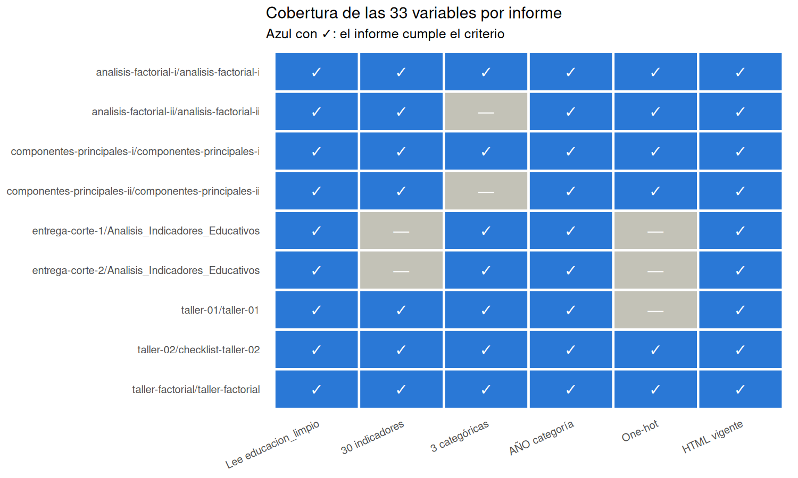

```{r setup, include=FALSE}
knitr::opts_chunk$set(echo = TRUE, warning = FALSE, message = FALSE, fig.width = 10, fig.height = 6, fig.align = "center")
tryCatch(Sys.setlocale("LC_ALL", "C.UTF-8"), error = function(e) NULL)
find_project_root <- function(start = getwd()) {
  path <- normalizePath(start, mustWork = TRUE)
  repeat {
    if (file.exists(file.path(path, "data", "raw", "educacion_limpio.csv")) && dir.exists(file.path(path, "reports"))) return(path)
    parent <- dirname(path)
    if (parent == path) stop("No se encontró la raíz del proyecto.")
    path <- parent
  }
}
project_root <- find_project_root()
knitr::opts_knit$set(root.dir = project_root)
source(file.path(project_root, "scripts", "helpers_datos.R"))
library(knitr); library(dplyr)
# Se regenera la evaluación automática antes de leer sus tablas (unos segundos)
invisible(capture.output(source(file.path(project_root, "scripts", "evaluar_repositorio.R"), local = new.env())))
tdir <- file.path(project_root, "outputs", "informe-final", "tables")
lee <- function(f) read.csv(file.path(tdir, f), check.names = FALSE, stringsAsFactors = FALSE)
coma <- function(x, d = 1) formatC(x, format = "f", digits = d, decimal.mark = ",", big.mark = ".")

informes <- lee("evaluacion_informes.csv"); archivados <- lee("informes_archivados.csv")
outs <- lee("evaluacion_outputs.csv"); desact <- lee("outputs_posiblemente_desactualizados.csv")
pres <- lee("evaluacion_presentaciones.csv"); cruz <- lee("verificaciones_cruzadas.csv")
dep <- lee("dependencias.csv"); crit <- lee("cumplimiento_criterios.csv")

completo <- cargar_educacion(project_root); ind <- columnas_indicadores(completo); panel <- resumen_panel(completo)
j33 <- jsonlite::fromJSON(file.path(project_root, "outputs", "taller-pca", "analisis-33-variables", "tables", "metricas_33.json"))
tf <- function(f) read.csv(file.path(project_root, "outputs", "taller-factorial", "tables", f), check.names = FALSE)
```

# 1. Alcance y método

Este informe evalúa **todo el repositorio**: los **informes** (`reports/`), sus **outputs** (`outputs/`) y las **presentaciones** (`presentacion/`, ignorada por git).
El criterio rector es que cada entregable analice las **33 variables** de `data/raw/educacion_limpio.csv`: **30 indicadores numéricos** y **3 categóricas** (`AÑO`, `DEPARTAMENTO`, `MUNICIPIO`).

La evaluación es **automática y reproducible**: `scripts/evaluar_repositorio.R` lee el código de cada informe, la fecha de sus salidas, el contenido de las presentaciones y cruza las cifras clave entre entregables.
Sus tablas están en `outputs/informe-final/tables/`. Lo que no se puede comprobar automáticamente (por ejemplo, si un umbral está bien calibrado) se marca como pendiente y se explica.

**Datos de referencia.** `r format(panel$registros, big.mark = ".")` registros municipio-año de `r format(panel$municipios, big.mark = ".")` municipios, `r panel$departamentos` departamentos y `r panel$anios` años (2011-2024); cada fila es un municipio en un año, no un municipio independiente.

# 2. Resumen ejecutivo

```{r resumen}
n_cumple <- sum(crit$estado == "Cumple"); n_parcial <- sum(crit$estado == "Parcial"); n_pend <- sum(crit$estado == "Pendiente")
n_comp <- sum(grepl("Completo", informes$estado))
```

- **Cobertura de las 33 variables.** `r n_comp` de `r nrow(informes)` informes vigentes las analizan (los talleres 1, 2 y factorial completos; los cuatro de PCA y factorial originales con una ampliación a 33 columnas). Los dos informes de corte, de otro equipo, analizan 30 indicadores numéricos y describen las categóricas, sin one-hot: quedan como **parciales**.
- **Presentaciones.** `r sum(pres$cubre_33)` de `r nrow(pres)` presentaciones cubren las 33 variables, con bloques «qué vemos / qué significa / qué decidir» y notas del orador.
- **Coherencia.** `r sum(cruz$resultado == "Coincide")` de `r nrow(cruz)` verificaciones cruzadas coinciden, entre ellas el PCA de 30 indicadores del Corte 2 (implementación independiente) frente al análisis de 33 variables: PC1 `r coma(cruz$valor_A[3], 2)` % frente a `r coma(cruz$valor_B[3], 2)` %.
- **Criterios de calidad.** `r n_cumple` cumplidos, `r n_parcial` parciales y `r n_pend` pendientes (punto 8). Lo pendiente no es de código: son decisiones que exigen información externa (umbrales, fuente administrativa) y modelos que reconozcan el panel.
- **Conclusión técnica.** Con las 33 variables, un solo índice no basta; dos dimensiones orientan; el one-hot geográfico no mejora ni el PCA ni el análisis factorial (la mejor codificación es no usarlo y, si se quiere geografía, solo departamentos); y los dos factores del análisis factorial son estables pero siguen siendo exploratorios.

# 3. Informes: ¿analizan las 33 variables?

```{r informes}
tab_inf <- informes %>% transmute(
  Informe = sub("^reports/", "", informe), Dataset = dataset, `30 indicadores` = ifelse(treinta_indicadores, "sí", "no"),
  `3 categóricas` = ifelse(categoricas_analizadas, "sí", "no"), `One-hot` = ifelse(one_hot, "sí", "no"),
  `AÑO categoría` = ifelse(anio_como_categoria, "sí", "no"), `HTML vigente` = ifelse(html_vigente, "sí", "no"), Estado = estado)
kable(tab_inf, caption = "Evaluación de cada informe vigente.")
```

```{r figura-cobertura, results='asis', echo=FALSE}
cat("\n\n\n\n")
```

**Versiones históricas archivadas** (no se renderizan; usan el dataset reducido de los talleres o el análisis anterior):

```{r archivados}
kable(archivados, col.names = c("Archivo", "Motivo"))
```

**Cómo analiza cada entregable las 33 variables**

| Entregable | 30 indicadores | `AÑO`, `DEPARTAMENTO`, `MUNICIPIO` |
|---|---|---|
| Taller 1 | resumen, histogramas, boxplots, correlaciones con IC por municipio | frecuencias y R² ajustado sobre cada indicador |
| Taller 2 | correlación, covarianza, condicionamiento, Mahalanobis | one-hot con rango y dependencias exactas (35 con «ambos») |
| Taller factorial | modelo factorial completo | one-hot (diagnóstico), R² de los puntajes y puntajes por año |
| PCA I y II, factorial I y II | 6 variables (decisión) | ampliación a 33 columnas con one-hot de departamentos, municipios y ambos |
| Informes de corte 1 y 2 | 30 numéricas (PCA en el corte 2) | descriptivas; sin one-hot |

# 4. Outputs

```{r outputs}
tab_out <- outs %>% transmute(Carpeta = sub("^outputs/", "", carpeta), Tablas = tablas, Figuras = figuras, `Fuente que las genera` = fuente,
                              `Archivos posiblemente desactualizados` = posiblemente_desactualizados, `Estado de la fuente` = estado_fuente)
kable(tab_out, caption = "Outputs por carpeta y fuente que los regenera.")
```

`r if (nrow(desact) == 0) "Ningún archivo de salida es más antiguo que su fuente." else paste0("Archivos posiblemente desactualizados: ", paste(paste0(desact$carpeta, "/", desact$archivo), collapse = "; "), ".")`
Durante esta evaluación se **eliminó** `outputs/taller-pca/componentes-principales-ii/tables/signos_componentes.csv` (ya no lo produce ningún informe) y los archivos del one-hot antiguo de PCA I
(`comparacion_one_hot.csv`, `pesos_pc1_one_hot.csv`, `comparacion_one_hot.png`), que usaban códigos DANE como números y el archivo crudo.

# 5. Presentaciones

```{r presentaciones}
tab_pres <- pres %>% transmute(Presentación = sub("^presentacion/", "", presentacion), Diapositivas = diapositivas, `Con notas del orador` = con_notas_del_orador,
                               `33 variables` = ifelse(menciona_33, "sí", "no"), `30 indicadores` = ifelse(menciona_30_indicadores, "sí", "no"),
                               Categóricas = ifelse(menciona_categoricas, "sí", "no"), `One-hot` = ifelse(menciona_one_hot, "sí", "no"),
                               `Bloques «qué vemos»` = bloques_que_vemos, `Límites o pendientes` = ifelse(limites_o_validar, "sí", "no"))
kable(tab_pres, caption = "Evaluación de las cinco presentaciones.")
```

Las presentaciones siguen un hilo narrativo para el cliente (Dirección de Cobertura y Equidad Territorial): exploración, diagnóstico, PCA, análisis factorial y una integrada.
Cada diapositiva de resultados lleva un título con el mensaje, la cifra y su significado, y cierra con lo que se puede afirmar y lo que falta validar.

# 6. Verificaciones cruzadas de cifras

```{r cruzadas}
kable(cruz %>% transmute(Verificación = verificacion, `Fuente A` = fuente_A, `Valor A` = round(valor_A, 3), `Fuente B` = fuente_B, `Valor B` = round(valor_B, 3), Tolerancia = tolerancia, Resultado = resultado),
      caption = "Cifras clave comparadas entre entregables.")
```

La coincidencia entre el PCA del Corte 2 (escrito por otro integrante) y el de este proyecto sobre los mismos 30 indicadores es la comprobación más fuerte de que la preparación de datos y la estandarización están bien hechas.

# 7. Reproducibilidad

```{r repro}
kable(dep %>% filter(!declarado_en_install_dependencies | !instalado) %>% transmute(Paquete = paquete, `Declarado en install_dependencies.R` = ifelse(declarado_en_install_dependencies, "sí", "no"), Instalado = ifelse(instalado, "sí", "no")),
      caption = "Paquetes usados que no están declarados o no están instalados.")
```

Orden recomendado para regenerar todo desde la raíz del proyecto:

1. `source("scripts/install_dependencies.R")` y `source("scripts/check_project.R")`.
2. `source("scripts/render_reports.R")` (talleres 1, 2 y factorial; incluye el Corte 1 y 2, que regeneran `educacion_limpio.csv`) y `source("scripts/render_talleres_pca.R")` (PCA, factorial I y II y taller factorial).
3. `Rscript scripts/analisis_33_variables.R` (≈ 4 min; PCA y factorial con one-hot).
4. `Rscript scripts/presentacion_resultados.R` y `python scripts/presentacion_construir.py` (presentaciones).
5. `Rscript scripts/evaluar_repositorio.R` y renderizar este informe.

`ggrepel` es opcional (mejora las etiquetas del biplot) y no está instalado en este equipo; no afecta ningún resultado.

# 8. Resultados integrados de las 33 variables

```{r integrados}
p30 <- j33$pca[j33$pca$base == "30 indicadores", ]
sn <- p30[p30$codificacion == "Solo numéricas", ]; dd <- p30[p30$codificacion == "+ AÑO + departamentos" & p30$peso == "z", ]
um <- p30[p30$codificacion == "+ AÑO + municipios" & p30$peso == "z", ]; xx <- p30[p30$codificacion == "+ AÑO + ambos" & p30$peso == "z", ]
p6 <- j33$pca[j33$pca$base == "6 variables", ]; s6 <- p6[p6$codificacion == "Solo numéricas", ]
ad <- tf("adecuacion.csv"); crit_f <- tf("criterios_numero_factores.csv"); est <- tf("estabilidad_periodos_y_municipios.csv"); boot <- tf("bootstrap_resumen.csv")
eta_s <- tf("r2_puntajes_por_categorica.csv"); sol <- tf("solapamiento_fondos.csv"); cost <- tf("costo_factor_unico.csv")
eta1 <- read.csv(file.path(project_root, "outputs", "taller-01", "tables", "R2_ajustado_por_categorica.csv"), check.names = FALSE)
div <- data.frame(
  Tema = c("Datos", "Categóricas", "PCA (30 indicadores)", "PCA con one-hot geográfico", "Análisis factorial (30 indicadores)", "Estabilidad del factorial", "Decisión"),
  Resultado = c(
    paste0(format(panel$registros, big.mark = "."), " registros municipio-año; 30 indicadores + 3 categóricas; panel incompleto en 2011-2015"),
    paste0("El municipio explica una mediana de ", coma(median(eta1$MUNICIPIO), 0), " % de la varianza de un indicador, el departamento ", coma(median(eta1$DEPARTAMENTO), 0), " % y el año ", coma(median(eta1$AÑO), 0), " % (persistencia, no patrón nuevo)"),
    paste0("PC1 ", coma(sn$pct_pc1, 1), " %, PC1+PC2 ", coma(sn$pct_pc12, 1), " %, ", sn$n80, " componentes para el 80 % (con 6 variables: ", coma(s6$pct_pc12, 1), " % y ", s6$n80, ")"),
    paste0("Ninguna variante supera a «solo numéricas»; departamentos: ", coma(dd$pct_numericas_en_varianza, 0), " % de la varianza viene de los indicadores; municipios: ", coma(um$pct_numericas_en_varianza, 1), " %; ambos: singular"),
    paste0("KMO ", ad$Valor[ad$Medida == "KMO global"], "; el paralelo sugiere ", crit_f$Factores_sugeridos[2], " factores; dos factores (acceso, permanencia y rendimiento) como hipótesis de política"),
    paste0("Congruencia de los 2 factores ", coma(min(est$Congruencia_2_factores), 3), " a ", coma(max(est$Congruencia_2_factores), 3), " entre períodos y por municipio; bootstrap por municipio ", coma(boot$Mediana[1], 3)),
    paste0("Un factor único omite ", coma(cost$Pct_omitido[3], 1), " % del grupo prioritario; con dos fondos coinciden ", coma(sol$Porcentaje_del_cupo[2], 1), " % (20 % si fueran independientes)")))
kable(div, caption = "Resumen integrado de resultados.")
```

**Qué significa para el cliente.** Los datos permiten **orientar**, no decidir solos. Un único número ordena pero no basta; dos dimensiones (acceso y permanencia/rendimiento) son una hipótesis bien respaldada
y estable en los 30 indicadores, aunque sus índices de ajuste son pobres y las filas de un municipio no son independientes. Agregar año, departamentos o municipios en one-hot no revela estructura nueva:
la geografía sirve para **leer** los resultados (el acceso es muy estable por municipio; la permanencia casi no lo es), no como variable del modelo.

# 9. Cumplimiento de criterios

```{r criterios}
kable(crit %>% transmute(Criterio = criterio, Estado = estado, Evidencia = evidencia), caption = "Evaluación final por criterio.")
```

# 10. Hallazgos prioritarios y hoja de ruta

| Prioridad | Hallazgo | Acción propuesta |
|---|---|---|
| Alta | Los informes de corte (otro equipo) analizan 30 numéricas sin one-hot ni inferencia por municipio, y aplican cientos de pruebas `cor.test` sin ajuste. | Incorporar las 3 categóricas y la sección de PCA con one-hot; reemplazar valores p por magnitudes e intervalos por municipio. |
| Alta | Panel incompleto en 2011-2015 y filas no independientes en PCA, Mahalanobis y factorial. | Repetir con ponderación por población y con 2016-2024; modelos que reconozcan el panel; separar variación entre y dentro de municipios. |
| Alta | Registros con todos los indicadores en cero (p. ej. Papunaua, 2021-2024) probablemente son datos ausentes. | Confirmar con la fuente y tratarlos como faltantes. |
| Media | Umbrales de 6,5 % de deserción, 60 % de cobertura y PC1 ≤ 0 no están calibrados y la etiqueta usa variables del propio PCA. | Calibrar con criterios externos y evaluar con una etiqueta independiente. |
| Media | Análisis factorial con índices de ajuste pobres y matriz casi singular. | Validar los factores con otra muestra; evaluar la solución sin la familia de reprobación. |
| Media | Solo el Taller 1 y el factorial usan bootstrap por municipio; el resto no. | Extender el bootstrap por municipio a PCA y Mahalanobis. |
| Baja | Dependencia opcional `ggrepel` no instalada; derivados antiguos y duplicados históricos. | Documentado; los históricos están archivados. |

# 11. Cambios hechos en esta evaluación

- **Talleres 1 y 2:** pasan a analizar las 33 variables de `educacion_limpio.csv` (antes leían el dataset reducido de los talleres, sin año ni nombres) y suman el análisis de las 3 categóricas.
- **Carpeta nueva `taller-factorial`** (`reports/taller-factorial/`, `outputs/taller-factorial/`, `presentacion/taller-factorial/`): análisis factorial completo con su estructura.
- **Archivados** en `reports/*/archive/`: `Taller1.Rmd`, `Checklist_Taller2.Rmd` y `taller-02-html.Rmd` (+ HTML), por usar el dataset reducido o el análisis anterior.
- **Eliminados:** salidas sin productor (`signos_componentes.csv` y el one-hot antiguo de PCA I).
- **Validaciones nuevas:** `check_project.R` comprueba que `AÑO` es categoría, que los 30 indicadores son finitos y que las tablas del Taller 2 corresponden al dataset; `evaluar_repositorio.R` automatiza esta evaluación.
- **Presentaciones:** las cinco incorporan las 33 variables; la de factorial se reconstruyó sobre el análisis completo y la integrada suma esta evaluación.

**Límites de esta evaluación.** Mide cobertura, vigencia y coherencia; no valida la calidad sustantiva de cada análisis ni reemplaza la revisión de un especialista. Todas las asociaciones son descriptivas, no causales.
