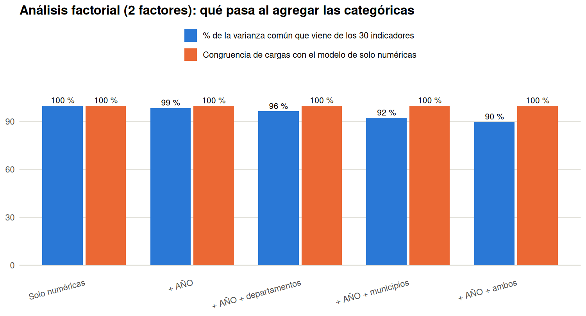

```{r setup, include=FALSE}
knitr::opts_chunk$set(echo = TRUE, warning = FALSE, message = FALSE, fig.width = 10, fig.height = 6, fig.align = "center")
tryCatch(Sys.setlocale("LC_ALL", "C.UTF-8"), error = function(e) NULL)
find_project_root <- function(start = getwd()) {
  path <- normalizePath(start, mustWork = TRUE)
  repeat {
    if (file.exists(file.path(path, "data", "raw", "educacion_limpio.csv")) && dir.exists(file.path(path, "reports"))) return(path)
    parent <- dirname(path)
    if (parent == path) stop("No se encontró la raíz del proyecto.")
    path <- parent
  }
}
project_root <- find_project_root()
knitr::opts_knit$set(root.dir = project_root)
source(file.path(project_root, "scripts", "helpers_datos.R"))
tables_dir <- file.path(project_root, "outputs", "taller-factorial", "tables")
figures_dir <- file.path(project_root, "outputs", "taller-factorial", "figures")
dir.create(tables_dir, recursive = TRUE, showWarnings = FALSE)
dir.create(figures_dir, recursive = TRUE, showWarnings = FALSE)

for (p in c("psych", "GPArotation", "ggplot2", "dplyr", "tidyr", "knitr")) {
  if (!requireNamespace(p, quietly = TRUE)) stop("Falta el paquete ", p, ". Ejecute scripts/install_dependencies.R")
}
suppressPackageStartupMessages({ library(psych); library(ggplot2); library(dplyr); library(tidyr); library(knitr) })
tema <- theme_minimal(base_size = 11) +
  theme(panel.grid.minor = element_blank(), panel.grid.major.x = element_blank(),
        panel.grid.major.y = element_line(color = paleta$rejilla), plot.title = element_text(face = "bold"),
        plot.subtitle = element_text(color = "#52514e"), legend.position = "top")
coma <- function(x, d = 1) formatC(x, format = "f", digits = d, decimal.mark = ",", big.mark = ".")
guardar_tabla <- function(df, nombre) write.csv(df, file.path(tables_dir, nombre), row.names = FALSE)
guardar_fig <- function(p, nombre, w = 10, h = 6) ggsave(file.path(figures_dir, nombre), p, width = w, height = h, dpi = 150, bg = "white")
set.seed(20261030)
```

## Ficha técnica del caso

**Cliente:** Dirección de Cobertura y Equidad Territorial del Ministerio de Educación Nacional.
**Decisión estratégica:** Decidir si los indicadores educativos municipales revelan dimensiones latentes estables que justifiquen nombrar y financiar dos fondos (acceso y permanencia), y qué tan sólida es esa conclusión.
**Pregunta de fondo:** ¿Cuántos factores comunes hay entre los 30 indicadores? ¿Se pueden nombrar? ¿Son estables ante el estimador, el período y la unidad de análisis? ¿Qué aportan las 3 categóricas (`AÑO`, `DEPARTAMENTO`, `MUNICIPIO`)?
**Datos:** `data/raw/educacion_limpio.csv`, las **33 variables**: 30 indicadores numéricos, `AÑO`, `DEPARTAMENTO` y `MUNICIPIO`.
**Estructura de esta carpeta:** el informe está en `reports/taller-factorial/`; sus tablas en `outputs/taller-factorial/tables/` y sus figuras en `outputs/taller-factorial/figures/`; la presentación para el cliente, en `presentacion/taller-factorial/`.

---

# 1. Las 33 variables y cómo entra cada una al análisis

El análisis factorial supone variables continuas. Por eso los **30 indicadores** forman el modelo factorial y las **3 categóricas** se tratan de tres formas complementarias:
(a) se describen y se mide cuánta varianza de cada indicador explican (R² ajustado); (b) se prueban como columnas one-hot en el modelo (punto 9, solo como diagnóstico, porque son binarias); y
(c) se usan para **leer los puntajes factoriales** por año, departamento y municipio (punto 8).

```{r variables}
datos <- cargar_educacion(project_root)
indicadores <- columnas_indicadores(datos)
X <- datos[, indicadores]
n <- nrow(X); p <- ncol(X)
panel <- resumen_panel(datos)
stopifnot(p == 30, ncol(datos) - 1 == 33, !anyNA(X))   # 33 columnas originales (+ ID_MUNICIPIO derivado)

familia <- function(v) {
  f <- sub("_.*$", "", v)
  f <- ifelse(f %in% c("TASA"), "COBERTURA", f)
  f <- ifelse(f == "POBLACIÓN", "POBLACIÓN", f)
  f
}
roles <- data.frame(
  Variable = c(indicadores, "AÑO", "DEPARTAMENTO", "MUNICIPIO"),
  Tipo = c(rep("Indicador numérico", 30), rep("Categórica", 3)),
  Uso = c(rep("Entra al modelo factorial", 30),
          "One-hot (diagnóstico), R², puntajes por año", "One-hot (diagnóstico), R², puntajes por departamento", "One-hot (diagnóstico), R², puntajes por municipio"),
  Familia = c(familia(indicadores), "—", "—", "—")
)
guardar_tabla(roles, "variables_y_roles.csv")
kable(as.data.frame(table(Tipo = roles$Tipo, Familia = roles$Familia)) %>% filter(Freq > 0) %>% tidyr::pivot_wider(names_from = Familia, values_from = Freq, values_fill = 0),
      caption = "Cuántas variables hay por tipo y familia.")
```

Son **`r fint(n)` registros municipio-año** de **`r fint(panel$municipios)` municipios** en **`r panel$departamentos` departamentos** y `r panel$anios` años. Cada fila es un municipio en un año:
las filas de un mismo municipio no son independientes, y eso condiciona la inferencia y la lectura de los factores (puntos 7 y 8).

---

# 2. ¿Tiene sentido factorizar? Adecuación de la matriz

```{r adecuacion}
R <- cor(X)
kmo <- KMO(R)
bart <- cortest.bartlett(R, n = n)
autov <- eigen(R, symmetric = TRUE, only.values = TRUE)$values
suma_tres <- datos$APROBACIÓN + datos$REPROBACIÓN + datos$DESERCIÓN

kmo_tab <- data.frame(Variable = indicadores, KMO = as.numeric(kmo$MSAi), Familia = familia(indicadores))
kmo_tab$Lectura <- cut(kmo_tab$KMO, c(-Inf, 0.5, 0.6, 0.7, 0.8, Inf), labels = c("inaceptable", "mediocre", "regular", "meritorio", "excelente"))
guardar_tabla(kmo_tab, "kmo_por_variable.csv")

adec <- data.frame(
  Medida = c("KMO global", "Variables con KMO < 0,5", "Chi² de Bartlett", "Grados de libertad", "Valor p de Bartlett",
             "Determinante de R", "Menor autovalor de R", "Número de condición de R"),
  Valor = c(coma(kmo$MSA, 3), sum(kmo$MSAi < 0.5), coma(bart$chisq, 0), bart$df, ifelse(bart$p.value < 1e-300, "< 1e-300", format(bart$p.value, digits = 2, scientific = TRUE)),
            format(det(R), digits = 3, scientific = TRUE), format(min(autov), digits = 3, scientific = TRUE),
            format(max(autov) / min(autov), digits = 3, scientific = TRUE))
)
guardar_tabla(adec, "adecuacion.csv")
kable(adec, caption = "Pruebas de adecuación de la matriz de correlaciones de los 30 indicadores.")

p_kmo <- ggplot(kmo_tab, aes(reorder(Variable, KMO), KMO, fill = KMO < 0.5)) + geom_col(width = 0.75) + coord_flip() +
  geom_hline(yintercept = 0.5, linetype = "dashed", color = paleta$naranja) +
  scale_fill_manual(values = c(`FALSE` = paleta$azul, `TRUE` = paleta$naranja), guide = "none") +
  tema + theme(axis.text.y = element_text(size = 8), panel.grid.major.y = element_blank()) +
  labs(title = paste0("KMO por variable (global: ", coma(kmo$MSA, 3), ")"), subtitle = "Naranja: por debajo de 0,5", x = NULL, y = "KMO")
print(p_kmo)
guardar_fig(p_kmo, "kmo_por_variable.png", 9, 7.5)
```

> ⭐ **Qué ve:** El KMO global es **`r coma(kmo$MSA, 3)`** y `r sum(kmo$MSAi < 0.5)` de los 30 indicadores quedan por debajo de 0,5 (los más bajos: `r paste(head(kmo_tab$Variable[order(kmo_tab$KMO)], 3), collapse = ", ")`). La prueba de Bartlett rechaza la matriz identidad (valor p `r ifelse(bart$p.value < 1e-300, "< 1e-300", format(bart$p.value, digits = 2, scientific = TRUE))`), pero con `r fint(n)` filas casi cualquier matriz la rechaza. El número de condición de R es `r format(max(autov) / min(autov), digits = 3, scientific = TRUE)`.
>
> ⭐ **Qué significa para el cliente:** Hay correlación suficiente para factorizar, pero el piso es débil y la matriz está **casi pegada a ser singular**: aprobación + reprobación + deserción suma entre `r coma(min(suma_tres), 3)` y `r coma(max(suma_tres), 3)` (mediana `r coma(median(suma_tres), 3)`; `r sum(suma_tres < 0.99)` registros suman menos de 0,99, los de ceros sospechosos que muestra el Taller 2). Los índices de ajuste del modelo (punto 6) heredan esa fragilidad.
>
> ⭐ **Qué decide él:** Factorizar los 30 indicadores como análisis **exploratorio**, y comprobar en el punto 7 que las conclusiones no dependen del estimador, del período ni de repetir municipios.

---

# 3. ¿Cuántos factores? Varios criterios, ninguna respuesta única

```{r numero-factores}
k_kaiser <- sum(autov > 1)
pa <- fa.parallel(X, fa = "fa", fm = "minres", n.iter = 50, plot = FALSE)
k_pa <- pa$nfact
vss <- VSS(R, n = 10, rotate = "oblimin", fm = "minres", n.obs = n, plot = FALSE)
k_map <- which.min(vss$map)
k_bic <- which.min(vss$vss.stats$BIC)
acum <- cumsum(autov) / sum(autov) * 100

criterios <- data.frame(
  Criterio = c("Kaiser (autovalor de R > 1)", "Análisis paralelo (MinRes, 50 simulaciones)", "MAP de Velicer (mínimo)",
               "BIC (mínimo entre 1 y 10 factores)", "Hipótesis de política: acceso y permanencia"),
  Factores_sugeridos = c(k_kaiser, k_pa, k_map, k_bic, 2)
)
guardar_tabla(criterios, "criterios_numero_factores.csv")
kable(criterios, caption = "Número de factores que sugiere cada criterio.")

scree <- data.frame(k = 1:p, autovalor = autov, simulado = pa$fa.sim[1:p], real_fa = pa$fa.values[1:p], acumulado = acum)
guardar_tabla(scree, "scree_y_paralelo.csv")
p_scree <- ggplot(scree[1:12, ], aes(k)) +
  geom_line(aes(y = real_fa, color = "Real"), linewidth = 1) + geom_point(aes(y = real_fa, color = "Real"), size = 2.5) +
  geom_line(aes(y = simulado, color = "Simulado (azar)"), linewidth = 1) + geom_point(aes(y = simulado, color = "Simulado (azar)"), size = 2.5) +
  geom_hline(yintercept = 0, color = paleta$gris) +
  scale_color_manual(values = c(Real = paleta$azul, `Simulado (azar)` = paleta$naranja), name = NULL) + scale_x_continuous(breaks = 1:12) +
  tema + theme(panel.grid.major.x = element_line(color = paleta$rejilla)) +
  labs(title = paste0("Análisis paralelo: ", k_pa, " factores por encima del azar"), subtitle = "Autovalores de los factores comunes reales frente a datos simulados", x = "Factor", y = "Autovalor")
print(p_scree)
guardar_fig(p_scree, "paralelo.png", 9, 5)

# Casos límite (comunalidad ~ 1) según el número de factores
heywood <- do.call(rbind, lapply(1:9, function(k) {
  f <- suppressWarnings(fa(R, nfactors = k, n.obs = n, fm = "minres", rotate = if (k == 1) "none" else "oblimin"))
  data.frame(Factores = k, Varianza_comun_pct = 100 * sum(f$communality) / p,
             Comunalidades_mayores_099 = sum(f$communality > 0.99), Unicidad_minima = min(f$uniquenesses), RMSR = f$rms)
}))
guardar_tabla(heywood, "casos_limite_por_numero_de_factores.csv")
kable(heywood, digits = 3, caption = "Varianza común y casos límite (comunalidad ≈ 1 o unicidad ≤ 0) para cada número de factores (MinRes, Oblimin).")
```

> ⭐ **Qué ve:** Los criterios no coinciden: Kaiser sugiere **`r k_kaiser`**, el análisis paralelo **`r k_pa`**, el MAP **`r k_map`**, y el BIC sigue bajando hasta el máximo probado (`r k_bic`). Los `r k_pa` primeros autovalores de R acumulan `r coma(acum[k_pa], 1)` % de la varianza. Con `r max(heywood$Factores[heywood$Comunalidades_mayores_099 == 0])` factores o menos no aparece ninguna comunalidad ≈ 1; a partir de `r min(heywood$Factores[heywood$Comunalidades_mayores_099 > 0])` factores sí.
>
> ⭐ **Qué significa para el cliente:** No existe «el» número de factores. La hipótesis de dos fondos (2 factores) es la más simple; los datos sostienen entre `r k_map` y `r k_pa`, porque los 30 indicadores son familias (cobertura, deserción, aprobación, reprobación, repitencia) repetidas por nivel educativo. Pedir más factores empieza a producir soluciones en el borde del espacio permitido.
>
> ⭐ **Qué decide él:** Trabajar con **2 factores** (hipótesis de política) y con **`r k_map` factores** (el menor número que sugiere un criterio de los datos), y mostrar ambas. Con `r k_map` factores hay `r heywood$Comunalidades_mayores_099[heywood$Factores == k_map]` comunalidades cercanas a 1: esa solución se lee como exploración.

---

# 4. Estimación: ¿importa el método?

Se estiman las dos soluciones con tres métodos (MinRes, máxima verosimilitud y ejes principales) y rotación oblicua (Oblimin).

```{r estimacion}
tuck <- function(a, b) abs(sum(a * b)) / sqrt(sum(a^2) * sum(b^2))
# Congruencia de Tucker entre dos matrices de cargas, emparejando factores (asignación voraz)
congruencia <- function(L1, L2) {
  k <- ncol(L1); C <- outer(1:k, 1:k, Vectorize(function(i, j) tuck(L1[, i], L2[, j])))
  usado <- integer(0); res <- numeric(k)
  for (i in order(-apply(C, 1, max))) { j <- setdiff(order(-C[i, ]), usado)[1]; usado <- c(usado, j); res[i] <- C[i, j] }
  res
}
ajusta <- function(k, fm, rot = "oblimin", datos_x = NULL, r = NULL) {
  suppressWarnings(tryCatch(
    if (!is.null(r)) fa(r, nfactors = k, n.obs = n, fm = fm, rotate = rot) else fa(datos_x, nfactors = k, fm = fm, rotate = rot),
    error = function(e) NULL))
}
k_trab <- k_map
modelos <- list()
for (k in unique(c(2, k_trab))) for (fm in c("minres", "ml", "pa")) modelos[[paste(k, fm)]] <- ajusta(k, fm, r = R)
est <- do.call(rbind, lapply(names(modelos), function(nm) {
  f <- modelos[[nm]]; k <- as.integer(sub(" .*", "", nm)); fm <- sub(".* ", "", nm)
  ref <- unclass(modelos[[paste(k, "minres")]]$loadings)
  data.frame(Factores = k, Metodo = fm, Varianza_comun_pct = 100 * sum(f$communality) / p,
             Comunalidades_mayores_099 = sum(f$communality > 0.99), Unicidad_minima = min(f$uniquenesses),
             Congruencia_con_MinRes = mean(congruencia(unclass(f$loadings), ref)), RMSR = f$rms)
}))
guardar_tabla(est, "comparacion_estimadores.csv")
kable(est, digits = 3, caption = "Los tres métodos de estimación, para 2 factores y para la solución conservadora.")
```

> ⭐ **Qué ve:** Con `r k_trab` y con 2 factores, los tres métodos producen cargas casi idénticas (congruencia de Tucker con MinRes entre `r coma(min(est$Congruencia_con_MinRes), 3)` y 1). La varianza común va de `r coma(min(est$Varianza_comun_pct[est$Factores == 2]), 1)` % (2 factores) a `r coma(max(est$Varianza_comun_pct[est$Factores == k_trab]), 1)` % (`r k_trab` factores).
>
> ⭐ **Qué significa para el cliente:** El resultado **no depende del estimador**; depende de qué variables se usan y de cuántos factores se piden.
>
> ⭐ **Qué decide él:** Usar MinRes (no exige normalidad, que los datos no cumplen) como estimador de referencia.

---

# 5. Rotación y lectura de los factores

```{r rotacion}
f2 <- modelos[["2 minres"]]; fk <- modelos[[paste(k_trab, "minres")]]
f2v <- ajusta(2, "minres", rot = "varimax", r = R); fkv <- ajusta(k_trab, "minres", rot = "varimax", r = R)

etiqueta_factor <- function(f, top = 4) {
  L <- unclass(f$loadings)
  sapply(seq_len(ncol(L)), function(j) {
    o <- order(-abs(L[, j]))[1:top]
    fam <- table(familia(rownames(L)[o][abs(L[o, j]) > 0.4]))
    f1 <- if (length(fam)) names(which.max(fam)) else "mixto"
    paste0(f1, ": ", paste0(rownames(L)[o], " (", coma(L[o, j], 2), ")", collapse = "; "))
  })
}
tab_cargas <- function(f) { L <- unclass(f$loadings); data.frame(Variable = rownames(L), round(L, 3), Comunalidad = round(f$communality, 3), check.names = FALSE) }
guardar_tabla(tab_cargas(f2), "cargas_2_factores_oblimin.csv")
guardar_tabla(tab_cargas(f2v), "cargas_2_factores_varimax.csv")
guardar_tabla(tab_cargas(fk), "cargas_k_factores_oblimin.csv")
guardar_tabla(tab_cargas(fkv), "cargas_k_factores_varimax.csv")
phi2 <- f2$Phi; phik <- fk$Phi
guardar_tabla(data.frame(round(phik, 3)), "correlacion_entre_factores_k.csv")

et2 <- etiqueta_factor(f2); etk <- etiqueta_factor(fk)
kable(data.frame(Factor = colnames(unclass(f2$loadings)), `Lectura (cargas más altas)` = et2, check.names = FALSE), caption = "Los 2 factores: qué indicadores los definen.")
kable(data.frame(Factor = colnames(unclass(fk$loadings)), `Lectura (cargas más altas)` = etk, check.names = FALSE), caption = paste0("Los ", k_trab, " factores: qué indicadores los definen."))

carga_larga <- function(f, nombre) {
  L <- as.data.frame(unclass(f$loadings)); L$Variable <- factor(rownames(L), levels = rev(indicadores))
  tidyr::pivot_longer(L, -Variable, names_to = "Factor", values_to = "Carga") %>% mutate(Modelo = nombre)
}
ll <- rbind(carga_larga(f2, "2 factores"), carga_larga(fk, paste0(k_trab, " factores")))
ll$Modelo <- factor(ll$Modelo, levels = c("2 factores", paste0(k_trab, " factores")))
p_cargas <- ggplot(ll, aes(Factor, Variable, fill = Carga)) + geom_tile(color = "white") +
  geom_text(aes(label = ifelse(abs(Carga) >= 0.3, coma(Carga, 2), "")), size = 2.4) +
  scale_fill_gradient2(low = paleta$naranja, mid = "#f0efec", high = paleta$azul, limits = c(-1, 1), oob = scales::squish, name = "Carga") +
  facet_grid(. ~ Modelo, scales = "free_x", space = "free_x") + tema +
  theme(axis.text.y = element_text(size = 7), panel.grid = element_blank()) + labs(title = "Cargas factoriales (MinRes, Oblimin)", x = NULL, y = NULL)
print(p_cargas)
guardar_fig(p_cargas, "cargas_factoriales.png", 11, 8)

com <- data.frame(Variable = indicadores, h2_2factores = f2$communality, h2_k = fk$communality)
guardar_tabla(com, "comunalidades.csv")
```

> ⭐ **Qué ve:** Con 2 factores, el primero reúne cobertura y matriculación (`r et2[1]`) y el segundo rendimiento y permanencia (`r et2[2]`). Su correlación es `r coma(phi2[1, 2], 3)`. Con `r k_trab` factores los indicadores se agrupan por familia y nivel educativo; la correlación entre factores va de `r coma(min(phik[upper.tri(phik)]), 2)` a `r coma(max(phik[upper.tri(phik)]), 2)`. La población 5-16 no pertenece a ningún factor (comunalidad `r coma(com$h2_2factores[com$Variable == "POBLACIÓN_5_16"], 3)`).
>
> ⭐ **Qué significa para el cliente:** Con los 30 indicadores los nombres **«Acceso»** y **«Permanencia y rendimiento»** son defendibles, y cada factor lo definen familias de indicadores, no una sola variable (con solo 6 variables, cada factor lo definía casi una variable). Una correlación casi nula entre factores no prueba independencia, solo que, con rotación oblicua, quedaron poco relacionados.
>
> ⭐ **Qué decide él:** Adoptar los nombres como **hipótesis de trabajo**; la rotación varimax (ortogonal) está en `outputs/taller-factorial/tables/` y no cambia la lectura.

---

# 6. Ajuste del modelo (con cautela)

```{r ajuste}
ajuste <- data.frame(
  Modelo = c("1 factor", "2 factores", paste0(k_trab, " factores")),
  RMSR = c(modelos[["2 minres"]]$rms * NA, f2$rms, fk$rms),
  RMSEA = c(NA, f2$RMSEA[1], fk$RMSEA[1]), TLI = c(NA, f2$TLI, fk$TLI),
  Varianza_comun_pct = c(NA, 100 * sum(f2$communality) / p, 100 * sum(fk$communality) / p)
)
f1 <- ajusta(1, "minres", rot = "none", r = R)
ajuste[1, ] <- c("1 factor", f1$rms, f1$RMSEA[1], f1$TLI, 100 * sum(f1$communality) / p)
guardar_tabla(ajuste, "ajuste_del_modelo.csv")
kable(ajuste, digits = 3, caption = "Índices de ajuste de los modelos factoriales (MinRes).")
```

> ⭐ **Qué ve:** El RMSR baja de `r coma(as.numeric(ajuste$RMSR[1]), 3)` (1 factor) a `r coma(as.numeric(ajuste$RMSR[2]), 3)` (2) y `r coma(as.numeric(ajuste$RMSR[3]), 3)` (`r k_trab`), pero el RMSEA se queda en torno a `r coma(as.numeric(ajuste$RMSEA[2]), 2)` y el TLI en `r coma(as.numeric(ajuste$TLI[2]), 2)`.
>
> ⭐ **Qué significa para el cliente:** Los valores de ajuste habituales (RMSEA ≤ 0,08; TLI ≥ 0,90) **no se alcanzan**, pero estos índices no son fiables aquí: la matriz es casi singular y los indicadores son acotados y asimétricos. Mejorar el RMSR confirma que más factores recogen más correlación; no valida los nombres.

---

# 7. ¿Es estable? Estimador, período, unidad de análisis y repetición de municipios

```{r estabilidad}
L_ref2 <- unclass(f2$loadings); L_refk <- unclass(fk$loadings)

# (a) Períodos: 2011-2015 frente a 2016-2024
anio_num <- as.integer(as.character(datos$AÑO))
per <- list(`2011-2015` = anio_num <= 2015, `2016-2024` = anio_num >= 2016)
est_per <- do.call(rbind, lapply(names(per), function(nm) {
  Rs <- cor(X[per[[nm]], ])
  g2 <- suppressWarnings(fa(Rs, nfactors = 2, n.obs = sum(per[[nm]]), fm = "minres", rotate = "oblimin"))
  gk <- suppressWarnings(fa(Rs, nfactors = k_trab, n.obs = sum(per[[nm]]), fm = "minres", rotate = "oblimin"))
  data.frame(Subconjunto = nm, Registros = sum(per[[nm]]),
             Congruencia_2_factores = mean(congruencia(unclass(g2$loadings), L_ref2)),
             Congruencia_k_factores = mean(congruencia(unclass(gk$loadings), L_refk)),
             Phi_2_factores = g2$Phi[1, 2])
}))

# (b) Unidad de análisis: promedio por municipio (un perfil por municipio)
medias <- aggregate(X, by = list(id = datos$ID_MUNICIPIO), FUN = mean)[, -1]
Rm <- cor(medias)
gm2 <- suppressWarnings(fa(Rm, nfactors = 2, n.obs = nrow(medias), fm = "minres", rotate = "oblimin"))
gmk <- suppressWarnings(fa(Rm, nfactors = k_trab, n.obs = nrow(medias), fm = "minres", rotate = "oblimin"))
kmo_m <- KMO(Rm)$MSA
est_mun <- data.frame(Subconjunto = "Promedio por municipio", Registros = nrow(medias),
                      Congruencia_2_factores = mean(congruencia(unclass(gm2$loadings), L_ref2)),
                      Congruencia_k_factores = mean(congruencia(unclass(gmk$loadings), L_refk)), Phi_2_factores = gm2$Phi[1, 2])

# (c) Bootstrap por municipio: se remuestrean municipios completos
ids <- split(seq_len(n), datos$ID_MUNICIPIO)
B <- 100
boot <- do.call(rbind, lapply(seq_len(B), function(b) {
  muestra <- unlist(ids[sample(length(ids), length(ids), replace = TRUE)], use.names = FALSE)
  g <- suppressWarnings(fa(cor(X[muestra, ]), nfactors = 2, n.obs = length(muestra), fm = "minres", rotate = "oblimin"))
  Lb <- unclass(g$loadings); cg <- congruencia(Lb, L_ref2)
  data.frame(rep = b, congruencia = mean(cg), phi = g$Phi[1, 2],
             apro = max(abs(Lb["APROBACIÓN", ])), cob = max(abs(Lb["COBERTURA_NETA", ])), des = max(abs(Lb["DESERCIÓN", ])))
}))

estab <- rbind(est_per, est_mun)
guardar_tabla(estab, "estabilidad_periodos_y_municipios.csv")
guardar_tabla(boot, "bootstrap_por_municipio_2_factores.csv")
kable(estab, digits = 3, caption = "Congruencia de Tucker de las cargas con la solución de todos los registros (1 = idénticas).")
resumen_boot <- data.frame(
  Medida = c("Congruencia con la solución completa", "Correlación entre factores", "|Carga| de aprobación", "|Carga| de cobertura neta", "|Carga| de deserción"),
  Mediana = c(median(boot$congruencia), median(boot$phi), median(boot$apro), median(boot$cob), median(boot$des)),
  IC95_inf = c(quantile(boot$congruencia, .025), quantile(boot$phi, .025), quantile(boot$apro, .025), quantile(boot$cob, .025), quantile(boot$des, .025)),
  IC95_sup = c(quantile(boot$congruencia, .975), quantile(boot$phi, .975), quantile(boot$apro, .975), quantile(boot$cob, .975), quantile(boot$des, .975)))
guardar_tabla(resumen_boot, "bootstrap_resumen.csv")
kable(resumen_boot, digits = 3, caption = paste0("Bootstrap por municipio (", B, " réplicas, 2 factores): estabilidad de la solución."))

p_boot <- ggplot(boot, aes(congruencia)) + geom_histogram(bins = 25, fill = paleta$azul, color = "white") +
  tema + labs(title = "Estabilidad de los 2 factores al repetir el muestreo por municipio", subtitle = "Congruencia de Tucker de cada réplica con la solución completa", x = "Congruencia", y = "Réplicas")
print(p_boot)
guardar_fig(p_boot, "bootstrap_congruencia.png", 8.5, 4.8)
```

> ⭐ **Qué ve:** Con 2 factores, la solución se parece mucho a la de todos los registros en cada período (congruencia `r coma(est_per$Congruencia_2_factores[1], 3)` y `r coma(est_per$Congruencia_2_factores[2], 3)`) y con promedios por municipio (`r coma(est_mun$Congruencia_2_factores, 3)`). El bootstrap por municipio da una congruencia mediana de `r coma(resumen_boot$Mediana[1], 3)` (IC95 `r coma(resumen_boot$IC95_inf[1], 3)` a `r coma(resumen_boot$IC95_sup[1], 3)`). Con `r k_trab` factores la congruencia es menor: `r coma(est_per$Congruencia_k_factores[1], 3)` y `r coma(est_per$Congruencia_k_factores[2], 3)` por período y `r coma(est_mun$Congruencia_k_factores, 3)` por municipio.
>
> ⭐ **Qué significa para el cliente:** La solución de **2 factores es estable** ante el período, la unidad de análisis y la repetición de municipios; la de `r k_trab` factores es más sensible. Es un resultado distinto al de 6 variables, donde el segundo factor cambiaba de sentido al promediar por municipio.
>
> ⭐ **Qué decide él:** Los dos fondos tienen una base estable en los 30 indicadores; los subfactores por nivel educativo son una exploración, no una estructura confirmada.

---

# 8. Los puntajes factoriales y las categóricas: año, departamento y municipio

```{r puntajes}
f2s <- suppressWarnings(fa(X, nfactors = 2, fm = "minres", rotate = "oblimin", scores = "regression"))
S <- as.data.frame(f2s$scores)
L2 <- unclass(f2s$loadings)
# Orientación: mayor puntaje = mejores condiciones (cobertura y aprobación suben; deserción y repitencia bajan)
for (j in 1:2) { sg <- sign(L2["COBERTURA_NETA", j] + L2["APROBACIÓN", j] - L2["DESERCIÓN", j] - L2["REPITENCIA", j]); if (sg < 0) S[[j]] <- -S[[j]] }
# Se nombra cada factor por lo que carga (no por su etiqueta MR1/MR2): el de mayor carga en cobertura neta es «Acceso»
acc_col <- which.max(abs(L2["COBERTURA_NETA", ]))
S <- S[, c(acc_col, setdiff(1:2, acc_col))]
names(S) <- c("Acceso", "Permanencia y rendimiento")
S$AÑO <- datos$AÑO; S$DEPARTAMENTO <- datos$DEPARTAMENTO; S$ID_MUNICIPIO <- datos$ID_MUNICIPIO

eta_s <- do.call(rbind, lapply(names(S)[1:2], function(f)
  data.frame(Puntaje = f, AÑO = 100 * max(0, eta2_ajustado(S[[f]], S$AÑO)), DEPARTAMENTO = 100 * max(0, eta2_ajustado(S[[f]], S$DEPARTAMENTO)),
             MUNICIPIO = 100 * max(0, eta2_ajustado(S[[f]], S$ID_MUNICIPIO)))))
guardar_tabla(eta_s, "r2_puntajes_por_categorica.csv")
kable(eta_s, digits = 1, caption = "Parte de la varianza de cada puntaje factorial que explica cada categórica (R² ajustado, %).")

por_anio_l <- do.call(rbind, lapply(names(S)[1:2], function(f)
  S %>% group_by(AÑO) %>% summarise(Factor = f, mediana = median(.data[[f]]), q25 = quantile(.data[[f]], .25), q75 = quantile(.data[[f]], .75), .groups = "drop")))
por_anio_l$AÑO <- as.integer(as.character(por_anio_l$AÑO))
por_anio_l$Factor <- factor(por_anio_l$Factor, levels = c("Acceso", "Permanencia y rendimiento"))
guardar_tabla(por_anio_l, "puntajes_por_anio.csv")
p_anio <- ggplot(por_anio_l, aes(AÑO, mediana)) + geom_ribbon(aes(ymin = q25, ymax = q75), fill = "#cde2fb") +
  geom_line(color = paleta$azul, linewidth = 1) + geom_point(color = paleta$azul, size = 2) + facet_wrap(~Factor, scales = "free_y") +
  scale_x_continuous(breaks = seq(2011, 2024, 3)) + tema + theme(panel.grid.major.x = element_line(color = paleta$rejilla)) +
  labs(title = "Puntaje factorial por año", subtitle = "Mediana y rango intercuartílico (las medias son sensibles a registros extremos)", x = NULL, y = "Puntaje (mayor = mejor)")
print(p_anio)
guardar_fig(p_anio, "puntajes_por_anio.png", 10, 4.8)

por_dep <- S %>% group_by(DEPARTAMENTO) %>% summarise(registros = n(), across(all_of(names(S)[1:2]), mean), .groups = "drop") %>% arrange(.data[[names(S)[1]]])
guardar_tabla(por_dep, "puntajes_por_departamento.csv")
```

> ⭐ **Qué ve:** Para el puntaje de **Acceso**, el municipio explica `r coma(eta_s$MUNICIPIO[eta_s$Puntaje == "Acceso"], 1)` %, el departamento `r coma(eta_s$DEPARTAMENTO[eta_s$Puntaje == "Acceso"], 1)` % y el año `r coma(eta_s$AÑO[eta_s$Puntaje == "Acceso"], 1)` %. Para **Permanencia y rendimiento**: municipio `r coma(eta_s$MUNICIPIO[eta_s$Puntaje != "Acceso"], 1)` %, departamento `r coma(eta_s$DEPARTAMENTO[eta_s$Puntaje != "Acceso"], 1)` % y año `r coma(eta_s$AÑO[eta_s$Puntaje != "Acceso"], 1)` %.
>
> ⭐ **Qué significa para el cliente:** `r if (eta_s$MUNICIPIO[eta_s$Puntaje == "Acceso"] > 3 * max(eta_s$MUNICIPIO[eta_s$Puntaje != "Acceso"], 1)) "El acceso es sobre todo una **característica estable del municipio** (el mismo municipio conserva su posición durante los años), mientras que la permanencia y el rendimiento casi no tienen componente municipal ni anual: varían dentro de cada municipio de un año a otro." else "Los dos puntajes dependen de forma parecida del territorio y del año."` Por eso un ordenamiento de municipios construido con un solo año o con promedios de todos los años puede contar historias distintas para cada fondo.
>
> ⭐ **Qué decide él:** Si los fondos se asignan con estos puntajes, definir el período de referencia: para acceso conviene un promedio histórico por municipio; para permanencia, el año más reciente o un promedio móvil. El año y los territorios explican poco del segundo factor: tratarlo como señal anual requiere validarlo con la fuente.

---

# 9. Las 33 columnas con one-hot: ¿aparecen factores nuevos?

Las categóricas se agregan como columnas one-hot (una por categoría menos una de referencia) al modelo de 2 factores por ejes principales. Los resultados vienen de `scripts/analisis_33_variables.R` (tarda unos 4 minutos y se lee aquí de `outputs/taller-pca/analisis-33-variables/`), porque con 1.200 columnas la estimación es pesada.

```{r one-hot}
f_var <- file.path(project_root, "outputs", "taller-pca", "analisis-33-variables", "tables", "fa_comparacion_variantes.csv")
if (!file.exists(f_var)) stop("Ejecute primero: Rscript scripts/analisis_33_variables.R")
var_oh <- read.csv(f_var, check.names = FALSE)
guardar_tabla(var_oh, "variantes_one_hot.csv")
file.copy(file.path(project_root, "outputs", "taller-pca", "analisis-33-variables", "figures", "fa33_variantes.png"), file.path(figures_dir, "variantes_one_hot.png"), overwrite = TRUE)
tab_oh <- data.frame(
  `Codificación` = var_oh$codificacion, `Columnas` = fint(var_oh$columnas),
  `KMO global` = ifelse(is.na(var_oh$kmo_global), "no existe (singular)", coma(var_oh$kmo_global, 3)),
  `% de la varianza común` = coma(var_oh$pct_comun, 1),
  `% de la varianza común que viene de los 30 indicadores` = coma(var_oh$pct_comun_en_numericas, 1),
  `Comunalidad media de las columnas one-hot` = ifelse(is.na(var_oh$h2_dummies_media), "—", coma(var_oh$h2_dummies_media, 3)),
  `Congruencia con «solo numéricas»` = coma(var_oh$congruencia_con_solo_numericas, 3), check.names = FALSE)
kable(tab_oh, align = "lrrrrrr", caption = "Análisis factorial de 2 factores (ejes principales) con cada codificación de las categóricas.")
```

```{r figura-one-hot, results='asis', echo=FALSE}
cat("\n\n\n\n")
```

> ⭐ **Qué ve:** Al agregar `AÑO`, departamentos y municipios en one-hot, el KMO baja de `r coma(var_oh$kmo_global[1], 2)` a `r coma(var_oh$kmo_global[2], 2)` (+ año), `r coma(var_oh$kmo_global[3], 2)` (+ departamentos) y `r coma(var_oh$kmo_global[4], 3)` (+ municipios); con ambos no existe. La varianza común cae de `r coma(var_oh$pct_comun[1], 1)` % a `r coma(var_oh$pct_comun[4], 1)` %, y las columnas one-hot tienen comunalidad media de `r coma(var_oh$h2_dummies_media[4], 3)`. Las cargas de los 30 indicadores no cambian (congruencia `r coma(min(var_oh$congruencia_con_solo_numericas), 3)` o más).
>
> ⭐ **Qué significa para el cliente:** Las categóricas **no forman ni se suman a ningún factor**: no hay una dimensión latente «territorial» en el sentido factorial. «Ambos» es redundante (cada municipio pertenece a un solo departamento) y la matriz queda singular. La geografía importa (punto 8), pero como contexto para leer puntajes, no como variable del modelo.
>
> ⭐ **Qué decide él:** La mejor codificación para el análisis factorial es **sin one-hot geográfico**; si se quiere geografía, solo departamentos y solo como diagnóstico. Las dummies son binarias y el modelo supone variables continuas.

---

# 10. La decisión: ¿un factor, dos fondos, o los indicadores directos?

```{r decision}
vul <- datos$DESERCIÓN > 0.065 | datos$COBERTURA_NETA <= 0.60
f1s <- suppressWarnings(fa(X, nfactors = 1, fm = "minres", scores = "regression"))
s1 <- as.numeric(f1s$scores); if (cor(s1, datos$APROBACIÓN) < 0) s1 <- -s1
peor1 <- s1 <= quantile(s1, 0.2)
crit <- list(`Deserción > 6,5 %` = datos$DESERCIÓN > 0.065, `Cobertura neta ≤ 60 %` = datos$COBERTURA_NETA <= 0.60, `Cumple al menos uno` = vul)
costo <- data.frame(Criterio = names(crit), Registros = sapply(crit, sum), Omitidos = sapply(crit, function(g) sum(g & !peor1)))
costo$Pct_omitido <- 100 * costo$Omitidos / costo$Registros
rownames(costo) <- NULL
guardar_tabla(costo, "costo_factor_unico.csv")
kable(costo, digits = 1, caption = "Registros prioritarios que quedan fuera del 20 % inferior del puntaje de un factor único (30 indicadores).")

b1 <- S[[1]] <= quantile(S[[1]], 0.2); b2 <- S[[2]] <= quantile(S[[2]], 0.2)
solape <- data.frame(Grupo = c("Solo fondo de acceso", "En ambos fondos", "Solo fondo de permanencia"),
                     Registros = c(sum(b1 & !b2), sum(b1 & b2), sum(b2 & !b1)))
solape$Porcentaje_del_cupo <- 100 * solape$Registros / sum(b1)
guardar_tabla(solape, "solapamiento_fondos.csv")
kable(solape, digits = 1, caption = "Quién entra a cada fondo (20 % inferior de cada puntaje, 30 indicadores). Con factores independientes se esperaría 20 % en ambos.")

# Capturas de los criterios directos frente al puntaje
cap <- data.frame(
  Regla = c("Fondo de acceso: 20 % inferior del factor Acceso", "Fondo de permanencia: 20 % inferior del factor Permanencia", "Unión de ambos fondos"),
  Registros_seleccionados = c(sum(b1), sum(b2), sum(b1 | b2)),
  Grupo_prioritario_capturado_pct = 100 * c(sum(b1 & vul), sum(b2 & vul), sum((b1 | b2) & vul)) / sum(vul))
guardar_tabla(cap, "captura_grupo_prioritario.csv")
kable(cap, digits = 1, caption = "Parte del grupo prioritario que capturan los fondos basados en los factores.")
```

> ⭐ **Qué ve:** Con un solo factor, queda fuera el **`r coma(costo$Pct_omitido[3], 1)` %** del grupo prioritario (`r coma(costo$Pct_omitido[1], 1)` % de los de deserción alta y `r coma(costo$Pct_omitido[2], 1)` % de los de cobertura baja). Con dos fondos, cada uno selecciona `r fint(sum(b1))` registros y coinciden `r fint(solape$Registros[2])` (`r coma(solape$Porcentaje_del_cupo[2], 1)` %, frente al 20 % esperado si fueran independientes). Entre los dos fondos capturan `r coma(cap$Grupo_prioritario_capturado_pct[3], 1)` % del grupo prioritario.
>
> ⭐ **Qué significa para el cliente:** Un solo índice sigue sin bastar. Dos fondos recogen más del grupo prioritario, pero la cifra de solapamiento depende de las variables (con 6 variables era 26,5 %; con 30, `r coma(solape$Porcentaje_del_cupo[2], 1)` %), así que no sostiene hablar de un solapamiento «mínimo».
>
> ⭐ **Qué decide él:** Para asignar, usar los indicadores directos de cada fondo y los puntajes solo para ordenar. El grupo prioritario se define con dos variables que están dentro del modelo: estas cifras comparan reglas, no validan el corte.

---

# 11. Comparación con las 6 variables de los talleres anteriores

```{r comparacion-6}
vars6 <- c("POBLACIÓN_5_16", "COBERTURA_NETA", "COBERTURA_NETA_MEDIA", "DESERCIÓN", "APROBACIÓN", "REPITENCIA")
f6 <- suppressWarnings(fa(datos[vars6], nfactors = 2, fm = "ml", rotate = "oblimin"))
cmp6 <- data.frame(Variable = vars6, Comunalidad_6_variables = f6$communality[vars6], Comunalidad_30_indicadores = f2$communality[vars6])
guardar_tabla(cmp6, "comparacion_6_vs_30.csv")
medidas6 <- data.frame(
  Medida = c("KMO global", "Variables con KMO < 0,5", "Factores sugeridos por el análisis paralelo", "Varianza común con 2 factores (%)", "Correlación entre factores"),
  `6 variables` = c(coma(KMO(cor(datos[vars6]))$MSA, 3), sum(KMO(cor(datos[vars6]))$MSAi < 0.5),
                    fa.parallel(datos[vars6], fa = "fa", fm = "ml", n.iter = 30, plot = FALSE)$nfact, coma(100 * sum(f6$communality) / 6, 1), coma(f6$Phi[1, 2], 2)),
  `30 indicadores` = c(coma(kmo$MSA, 3), sum(kmo$MSAi < 0.5), k_pa, coma(100 * sum(f2$communality) / p, 1), coma(f2$Phi[1, 2], 2)), check.names = FALSE)
guardar_tabla(medidas6, "comparacion_medidas_6_vs_30.csv")
kable(medidas6, caption = "Análisis factorial con 6 variables y con los 30 indicadores.")
kable(cmp6, digits = 3, caption = "Comunalidad de las 6 variables con cada modelo (2 factores).")
```

Con los 30 indicadores el KMO sube y los factores dejan de estar definidos por una sola variable. En el modelo de 6 variables, cobertura media y aprobación tenían comunalidad casi 1 y definían un factor cada una;
con 30, esa comunalidad se reparte entre familias de indicadores. Es una razón para preferir el modelo de 30 indicadores como base del análisis factorial.

---

# 12. Conclusiones y límites

```{r resumen-final}
resumen_final <- data.frame(
  Tema = c("Datos", "Adecuación", "Número de factores", "Estimación", "Lectura (2 factores)", "Estabilidad (2 factores)", "Categóricas", "Decisión"),
  Resultado = c(
    paste0(fint(n), " registros, 30 indicadores + 3 categóricas (33 variables)"),
    paste0("KMO ", coma(kmo$MSA, 3), "; ", sum(kmo$MSAi < 0.5), " variables < 0,5; matriz casi singular"),
    paste0("Kaiser ", k_kaiser, "; paralelo ", k_pa, "; MAP ", k_map),
    "MinRes, ML y ejes principales coinciden",
    paste0("Acceso y Permanencia y rendimiento; Φ = ", coma(f2$Phi[1, 2], 2)),
    paste0("Congruencia bootstrap por municipio ", coma(resumen_boot$Mediana[1], 3)),
    paste0("One-hot no agrega factores; el municipio explica ", coma(eta_s$MUNICIPIO[eta_s$Puntaje == "Acceso"], 0), " % del puntaje de acceso y ", coma(eta_s$MUNICIPIO[eta_s$Puntaje != "Acceso"], 0), " % del de permanencia"),
    paste0("Un factor omite ", coma(costo$Pct_omitido[3], 1), " % del grupo prioritario; solapamiento ", coma(solape$Porcentaje_del_cupo[2], 1), " %")))
guardar_tabla(resumen_final, "resumen_final.csv")
kable(resumen_final, caption = "Resumen del análisis factorial completo.")
```

1. **Hay estructura factorial, pero es exploratoria.** KMO `r coma(kmo$MSA, 3)` y una matriz casi singular: los índices de ajuste no son fiables y los factores no son dimensiones validadas.
2. **Los criterios no fijan el número de factores** (`r k_kaiser`, `r k_pa` y `r k_map`). Dos factores son una hipótesis de política razonable; más factores separan familias por nivel educativo y empiezan a producir casos límite.
3. **Los dos factores se pueden nombrar con los 30 indicadores**: acceso (cobertura y matriculación) y permanencia y rendimiento (aprobación, reprobación, deserción y repitencia). Son **estables** ante el estimador, el período, la unidad de análisis y el bootstrap por municipio.
4. **Las categóricas no son factores.** Año, departamento y municipio agregados en one-hot no pertenecen a ningún factor y hunden el KMO; sí explican parte del puntaje de acceso (sobre todo el municipio, por persistencia) y casi nada del de permanencia y rendimiento.
5. **Un solo factor no basta, y dos fondos no se separan «mínimamente»**: el solapamiento depende de las variables y no está validado.
6. **Límites:** las filas de un municipio no son independientes; los umbrales de 6,5 % y 60 % son reglas de trabajo; la etiqueta del grupo prioritario usa variables del propio modelo; todas las asociaciones son descriptivas, no causales.

**Próximos pasos:** validar los factores con otra muestra o con datos por municipio y período; usar modelos que reconozcan el panel; calibrar umbrales con criterios externos.
