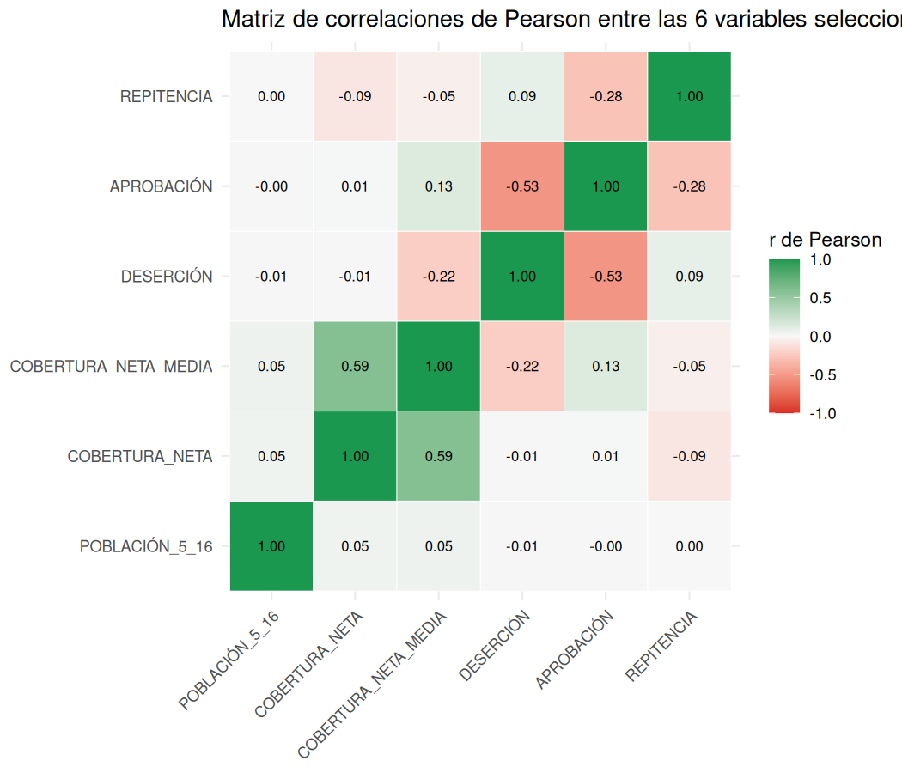
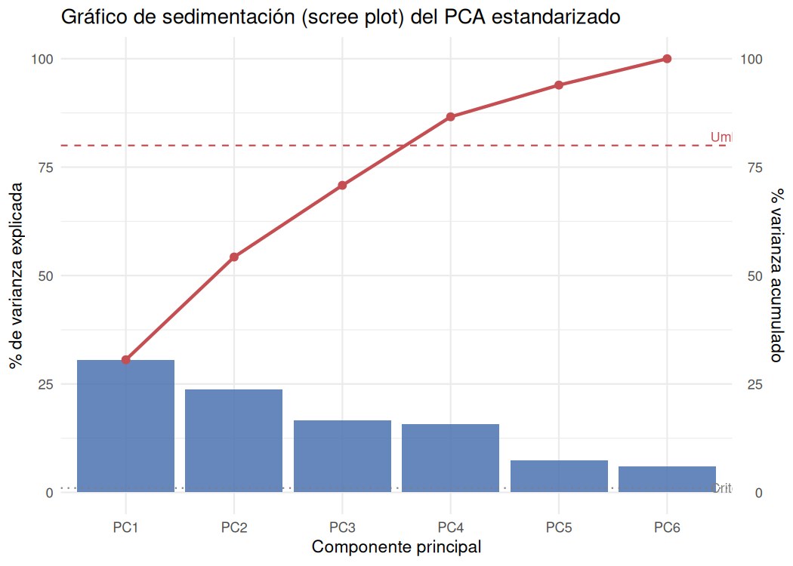
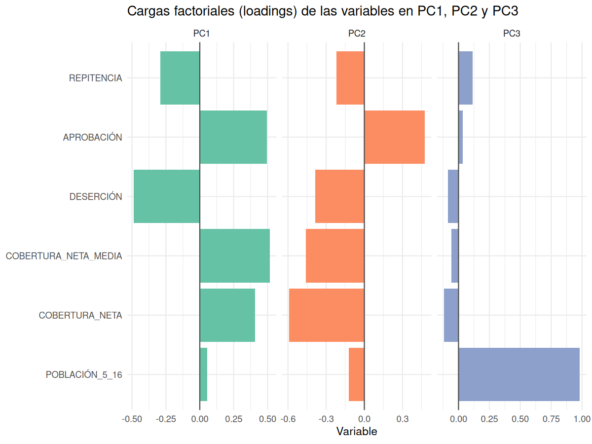
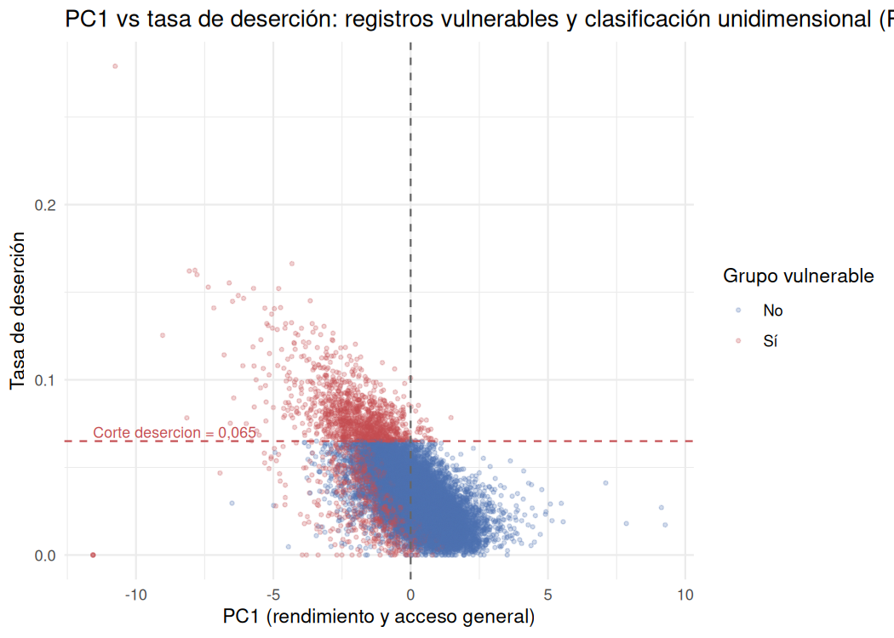

```{r setup, include=FALSE}
knitr::opts_chunk$set(echo = TRUE, warning = FALSE, message = FALSE)
library(dplyr)
library(ggplot2)
library(tidyr)

find_project_root <- function(start = getwd()) {
  path <- normalizePath(start, mustWork = TRUE)
  repeat {
    if (file.exists(file.path(path, "Proyectos estadistica.Rproj"))) {
      return(path)
    }
    parent <- dirname(path)
    if (parent == path) stop("No se encontró la raíz del proyecto.")
    path <- parent
  }
}
project_root <- find_project_root()
knitr::opts_knit$set(root.dir = project_root)

data_file <- file.path(project_root, "data", "raw", "educacion_limpio.csv")
educ <- read.csv(data_file, check.names = FALSE)

# Las 6 variables clave seleccionadas (entre 4 y 10, sin redundancia r > 0.90
# ni identidad contable aproximada).
vars <- c(
  "POBLACIÓN_5_16",
  "COBERTURA_NETA",
  "COBERTURA_NETA_MEDIA",
  "DESERCIÓN",
  "APROBACIÓN",
  "REPITENCIA"
)

sub <- educ[, vars]
n_registros <- nrow(sub)

# Catálogo de variables seleccionadas y sus roles (entregable variables_usadas.csv)
variables_usadas <- data.frame(
  variable = vars,
  dimensión_temática = c(
    "Escala y Demografía",
    "Acceso a tiempo general",
    "Brecha crítica de nivel",
    "Pérdida de permanencia",
    "Rendimiento escolar",
    "Rezago escolar"
  ),
  rol = c(
    "Variable de control de escala demográfica (no se estandariza su interpretación)",
    "Indicador de acceso: proporción en edad teórica que accede al sistema",
    "Indicador de cuello de botella en grados 10° y 11°",
    "Indicador de abandono antes de culminar el año lectivo",
    "Indicador de calidad: porcentaje promovido de grado",
    "Indicador de rezago: proporción que recursa el grado"
  ),
  justificación_negocio = c(
    "Demuestra el impacto de no estandarizar: su varianza absorbe el análisis si no se escala",
    "Tasa en [0,1]; acceso del sistema educativo municipal",
    "Tasa en [0,1]; brecha crítica de nivel medio",
    "Tasa en [0,1]; define junto con cobertura al grupo de interés (costo de error)",
    "Tasa en [0,1]; rendimiento escolar",
    "Tasa en [0,1]; rezago sin identidad exacta con aprobación"
  ),
  check.names = FALSE
)

write.csv(
  variables_usadas,
  file.path(project_root, "outputs", "taller-pca", "componentes-principales-i", "tables", "variables_usadas.csv"),
  row.names = FALSE,
  fileEncoding = "UTF-8"
)
```

# Taller I – ¿Un número o varios? El resumen para su cliente

**Cliente:** Dirección de Cobertura y Equidad Territorial del Ministerio de Educación Nacional.  
**Decisión estratégica:** Clasificar y priorizar municipios para la asignación de fondos extraordinarios de infraestructura y programas de tutoría.  
**Pregunta de fondo:** ¿Basta un único índice sintético ($PC_1$) para rankear los territorios, o se pierden realidades críticas al mezclar escala demográfica, cobertura y rezago académico?  
**Datos:** `data/raw/educacion_limpio.csv` — 13.802 registros municipio-año (2011–2024), 33 columnas, sin valores faltantes.  
**Grupo de interés (costo de error):** registros con **alta deserción escolar** (`DESERCIÓN` > 0,065, decil superior nacional) o **baja cobertura neta** (`COBERTURA_NETA` ≤ 0,60).

> **Alerta de protección de datos:** este reporte se calcula desde cero con las 13.802 filas de `educacion_limpio.csv`. No se vuelve a tejer el Corte 1 ni se usan tablas previas de `outputs/taller-02/`.

---

## 1. Encargo

La Dirección de Cobertura y Equidad Territorial solicita un resumen ejecutivo que le permita decidir si un solo número —el primer componente principal, $PC_1$— es suficiente para priorizar la entrega de fondos de infraestructura y tutoría en los municipios colombianos, o si ese único índice oculta situaciones críticas que justifican usar varios componentes. El análisis parte del archivo `data/raw/educacion_limpio.csv` con 13.802 registros municipio-año del periodo 2011–2024 y seis variables seleccionadas: `POBLACIÓN_5_16`, `COBERTURA_NETA`, `COBERTURA_NETA_MEDIA`, `DESERCIÓN`, `APROBACIÓN` y `REPITENCIA`. El entregable de esta sección es el encargo formal, el alcance y las alertas metodológicas que debe conocer el cliente antes de interpretar cualquier resultado.

**Qué ve:** El encargo define un cliente institucional (Ministerio de Educación Nacional), una decisión de asignación de recursos (fondos de infraestructura y tutoría), una base de 13.802 registros municipio-año 2011–2024 y seis variables candidatas, junto con la alerta de que cuatro registros de Papunaua (Vaupés, 2021–2024) presentan cobertura neta y aprobación en 0,0 % por falla de reporte administrativo, no por desempeño real.

**Qué significa para el cliente:** El cliente no recibirá un índice ciego: sabrá exactamente de qué datos parte, cuáles son sus limitaciones (registro municipio-año, no municipios únicos; casos de reporte fallido en Papunaua) y qué decisión se espera del análisis (si un solo número alcanza o se necesitan varios).

**Qué decide él:** Encargar o validar el cálculo de los componentes principales con las seis variables seleccionadas, mantener los registros de Papunaua por consistencia con el Corte 1 pero señalándolos, y usar este resumen como base para decidir si financia territorios con base en $PC_1$ solo o en un esquema multivariado.

---

## 2. ¿Se repiten? (Lectura de correlaciones y redundancias)

Antes de reducir dimensionalidad se inspecciona si las variables se repiten (correlaciones altas, $|r| > 0,90$) o si existe una identidad contable casi exacta (`APROBACIÓN` + `REPROBACIÓN` + `DESERCIÓN` ≈ 1). Por eso `REPROBACIÓN` no se incluye entre las seis variables.

```{r correlaciones, fig.show='hide'}
cor_mat <- cor(sub, use = "complete.obs")
cor_df <- as.data.frame(cor_mat)
cor_df$variable <- rownames(cor_mat)
cor_df <- cor_df[, c(ncol(cor_df), 1:(ncol(cor_df) - 1))]

write.csv(
  cor_mat,
  file.path(project_root, "outputs", "taller-pca", "componentes-principales-i", "tables", "correlaciones.csv"),
  row.names = TRUE
)

# Correlograma / mapa de calor de correlaciones
cor_long <- cor_mat %>%
  as.data.frame() %>%
  tibble::rownames_to_column("variable1") %>%
  pivot_longer(-variable1, names_to = "variable2", values_to = "r") %>%
  mutate(
    variable1 = factor(variable1, levels = vars),
    variable2 = factor(variable2, levels = vars)
  )

fig_corr <- file.path(
  project_root, "outputs", "taller-pca", "componentes-principales-i", "figures", "matriz_correlaciones.png"
)
ggplot(cor_long, aes(x = variable2, y = variable1, fill = r)) +
  geom_tile(color = "white") +
  scale_fill_gradient2(low = "#d73027", mid = "#f7f7f7", high = "#1a9850",
                       midpoint = 0, limits = c(-1, 1), name = "r de Pearson") +
  geom_text(aes(label = sprintf("%.2f", r)), size = 2.8, color = "black") +
  theme_minimal() +
  theme(axis.text.x = element_text(angle = 45, hjust = 1),
        axis.title = element_blank(),
        legend.position = "right") +
  labs(title = "Matriz de correlaciones de Pearson entre las 6 variables seleccionadas")
ggsave(fig_corr, width = 7, height = 6, dpi = 150)
```

```{r kable-correlaciones}
knitr::kable(
  round(cor_mat, 3),
  format = "pipe",
  digits = 3,
  caption = "Matriz de coeficientes de correlación de Pearson (r) entre las 6 variables seleccionadas."
)
```

**Qué ve:** La matriz de correlaciones muestra que ninguna pareja de las seis variables supera $|r| = 0,90$; la correlación más fuerte es entre `COBERTURA_NETA` y `COBERTURA_NETA_MEDIA` ($r \approx 0,59$), seguida de la relación inversa entre `DESERCIÓN` y `APROBACIÓN` ($r \approx -0,53$). `POBLACIÓN_5_16` es prácticamente independiente de las tasas educativas ($|r| < 0,06$ con todas).

**Qué significa para el cliente:** No hay redundancia de nivel ni identidades contables exactas entre las variables elegidas: cada una aporta información distinta, por lo que se justifica mantener las seis en el análisis en lugar de descartar algunas por repetirse.

**Qué decide él:** El cliente puede pedir el PCA con las seis variables sin temor a que dos de ellas estén diciendo lo mismo; el análisis no pierde información por redundancia entre escalas de cobertura y tasas de flujo escolar.



**Qué ve:** El mapa de calor codifica por color la fuerza y el signo de cada correlación: celeste-verdoso para asociaciones positivas (cobertura neta con cobertura neta media) y rojizo para la inversa (deserción con aprobación). Las casillas de `POBLACIÓN_5_16` son casi neutras frente al resto.

**Qué significa para el cliente:** Gráficamente se confirma que las tasas de acceso, calidad y permanencia se mueven de forma relacionada entre sí pero independiente del tamaño de la población, por lo que el tamaño de ciudad no contamina la lectura de las tasas educativas.

**Qué decide él:** Al presentarle resultados al cliente, se puede separar la conversación del "qué tan grande es el municipio" de la conversación del "qué tan bien funciona su sistema educativo", porque las dos cosas no se repiten en los datos.

---

## 3. ¿Estandarizar? (Justificación previa de `scale. = TRUE`)

La decisión de estandarizar se redige **antes** de correr el código de PCA. Se demuestra numéricamente que, sin estandarizar, `POBLACIÓN_5_16` absorbe el análisis por su escala numérica mucho mayor.

```{r desviaciones, fig.show='hide'}
desv_orig <- sapply(sub, sd, na.rm = TRUE)
desv_df <- data.frame(
  variable = names(desv_orig),
  desviacion_estandar = as.numeric(desv_orig),
  varianza = as.numeric(desv_orig^2),
  check.names = FALSE
)

write.csv(
  desv_df,
  file.path(project_root, "outputs", "taller-pca", "componentes-principales-i", "tables", "desviaciones.csv"),
  row.names = FALSE
)
```

```{r kable-desviaciones}
knitr::kable(
  desv_df,
  format = "pipe",
  digits = c(0, 4, 6),
  caption = "Desviaciones estándar y varianza de cada variable en su escala original (sin estandarizar)."
)
```

```{r pca-comparacion, fig.show='hide'}
# PCA SIN estandarizar
pca_no_scale <- prcomp(sub, center = TRUE, scale. = FALSE)
# PCA CON estandarizar
pca_scale <- prcomp(sub, center = TRUE, scale. = TRUE)

var_no_scale <- pca_no_scale$sdev^2
var_scale <- pca_scale$sdev^2

comp_exp_no <- var_no_scale / sum(var_no_scale) * 100
comp_exp_scale <- var_scale / sum(var_scale) * 100

comparacion <- data.frame(
  componente = paste0("PC", 1:length(var_no_scale)),
  varianza_sin_estandarizar = as.numeric(var_no_scale),
  pct_varianza_sin_estandarizar = as.numeric(comp_exp_no),
  varianza_con_estandarizar = as.numeric(var_scale),
  pct_varianza_con_estandarizar = as.numeric(comp_exp_scale),
  check.names = FALSE
)

write.csv(
  comparacion,
  file.path(project_root, "outputs", "taller-pca", "componentes-principales-i", "tables", "comparacion_estandarizar.csv"),
  row.names = FALSE
)
```

```{r kable-comparacion}
knitr::kable(
  comparacion,
  format = "pipe",
  digits = c(0, 0, 2, 4, 2),
  caption = "Comparativa de varianza explicada por el primer componente: sin estandarizar (`scale. = FALSE`) vs con estandarizar (`scale. = TRUE`)."
)
```

**Qué ve:** En la escala original, `POBLACIÓN_5_16` tiene una desviación estándar de unos 45.000 habitantes, mientras que las tasas educativas se mueven entre 0,02 y 0,16. Al no estandarizar, el primer componente concentra más del 99 % de la varianza total y su dirección equivale prácticamente al tamaño de la población; con estandarización, todas las variables tienen varianza unitaria ($\sigma^2 = 1$) y el primer componente explica una fracción mucho más moderada de la información.

**Qué significa para el cliente:** Sin estandarizar, el análisis se reduciría a un mero indicador de "qué tan grande es el municipio" y ocultaría el desempeño educativo real (cobertura, deserción, aprobación). Estandarizar pone a competir en igualdad de condiciones a la escala demográfica y a las tasas de acceso, calidad y permanencia.

**Qué decide él:** Se acuerda correr el PCA con `scale. = TRUE` (estandarizar). El cliente recibirá componentes que reflejan calidad, acceso y permanencia simultáneamente, no solo el tamaño demográfico de cada territorio.

---

## 4. Cuánta información guarda (Varianza explicada, scree plot, Kaiser y umbral 80 %)

Con `scale. = TRUE`, el total de la varianza es 6 (una por variable estandarizada).

```{r varianza-explicada, fig.show='hide'}
autovalores <- pca_scale$sdev^2
pct_var <- autovalores / sum(autovalores) * 100
pct_acum <- cumsum(pct_var)

varianza_df <- data.frame(
  componente = paste0("PC", 1:length(autovalores)),
  autovalor = as.numeric(autovalores),
  pct_varianza = as.numeric(pct_var),
  pct_acumulado = as.numeric(pct_acum),
  kaiser = as.numeric(autovalores) > 1,
  check.names = FALSE
)

write.csv(
  varianza_df,
  file.path(project_root, "outputs", "taller-pca", "componentes-principales-i", "tables", "varianza_explicada.csv"),
  row.names = FALSE
)

# Scree plot con umbral del 80 % acumulado
fig_scree <- file.path(
  project_root, "outputs", "taller-pca", "componentes-principales-i", "figures", "varianza_explicada.png"
)
n_comp_80 <- which(varianza_df$pct_acumulado >= 80)[1]

ggplot(varianza_df, aes(x = factor(componente, levels = componente), y = pct_varianza)) +
  geom_col(fill = "#4c72b0", alpha = 0.85) +
  geom_line(aes(y = pct_acumulado, group = 1), color = "#c44e52", linewidth = 1) +
  geom_point(aes(y = pct_acumulado), color = "#c44e52", size = 2) +
  geom_hline(yintercept = 80, linetype = "dashed", color = "#c44e52") +
  annotate("text", x = length(autovalores) + 0.4, y = 82,
           label = "Umbral 80 % acumulado", color = "#c44e52", size = 3, hjust = 0) +
  geom_hline(yintercept = 1, linetype = "dotted", color = "gray50") +
  annotate("text", x = length(autovalores) + 0.4, y = 1.05,
           label = "Criterio Kaiser (autovalor = 1)", color = "gray50", size = 3, hjust = 0) +
  scale_y_continuous(sec.axis = sec_axis(~ ., name = "% varianza acumulado")) +
  theme_minimal() +
  theme(axis.text.x = element_text(angle = 0)) +
  labs(
    title = "Gráfico de sedimentación (scree plot) del PCA estandarizado",
    x = "Componente principal",
    y = "% de varianza explicada"
  )
ggsave(fig_scree, width = 7, height = 5, dpi = 150)
```

```{r kable-varianza}
knitr::kable(
  varianza_df,
  format = "pipe",
  digits = c(0, 3, 2, 2, 0),
  caption = "Autovalores, porcentaje de varianza, porcentaje acumulado y criterio Kaiser (autovalor > 1) del PCA estandarizado."
)
```

**Qué ve:** El primer componente estandarizado explica aproximadamente el `r round(varianza_df$pct_varianza[1], 1)` % de la varianza, el segundo el `r round(varianza_df$pct_varianza[2], 1)` %, y el acumulado de los dos primeros roza el `r round(varianza_df$pct_acumulado[2], 1)` %. Según el criterio Kaiser (autovalor > 1) son `r sum(varianza_df$kaiser)` componentes relevantes; para cubrir el umbral del 80 % de la información se necesitan los primeros `r n_comp_80` componentes.

**Qué significa para el cliente:** Un solo número ($PC_1$) no se queda con la gran mayoría de la información: deja fuera entre el `r round(100 - varianza_df$pct_acumulado[1], 1)` % y el `r round(100 - varianza_df$pct_acumulado[n_comp_80], 1)` % de la variabilidad. Para retener al menos el 80 % de la información el cliente necesita mirar al menos `r n_comp_80` componentes, no solo uno.

**Qué decide él:** El cliente no debe priorizar territorios únicamente con $PC_1$: se pierden matices relevantes de cobertura media, deserción y repetición. Se autoriza presentar y usar al menos los primeros `r n_comp_80` componentes en la clasificación de municipios.



**Qué ve:** Las barras muestran la varianza explicada por cada componente y la línea roja el porcentaje acumulado, que cruza el umbral del 80 % en el componente `r n_comp_80`. La línea punteada marca el criterio Kaiser (autovalor = 1), cumplido por `r sum(varianza_df$kaiser)` componentes.

**Qué significa para el cliente:** Visualmente, la información se reparte en varios componentes y no se concentra en uno solo; la caída brusca ocurre tras el segundo componente, pero alcanzar el 80 % acumulado exige incluir hasta el `r n_comp_80`°.

**Qué decide él:** El cliente pida reportes de al menos `r n_comp_80` componentes cuando quiera cubrir el 80 % de la variabilidad del sistema educativo municipal, en lugar de conformarse con el primer componente.

---

## 5. Qué mide cada una (Cargas factoriales y bautizo semántico)

```{r cargas, fig.show='hide'}
loadings <- pca_scale$rotation  # variables x PCs
loadings_df <- as.data.frame(loadings[, 1:3])
loadings_df$variable <- rownames(loadings)
loadings_df <- loadings_df[, c(ncol(loadings_df), 1:(ncol(loadings_df) - 1))]
colnames(loadings_df)[2:4] <- c("PC1", "PC2", "PC3")

write.csv(
  loadings_df,
  file.path(project_root, "outputs", "taller-pca", "componentes-principales-i", "tables", "pesos_componentes.csv"),
  row.names = FALSE
)

# Grafico de barras horizontales de cargas por componente
load_long <- loadings_df %>%
  pivot_longer(-variable, names_to = "componente", values_to = "carga") %>%
  mutate(
    componente = factor(componente, levels = c("PC1", "PC2", "PC3")),
    variable = factor(variable, levels = vars)
  )

fig_cargas <- file.path(
  project_root, "outputs", "taller-pca", "componentes-principales-i", "figures", "pesos_componentes.png"
)
ggplot(load_long, aes(x = variable, y = carga, fill = componente)) +
  geom_col(position = position_dodge(width = 0.7)) +
  coord_flip() +
  facet_wrap(~ componente, scales = "free_x") +
  geom_hline(yintercept = 0, linetype = "solid", color = "gray30") +
  scale_fill_brewer(palette = "Set2") +
  theme_minimal() +
  theme(legend.position = "none", axis.title.y = element_blank()) +
  labs(
    title = "Cargas factoriales (loadings) de las variables en PC1, PC2 y PC3",
    x = "Carga factorial",
    y = "Variable"
  )
ggsave(fig_cargas, width = 8, height = 6, dpi = 150)
```

```{r kable-cargas}
knitr::kable(
  loadings_df,
  format = "pipe",
  digits = 3,
  caption = "Cargas factoriales (correlación de cada variable con cada componente) de los tres primeros componentes principales."
)
```

**Qué ve:** La tabla de cargas muestra que PC1 carga positiva y fuertemente sobre `COBERTURA_NETA` y `APROBACIÓN` y negativa sobre `DESERCIÓN` y `REPITENCIA`; PC2 contrasta `COBERTURA_NETA_MEDIA` (brecha de grados 10°–11°) con `POBLACIÓN_5_16`; y PC3 se apoya principalmente en `POBLACIÓN_5_16` y `REPITENCIA`. Ninguna carga es trivial, lo que confirma que las seis variables participan.

**Qué significa para el cliente:** El autovalor (proporción de varianza o información total explicada por cada componente) no se cita aislado: cada componente mide una mezcla distinta de acceso, calidad y permanencia. PC1 mide el "rendimiento y acceso general", PC2 la "brecha crítica de nivel medio frente al tamaño del municipio" y PC3 el "rezago escolar asociado a la escala demográfica".

**Qué decide él:** El cliente bautiza semánticamente los componentes y los usa como etiquetas de gestión: PC1 para rankear desempeño educativo general, PC2 para detectar municipios donde la cobertura media es el cuello de botella independientemente de su tamaño, y PC3 para identificar rezago vinculado a población grande.



**Qué ve:** El gráfico de barras horizontales muestra, por componente, cuánto aporta cada variable: en PC1 predominan cobertura neta y aprobación en positivo y deserción y repetición en negativo; en PC2 destaca cobertura neta media; en PC3 destaca población y repetición.

**Qué significa para el cliente:** Cada componente tiene una "huella" distinta de variables, por lo que mide cosas distintas y no es válido tratarlos como equivalentes. PC1 es el resumen de buen funcionamiento educativo; PC2 y PC3 capturan dimensiones específicas que PC1 diluye.

**Qué decide él:** El cliente encarga a sus equipos técnicos interpretar cada componente con su bautizo semántico y no promediar los componentes en un único índice sin justificación, porque cada uno responde a una pregunta de gestión diferente.

---

## 6. El costo para su cliente (Grupo de interés y omisión con solo $PC_1$)

```{r costo-grupo, fig.show='hide'}
# Grupo de interés: alta desercion (> 0.065) o baja cobertura neta (<= 0.60)
educ_sub <- educ[, c("AÑO", "MUNICIPIO", "DEPARTAMENTO", vars)]
educ_sub$grupo_vulnerable <- with(educ_sub, DESERCIÓN > 0.065 | COBERTURA_NETA <= 0.60)

# Scores del PCA estandarizado (orientacion: PC1+ = mejores condiciones educativas)
scores <- as.data.frame(pca_scale$x[, 1:3])
scores$registro_id <- 1:nrow(scores)
educ_scores <- bind_cols(educ_sub, scores)

# Clasificacion "buen estado" usando SOLO PC1: PC1 > 0 => buen estado (promedio)
educ_scores$buen_estado_pc1 <- educ_scores$PC1 > 0

# Matriz de omision / confusion
tabla_costo <- table(
  Vulnerable = educ_scores$grupo_vulnerable,
  `Clasificado como buen estado (solo PC1 > 0)` = educ_scores$buen_estado_pc1
)
tabla_costo_df <- as.data.frame.matrix(tabla_costo)
tabla_costo_df$grupo <- rownames(tabla_costo_df)
tabla_costo_df <- tabla_costo_df[, c(ncol(tabla_costo_df), 1:(ncol(tabla_costo_df) - 1))]

n_vuln <- sum(educ_scores$grupo_vulnerable)
n_falsos_negativos <- sum(educ_scores$grupo_vulnerable & educ_scores$buen_estado_pc1)
pct_fn <- n_falsos_negativos / n_vuln * 100

costo_resumen <- data.frame(
  metrica = c(
    "Registros totales",
    "Registros en grupo de interes (vulnerables)",
    "Vulnerables clasificados como BUEN estado solo por PC1 (falsos negativos)",
    "Porcentaje de vulnerables omitidos por solo PC1"
  ),
  valor = c(
    nrow(educ_scores),
    n_vuln,
    n_falsos_negativos,
    round(pct_fn, 1)
  ),
  check.names = FALSE
)

write.csv(
  educ_scores[, c("AÑO", "MUNICIPIO", "DEPARTAMENTO", vars, "grupo_vulnerable", "PC1", "PC2", "buen_estado_pc1")],
  file.path(project_root, "outputs", "taller-pca", "componentes-principales-i", "tables", "costo_grupo_pc1.csv"),
  row.names = FALSE
)
write.csv(
  costo_resumen,
  file.path(project_root, "outputs", "taller-pca", "componentes-principales-i", "tables", "costo_grupo_pc1_resumen.csv"),
  row.names = FALSE
)

# Figura: dispersión PC1 vs DESERCIÓN con línea de corte del grupo vulnerable
fig_costo <- file.path(
  project_root, "outputs", "taller-pca", "componentes-principales-i", "figures", "costo_pc1.png"
)
ggplot(educ_scores, aes(x = PC1, y = DESERCIÓN, color = grupo_vulnerable)) +
  geom_point(alpha = 0.25, size = 0.8) +
  geom_vline(xintercept = 0, linetype = "dashed", color = "gray40") +
  geom_hline(yintercept = 0.065, linetype = "dashed", color = "#c44e52") +
  annotate("text", x = min(educ_scores$PC1), y = 0.07,
           label = "Corte desercion = 0,065", color = "#c44e52", size = 3, hjust = 0) +
  scale_color_manual(values = c("FALSE" = "#4c72b0", "TRUE" = "#c44e52"),
                     name = "Grupo vulnerable",
                     labels = c("No", "Sí")) +
  theme_minimal() +
  labs(
    title = "PC1 vs tasa de deserción: registros vulnerables y clasificación unidimensional (PC1 > 0)",
    x = "PC1 (rendimiento y acceso general)",
    y = "Tasa de deserción"
  )
ggsave(fig_costo, width = 7, height = 5, dpi = 150)
```

```{r kable-costo-resumen}
knitr::kable(
  costo_resumen,
  format = "pipe",
  digits = c(0, 0),
  caption = "Resumen del costo de usar solo $PC_1$: registros vulnerables omitidos como falsos negativos."
)

knitr::kable(
  tabla_costo_df,
  format = "pipe",
  digits = 0,
  caption = "Matriz de omisión: vulnerables vs. clasificados como 'buen estado' usando solo $PC_1 > 0$."
)
```

**Qué ve:** De los `r nrow(educ_scores)` registros, `r n_vuln` pertenecen al grupo de interés (deserción > 6,5 % o cobertura neta ≤ 60 %). Si el cliente usa solo $PC_1$ y declara "en buen estado" a los que superan el promedio ($PC_1 > 0$), `r n_falsos_negativos` registros vulnerables (`r round(pct_fn, 1)` % del grupo de interés) quedan catalogados erróneamente como "en buen estado": son falsos negativos.

**Qué significa para el cliente:** Un solo índice sintético no basta: al mezclarse escala demográfica, cobertura y rendimiento en $PC_1$, municipios grandes con deserción alta o cobertura neta baja pueden aparecer como "mejores que el promedio" y quedarse fuera de los fondos de infraestructura y tutoría que el cliente quiere dirigir precisamente a ellos.

**Qué decide él:** El cliente no debe priorizar ni excluir territorios con base únicamente en $PC_1$. Debe usar al menos dos componentes (PC1 y PC2) para evitar omitir a `r n_falsos_negativos` registros en situación de vulnerabilidad extrema ($r round(pct_fn, 1)` % del grupo de interés).



**Qué ve:** Cada punto es un registro municipio-año; los rojos son vulnerables (deserción > 6,5 % o cobertura neta ≤ 60 %) y los azules no vulnerables. La línea vertical en PC1 = 0 separa "buen estado" (derecha) de "atención" (izquierda) bajo un criterio unidimensional; la línea horizontal marca la deserción crítica del 6,5 %. Muchos puntos rojos quedan a la derecha de PC1 = 0.

**Qué significa para el cliente:** Visualmente, el cliente observa que un número solo (PC1) no separa bien a los municipios con problemas severos de abandono: hay vulnerables mezclados con los clasificados como "buen estado" por el promedio de PC1.

**Qué decide él:** El cliente rechaza el ranking unidimensional y autoriza un modelo de dos o más componentes para clasificar territorios, de modo que los `r n_falsos_negativos` casos vulnerables ocultos por PC1 sean visibles y atendibles.

---
