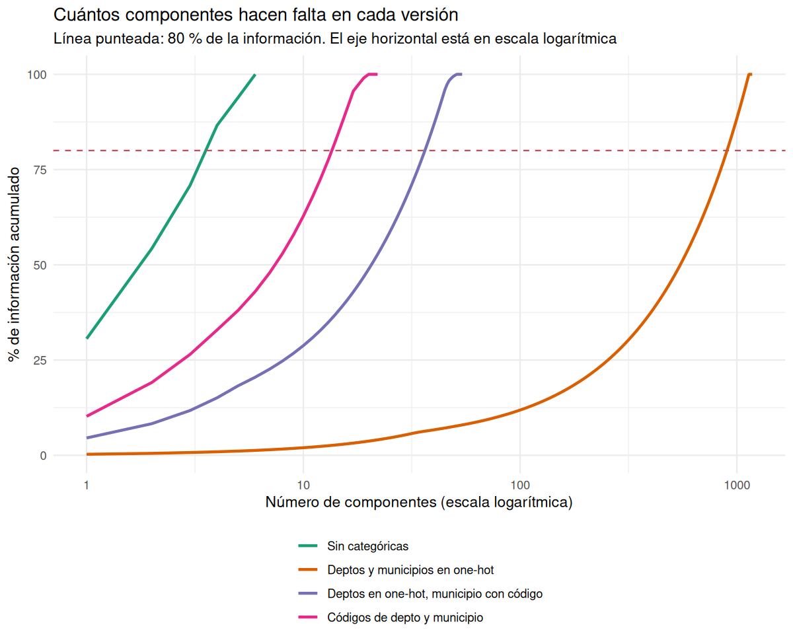

## Ficha técnica del caso

**Cliente:** Dirección de Cobertura y Equidad Territorial del Ministerio de Educación Nacional.  
**Decisión estratégica:** Clasificar y priorizar municipios para la asignación de fondos extraordinarios de infraestructura y programas de tutoría.  
**Pregunta de fondo:** ¿Basta un único índice sintético ($PC_1$) para rankear los territorios, o se pierden realidades críticas, como un municipio con buen acceso y mala permanencia, o el tamaño del municipio?  
**Datos:** `data/raw/educacion_limpio.csv` — 13.802 registros municipio-año (2011–2024), 33 columnas, sin valores faltantes.  
**Grupo de interés (costo de error):** registros con **alta deserción escolar** (`DESERCIÓN` > 0,065, que deja al 8,3 % de los registros con mayor deserción) o **baja cobertura neta** (`COBERTURA_NETA` ≤ 0,60).

---

## 1. Encargo

La Dirección de Cobertura y Equidad Territorial solicita un resumen ejecutivo que le permita decidir si un solo número —el primer componente principal, $PC_1$— es suficiente para priorizar la entrega de fondos de infraestructura y tutoría en los municipios colombianos, o si ese único índice oculta situaciones críticas que justifican usar varios componentes. El análisis parte del archivo `data/raw/educacion_limpio.csv` con 13.802 registros municipio-año del periodo 2011–2024 y seis variables seleccionadas: `POBLACIÓN_5_16`, `COBERTURA_NETA`, `COBERTURA_NETA_MEDIA`, `DESERCIÓN`, `APROBACIÓN` y `REPITENCIA`. El entregable de esta sección es el encargo formal, el alcance y las alertas metodológicas que debe conocer el cliente antes de interpretar cualquier resultado.

**Con qué decide hoy:** el cliente revisa por separado la cobertura, la deserción, la aprobación y la repitencia de cada municipio, además del tamaño de su población.

**Por qué estas seis variables:** de las 30 numéricas del Corte 1 se eligieron seis, una por dimensión de la decisión (tamaño, acceso, acceso en media, permanencia, rendimiento y rezago). Se dejaron fuera las que repetirían lo mismo: la tasa de matriculación y la cobertura bruta (r de 0,90 y 0,92 con la cobertura neta), las versiones por nivel de cada tasa (r hasta 0,93 con su indicador general) y la reprobación, que junto con la aprobación y la deserción suma cerca de 1.


``` r
knitr::kable(
  variables_usadas[, c("variable", "dimensión_temática", "rol", "justificación_negocio")],
  col.names = c("Variable", "Dimensión", "Qué mide", "Por qué está"),
  format = "pipe",
  caption = "Variables seleccionadas y razón de su inclusión."
)
```


Table: Variables seleccionadas y razón de su inclusión.

|Variable             |Dimensión                          |Qué mide                                                                                       |Por qué está                                                                                                                                                             |
|:--------------------|:----------------------------------|:----------------------------------------------------------------------------------------------|:------------------------------------------------------------------------------------------------------------------------------------------------------------------------|
|POBLACIÓN_5_16       |Tamaño del municipio               |Población de 5 a 16 años: cuántos niños y jóvenes hay en edad escolar                          |Separa municipios grandes de pequeños. Es la única variable en conteo y no en tasa, por eso obliga a estandarizar (punto 3).                                             |
|COBERTURA_NETA       |Acceso                             |Proporción de la población en edad escolar que está matriculada en el nivel que le corresponde |Dice si los niños entran al sistema. Con la deserción define el grupo de interés (punto 6). Se eligió en lugar de la matriculación y la cobertura bruta, que la repiten. |
|COBERTURA_NETA_MEDIA |Acceso en media (grados 10° y 11°) |Lo mismo, pero solo para la educación media, el último tramo del ciclo escolar                 |Dice si el acceso se sostiene hasta el final. Su correlación con la cobertura neta es 0,59: se parecen, pero no son lo mismo.                                            |
|DESERCIÓN            |Permanencia                        |Proporción de estudiantes que abandona antes de terminar el año                                |Dice si los que entran se quedan. Con la cobertura define el grupo de interés (punto 6).                                                                                 |
|APROBACIÓN           |Rendimiento                        |Proporción de estudiantes que es promovida al grado siguiente                                  |Dice cuántos avanzan. Reemplaza a la reprobación, que con aprobación y deserción suma cerca de 1.                                                                        |
|REPITENCIA           |Rezago                             |Proporción de estudiantes que repite el grado                                                  |Mide el rezago que acumula el sistema. Es distinta de la aprobación (r = -0,28), no una identidad con ella.                                                              |

**Qué ve:** Un cliente institucional (Ministerio de Educación Nacional) que decide a quién dirigir fondos extraordinarios de infraestructura y tutoría, 13.802 registros municipio-año de 2011 a 2024 y seis variables, una por dimensión de esa decisión, elegidas de forma que ninguna repita a otra.

**Qué significa para el cliente:** Sabe de qué datos parte y por qué cada variable está en el análisis. También sabe que cada «caso» es un municipio en un año, no un municipio único, y que un mismo municipio puede aparecer varias veces.

**Qué decide él:** Si basta un solo número para priorizar municipios o si necesita reportar varios.

---

## 2. ¿Se repiten? (Lectura de correlaciones y redundancias)

Antes de reducir dimensionalidad se inspecciona si las variables se repiten (correlaciones altas, $|r| > 0,90$) o si existe una identidad contable casi exacta (`APROBACIÓN` + `REPROBACIÓN` + `DESERCIÓN` ≈ 1). Por eso `REPROBACIÓN` no se incluye entre las seis variables.


``` r
cor_mat <- cor(sub, use = "complete.obs")
cor_df <- as.data.frame(cor_mat)
cor_df$variable <- rownames(cor_mat)
cor_df <- cor_df[, c(ncol(cor_df), 1:(ncol(cor_df) - 1))]

write.csv(
  cor_mat,
  file.path(dir_tablas, "correlaciones.csv"),
  row.names = TRUE
)

# Correlograma / mapa de calor de correlaciones
cor_long <- cor_mat %>%
  as.data.frame() %>%
  tibble::rownames_to_column("variable1") %>%
  pivot_longer(-variable1, names_to = "variable2", values_to = "r") %>%
  mutate(
    variable1 = factor(variable1, levels = vars),
    variable2 = factor(variable2, levels = vars)
  )

fig_corr <- file.path(dir_figuras, "matriz_correlaciones.png")
ggplot(cor_long, aes(x = variable2, y = variable1, fill = r)) +
  geom_tile(color = "white") +
  scale_fill_gradient2(low = "#d73027", mid = "#f7f7f7", high = "#1a9850",
                       midpoint = 0, limits = c(-1, 1), name = "r de Pearson") +
  geom_text(aes(label = sprintf("%.2f", r)), size = 2.8, color = "black") +
  theme_minimal() +
  theme(axis.text.x = element_text(angle = 45, hjust = 1),
        axis.title = element_blank(),
        legend.position = "right") +
  labs(title = "Matriz de correlaciones de Pearson entre las 6 variables seleccionadas")
```

``` r
ggsave(fig_corr, width = 7, height = 6, dpi = 150)
```


``` r
knitr::kable(
  round(cor_mat, 3),
  format = "pipe",
  digits = 3,
  caption = "Matriz de coeficientes de correlación de Pearson (r) entre las 6 variables seleccionadas."
)
```


Table: Matriz de coeficientes de correlación de Pearson (r) entre las 6 variables seleccionadas.

|                     | POBLACIÓN_5_16| COBERTURA_NETA| COBERTURA_NETA_MEDIA| DESERCIÓN| APROBACIÓN| REPITENCIA|
|:--------------------|--------------:|--------------:|--------------------:|---------:|----------:|----------:|
|POBLACIÓN_5_16       |          1.000|          0.046|                0.053|    -0.006|     -0.004|      0.002|
|COBERTURA_NETA       |          0.046|          1.000|                0.587|    -0.005|      0.008|     -0.094|
|COBERTURA_NETA_MEDIA |          0.053|          0.587|                1.000|    -0.225|      0.134|     -0.045|
|DESERCIÓN            |         -0.006|         -0.005|               -0.225|     1.000|     -0.530|      0.087|
|APROBACIÓN           |         -0.004|          0.008|                0.134|    -0.530|      1.000|     -0.284|
|REPITENCIA           |          0.002|         -0.094|               -0.045|     0.087|     -0.284|      1.000|


**Qué ve:** Ninguna pareja de las seis variables llega a $|r| = 0,90$ y solo dos superan $|r| = 0,5$: `COBERTURA_NETA` con `COBERTURA_NETA_MEDIA` ($r = 0,59$) y `DESERCIÓN` con `APROBACIÓN` ($r = -0,53$). Las demás son débiles. Las que más se repiten son las dos coberturas y, por otro lado, la deserción con la aprobación; la que va más sola es `POBLACIÓN_5_16`, que no se relaciona con ninguna tasa ($|r| \leq 0,06$), lo que en el mapa se ve como una fila y una columna casi blancas.

**Qué significa para el cliente:** Las seis variables no cuentan la misma historia: solo dos pares se parecen, así que no se puede descartar ninguna por repetida, y tampoco se debe esperar que un único número las resuma bien. Resumir tiene sentido solo en parte: se pueden juntar los dos tipos de cobertura y la deserción con la aprobación, pero el tamaño del municipio y la repitencia quedan aparte.

**Qué decide él:** Puede pedir el análisis con las seis variables, sabiendo que el resumen va a perder bastante; cuánto, se mide en el punto 4.

---

## 3. ¿Estandarizar? (Justificación previa de `scale. = TRUE`)

**Decisión:** se estandariza (`scale. = TRUE`). `POBLACIÓN_5_16` se mide en miles de habitantes y las demás variables en tasas entre 0 y 1; el PCA reparte varianza, y sin estandarizar la variable con números grandes se queda con toda. Abajo se comprueba que la decisión era necesaria.


``` r
desv_orig <- sapply(sub, sd, na.rm = TRUE)
desv_df <- data.frame(
  variable = names(desv_orig),
  desviacion_estandar = as.numeric(desv_orig),
  varianza = as.numeric(desv_orig^2),
  check.names = FALSE
)

write.csv(
  desv_df,
  file.path(dir_tablas, "desviaciones.csv"),
  row.names = FALSE
)
```


``` r
knitr::kable(
  desv_df,
  format = "pipe",
  digits = c(0, 4, 6),
  caption = "Desviaciones estándar y varianza de cada variable en su escala original (sin estandarizar)."
)
```


Table: Desviaciones estándar y varianza de cada variable en su escala original (sin estandarizar).

|variable             | desviacion_estandar|    varianza|
|:--------------------|-------------------:|-----------:|
|POBLACIÓN_5_16       |          45008.4417| 2.02576e+09|
|COBERTURA_NETA       |              0.1644| 2.70320e-02|
|COBERTURA_NETA_MEDIA |              0.1522| 2.31730e-02|
|DESERCIÓN            |              0.0207| 4.29000e-04|
|APROBACIÓN           |              0.0493| 2.43000e-03|
|REPITENCIA           |              0.0369| 1.36400e-03|


``` r
# PCA SIN estandarizar
pca_no_scale <- prcomp(sub, center = TRUE, scale. = FALSE)
# PCA CON estandarizar
pca_scale <- prcomp(sub, center = TRUE, scale. = TRUE)

var_no_scale <- pca_no_scale$sdev^2
var_scale <- pca_scale$sdev^2

comp_exp_no <- var_no_scale / sum(var_no_scale) * 100
comp_exp_scale <- var_scale / sum(var_scale) * 100
pct_var_scale1 <- comp_exp_scale[1]

comparacion <- data.frame(
  componente = paste0("PC", 1:length(var_no_scale)),
  varianza_sin_estandarizar = as.numeric(var_no_scale),
  pct_varianza_sin_estandarizar = as.numeric(comp_exp_no),
  varianza_con_estandarizar = as.numeric(var_scale),
  pct_varianza_con_estandarizar = as.numeric(comp_exp_scale),
  check.names = FALSE
)

write.csv(
  comparacion,
  file.path(dir_tablas, "comparacion_estandarizar.csv"),
  row.names = FALSE
)
```


``` r
comparacion_tab <- data.frame(
  componente = comparacion$componente,
  `varianza sin estandarizar` = formatC(comparacion$varianza_sin_estandarizar, format = "e", digits = 2),
  `% sin estandarizar` = formatC(comparacion$pct_varianza_sin_estandarizar, format = "e", digits = 2),
  `varianza estandarizada` = round(comparacion$varianza_con_estandarizar, 3),
  `% estandarizado` = round(comparacion$pct_varianza_con_estandarizar, 2),
  check.names = FALSE
)
knitr::kable(
  comparacion_tab,
  format = "pipe",
  align = "lrrrr",
  caption = "Varianza de cada componente sin estandarizar (`scale. = FALSE`) y estandarizado (`scale. = TRUE`)."
)
```


Table: Varianza de cada componente sin estandarizar (`scale. = FALSE`) y estandarizado (`scale. = TRUE`).

|componente | varianza sin estandarizar| % sin estandarizar| varianza estandarizada| % estandarizado|
|:----------|-------------------------:|------------------:|----------------------:|---------------:|
|PC1        |                  2.03e+09|           1.00e+02|                  1.835|           30.58|
|PC2        |                  3.98e-02|           1.97e-09|                  1.422|           23.69|
|PC3        |                  1.04e-02|           5.13e-10|                  0.992|           16.53|
|PC4        |                  2.67e-03|           1.32e-10|                  0.948|           15.80|
|PC5        |                  1.15e-03|           5.67e-11|                  0.439|            7.32|
|PC6        |                  2.76e-04|           1.36e-11|                  0.365|            6.08|

**Qué ve:** En la escala original, `POBLACIÓN_5_16` tiene una desviación estándar de unos 45.000 habitantes y las tasas se mueven entre 0,02 y 0,16. Sin estandarizar, el primer componente se queda con prácticamente el 100 % de la varianza y apunta solo a la población; los otros cinco componentes quedan en cero. Con estandarización, cada variable pesa lo mismo y el primer componente explica el 30,6 %.

**Qué significa para el cliente:** Sin estandarizar, el análisis sería una forma complicada de ordenar municipios por tamaño y no diría nada de cobertura, deserción o aprobación. Estandarizar hace que el tamaño del municipio compita en igualdad de condiciones con las tasas educativas.

**Qué decide él:** Se corre el PCA con `scale. = TRUE`. Los componentes que reciba reflejan el desempeño educativo y no el tamaño demográfico.

---

## 4. Cuánta información guarda (Varianza explicada, scree plot, Kaiser y umbral 80 %)

El **autovalor** de un componente mide cuánta información concentra. Con seis variables estandarizadas, el total es 6 y cada variable original aporta 1; por eso un componente con autovalor menor que 1 resume menos que una variable suelta (criterio de Kaiser).


``` r
autovalores <- pca_scale$sdev^2
pct_var <- autovalores / sum(autovalores) * 100
pct_acum <- cumsum(pct_var)

varianza_df <- data.frame(
  componente = paste0("PC", 1:length(autovalores)),
  autovalor = as.numeric(autovalores),
  pct_varianza = as.numeric(pct_var),
  pct_acumulado = as.numeric(pct_acum),
  kaiser = as.numeric(autovalores) > 1,
  check.names = FALSE
)

write.csv(
  varianza_df,
  file.path(dir_tablas, "varianza_explicada.csv"),
  row.names = FALSE
)

# Scree plot con umbral del 80 % acumulado
fig_scree <- file.path(dir_figuras, "varianza_explicada.png")
n_comp_80 <- which(varianza_df$pct_acumulado >= 80)[1]

ggplot(varianza_df, aes(x = factor(componente, levels = componente), y = pct_varianza)) +
  geom_col(fill = "#4c72b0", alpha = 0.85) +
  geom_line(aes(y = pct_acumulado, group = 1), color = "#c44e52", linewidth = 1) +
  geom_point(aes(y = pct_acumulado), color = "#c44e52", size = 2) +
  geom_hline(yintercept = 80, linetype = "dashed", color = "#c44e52") +
  annotate("text", x = length(autovalores) + 0.4, y = 76, hjust = 1,
           label = "Umbral 80 % acumulado", color = "#c44e52", size = 3) +
  geom_hline(yintercept = 100 / length(autovalores), linetype = "dotted", color = "gray40") +
  annotate("text", x = length(autovalores) + 0.4, y = 100 / length(autovalores) + 3, hjust = 1,
           label = "Kaiser: autovalor = 1 (16,7 %)", color = "gray40", size = 3) +
  theme_minimal() +
  theme(axis.text.x = element_text(angle = 0)) +
  labs(
    title = "Gráfico de sedimentación (scree plot) del PCA estandarizado",
    x = "Componente principal",
    subtitle = "Barras: % de varianza de cada componente. Línea roja: % acumulado",
    y = "% de varianza"
  )
```

``` r
ggsave(fig_scree, width = 7, height = 5, dpi = 150)
```


``` r
knitr::kable(
  varianza_df,
  format = "pipe",
  digits = c(0, 3, 2, 2, 0),
  caption = "Autovalores, porcentaje de varianza, porcentaje acumulado y criterio Kaiser (autovalor > 1) del PCA estandarizado."
)
```


Table: Autovalores, porcentaje de varianza, porcentaje acumulado y criterio Kaiser (autovalor > 1) del PCA estandarizado.

|componente | autovalor| pct_varianza| pct_acumulado|kaiser |
|:----------|---------:|------------:|-------------:|:------|
|PC1        |     1.835|        30.58|         30.58|TRUE   |
|PC2        |     1.422|        23.69|         54.28|TRUE   |
|PC3        |     0.992|        16.53|         70.81|FALSE  |
|PC4        |     0.948|        15.80|         86.60|FALSE  |
|PC5        |     0.439|         7.32|         93.92|FALSE  |
|PC6        |     0.365|         6.08|        100.00|FALSE  |


**Qué ve:** El primer componente explica el 30,6 % de la varianza y el segundo el 23,7 %; juntos suman 54,3 %. El criterio de Kaiser retiene 2 componentes, aunque el tercero (autovalor 0,992) queda a un paso de la línea. Para llegar al 80 % hacen falta 4 componentes (86,6 %); con tres solo se llega a 70,8 %. En el gráfico, las cuatro primeras barras son parecidas (entre 15 % y 31 %) y la mayor caída está entre el cuarto y el quinto componente.

**Qué significa para el cliente:** Un solo número guarda apenas 31 de cada 100 partes de la información y deja sin explicar el 69,4 %, y dos números todavía dejan el 45,7 %. Resumir seis variables en 4 componentes es un ahorro modesto, y eso es coherente con el punto 2, donde casi ninguna variable se parecía a otra.

**Qué decide él:** No debe priorizar municipios solo con $PC_1$. Como mínimo, debe mirar los dos primeros componentes (los que retiene Kaiser, 54,3 %) y decidir si el 80 % justifica trabajar con 4 números en lugar de las seis variables originales.

---

## 5. Qué mide cada una (Pesos de cada variable y nombre de cada componente)


``` r
loadings <- pca_scale$rotation  # variables x PCs
loadings_df <- as.data.frame(loadings[, 1:3])
loadings_df$variable <- rownames(loadings)
loadings_df <- loadings_df[, c(ncol(loadings_df), 1:(ncol(loadings_df) - 1))]
colnames(loadings_df)[2:4] <- c("PC1", "PC2", "PC3")
rownames(loadings_df) <- NULL

write.csv(
  loadings_df,
  file.path(dir_tablas, "pesos_componentes.csv"),
  row.names = FALSE
)

# Grafico de barras horizontales de cargas por componente
load_long <- loadings_df %>%
  pivot_longer(-variable, names_to = "componente", values_to = "carga") %>%
  mutate(
    componente = factor(componente, levels = c("PC1", "PC2", "PC3")),
    variable = factor(variable, levels = vars)
  )

fig_cargas <- file.path(dir_figuras, "pesos_componentes.png")
ggplot(load_long, aes(x = variable, y = carga, fill = componente)) +
  geom_col(position = position_dodge(width = 0.7)) +
  coord_flip() +
  facet_wrap(~ componente, scales = "free_x") +
  geom_hline(yintercept = 0, linetype = "solid", color = "gray30") +
  scale_fill_brewer(palette = "Set2") +
  theme_minimal() +
  theme(legend.position = "none") +
  labs(
    title = "Peso de cada variable en PC1, PC2 y PC3",
    x = "Variable",
    y = "Peso en el componente"
  )
```

``` r
ggsave(fig_cargas, width = 8, height = 6, dpi = 150)
```


``` r
knitr::kable(
  loadings_df,
  format = "pipe",
  digits = 3,
  row.names = FALSE,
  caption = "Peso de cada variable en los tres primeros componentes. El signo de un componente es arbitrario: lo que importa es qué variables van juntas y cuáles en sentido contrario."
)
```


Table: Peso de cada variable en los tres primeros componentes. El signo de un componente es arbitrario: lo que importa es qué variables van juntas y cuáles en sentido contrario.

|variable             |    PC1|    PC2|    PC3|
|:--------------------|------:|------:|------:|
|POBLACIÓN_5_16       |  0.056| -0.123|  0.980|
|COBERTURA_NETA       |  0.406| -0.593| -0.119|
|COBERTURA_NETA_MEDIA |  0.515| -0.461| -0.059|
|DESERCIÓN            | -0.486| -0.385| -0.084|
|APROBACIÓN           |  0.495|  0.474|  0.033|
|REPITENCIA           | -0.293| -0.218|  0.114|


**Qué ve:** En $PC_1$ todas las variables de desempeño pesan en la misma dirección: cobertura neta media (0,52), aprobación (0,50) y cobertura neta (0,41) en positivo; deserción (-0,49) y repitencia (-0,29) en negativo; la población casi no pesa (0,06). En $PC_2$ la cobertura neta (-0,59), la cobertura neta media (-0,46) y la deserción (-0,39) van en un sentido y la aprobación (0,47) en el contrario. En $PC_3$ pesa casi solo la población (0,98).

**Qué significa para el cliente:** $PC_1$ se puede leer como el **funcionamiento educativo general**: sube cuando hay más acceso y más aprobación, y baja cuando hay más deserción y repitencia. $PC_2$ contrapone el **acceso frente a la permanencia y la aprobación**: separa a los municipios con mucha cobertura pero también mucha deserción de los que tienen poca cobertura pero buena aprobación. $PC_3$ es el **tamaño del municipio**: no mide desempeño, y por sí sola explica el 16,5 % de la información. El signo de cada componente es arbitrario; aquí $PC_1$ quedó con el signo en que positivo es mejor. Los nombres los pusimos nosotros mirando los pesos: otro analista podría nombrarlos distinto, y no dicen que exista una causa detrás, solo que las variables se mueven juntas. $PC_2$ es un contraste entre dos grupos de variables (cobertura y deserción de un lado, aprobación del otro), no una variable por su cuenta.

**Qué decide él:** Usa $PC_1$ para ordenar el desempeño general, $PC_2$ para encontrar municipios donde el acceso y la permanencia van en direcciones opuestas, y $PC_3$ solo como contexto de tamaño, nunca para decir que un municipio está mejor o peor. No debe promediar los componentes en un único índice, porque cada uno responde una pregunta distinta.

---

## 6. El costo para su cliente (Grupo de interés y omisión con solo $PC_1$)


``` r
# Grupo de interés: deserción alta (> 0.065) o cobertura neta baja (<= 0.60)
educ_sub <- educ[, c("AÑO", "MUNICIPIO", "DEPARTAMENTO", vars)]
educ_sub$grupo_vulnerable <- with(educ_sub, DESERCIÓN > 0.065 | COBERTURA_NETA <= 0.60)

# Scores del PCA estandarizado (PC1 positivo = mejores condiciones: aprobación pesa +, deserción pesa −)
scores <- as.data.frame(pca_scale$x[, 1:3])
educ_scores <- bind_cols(educ_sub, scores)

# Un solo número: PC1 positivo es "buen estado"; PC1 ≤ 0 es "en atención"
educ_scores$buen_estado_pc1 <- educ_scores$PC1 > 0

n_total              <- nrow(educ_scores)
n_vuln               <- sum(educ_scores$grupo_vulnerable)
n_encontrados        <- sum(educ_scores$grupo_vulnerable & !educ_scores$buen_estado_pc1)
n_falsos_negativos   <- sum(educ_scores$grupo_vulnerable & educ_scores$buen_estado_pc1)
pct_fn               <- n_falsos_negativos / n_vuln * 100
n_marcados           <- sum(!educ_scores$buen_estado_pc1)
n_marcados_sin_grupo <- sum(!educ_scores$buen_estado_pc1 & !educ_scores$grupo_vulnerable)

# Comparación justa: si solo se pudieran atender tantos registros como tiene el grupo,
# ¿cuántos del grupo hay entre los n_vuln de menor PC1? (al azar se encontraría n_vuln / n_total)
corte_igual       <- sort(educ_scores$PC1)[n_vuln]
encontrados_igual <- sum(educ_scores$grupo_vulnerable & educ_scores$PC1 <= corte_igual)
pct_igual         <- encontrados_igual / n_vuln * 100
pct_azar          <- n_vuln / n_total * 100

# Casos concretos que se escapan
escapan <- educ_scores %>% filter(grupo_vulnerable, buen_estado_pc1)
perfil_escapan <- data.frame(
  criterio = c("Solo deserción alta", "Solo cobertura neta baja", "Ambos criterios"),
  casos = c(
    sum(escapan$DESERCIÓN >  0.065 & escapan$COBERTURA_NETA >  0.60),
    sum(escapan$DESERCIÓN <= 0.065 & escapan$COBERTURA_NETA <= 0.60),
    sum(escapan$DESERCIÓN >  0.065 & escapan$COBERTURA_NETA <= 0.60)
  )
)
ejemplos <- escapan %>%
  arrange(desc(PC1)) %>%
  select(AÑO, MUNICIPIO, DEPARTAMENTO, DESERCIÓN, COBERTURA_NETA, APROBACIÓN, PC1) %>%
  head(5)

# Tablas de salida
tabla_costo <- table(Vulnerable = educ_scores$grupo_vulnerable,
                     buen_estado = educ_scores$buen_estado_pc1)
tabla_costo_df <- as.data.frame.matrix(tabla_costo)
rownames(tabla_costo_df) <- c("No vulnerable", "Vulnerable")
colnames(tabla_costo_df) <- c("PC1 ≤ 0 (en atención)", "PC1 mayor que 0 (buen estado)")

costo_resumen <- data.frame(
  metrica = c("Registros totales",
              "Registros del grupo de interés",
              "Del grupo, encontrados por PC1 (PC1 ≤ 0)",
              "Del grupo, que se escapan (PC1 mayor que 0)",
              "Registros marcados «en atención» por PC1",
              "Del grupo, encontrados entre los registros de menor PC1 (mismo tamaño del grupo)"),
  valor = c(n_total, n_vuln, n_encontrados, n_falsos_negativos, n_marcados, encontrados_igual)
)

write.csv(
  educ_scores[, c("AÑO", "MUNICIPIO", "DEPARTAMENTO", vars, "grupo_vulnerable", "PC1", "PC2", "buen_estado_pc1")],
  file.path(dir_tablas, "costo_grupo_pc1.csv"),
  row.names = FALSE
)
write.csv(
  costo_resumen,
  file.path(dir_tablas, "costo_grupo_pc1_resumen.csv"),
  row.names = FALSE
)

# Figura: PC1 frente a la deserción, con el corte de un solo número (PC1 = 0)
fig_costo <- file.path(dir_figuras, "costo_pc1.png")
p_costo <- ggplot(educ_scores, aes(x = PC1, y = DESERCIÓN, color = grupo_vulnerable)) +
  geom_point(alpha = 0.25, size = 0.8) +
  geom_vline(xintercept = 0, linetype = "dashed", color = "gray40") +
  geom_hline(yintercept = 0.065, linetype = "dashed", color = "#c44e52") +
  scale_color_manual(values = c("FALSE" = "#4c72b0", "TRUE" = "#c44e52"),
                     name = "Grupo de interés", labels = c("No", "Sí")) +
  theme_minimal() +
  labs(
    title = "PC1 frente a la deserción: el grupo de interés y el corte de un solo número",
    subtitle = "Línea vertical: PC1 = 0 (a la derecha, «buen estado»). Línea horizontal: deserción = 6,5 %",
    x = "PC1 (funcionamiento educativo general; positivo = mejor)",
    y = "Tasa de deserción"
  )
ggsave(fig_costo, plot = p_costo, width = 7, height = 5, dpi = 150)
```


``` r
knitr::kable(costo_resumen, format = "pipe", format.args = list(big.mark = "."),
             caption = "Cuántos del grupo de interés encuentra y cuántos deja por fuera la primera componente.")
```


Table: Cuántos del grupo de interés encuentra y cuántos deja por fuera la primera componente.

|metrica                                                                          |  valor|
|:--------------------------------------------------------------------------------|------:|
|Registros totales                                                                | 13.802|
|Registros del grupo de interés                                                   |  1.783|
|Del grupo, encontrados por PC1 (PC1 ≤ 0)                                         |  1.699|
|Del grupo, que se escapan (PC1 mayor que 0)                                      |     84|
|Registros marcados «en atención» por PC1                                         |  6.408|
|Del grupo, encontrados entre los registros de menor PC1 (mismo tamaño del grupo) |  1.087|

``` r
knitr::kable(tabla_costo_df, format = "pipe", format.args = list(big.mark = "."),
             caption = "Registros del grupo de interés y de los demás, según la clasificación con solo la primera componente.")
```


Table: Registros del grupo de interés y de los demás, según la clasificación con solo la primera componente.

|              | PC1 ≤ 0 (en atención)| PC1 mayor que 0 (buen estado)|
|:-------------|---------------------:|-----------------------------:|
|No vulnerable |                 4.709|                         7.310|
|Vulnerable    |                 1.699|                            84|

``` r
knitr::kable(perfil_escapan, format = "pipe",
             caption = "Los registros del grupo que se escapan, según el criterio que cumplen.")
```


Table: Los registros del grupo que se escapan, según el criterio que cumplen.

|criterio                 | casos|
|:------------------------|-----:|
|Solo deserción alta      |    26|
|Solo cobertura neta baja |    58|
|Ambos criterios          |     0|

``` r
knitr::kable(ejemplos, format = "pipe", digits = c(0, 0, 0, 3, 3, 3, 2),
             caption = "Los cinco casos más lejanos de la zona «en atención» entre los que se escapan.")
```


Table: Los cinco casos más lejanos de la zona «en atención» entre los que se escapan.

|  AÑO|MUNICIPIO |DEPARTAMENTO | DESERCIÓN| COBERTURA_NETA| APROBACIÓN|  PC1|
|----:|:---------|:------------|---------:|--------------:|----------:|----:|
| 2011|Tenjo     |Cundinamarca |     0.078|          1.355|      0.921| 1.47|
| 2020|Sutatenza |Boyacá       |     0.007|          0.588|      0.959| 1.30|
| 2017|Nariño    |Nariño       |     0.005|          0.593|      0.994| 1.15|
| 2017|Chaguaní  |Cundinamarca |     0.012|          0.579|      0.988| 1.04|
| 2016|Útica     |Cundinamarca |     0.003|          0.589|      0.979| 0.97|


**Qué ve:** De los 13.802 registros, 1.783 (12,9 %) están en el grupo de interés: deserción mayor de 6,5 % o cobertura neta de 60 % o menos. Si el cliente declara «en atención» a todo registro con PC1 ≤ 0, la primera componente encuentra 1.699 del grupo (95,3 %) y se le escapan 84 (4,7 %), que quedan como «buen estado». A cambio, marca como «en atención» a 6.408 registros (46,4 % del total), de los cuales 4.709 no son del grupo. Si solo pudiera atender tantos registros como tiene el grupo, tomando los de menor PC1, encontraría 1.087 (61 %), frente a 12,9 % que encontraría al azar.

Entre los 84 que se escapan hay dos tipos de casos. Unos tienen cobertura neta apenas por debajo de 60 % pero deserción casi nula y aprobación alta, como Sutatenza (Boyacá, 2020: cobertura de 58,8 %, deserción de 0,7 % y aprobación de 95,9 %), Nariño (Nariño, 2017), Chaguaní (Cundinamarca, 2017) y Útica (Cundinamarca, 2016). Otros tienen cobertura neta por encima de 100 % y deserción alta, como Tenjo (Cundinamarca, 2011: cobertura de 135,5 % y deserción de 7,8 %); el Corte 1 explicó que las coberturas sobre 100 % responden a desajustes entre la matrícula y las proyecciones de población.

**Qué significa para el cliente:** Con el corte en cero, un solo número casi no deja a nadie del grupo por fuera (95,3 % encontrado), pero lo logra marcando a 46,4 % de los registros: de cada 100 señalados, solo 27 son del grupo. En la figura, los puntos rojos (grupo de interés) quedan sobre todo a la izquierda de PC1 = 0, pero esa zona también contiene 4.709 puntos azules; los rojos por debajo de la línea de 6,5 % de deserción están en el grupo solo por su baja cobertura. Si el cliente solo puede atender a tantos registros como tiene el grupo, el número encuentra 61 de cada 100 (frente a 13 al azar) y se le escapan 39. Los que se escapan son registros donde la cobertura y la permanencia van en direcciones opuestas: PC1 los promedia y los deja por encima del promedio. Además, cuatro de los cinco ejemplos tienen una cobertura entre 57,9 % y 59,3 %, justo bajo el límite de 60 %, así que parte de lo que se escapa es el borde de un corte arbitrario. Y como la deserción y la cobertura neta son dos de las variables del PCA, parte de este resultado es esperable; por eso la comparación a igual tamaño es la prueba exigente.

**Qué decide él:** Un solo número no le basta si solo puede atender a un grupo del tamaño del de interés: 39 de cada 100 quedarían por fuera. Debe reportar al menos dos: PC1, el funcionamiento general, y PC2, que contrapone el acceso con la permanencia (punto 5) y es el segundo componente que retiene Kaiser (punto 4). Para los registros cercanos al límite de 60 % de cobertura, debe revisar directamente la cobertura neta, sin depender de ningún componente.

---

### Costo por criterio: ¿a quiénes deja por fuera PC1 en cada fondo?

El cliente tiene dos fondos: infraestructura, que responde al acceso (cobertura), y tutoría, que responde a la permanencia (deserción, aprobación y repitencia). Para cada criterio se toma el 20 % peor de los registros y se cuenta cuántos de ellos están también en el 20 % más bajo de PC1, que es el mismo tamaño.


``` r
peor20 <- function(v, alto_es_malo) {
  if (alto_es_malo) v >= quantile(v, 0.80) else v <= quantile(v, 0.20)
}
criterios <- data.frame(
  variable  = c("COBERTURA_NETA", "COBERTURA_NETA_MEDIA", "DESERCIÓN", "APROBACIÓN", "REPITENCIA"),
  alto_malo = c(FALSE, FALSE, TRUE, FALSE, TRUE),
  fondo     = c("Infraestructura (acceso)", "Infraestructura (acceso)",
                "Tutoría (permanencia)", "Tutoría (permanencia)", "Tutoría (permanencia)"),
  stringsAsFactors = FALSE
)
pc1_bajo <- educ_scores$PC1 <= quantile(educ_scores$PC1, 0.20)

costo_criterios <- do.call(rbind, lapply(seq_len(nrow(criterios)), function(i) {
  necesita <- peor20(educ_scores[[criterios$variable[i]]], criterios$alto_malo[i])
  data.frame(
    variable     = criterios$variable[i],
    fondo        = criterios$fondo[i],
    lo_necesitan = sum(necesita),
    pc1_los_ve   = sum(necesita & pc1_bajo),
    por_fuera    = sum(necesita & !pc1_bajo),
    de_cada_100  = round(100 * sum(necesita & !pc1_bajo) / sum(necesita), 1)
  )
}))
write.csv(costo_criterios, file.path(dir_tablas, "costo_por_criterio.csv"), row.names = FALSE)
```


``` r
knitr::kable(
  costo_criterios,
  format = "pipe",
  col.names = c("Criterio (el 20 % peor)", "Fondo", "Lo necesitan", "PC1 los ve",
                "Se quedan por fuera", "De cada 100 por fuera"),
  format.args = list(big.mark = ".", decimal.mark = ","),
  caption = "Del 20 % peor de cada indicador, cuántos están en el 20 % más bajo de PC1 y cuántos se quedan por fuera."
)
```


Table: Del 20 % peor de cada indicador, cuántos están en el 20 % más bajo de PC1 y cuántos se quedan por fuera.

|Criterio (el 20 % peor) |Fondo                    | Lo necesitan| PC1 los ve| Se quedan por fuera| De cada 100 por fuera|
|:-----------------------|:------------------------|------------:|----------:|-------------------:|---------------------:|
|COBERTURA_NETA          |Infraestructura (acceso) |        2.762|      1.276|               1.486|                  53,8|
|COBERTURA_NETA_MEDIA    |Infraestructura (acceso) |        2.761|      1.460|               1.301|                  47,1|
|DESERCIÓN               |Tutoría (permanencia)    |        2.765|      1.672|               1.093|                  39,5|
|APROBACIÓN              |Tutoría (permanencia)    |        2.769|      1.617|               1.152|                  41,6|
|REPITENCIA              |Tutoría (permanencia)    |        2.764|      1.184|               1.580|                  57,2|

**Qué ve:** Si se toma el 20 % peor de cada indicador, PC1 deja por fuera entre 40 y 57 de cada 100: lo más alto en REPITENCIA (57 de cada 100) y lo más bajo en DESERCIÓN (40 de cada 100).

**Qué significa para el cliente:** En los indicadores de acceso (infraestructura) se quedan por fuera 54 y 47 de cada 100; en los de permanencia (tutoría), 40, 42 y 57 de cada 100. Es la información que un solo número esconde, y el costo no es el mismo en todos los criterios.

**Qué decide él:** Si asignara un fondo mirando solo PC1, dejaría por fuera al menos 40 de cada 100 de quienes más lo necesitan según ese criterio. Para decidir quién recibe cada fondo debe mirar directamente el indicador de ese fondo, y usar PC1 solo para ordenar el funcionamiento general.

---

## 7. Con y sin one-hot para variables categóricas

One-hot de los más de mil municipios es pesado y probablemente poco útil, así que se prueban tres caminos y se comparan con la versión sin categóricas. Todas están estandarizadas (`scale. = TRUE`, la misma decisión del punto 3), y en las tres con categóricas el año entra en one-hot (14 columnas):

- **Sin categóricas:** solo las 6 variables numéricas, la versión de los puntos 1 a 6.
- **Departamentos y municipios en one-hot:** una columna por cada departamento y por cada municipio.
- **Departamentos en one-hot y municipio con su código:** una columna por departamento y una sola columna con el código DANE del municipio, estandarizada.
- **Códigos de departamento y de municipio:** dos columnas, los códigos DANE estandarizados.

Estandarizar un código no lo vuelve una cantidad: el código sigue siendo una etiqueta y estandarizarlo le inventa un orden. Se incluye porque es una de las alternativas pedidas y porque comparar es la forma de ver cuánto cuesta.

El Corte 1 descartó los códigos DANE al limpiar los datos, así que aquí se recuperan del archivo crudo con la misma normalización de nombres.


``` r
# ---- Códigos DANE: se recuperan del archivo crudo (el Corte 1 los descartó) ----
crudo <- read.csv(file.path(project_root, "data", "raw", "educacion.csv"),
                  check.names = FALSE, stringsAsFactors = FALSE)

codigos <- crudo %>%
  mutate(
    DEPARTAMENTO = case_when(
      grepl("^Bogot", DEPARTAMENTO)   ~ "Bogotá D.C.",
      grepl("^Archipi", DEPARTAMENTO) ~ "Archipiélago de San Andrés, Providencia y Santa Catalina",
      TRUE ~ DEPARTAMENTO
    ),
    MUNICIPIO = if_else(MUNICIPIO == "Bogotá, D.C.", "Bogotá D.C.", MUNICIPIO)
  ) %>%
  distinct(DEPARTAMENTO, MUNICIPIO, CÓDIGO_DEPARTAMENTO, CÓDIGO_MUNICIPIO)

# Cada pareja departamento-municipio debe tener un solo código
stopifnot(!anyDuplicated(codigos[, c("DEPARTAMENTO", "MUNICIPIO")]))

educ_cod <- educ %>% left_join(codigos, by = c("DEPARTAMENTO", "MUNICIPIO"))
stopifnot(nrow(educ_cod) == nrow(educ), !anyNA(educ_cod$CÓDIGO_MUNICIPIO))

n_municipios <- dplyr::n_distinct(educ_cod$CÓDIGO_MUNICIPIO)
n_deptos     <- dplyr::n_distinct(educ_cod$CÓDIGO_DEPARTAMENTO)

# ---- Matrices de cada versión ----
cats <- data.frame(
  anio      = factor(educ_cod$AÑO),
  depto     = factor(educ_cod$CÓDIGO_DEPARTAMENTO),
  municipio = factor(educ_cod$CÓDIGO_MUNICIPIO)
)

# One-hot con todos los niveles (una columna por categoría)
one_hot <- function(df) {
  model.matrix(~ . - 1, data = df, contrasts.arg = lapply(df, contrasts, contrasts = FALSE))
}

X_num  <- as.matrix(sub)
X_anio <- one_hot(cats["anio"])

X_v1 <- cbind(X_num, X_anio, one_hot(cats["depto"]), one_hot(cats["municipio"]))
X_v2 <- cbind(X_num, X_anio, one_hot(cats["depto"]), cod_municipio = educ_cod$CÓDIGO_MUNICIPIO)
X_v3 <- cbind(X_num, X_anio, cod_departamento = educ_cod$CÓDIGO_DEPARTAMENTO,
              cod_municipio = educ_cod$CÓDIGO_MUNICIPIO)
for (nm in c("X_v1", "X_v2", "X_v3")) {
  m <- get(nm); rownames(m) <- NULL; assign(nm, m)
}

# Este bloque puede tardar: la primera versión tiene más de mil columnas
pcas <- list(
  `Sin categóricas`                      = pca_scale,
  `Deptos y municipios en one-hot`       = prcomp(X_v1, center = TRUE, scale. = TRUE),
  `Deptos en one-hot, municipio con código` = prcomp(X_v2, center = TRUE, scale. = TRUE),
  `Códigos de depto y municipio`         = prcomp(X_v3, center = TRUE, scale. = TRUE)
)

# ---- Métricas de cada versión ----
grupo <- educ$DESERCIÓN > 0.065 | educ$COBERTURA_NETA <= 0.60   # mismo grupo del punto 6
n_vuln_oh <- sum(grupo)

# Signo: COBERTURA_NETA con peso positivo en cada componente, como en el resto del taller
score_de <- function(p, k) p$x[, k] * (if (p$rotation["COBERTURA_NETA", k] < 0) -1 else 1)
pc1_base <- score_de(pcas[[1]], 1)
pc2_base <- score_de(pcas[[1]], 2)

metricas_version <- function(p) {
  ev  <- p$sdev^2
  pct <- ev / sum(ev) * 100
  ac  <- cumsum(pct)
  pc1 <- score_de(p, 1)
  corte_igual <- sort(pc1)[n_vuln_oh]
  data.frame(
    columnas  = length(ev),
    pct_pc1   = pct[1],
    pct_pc12  = ac[2],
    n80       = which(ac >= 80)[1],
    n_kaiser  = sum(ev > 1),
    peso_num1 = sum(p$rotation[vars, 1]^2) * 100,
    peso_num2 = sum(p$rotation[vars, 2]^2) * 100,
    cor_pc1   = abs(cor(pc1, pc1_base)),
    cor_pc2   = abs(cor(score_de(p, 2), pc2_base)),
    pct_enc   = sum(grupo & pc1 <= 0) / n_vuln_oh * 100,
    marcados  = sum(pc1 <= 0),
    pct_igual = sum(grupo & pc1 <= corte_igual) / n_vuln_oh * 100
  )
}
res <- do.call(rbind, lapply(pcas, metricas_version))
res$version <- names(pcas)
write.csv(res, file.path(dir_tablas, "comparacion_one_hot.csv"), row.names = FALSE)

# Mejor y peor de las tres versiones con categóricas (índices 2 a 4)
con_cat   <- 2:4
i_menos   <- con_cat[which.min(res$columnas[con_cat])]    # menos columnas
i_mas_inf <- con_cat[which.max(res$pct_pc12[con_cat])]    # más información en PC1 y PC2
i_mas_col <- con_cat[which.max(res$columnas[con_cat])]    # más columnas

# Pesos de las 6 numéricas en PC1 de cada versión
pesos_pc1 <- sapply(pcas, function(p) {
  p$rotation[vars, 1] * (if (p$rotation["COBERTURA_NETA", 1] < 0) -1 else 1)
})
colnames(pesos_pc1) <- c("Sin categóricas", "Deptos y municipios one-hot",
                         "Deptos one-hot + código municipio", "Códigos depto y municipio")
write.csv(pesos_pc1, file.path(dir_tablas, "pesos_pc1_one_hot.csv"))

# Información acumulada por número de componentes
acum_df <- do.call(rbind, lapply(names(pcas), function(k) {
  ev <- pcas[[k]]$sdev^2
  data.frame(version = k, componente = seq_along(ev), acumulado = cumsum(ev / sum(ev) * 100))
}))
acum_df$version <- factor(acum_df$version, levels = names(pcas))

fig_oh <- file.path(dir_figuras, "comparacion_one_hot.png")
p_oh <- ggplot(acum_df, aes(x = componente, y = acumulado, color = version)) +
  geom_line(linewidth = 1) +
  geom_hline(yintercept = 80, linetype = "dashed", color = "#c44e52") +
  scale_x_log10() +
  scale_color_brewer(palette = "Dark2", name = NULL) +
  theme_minimal() +
  theme(legend.position = "bottom", legend.direction = "vertical") +
  labs(
    title = "Cuántos componentes hacen falta en cada versión",
    subtitle = "Línea punteada: 80 % de la información. El eje horizontal está en escala logarítmica",
    x = "Número de componentes (escala logarítmica)",
    y = "% de información acumulado"
  )
ggsave(fig_oh, plot = p_oh, width = 8, height = 6.5, dpi = 150)
```


``` r
tabla_oh <- data.frame(
  Métrica = c("Columnas que entran al PCA",
              "% de información de PC1",
              "% de información de PC1 y PC2",
              "Componentes para llegar al 80 %",
              "Componentes con autovalor mayor que 1 (criterio de Kaiser)",
              "% de PC1 que viene de las 6 variables numéricas",
              "% de PC2 que viene de las 6 variables numéricas",
              "Correlación de PC1 con el PC1 sin categóricas",
              "Correlación de PC2 con el PC2 sin categóricas",
              "Del grupo de interés, encontrados con PC1 ≤ 0 (%)",
              "Registros marcados «en atención» con PC1 ≤ 0",
              "A igual tamaño del grupo, encontrados (%)"),
  check.names = FALSE
)
for (i in seq_len(nrow(res))) {
  r <- res[i, ]
  tabla_oh[[r$version]] <- c(
    fint(r$columnas), fnum(r$pct_pc1, 2), fnum(r$pct_pc12, 2), fint(r$n80), fint(r$n_kaiser),
    fnum(r$peso_num1, 1), fnum(r$peso_num2, 1), fnum(r$cor_pc1, 2), fnum(r$cor_pc2, 2),
    fnum(r$pct_enc, 1), fint(r$marcados), fnum(r$pct_igual, 1)
  )
}
knitr::kable(
  tabla_oh,
  format = "pipe",
  align = "lrrrr",
  caption = "Las cuatro versiones del PCA: cuántas columnas usan, cuánta información guardan y cuántos del grupo de interés encuentran con un solo número."
)
```


Table: Las cuatro versiones del PCA: cuántas columnas usan, cuánta información guardan y cuántos del grupo de interés encuentran con un solo número.

|Métrica                                                    | Sin categóricas| Deptos y municipios en one-hot| Deptos en one-hot, municipio con código| Códigos de depto y municipio|
|:----------------------------------------------------------|---------------:|------------------------------:|---------------------------------------:|----------------------------:|
|Columnas que entran al PCA                                 |               6|                          1.176|                                      54|                           22|
|% de información de PC1                                    |           30,58|                           0,27|                                    4,55|                        10,23|
|% de información de PC1 y PC2                              |           54,28|                           0,51|                                    8,30|                        19,12|
|Componentes para llegar al 80 %                            |               4|                            901|                                      37|                           14|
|Componentes con autovalor mayor que 1 (criterio de Kaiser) |               2|                          1.125|                                      43|                           15|
|% de PC1 que viene de las 6 variables numéricas            |           100,0|                           49,0|                                    57,5|                         46,5|
|% de PC2 que viene de las 6 variables numéricas            |           100,0|                           32,7|                                    23,8|                         36,8|
|Correlación de PC1 con el PC1 sin categóricas              |            1,00|                           0,91|                                    0,87|                         0,74|
|Correlación de PC2 con el PC2 sin categóricas              |            1,00|                           0,24|                                    0,30|                         0,38|
|Del grupo de interés, encontrados con PC1 ≤ 0 (%)          |            95,3|                           89,7|                                    89,1|                         82,5|
|Registros marcados «en atención» con PC1 ≤ 0               |           6.408|                          6.456|                                   6.451|                        6.432|
|A igual tamaño del grupo, encontrados (%)                  |            61,0|                           56,1|                                    53,1|                         43,7|

``` r
knitr::kable(
  pesos_pc1,
  format = "pipe",
  digits = 3,
  caption = "Peso de las 6 variables numéricas en PC1 de cada versión (COBERTURA_NETA con signo positivo)."
)
```


Table: Peso de las 6 variables numéricas en PC1 de cada versión (COBERTURA_NETA con signo positivo).

|                     | Sin categóricas| Deptos y municipios one-hot| Deptos one-hot + código municipio| Códigos depto y municipio|
|:--------------------|---------------:|---------------------------:|---------------------------------:|-------------------------:|
|POBLACIÓN_5_16       |           0.056|                       0.082|                             0.055|                     0.043|
|COBERTURA_NETA       |           0.406|                       0.245|                             0.231|                     0.215|
|COBERTURA_NETA_MEDIA |           0.515|                       0.396|                             0.346|                     0.270|
|DESERCIÓN            |          -0.486|                      -0.337|                            -0.394|                    -0.347|
|APROBACIÓN           |           0.495|                       0.344|                             0.417|                     0.383|
|REPITENCIA           |          -0.293|                      -0.188|                            -0.263|                    -0.277|



**Qué ve:** Sin categóricas, el PCA usa 6 columnas y PC1 guarda 30,6 % de la información (PC1 y PC2, 54,3 %); bastan 4 componentes para pasar del 80 %. Con deptos y municipios en one-hot, usa 1.176 columnas, PC1 guarda 0,27 % y hacen falta 901 componentes. Con deptos en one-hot y el código del municipio, usa 54 columnas, PC1 guarda 4,55 % y hacen falta 37. Con solo los códigos, usa 22 columnas, PC1 guarda 10,23 % y hacen falta 14. La correlación de PC1 con el PC1 sin categóricas es 0,91, 0,87 y 0,74 en las tres versiones con categóricas. Con PC1 ≤ 0 se encuentra el 95,3 % del grupo de interés sin categóricas y el 89,7 %, 89,1 % y 82,5 % con las tres versiones con categóricas; a igual tamaño del grupo, 61,0 % frente a 56,1 %, 53,1 % y 43,7 %. De PC1, solo entre el 46 % y el 58 % viene de las 6 variables educativas, y PC2 se parece poco al original (correlación de 0,24 a 0,38). Los pesos de las 6 variables en PC1 mantienen sus signos, pero bajan: la cobertura neta pasa de 0,41 a entre 0,21 y 0,24.

**Qué significa para el cliente:** Agregar categóricas no solo reparte la información en más componentes: cambia lo que miden. Parte de PC1 pasa a las columnas de año, departamento y municipio, y PC2 deja de ser el mismo componente, por eso se encuentran menos casos del grupo de interés. Entre las tres versiones con categóricas, la de códigos es la que pierde menos con menos columnas (22 columnas y 19,1 % en PC1 y PC2), pero es la que peor encuentra al grupo y trata un código como si fuera una cantidad; la de municipios en one-hot es la peor relación (1.176 columnas para 0,51 %). Ninguna de las tres supera a la versión sin categóricas: todas usan más columnas y guardan menos información en los dos primeros componentes.

**Qué decide él:** Decide con el PCA sin categóricas, que resume en pocos números con la menor cantidad de columnas. Si necesita ver cómo cambia el desempeño entre años o territorios, los usa como grupos para comparar sobre ese mismo mapa y no como columnas del PCA.

---

## 8. Conclusión para el cliente

**Un solo número ordena, pero no basta para rankear.** PC1 guarda 31 de cada 100 partes de la información (54 con dos componentes) y hacen falta 4 componentes para pasar de 80.

**Lo que deja por fuera tiene nombre.** Es el contraste entre acceso y permanencia (PC2) y el tamaño del municipio (PC3), que no se mezcla con las tasas porque viene en su propio componente.

**El costo es concreto.** De los 1.783 registros del grupo de interés, PC1 ≤ 0 encuentra 1.699 (95,3 %), pero marca 6.408 registros (46,4 % del total). Si solo pudiera atender a tantos registros como tiene el grupo, encontraría 61 de cada 100 y se le escaparían 39; y por criterio, PC1 deja por fuera entre 40 y 57 de cada 100 del 20 % peor.

**La decisión.** PC1 para ordenar el funcionamiento general; cobertura neta y deserción, y los demás indicadores de cada fondo, revisados directamente para asignar infraestructura y tutoría; y PC2 como segundo número cuando se quiera ver si el problema está en el acceso o en la permanencia. Agregar las categóricas al PCA no mejora el resumen (punto 7), así que la decisión se toma con el PCA de las 6 variables numéricas.
