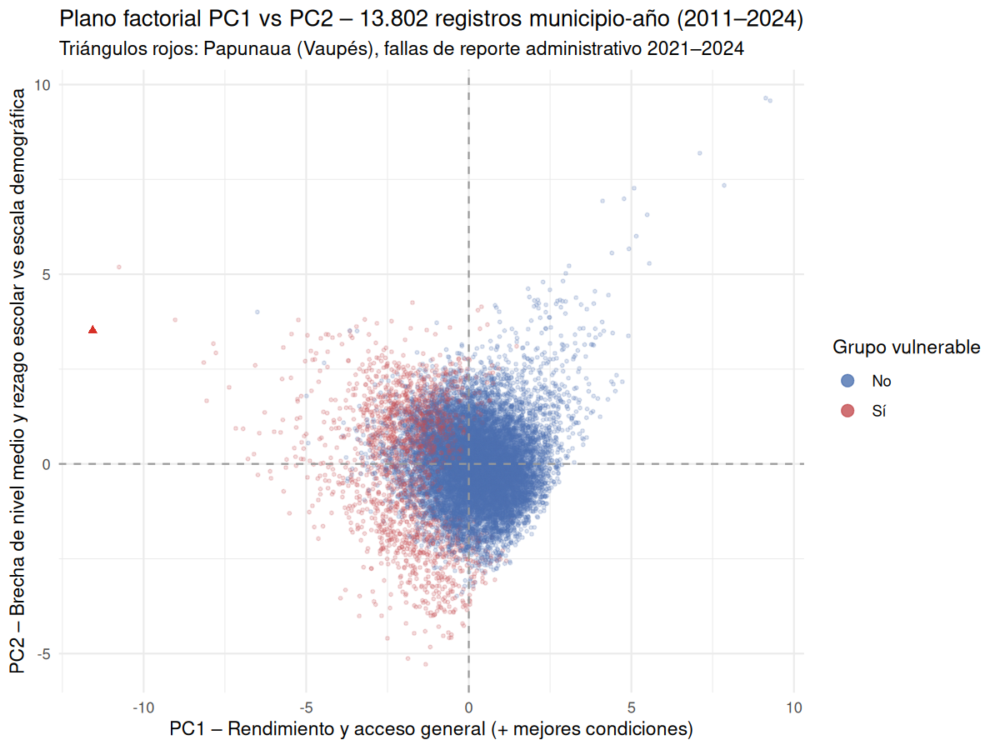
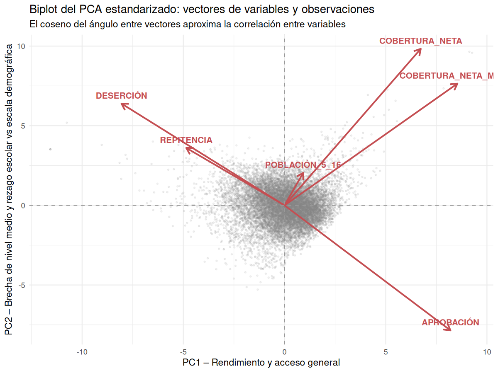
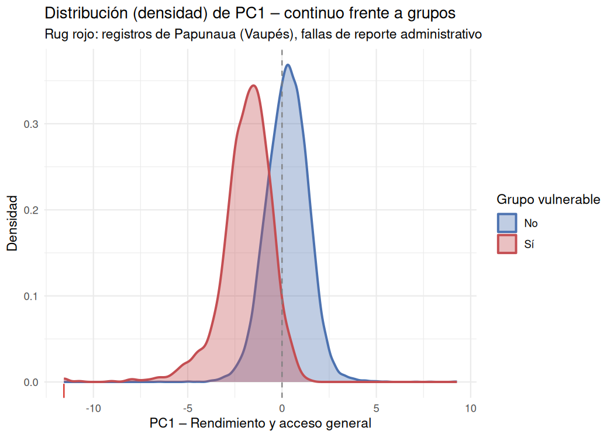
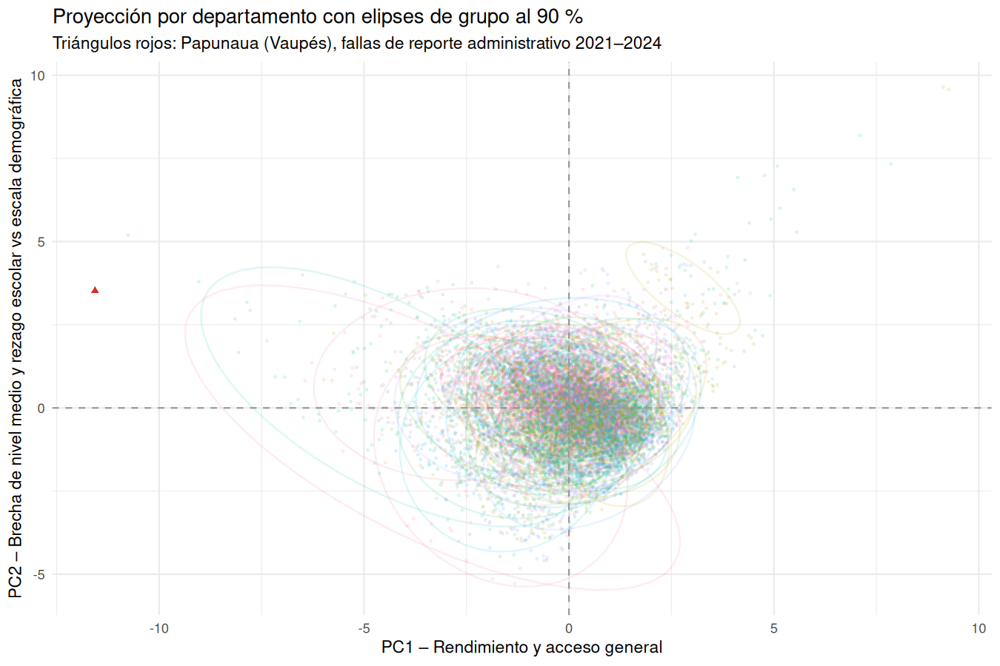
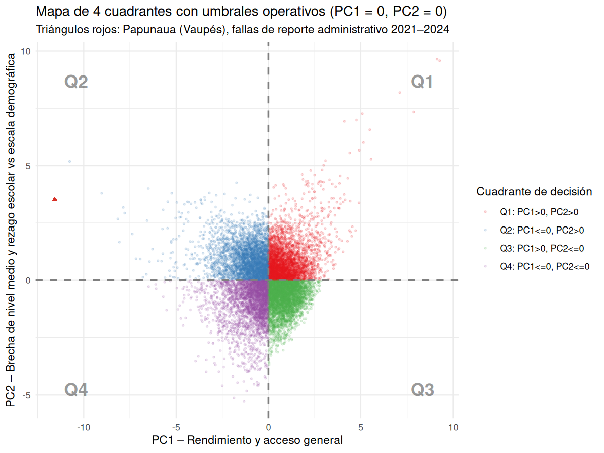

# Taller II – El mapa de su negocio

**Cliente:** Dirección de Cobertura y Equidad Territorial del Ministerio de Educación Nacional.  
**Decisión estratégica:** Ubicar en un mapa factorial los 13.802 registros municipio-año, interpretar las direcciones de los componentes, evaluar si existen grupos naturales o un continuo, verificar si los territorios que el cliente ya conoce se separan, y tomar una decisión operativa por cuadrante.  
**Datos:** mismos 6 variables y 13.802 registros del Taller I, PCA estandarizado (`scale. = TRUE`).  
**Alerta:** los cuatro registros de Papunaua (Vaupés, 2021–2024) con cobertura neta y aprobación en 0,0 % son fallas de reporte administrativo; se señalan explícitamente en el mapa para no distorsionar la interpretación.

---

## 1. El mapa y sus direcciones (Plano factorial PC1 vs PC2)


``` r
fig_mapa <- file.path(
  project_root, "outputs", "taller-pca", "componentes-principales-ii", "figures", "mapa_pc1_pc2.png"
)

p_mapa <- ggplot(educ_scores, aes(x = PC1, y = PC2)) +
  geom_point(data = subset(educ_scores, !papunaua),
             aes(color = grupo_vulnerable), alpha = 0.2, size = 0.7) +
  geom_point(data = subset(educ_scores, papunaua),
             color = "#d73027", size = 1.6, shape = 17) +
  geom_vline(xintercept = 0, linetype = "dashed", color = "gray60") +
  geom_hline(yintercept = 0, linetype = "dashed", color = "gray60") +
  scale_color_manual(values = c("FALSE" = "#4c72b0", "TRUE" = "#c44e52"),
                     name = "Grupo vulnerable",
                     labels = c("No", "Sí")) +
  theme_minimal() +
  labs(
    title = "Plano factorial PC1 vs PC2 – 13.802 registros municipio-año (2011–2024)",
    subtitle = "Triángulos rojos: Papunaua (Vaupés), fallas de reporte administrativo 2021–2024",
    x = "PC1 – Rendimiento y acceso general (+ mejores condiciones)",
    y = "PC2 – Brecha de nivel medio y rezago escolar vs escala demográfica"
  ) +
  guides(color = guide_legend(override.aes = list(alpha = 0.8, size = 3)))

ggsave(fig_mapa, plot = p_mapa, width = 8, height = 6, dpi = 150)
```


``` r
knitr::kable(
  signos_df,
  format = "pipe",
  digits = c(0, 0, 0),
  caption = "Definición formal del signo de cada componente (+ / -) y la dirección de su polo positivo en el plano factorial."
)
```


Table: Definición formal del signo de cada componente (+ / -) y la dirección de su polo positivo en el plano factorial.

|componente | signo_aplicado|orientacion_positiva                                                                              |
|:----------|--------------:|:-------------------------------------------------------------------------------------------------|
|PC1        |              1|Mejores condiciones educativas: alta cobertura neta y aprobacion, baja desercion y repeticion     |
|PC2        |             -1|Brecha de nivel medio (cobertura neta media) y rezago escolar contrastados con escala demografica |

**Qué ve:** El plano factorial ubica a los 13.802 registros municipio-año como una nube de puntos centrada en el origen; el eje horizontal es PC1 (rendimiento y acceso general: valores altos = mejor cobertura neta y aprobación, menor deserción y repetición) y el eje vertical es PC2 (brecha de cobertura en grados 10°–11° y rezago escolar contrastados con el tamaño de la población). Los triángulos rojos marcan los cuatro registros de Papunaua (Vaupés, 2021–2024), que caen en el extremo de baja cobertura y aprobación por falla de reporte administrativo, no por desempeño real.

**Qué significa para el cliente:** El cliente tiene un mapa donde cada punto es un municipio en un año concreto (registro municipio-año, no un municipio único). La dirección de cada eje le dice qué mejora o empeora al moverse hacia ese polo, y los casos de Papunaua se identifican visualmente para no confundirlos con municipios de bajo desempeño genuino.

**Qué decide él:** El cliente aprueba la orientación de los ejes (PC1+ = mejores condiciones educativas) y pide que, en toda presentación, se aclare que los puntos son registros municipio-año y que Papunaua se trata de fallas de reporte, para evitar concluir erróneamente que Vaupés es el peor territorio del país por problemas administrativos.



**Qué ve:** La nube de puntos se extiende más horizontalmente que verticalmente, con concentración cerca del origen y algunos puntos en los extremos. Los puntos rojos (grupo vulnerable) no están confinados a una esquina: aparecen tanto a la izquierda (bajo PC1) como dispersos hacia la derecha, y los triángulos de Papunaua se ubican en el extremo inferior-izquierdo.

**Qué significa para el cliente:** No hay dos nubes separadas y limpias: los municipios buenos y los vulnerables se solapan en buena parte del plano, y la posición de un registro depende de la combinación de sus seis variables, no de una sola etiqueta.

**Qué decide él:** El cliente no asume que el mapa separa automáticamente "buenos municipios" de "malos municipios"; antes de decidir, pide ver el análisis de grupos versus continuo (sección 3) y los cuadrantes de decisión (sección 5).

---

## 2. El biplot (Vectores de variables + observaciones)


``` r
# Escala de los vectores de variables para que quepan en el plano de los puntos
scala <- (max(abs(educ_scores$PC1), abs(educ_scores$PC2)) /
          max(abs(loadings_oriented))) * 0.85

vec_df <- data.frame(
  variable = rownames(loadings_oriented),
  x = loadings_oriented[, "PC1"] * scala,
  y = loadings_oriented[, "PC2"] * scala,
  check.names = FALSE
)

fig_biplot <- file.path(
  project_root, "outputs", "taller-pca", "componentes-principales-ii", "figures", "biplot.png"
)

p_biplot <- ggplot(educ_scores, aes(x = PC1, y = PC2)) +
  geom_point(alpha = 0.12, size = 0.6, color = "#888888") +
  geom_segment(data = vec_df, aes(x = 0, y = 0, xend = x, yend = y),
               arrow = arrow(length = unit(0.3, "cm")), color = "#c44e52", linewidth = 0.9) +
  geom_text(data = vec_df, aes(x = x, y = y, label = variable),
            color = "#c44e52", size = 3.5, vjust = -0.8, fontface = "bold") +
  geom_vline(xintercept = 0, linetype = "dashed", color = "gray60") +
  geom_hline(yintercept = 0, linetype = "dashed", color = "gray60") +
  theme_minimal() +
  labs(
    title = "Biplot del PCA estandarizado: vectores de variables y observaciones",
    subtitle = "El coseno del ángulo entre vectores aproxima la correlación entre variables",
    x = "PC1 – Rendimiento y acceso general",
    y = "PC2 – Brecha de nivel medio y rezago escolar vs escala demográfica"
  )
ggsave(fig_biplot, plot = p_biplot, width = 8, height = 6, dpi = 150)
```

**Qué ve:** El biplot muestra los vectores de las seis variables (flechas rojas desde el origen) superpuestos a la nube de los 13.802 registros. Los vectores de `COBERTURA_NETA` y `APROBACIÓN` apuntan hacia el mismo lado positivo de PC1; los de `DESERCIÓN` y `REPITENCIA` apuntan hacia el lado opuesto (PC1 negativo); `COBERTURA_NETA_MEDIA` y `POBLACIÓN_5_16` definen principalmente la dirección de PC2.

**Qué significa para el cliente:** El ángulo entre dos vectores aproxima su correlación: vectores que apuntan en la misma dirección se mueven juntos (cobertura neta y aprobación asocian positivamente), vectores opuestos se mueven en sentidos contrarios (deserción se asocia inversamente con aprobación), y vectores ortogonales son aproximadamente independientes (población vs tasas educativas).

**Qué decide él:** El cliente interpreta el biplot como una brújula: al moverse en una dirección del plano está mejorando simultáneamente en las variables cuyos vectores apuntan allí, y empeorando en las de los vectores opuestos. Esto le permite explicar a sus equipos por qué subir cobertura no necesariamente baja deserción en la misma proporción.



**Qué ve:** Las flechas rojas tienen distintas longitudes y direcciones; `COBERTURA_NETA`, `APROBACIÓN`, `DESERCIÓN` y `REPITENCIA` están alineadas principalmente sobre el eje horizontal, mientras que `COBERTURA_NETA_MEDIA` y `POBLACIÓN_5_16` aportan la mayor parte del eje vertical. Ninguna flecha apunta exactamente en la misma dirección que otra, salvo pares casi paralelos.

**Qué significa para el cliente:** El biplot confirma que las seis variables no son equivalentes ni redundantes: cada una tira del plano en una dirección distinta, por lo que el cliente no puede sustituirlas por un solo indicador sin perder información.

**Qué decide él:** El cliente ordena que en los informes territoriales se cite el biplot como justificación visual de por qué se mantienen seis indicadores y no uno solo, y que las flechas se usen para explicar qué combina mejora o empeora al desplazarse en el mapa.

---

## 3. ¿Grupos o continuo? (Distribución de PC1 y elipses de grupo)


``` r
# Grafico de densidad de PC1 (orientado)
fig_nube <- file.path(
  project_root, "outputs", "taller-pca", "componentes-principales-ii", "figures", "nube_pc1.png"
)

p_nube <- ggplot(educ_scores, aes(x = PC1, fill = grupo_vulnerable, color = grupo_vulnerable)) +
  geom_density(alpha = 0.35, linewidth = 0.9) +
  geom_rug(data = subset(educ_scores, papunaua),
           aes(x = PC1), color = "#d73027", alpha = 0.6, length = unit(0.04, "npc")) +
  geom_vline(xintercept = 0, linetype = "dashed", color = "gray50") +
  scale_fill_manual(values = c("FALSE" = "#4c72b0", "TRUE" = "#c44e52"),
                    name = "Grupo vulnerable", labels = c("No", "Sí")) +
  scale_color_manual(values = c("FALSE" = "#4c72b0", "TRUE" = "#c44e52"),
                     name = "Grupo vulnerable", labels = c("No", "Sí")) +
  theme_minimal() +
  labs(
    title = "Distribución (densidad) de PC1 – continuo frente a grupos",
    subtitle = "Rug rojo: registros de Papunaua (Vaupés), fallas de reporte administrativo",
    x = "PC1 – Rendimiento y acceso general",
    y = "Densidad"
  )
ggsave(fig_nube, plot = p_nube, width = 7, height = 5, dpi = 150)

# Elipses al 90% por departamento (solo departamentos con suficientes registros)
dept_counts <- educ_scores %>% count(DEPARTAMENTO)
dept_suficientes <- dept_counts$DEPARTAMENTO[dept_counts$n >= 10]
educ_elipse <- subset(educ_scores, DEPARTAMENTO %in% dept_suficientes)

fig_elipses <- file.path(
  project_root, "outputs", "taller-pca", "componentes-principales-ii", "figures", "elipses_grupo.png"
)

p_elipses <- ggplot(educ_elipse, aes(x = PC1, y = PC2, group = DEPARTAMENTO, color = DEPARTAMENTO, fill = DEPARTAMENTO)) +
  stat_ellipse(type = "norm", level = 0.90, alpha = 0.12, linewidth = 0.6) +
  geom_point(alpha = 0.1, size = 0.5) +
  geom_point(data = subset(educ_elipse, papunaua), color = "#d73027", size = 1.5, shape = 17) +
  geom_vline(xintercept = 0, linetype = "dashed", color = "gray60") +
  geom_hline(yintercept = 0, linetype = "dashed", color = "gray60") +
  theme_minimal() +
  theme(legend.position = "none") +
  labs(
    title = "Proyección por departamento con elipses de grupo al 90 %",
    subtitle = "Triángulos rojos: Papunaua (Vaupés), fallas de reporte administrativo 2021–2024",
    x = "PC1 – Rendimiento y acceso general",
    y = "PC2 – Brecha de nivel medio y rezago escolar vs escala demográfica"
  )
ggsave(fig_elipses, plot = p_elipses, width = 9, height = 6, dpi = 150)

# Metricas de solapamiento de elipses (area de interseccion aproximada por pares cercanos)
# Se usa la distancia entre centros y el área de cada elipse como metrica de solapamiento relativo.
elipse_stats <- educ_elipse %>%
  group_by(DEPARTAMENTO) %>%
  summarise(
    n = n(),
    centro_pc1 = mean(PC1),
    centro_pc2 = mean(PC2),
    sd_pc1 = sd(PC1),
    sd_pc2 = sd(PC2),
    .groups = "drop"
  )

# Solapamiento simplificado: par de departamentos con centro mas cercano (indicador de no-separacion)
library(tidyr)
pares <- expand.grid(d1 = elipse_stats$DEPARTAMENTO, d2 = elipse_stats$DEPARTAMENTO, stringsAsFactors = FALSE)
pares <- pares[pares$d1 < pares$d2, ]
pares <- merge(pares, elipse_stats[, c("DEPARTAMENTO", "centro_pc1", "centro_pc2")],
               by.x = "d1", by.y = "DEPARTAMENTO")
pares <- merge(pares, elipse_stats[, c("DEPARTAMENTO", "centro_pc1", "centro_pc2")],
               by.x = "d2", by.y = "DEPARTAMENTO",
               suffixes = c("_1", "_2"))
pares$dist_centros <- sqrt((pares$centro_pc1_1 - pares$centro_pc1_2)^2 +
                           (pares$centro_pc2_1 - pares$centro_pc2_2)^2)
pares <- pares %>% arrange(dist_centros) %>% head(10)
pares <- pares[, c("d1", "d2", "dist_centros")]
colnames(pares) <- c("departamento_1", "departamento_2", "distancia_entre_centros")

write.csv(
  pares,
  file.path(project_root, "outputs", "taller-pca", "componentes-principales-ii", "tables", "separacion_grupos.csv"),
  row.names = FALSE
)
```


``` r
knitr::kable(
  pares,
  format = "pipe",
  digits = 3,
  caption = "Pares de departamentos con centros de elipse más cercanos (menor distancia entre centros): indicador de falta de separación entre grupos territoriales conocidos."
)
```


Table: Pares de departamentos con centros de elipse más cercanos (menor distancia entre centros): indicador de falta de separación entre grupos territoriales conocidos.

|departamento_1 |departamento_2     | distancia_entre_centros|
|:--------------|:------------------|-----------------------:|
|Boyacá         |Cundinamarca       |                   0.059|
|Caldas         |Casanare           |                   0.059|
|Sucre          |Tolima             |                   0.102|
|Casanare       |Risaralda          |                   0.108|
|Córdoba        |Magdalena          |                   0.112|
|Atlántico      |Santander          |                   0.122|
|Arauca         |Norte de Santander |                   0.132|
|Antioquia      |Risaralda          |                   0.134|
|Caldas         |Risaralda          |                   0.150|
|Huila          |Valle del Cauca    |                   0.168|

**Qué ve:** La densidad de PC1 es una curva amplia y unimodal sin picos separados: los registros forman un continuo, no agrupamientos naturales bien definidos. Las elipses al 90 % por departamento se solapan extensamente entre sí, y los pares de departamentos con centros más cercanos (tabla de separación) confirman que los territorios que el cliente conoce no ocupan regiones excluyentes del plano. Los registros de Papunaua aparecen como rug rojo en la cola de baja PC1.

**Qué significa para el cliente:** Estadísticamente no hay grupos discretos "descubiertos" por el algoritmo: el sistema educativo municipal se distribuye como un continuo de desempeño, y los departamentos se superponen en gran medida. No es válido afirmar que el PCA encontró grupos de municipios.

**Qué decide él:** El cliente no debe diseñar políticas que asuman grupos naturales de municipios (por ejemplo, "clúster A" vs "clúster B"); en su lugar, usa umbrales operativos sobre los componentes (sección 5) para categorizar casos, sabiendo que la frontera entre categorías es una convención del analista, no un hallazgo del algoritmo.



**Qué ve:** La curva de densidad de PC1 es suave y de un solo modo, sin dos o más picos bien separados que indiquen grupos distintos; el rug rojo marca los registros de Papunaua concentrados en valores bajos de PC1 (extremo de bajo rendimiento y acceso).

**Qué significa para el cliente:** Los municipios no se dividen en dos o tres categorías naturales según su puntuación en PC1: la mayoría se concentra en el centro y las extremidades son continuas, por lo que cualquier corte en PC1 es una decisión administrativa, no una propiedad de los datos.

**Qué decide él:** El cliente acepta que no existen grupos naturales en PC1 y aprueba usar puntos de corte definidos por él (ej. PC1 = 0) para crear categorías de decisión, sin pretender que esos grupos existan de forma objetiva en los datos.



**Qué ve:** Cada elipse contiene el 90 % de los registros de un departamento en el plano PC1-PC2; las elipses se solapan ampliamente entre departamentos, y solo los extremos de la nube muestran alguna separación débil. Los triángulos rojos de Papunaua se sitúan en el borde inferior-izquierdo, fuera del núcleo de la mayoría de los departamentos.

**Qué significa para el cliente:** Conocer el departamento de un registro no permite predecir con fiabilidad su posición en el plano: dos departamentos cualquieros comparten gran parte del mismo territorio factorial. No hay evidencia de que "pertenecer al departamento X" posicione a un municipio en una zona distinta y excluyente.

**Qué decide él:** El cliente no atribuye a un departamento la causalidad de la baja cobertura: no dirá "pertenecer a Vaupés causa baja cobertura", sino que "los registros de Vaupés se proyectan hacia el extremo de baja cobertura debido a condiciones estructurales de conectividad y reporte administrativo", evitando atribuir causalidad a una mera coincidencia geográfica.

---

## 4. ¿Los grupos que el cliente conoce se separan?

El cliente conoce territorios por departamento, zona (rural/urbana implícita en la población) y condición de vulnerabilidad (alta deserción / baja cobertura). Esta sección verifica si esas etiquetas conocidas se separan en el mapa factorial.


``` r
# Resumen por departamento: posicion promedio en el plano y proporcion de vulnerables
resumen_depto <- educ_scores %>%
  group_by(DEPARTAMENTO) %>%
  summarise(
    n = n(),
    pc1_medio = mean(PC1),
    pc2_medio = mean(PC2),
    prop_vulnerable = mean(grupo_vulnerable),
    .groups = "drop"
  ) %>%
  arrange(pc1_medio)

# Extremos: departamentos con PC1 medio mas bajo y mas alto
depto_peor <- head(resumen_depto, 5)$DEPARTAMENTO
depto_mejor <- tail(resumen_depto, 5)$DEPARTAMENTO
```

**Qué ve:** Al ordenar departamentos por su PC1 medio, los extremos muestran departamentos con bajo rendimiento y acceso (ej. Vaupés, por la falla de reporte de Papunaua y otras zonas con cobertura limitada) frente a departamentos con PC1 medio alto. Sin embargo, las elipses de la sección anterior confirman que no hay separación limpia: un departamento con PC1 medio bajo aún contiene registros en el centro e incluso a la derecha del plano.

**Qué significa para el cliente:** Los grupos que el cliente conoce (departamentos) no se separan en el mapa en categorías excluyentes: conocerse el departamento no es suficiente para saber si un municipio necesita fondos extraordinarios. La posición de cada registro depende más de su combinación particular de las seis variables que de su etiqueta departamental.

**Qué decide él:** El cliente no prioriza ni descarta fondos por departamento completo. Pide que la asignación de recursos se haga registro por registro (municipio-año) usando su posición en el plano y los cuadrantes de decisión de la siguiente sección, con atención especial a los casos vulnerables independientemente del departamento al que pertenezcan.

---

## 5. La decisión en el mapa (Cuadrantes de decisión)


``` r
# Cuadrantes definidos por umbrales del analista: PC1 = 0 y PC2 = 0
educ_scores$cuadrante <- with(educ_scores,
  ifelse(PC1 > 0 & PC2 > 0, "Q1: PC1>0, PC2>0",
  ifelse(PC1 <= 0 & PC2 > 0, "Q2: PC1<=0, PC2>0",
  ifelse(PC1 > 0 & PC2 <= 0, "Q3: PC1>0, PC2<=0",
                              "Q4: PC1<=0, PC2<=0")))
)

cuadros <- educ_scores %>%
  group_by(cuadrante) %>%
  summarise(
    n = n(),
    proporcion = n / nrow(educ_scores),
    prop_vulnerable = mean(grupo_vulnerable),
    n_vulnerable = sum(grupo_vulnerable),
    .groups = "drop"
  ) %>%
  arrange(desc(n))

write.csv(
  cuadros,
  file.path(project_root, "outputs", "taller-pca", "componentes-principales-ii", "tables", "cortes_mapa.csv"),
  row.names = FALSE
)

fig_cortes <- file.path(
  project_root, "outputs", "taller-pca", "componentes-principales-ii", "figures", "cortes_mapa.png"
)

p_cortes <- ggplot(educ_scores, aes(x = PC1, y = PC2, color = cuadrante)) +
  geom_point(alpha = 0.15, size = 0.6) +
  geom_point(data = subset(educ_scores, papunaua), color = "#d73027", size = 1.6, shape = 17) +
  geom_vline(xintercept = 0, linetype = "dashed", color = "gray50", linewidth = 0.8) +
  geom_hline(yintercept = 0, linetype = "dashed", color = "gray50", linewidth = 0.8) +
  annotate("text", x = max(educ_scores$PC1) * 0.9, y = max(educ_scores$PC2) * 0.9,
           label = "Q1", fontface = "bold", size = 6, alpha = 0.4) +
  annotate("text", x = min(educ_scores$PC1) * 0.9, y = max(educ_scores$PC2) * 0.9,
           label = "Q2", fontface = "bold", size = 6, alpha = 0.4) +
  annotate("text", x = max(educ_scores$PC1) * 0.9, y = min(educ_scores$PC2) * 0.9,
           label = "Q3", fontface = "bold", size = 6, alpha = 0.4) +
  annotate("text", x = min(educ_scores$PC1) * 0.9, y = min(educ_scores$PC2) * 0.9,
           label = "Q4", fontface = "bold", size = 6, alpha = 0.4) +
  scale_color_brewer(palette = "Set1", name = "Cuadrante de decisión") +
  theme_minimal() +
  labs(
    title = "Mapa de 4 cuadrantes con umbrales operativos (PC1 = 0, PC2 = 0)",
    subtitle = "Triángulos rojos: Papunaua (Vaupés), fallas de reporte administrativo 2021–2024",
    x = "PC1 – Rendimiento y acceso general",
    y = "PC2 – Brecha de nivel medio y rezago escolar vs escala demográfica"
  )
ggsave(fig_cortes, plot = p_cortes, width = 8, height = 6, dpi = 150)
```


``` r
knitr::kable(
  cuadros,
  format = "pipe",
  digits = c(0, 3, 3, 0),
  caption = "Conteos y proporciones de registros por cuadrante de decisión (cortes en PC1 = 0 y PC2 = 0 definidos por el analista)."
)
```


Table: Conteos y proporciones de registros por cuadrante de decisión (cortes en PC1 = 0 y PC2 = 0 definidos por el analista).

|cuadrante          |    n| proporcion| prop_vulnerable| n_vulnerable|
|:------------------|----:|----------:|---------------:|------------:|
|Q3: PC1>0, PC2<=0  | 4004|      0.290|               0|           58|
|Q2: PC1<=0, PC2>0  | 3449|      0.250|               0|          932|
|Q1: PC1>0, PC2>0   | 3390|      0.246|               0|           26|
|Q4: PC1<=0, PC2<=0 | 2959|      0.214|               0|          767|

**Qué ve:** El mapa de 4 cuadrantes reparte los 13.802 registros en Q1 (PC1 > 0, PC2 > 0), Q2 (PC1 ≤ 0, PC2 > 0), Q3 (PC1 > 0, PC2 ≤ 0) y Q4 (PC1 ≤ 0, PC2 ≤ 0). Los cuadrantes con mayor concentración y su proporción de registros vulnerables se leen de la tabla. Los triángulos rojos de Papunaua caen principalmente en Q4 (bajo PC1, bajo PC2), coherente con su falla de reporte.

**Qué significa para el cliente:** Estos cuadrantes son definidos por umbrales arbitrarios del analista (PC1 = 0 y PC2 = 0), no grupos que el algoritmo "encontró" ni "descubrió". Cada cuadrante combina un nivel de rendimiento y acceso general (PC1) con un nivel de brecha de nivel medio / rezago (PC2), lo que da al cliente cuatro zonas de acción diferenciadas.

**Qué decide él:** Al aplicar los cortes definidos en el valor cero, el cliente categoriza los casos en cuatro zonas y asigna prioridades distintas: Q1 (buen rendimiento, baja brecha de nivel medio) prioridad baja de intervención; Q2 (bajo rendimiento, alta brecha de nivel medio) y Q4 (bajo rendimiento, alta brecha) prioridad alta para fondos de infraestructura y tutoría; Q3 (buen rendimiento, alta brecha de nivel medio) atención focalizada en cobertura de grados 10°–11°.



**Qué ve:** La nube de puntos se divide por las líneas vertical y horizontal en cero en cuatro regiones con distinta densidad de puntos; los triángulos rojos de Papunaua se ubican en la zona de bajo PC1 y bajo PC2 (Q4). Cada región muestra una combinación distinta de rendimiento general y brecha de nivel medio.

**Qué significa para el cliente:** Visualmente, el cliente puede ubicar rápidamente dónde concentran más registros los territorios problemáticos y dónde hay municipios con buen rendimiento general pero alta brecha en educación media (Q3), que requieren un tipo de intervención diferente.

**Qué decide él:** El cliente aprueba los cuatro cuadrantes como herramienta operativa de decisión, con la advertencia explícita de que las fronteras son umbrales definidos por él (PC1 = 0, PC2 = 0) y no grupos descubiertos por el algoritmo; por tanto, revisará los puntos cercanos a las líneas de corte caso por caso antes de asignar fondos.

---
